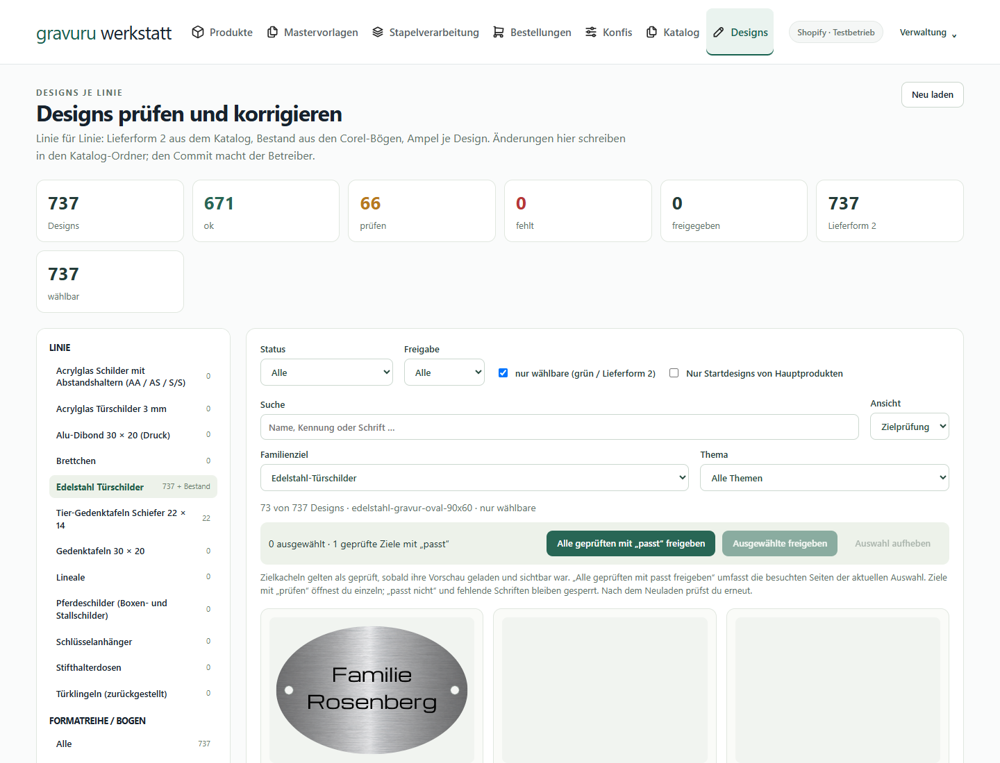
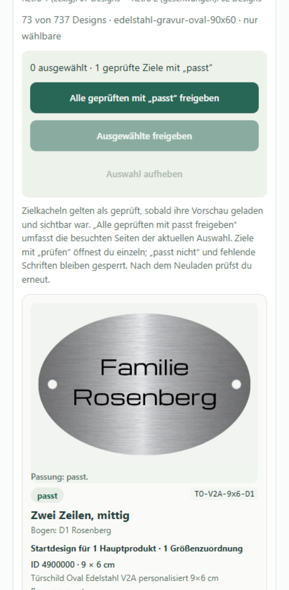
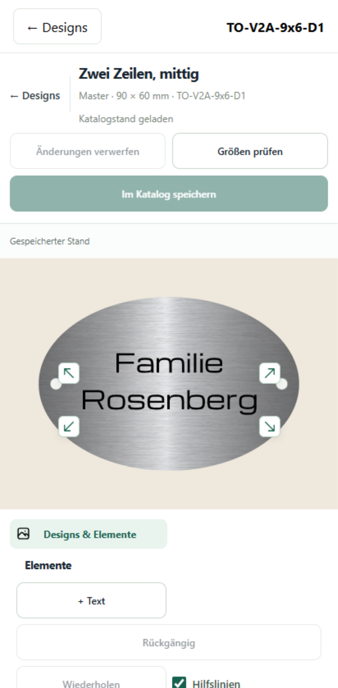
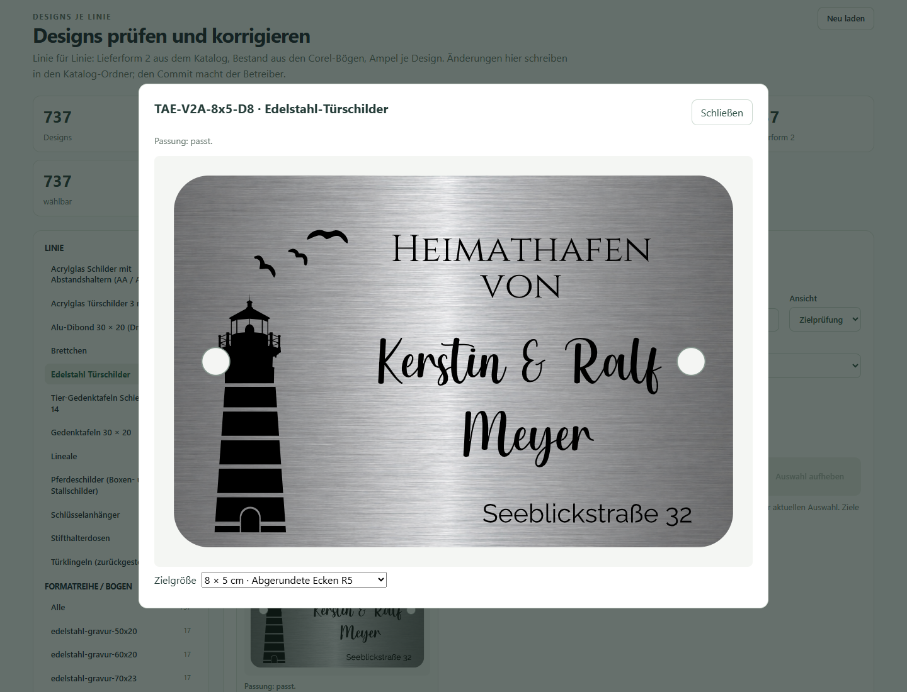

# Paket R · erster PR: Zielprüfung und Rückkehr · 26.10.2026

Codex / Astra. [PR #26](https://github.com/Chris83638w/gravuru-2027/pull/26) behandelt ausschließlich den Nachtrag (R2, Editor-Rückkehr, Issue #24). R1/R3 folgen getrennt.

## Stand und Grenzen

Code: `fc6b3cf0cc4281a7052b155842d5aa31742b2e0a`, Basis `376b5b6537291a81c418b0e26835a9e14359f51b`. Auf aktuellem main `5dd75a7` konfliktfrei (dessen Änderung entfernt alte Bereitstellungsarchive). Katalog: `fd50c645996a216b57f6c573808bc2486e5970f4`; 761/761 Master-design.json der privaten Testkopie vor Browseränderungen bytegleich gegen GitHub geprüft.

Keine echten Katalogdaten, Freigaben, Importe, Shopify-Aufrufe, Merge oder Force-Push. Browseränderungen betreffen ausschließlich die private Testkopie. Schriftdateien bleiben außerhalb des Code-Repositories.

## Ergebnis

- Kacheln und Ansicht **Zielprüfung** zeigen die echte Zieloberfläche mit Plattenkontur und Bohrungen; erste kompatible Größe als Vorgabe. Filter nach Linie, Reihe, Thema, Status und Startdesigns bleiben nutzbar.
- 24 Kacheln je Seite, höchstens drei gleichzeitige Vorschauabrufe, Cache an aktueller Quellprüfsumme. Nicht sichtbare Kacheln werden erst beim Sichtbarwerden geladen.
- **Alle geprüften mit „passt“ freigeben** erfasst nur geladene und tatsächlich sichtbare Vorschauen der Sitzung. Bestätigung mit Anzahl, danach je Ziel der vorhandene authentifizierte PATCH mit erneuter Prüfung unter Schreiblock. „prüfen“ bleibt einzeln nach Öffnen; „passt nicht“ und fehlende Schriften sperren.
- Größen zeigen Maße und echte Formgruppennamen, nach Form gruppiert und kompatible Größen zuerst (Issue #24). Rund meldet ausdrücklich 0 kompatible Designs.
- Bearbeiten öffnet als Überlagerung. Zurück erhält Dashboard-Dokument, Linie/Reihe/Filter/Ansicht, Scrollposition und Bildknoten. Speichern ersetzt nur die betroffene Kachel und verwirft deren Prüfstand. Ungespeicherte Änderungen verlangen eine Entscheidung.
- Der Händlerhost liefert dem eingebetteten Editor pro API-Anforderung einen frischen Sitzungstoken über einen geprüften Elternkanal. Globale Navigation ist dort verborgen. Auch nach unerwarteter Frame-Navigation bleibt Eltern-Zurück bedienbar.

## Windows-Prüfung

Alle **198 Testdateien** unter `app/configurator/variant-m/*.test.mjs`, `app/workshop/*.test.mjs` und `scripts/*.test.mjs` ausgeführt. Node v24.20.0, Repository als Arbeitsverzeichnis, vier Testprozesse, vorhandene Python-Umgebung und beschreibbares TEMP. Ein Test-Preload ersetzt ausschließlich den unter Windows unbrauchbaren ausführbaren Namen `python3` durch `GRAVURU_PYTHON`; keine Assertions oder Resultate werden verändert.

| Prüfung | Bestanden | Fehler | Übersprungen |
|---|---:|---:|---:|
| Vollauf | 1541 | 1 Import-/Ladefehler | 8 |
| Nachlauf der betroffenen Legacy-Datei, nach Ergänzung ihrer originalen Importabhängigkeit | 10 | 0 | 0 |
| Gesamt ohne doppelten Dateiplatzhalter | **1551** | **0 offen** | **8** |

Der Ladefehler war die in der lokalen Quellkopie fehlende `ops/plesk/order-webhook-probe.mjs`; sie wurde bytegleich aus dem Repository ergänzt. Die Datei enthielt zehn Tests, die beim Ladefehler noch nicht gelaufen waren. Deshalb sind insgesamt 1559 Tests erfasst (1550 minus ein Ladeplatzhalter plus zehn tatsächliche Tests). Kein Ergebnis wird als einzelner fehlerfreier Vollauf ausgegeben. Der frühere Diagnose-Lauf hatte zusätzlich falsches cwd und fehlende historische Testfixtures; das ist Prüfaufbau, keine Codekorrektur.

Die acht Skips betreffen nicht verfügbare Symlinks/Hardlinks/POSIX-Dateirechte sowie einen optionalen echten Katalog-/Shopify-Teilexport. Kein Live-Zugriff wurde dafür hergestellt. Testquellen im maßgeblichen Vollauf unverändert.

Nachweise: [Zähler und Skipgründe](paket-r/windows-summary.json), [unverändertes Vollauf-Rohlog, gzip](paket-r/windows-full.tap.gz), [Legacy-Nachlauf, gzip](paket-r/windows-legacy-followup.log.gz).

## Browser: Desktop und Pixel 7

Lokaler Händlerhost mit synthetischer Shopify-Anmeldung; externe Browseranfragen abgefangen. Echte Katalogkopie und echte Glyphenpfade. [Messprotokoll](paket-r/browser-results.json).

- Erster Durchgang: 100 verschiedene Kacheln auf fünf Seiten, 100 geladen; 73 „passt“, 27 „prüfen“; maximal drei Vorschauabrufe gleichzeitig. Nicht sichtbare Kachel bleibt ungeladen und nicht auswählbar.
- Rückkehr: identisches Dokument, gleiche Karten/Bildknoten, Scrollposition 1100 → 1100, kein erneuter Übersichtsabruf. Discard/Escape bestätigt. Speichern: genau eine ersetzte Kachel und ein PUT.
- Issue #24: D8 startet mit 8 × 5 cm · Abgerundete Ecken R5; alle Größenbezeichnungen unterscheidbar und gruppiert. Rund: 0 Designs.
- Pixel 7: 412 px Ansicht und Dokumentbreite, kein horizontaler Überlauf. Globale Navigation im Editor verborgen, Eltern-Zurück nach Frame-Navigation erfolgreich.
- Der erste Sammellauf erreichte die zu knapp angesetzte Testwartezeit nach 25 bestätigten PATCH-Antworten. Der frische Nachlauf prüfte den aktuellen Katalog erneut: **47 im Dialog bestätigt, genau 47 authentifizierte PATCHs erfolgreich**, keine Browser-/Routenfehler und keine externen Aufrufe. Dort waren beim Sampling 97 von erneut 100 besuchten Kacheln geladen; ungeprüfte Kacheln gelangten nicht in die Auswahl. Die vollständige 100-Kachel-Ladeprüfung ist im ersten Durchgang belegt.

Die lokale Laufzeit unter parallel laufenden Tests ist kein Produktions-Benchmark. Die Sammelfreigabe prüft bewusst jedes Design einzeln neu.

### Bilder

## Übergabe an Claude

R2 einschließlich Editor-Rückkehr und Issue #24 prüfen. R1/R3 kommen in einem eigenen Folge-PR; die Fachfrage zur Trennung von Designfreigabe und offenen Preisen steht in [Issue #25](https://github.com/Chris83638w/gravuru-2027/issues/25). Die bisherige Freigaberegel bleibt in diesem PR erhalten. Keine Freigabe von Chris ist für weitere lokale Prüfungen nötig; echte Katalog-/Shop-Aktionen sind nicht Bestandteil.
