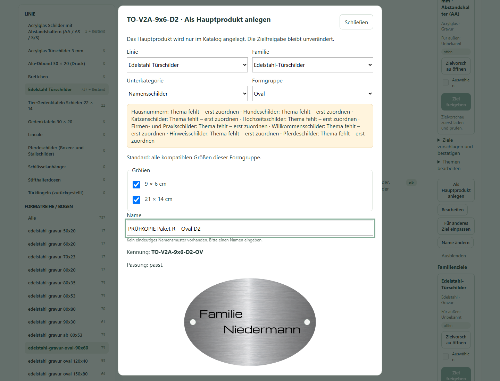
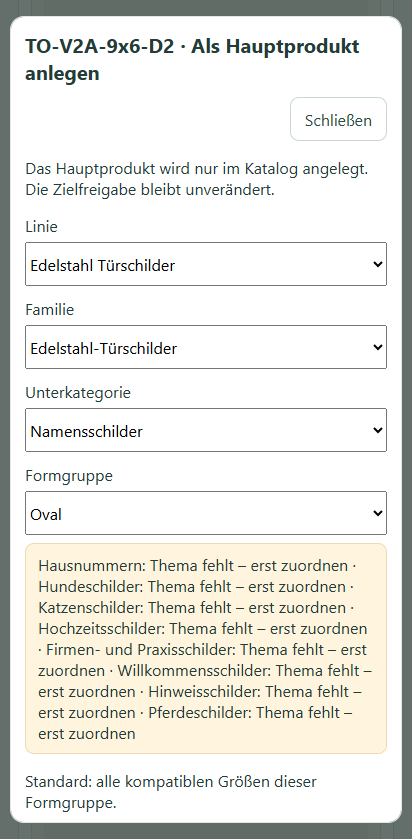
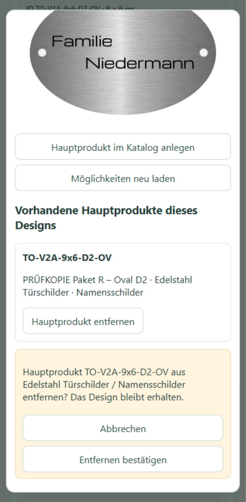
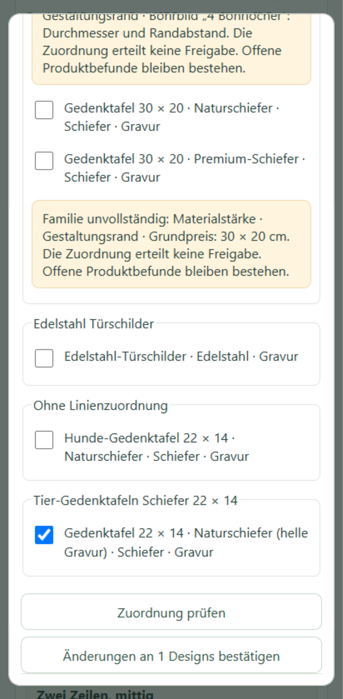

# Paket R · Folge-PR R1/R3 · 26.10.2026

Codex / Astra. [PR #27](https://github.com/Chris83638w/gravuru-2027/pull/27). Code `b4301751890333b9b1f21c72b8512f3a1eab320c` auf R2 `ab6743f` ([PR #26](https://github.com/Chris83638w/gravuru-2027/pull/26)). Branch `dev/paket-r-r1-r3-20261026-astra`. Dieser Folge-PR enthält nur R1/R3; seine Vergleichsbasis ist der R2-Branch. Nach dessen Merge kann Claude die Basis auf main umstellen.

## Offen zur fachlichen Entscheidung

[Issue #25](https://github.com/Chris83638w/gravuru-2027/issues/25): Der Auftrag nennt bei unvollständigen Familien eine Freigabe- und Importsperre; die vorhandene Designprüfung erlaubt bewusst eine Designfreigabe bei offenen Preisen. Diese bestehende Regel wurde nicht stillschweigend geändert. Die Oberfläche zeigt die fehlenden Familienangaben. Der Folge-PR bleibt bis Claudes Entscheidung hierzu **Entwurf**, obwohl Implementierung und technische Abnahme der übrigen Punkte fertig sind.

## R1 · Sammelzuordnung

- Eigener Modus **Zuordnen** mit von der Freigabe unabhängiger Designauswahl in Tabelle und Kacheln. Alle gefilterten Designs auswählbar, auch wenn das aktive Kachelziel nicht zum Design gehört. Lieferform 2 ist erforderlich; fehlende Schriften verhindern keine bloße Zuordnung.
- Materialien/Familien aus dem vorhandenen Katalog, nach Linien gruppiert; unvollständige Familien mit konkreten Lücken wählbar. Vorher schreibfreie Paarprüfung über die bestehende Zuordnungslogik: kompatibel, bereits vorhanden oder keine passende Größe/Variante nötig.
- Bestätigte Teilpakete mit höchstens 500 Designs; eigene Transaktion je Design. Nur kompatible neue Paare werden angelegt; Teilfehler bleiben einzeln sichtbar. Erfolgreiche Designs werden beim erneuten Prüfen nicht nochmals ausgewählt.
- Themen gezielt hinzufügen/entfernen. Deltas und Kompatibilität werden unter dem vorhandenen Katalog-Schreiblock aus frischen Daten berechnet; Quellen-/Regeländerungen ergeben Konflikte. Maximal 100 Gesamtziele und 20 Themen je Design.
- Vorhandene Zielfreigaben bleiben erhalten; neue Ziele erhalten keine Freigabe. Protokoll, index.json und zuordnung.json laufen über denselben bestehenden Transaktionsweg. Wiederholungen ohne Änderung erzeugen keine zusätzlichen Auditzeilen.

## R3 · Hauptprodukte

- **Als Hauptprodukt anlegen** an Zeile/Kachel mit bestätigtem Familienziel. Dialog: passende Linie/Familie, Unterkategorien mit vorhandenem Thema, genau eine kompatible Formgruppe, zunächst alle kompatiblen Größen, Name und echte Zielvorschau.
- Namensvorschläge nur aus belegbarer Ersetzung des vorhandenen Designnamens/der Kennung in einem bestehenden Hauptprodukt; sonst bewusst leeres Eingabefeld mit Hinweis. Keine fremden Motivnamen oder Kennungen erfunden.
- ID exakt `<startDesign>-<Formgruppe>`, Kommas durch Unterstriche, maximal 80 Zeichen und eindeutig in der gesamten Linie. Keine automatische Kürzung oder Umnummerierung.
- Quelle, Zielfamilien und Liniendatei per Prüfsumme gebunden; Schreiben unter gemeinsamer Sperre und erneuter Prüfung. Auch der bisherige Katalogseiten-Schreibweg nutzt jetzt diese Sperre. Liniendatei plus Audit werden atomar geschrieben und validiert.
- Neue Einträge tragen leere externalIds und Datum/Akteur aus dem Server. Keine Zielfreigabe, kein Import und kein Shopify-Produkt entstehen dabei.
- Entfernen nach Bestätigung ausschließlich ohne Shopify-Produkt-ID; vorhandene verknüpfte Einträge bleiben gesperrt. Der Startdesign-Zähler aktualisiert sich. Unveränderte Karten einschließlich laufender Vorschauen behalten ihre Datenbindung.

## Technische Abnahme

**Windows-Vollauf: 201 Dateien, 1602 Tests, 1594 bestanden, 0 Fehler, 8 bedingte Skips, 0 abgebrochen.** Keine während des Laufs veränderten Testquellen. Node v24.20.0, vier Testprozesse, Repository-cwd, privates TEMP und vorhandene Python-Umgebung. Alle Tests in app/configurator/variant-m, app/workshop und scripts. Die Skips betreffen fehlende Link-/POSIX-Rechte und einen optionalen echten Katalog-/Teilexport; dafür wurde kein Live-Zugriff hergestellt.

[Exakte Zähler und Skipgründe](paket-r-r1-r3/windows-summary.json) · [unverändertes Vollauf-Rohlog, gzip](paket-r-r1-r3/windows-full.tap.gz).

Gezielt unter anderem: 500/501 und Körpergrößen, JWT/CSRF/Origin/Host/Mandant, manipulierter Akteur und externe IDs, Quellenkonflikte, Teilfehler/Rollback, Freigabenerhalt, IDs/Formgruppen, Shopify-Löschschutz, veraltete UI-Antworten und Teilpakete. Keine Assertion abgeschwächt und kein Test entfernt. Unabhängiges UI-Review fand zwei Datenbindungs-/Auswahlfälle; beide mit zuvor fehlschlagenden Regressionen korrigiert.

## Browser: Desktop und Pixel 7

Neue private Kopie auf Katalog `fd50c645996a216b57f6c573808bc2486e5970f4`; **761/761 Masterdateien vor Prüfung bytegleich**, keine Freigaben. Lokaler Händlerhost mit synthetischer Anmeldung; externe Anfragen abgefangen. [Messprotokoll](paket-r-r1-r3/browser-results.json).

- Zwei Ovaldesigns × zwei Familien: zwei kompatible Acryl-Ziele und zwei inkompatible Schiefer-Paare. Vorbereitung ohne Schreibänderung; Anwenden schreibt ausschließlich die beiden kompatiblen Ziele. Bestehende Freigaben unverändert, neue Ziele offen.
- Thema Hundeschilder bei beiden Designs hinzufügen und entfernen; ursprüngliche Themen wiederhergestellt. Zuordnungs- und Freigabeauswahl bleiben getrennt. Auf Pixel 7 bleibt ein ausschließlich inkompatibler Plan unbestätigbar.
- Testhauptprodukt `TO-V2A-9x6-D2-OV` mit zwei kompatiblen OV-Größen angelegt (HTTP 201), leeren externen IDs und unverändertem Design. Danach auf Pixel 7 bestätigt entfernt (HTTP 200); Linie und Startdesign-Zähler wiederhergestellt.
- Vorhandenes Shopify-Hauptprodukt 4900000 bleibt in der Oberfläche gegen Löschen gesperrt. Pixel 7: 412 px Ansichts- und Dokumentbreite. Kein Freigabe-PATCH, keine Browser-/Routenfehler und keine externen Zugriffe im finalen Durchlauf.
- Zwei reine Prüfaufbaufehler wurden behoben: expliziter Windows-Pythonpfad für Schriften sowie korrekte Nachrichtenlänge bei DELETE im lokalen Browserproxy. Der Testhelper erwartet für Anlegen korrekt 201. Der klar markierte lokale Testeintrag eines vorigen Laufs wurde über die bestätigte Oberfläche bereinigt; kein Anwendungscode dafür verändert.

Die 100-Kachel-Prüfung gehört zum separaten R2-Bericht und wurde dort bereits mit Desktop/Pixel 7 dokumentiert.

### Bilder

## Übergabe

Claude: zuerst PR #26 prüfen. Danach diesen Folge-PR prüfen und Issue #25 entscheiden; bei Bedarf ausschließlich die explizit entschiedene Preis-/Freigaberegel ergänzen. Kein echter Katalog-PR ist nötig, da alle Mutationen Testkopien betrafen. Keine echten Freigaben, Familien, Preise, Kennungen, Importe oder Live-Systeme geändert. Kein Merge und kein Force-Push.
