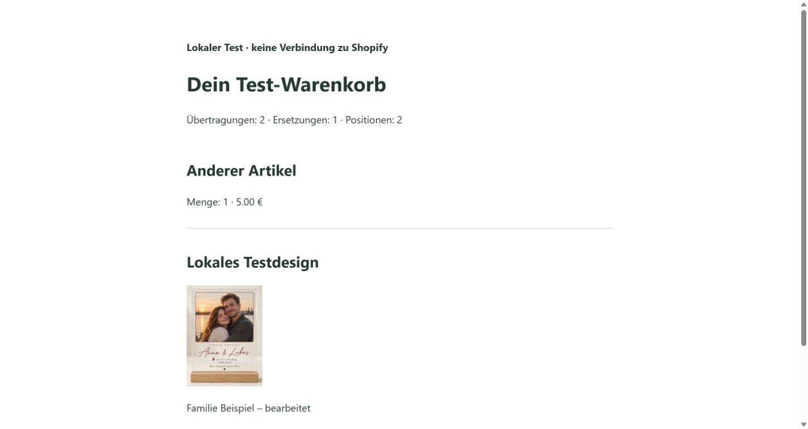
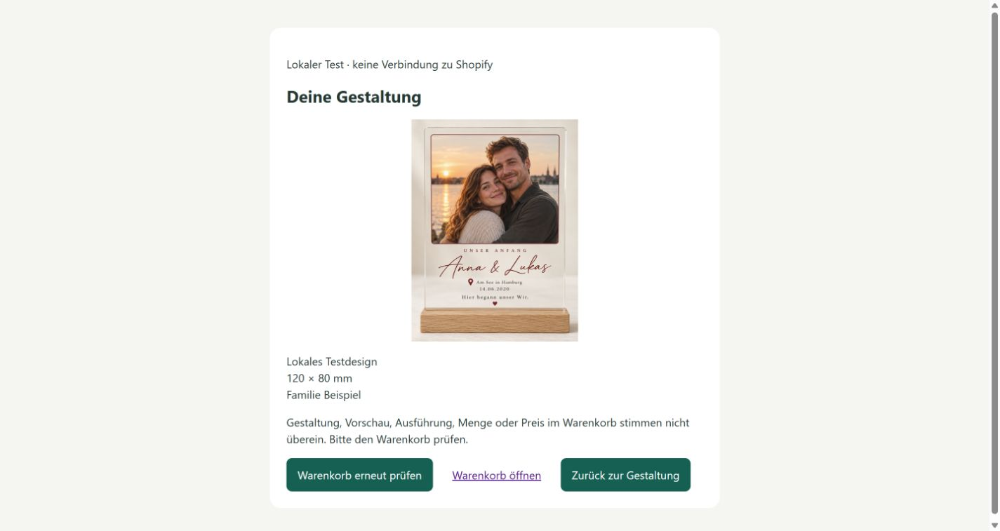

# Shop-Warenkorb mit gesicherter Gestaltung – Übergabe an Claude

Stand: 26.10.2026. Basis `main fccf2b1`; Branch `dev/shop-warenkorb-20261026-astra`.
Auftrag von Chris: den Kundenabschluss sicher nach dem bewährten Ablauf der Funkklingelschilder
und Gedenktafeln umbauen. Kein Merge, Deploy, Theme-Upload, Import oder Live-Testkauf durchgeführt.

## Ergebnis

Der öffentliche native Konfigurator sichert weiterhin den privaten Prüfstand und das serverseitige
Angebot. Anschließend öffnet er eine signierte App-Proxy-Seite im Shop und überträgt über
`/cart/add.js` in den bestehenden Shop-Warenkorb. Mitgegeben werden die PNG-Vorschau als
`_Entwurf`, Design, Format, vollständiger Gravurtext (bei Bedarf auf mehrere Eigenschaften
aufgeteilt), Bearbeiten-Link und die bestehenden Angebots-/Konfigurationskennungen.
Nach Rückprüfung von Vorschau, Eigenschaften, Variante, Menge und Preis öffnet sich `/cart`.

Der HTTP-/FormData-Vertrag folgt dem vorhandenen Funkklingel-Code:
[release.js auf dem gelesenen Legacy-Stand](https://github.com/Chris83638w/gravuru-shopify/blob/b564422edadaf56a27a09f99e1140a546e5e7145/platform/sources/funkklingel-release/release.js).
Auch die vorhandenen Gedenktafel-Dateien `configurator/variant-m/commerce.mjs`,
`platform/sources/workshop/configurator/commerce.js` und `shopify-bridge.js` wurden verglichen.
Der neue Ablauf behält die aktuelle serverseitige Zuordnung zum unveränderlichen Prüfstand.

Der Hausmotiv-Fehler ist ebenfalls behoben: `prepareAcrylicReview` ergänzt benutzte Motive
und Schriften aus derselben serverseitigen Bibliothek wie der Editor. Nur benötigte Ressourcen
werden eingefroren; unbekannte oder durch Produktprofile ausgeschlossene Ergänzungen bleiben
gesperrt. Fachliche Validierungsfehler liefern 422 statt eines pauschalen 503.

## Schutz und Bearbeiten

- Keine privaten Entwurfs-/Sitzungsschlüssel in Shopify-Eigenschaften; Originalfotos und
  Produktionsdateien bleiben privat. Die Übergabeadresse enthält nur einen kurzlebigen,
  zufälligen Übergabeschlüssel im Fragment.
- Angebot, Variante, Preisvertrag, Menge, Mandant, aktive Produktbindung und feste
  Produktrevision bleiben serverseitig geprüft. Die Ajax-Antwort wird zusätzlich im Browser
  zurückgelesen. Bestellungen werden weiterhin über den signierten Webhook serverseitig
  geprüft und an genau den gesicherten Stand gebunden.
- Vor einem Upload einmaliger dauerhafter Claim je Mandant/Angebot in
  `theme_cart_transfers`. Bei unklarer Antwort kein automatischer erneuter Upload.
  Bereits vorhandene Positionen werden durch Rücklesen erkannt.
- Bearbeiten: neue Position einschließlich Vorschau bestätigen, dann ausschließlich den
  alten Zeilenschlüssel der im Bearbeiten-Link bezeichneten Revision entfernen.
  Eine abgebrochene Zwischenvorbereitung verschiebt diesen Anker nicht.
- Andere Produkte und andere Personalisierungen desselben Produkts bleiben erhalten.
  Fehlender/mehrdeutiger alter Stand, falscher Preis, fehlende Vorschau oder veränderte
  Eigenschaften führen zum Abbruch. Zahlung/Fertigungsfreigabe werden nie behauptet.
- Der bisherige Storefront-Endpunkt und das Händlertest-Gateway bleiben erhalten.
  Der neue Kundeneinstieg verwendet `theme-cart`.

## Prüfung

| Lauf | Umfang | Bestanden | Fehler | Übersprungen |
| --- | --- | ---: | ---: | ---: |
| Windows-Vollauf | alle 198 Dateien unter variant-m und workshop, 1.549 Tests | 1.403 | 132 | 14 |
| Gegenprobe auf unverändertem main fccf2b1 | alle 39 fehlgeschlagenen Dateien, 185 Tests | 53 | 132 | 0 |
| Abschließender gezielter Lauf nach den zusätzlichen Randfallabsicherungen | 15 Dateien einschließlich Theme-Staging, 88 Tests | 88 | 0 | 0 |

Alle 132 Fehler des Vollaufs treten in der Gegenprobe mit denselben Testnamen auf main auf.
Der Python-Probe fehlen `svgpathtools`, `pymupdf`, `cairosvg` und `fontTools`;
die Druck-/Gravur-/Konturabhängigkeiten wurden nicht installiert. Ein komplett grüner
Vollauf wird ausdrücklich nicht behauptet. Der main-Vergleich ist ein Wiederholungslauf
der 39 Fehlerdateien, kein zweiter vollständiger main-Vollauf.

Im ersten Vollauf blieben geschützte Verzeichnisse und Testquellen unverändert.
Danach wurden drei weitere Fälle ergänzt (mehrere Personalisierungen, ursprüngliche
Warenkorbrevision, private Übergabeheader) und der Integrationstest um die abgebrochene
Vorbereitung erweitert. Diese finale Fassung ist durch die 88/88-Gegenprobe abgedeckt.
Keine bestehende Assertion gestrichen oder abgeschwächt. Quelldateien mit LF.

Maschinenlesbare Zähler, Fehlernamen und Quellenprüfsummen:
[tests.json](shop-warenkorb-20261026/tests.json).

Der Integrationstest verwendet echte Werkstatt/SQLite/Prüfstände, ein echtes Bibliotheks-Hausmotiv,
Originalfoto-Wiederöffnung und signierten synthetischen Bestelleingang. Shopify selbst ist
dabei ein Testadapter. Die Browserprüfung verwendet die produktive Übergabeseite und den
produktiven Client mit lokalem Ajax-Testadapter; ausschließlich die Hostprüfung der
ausgelieferten UI-Testkopie ist auf Loopback angepasst.

Sichtbar geprüft: normaler Upload, Vorschau/Text im Test-Warenkorb, Ersetzen mit geänderter
Menge, Erhalt eines anderen Artikels, Wiederaufnahme nach unlesbarer Antwort sowie
Preisabweichung mit Abbruch und erneutem Prüfen ohne weiteren Upload.

Reproduktion der Browserprüfung: `node scripts/manual-tests/theme-cart-browser.mjs`.
Die dort gezeigte Referenzgrafik ist ein vorhandenes Testmotiv, kein Nachweis eines
echten Shopify-Warenkorbs oder einer neuen Produktgestaltung.

## Für Claude vor einer Veröffentlichung

1. Code-/Sicherheitsreview und Linux-Gegenprobe. Besonders Preisvertrag/Cart-Transform und
   App-Proxy-Routing prüfen. Ein Server-Neustart verwirft offene kurzlebige Übergaben;
   ein neuer Start aus dem Editor ist erforderlich. Dauerhafte Claims bleiben erhalten.
2. Auf genehmigtem Teststand die tatsächliche Shopify-Proxy-Weiterleitung einschließlich
   Headern, `_Entwurf`-Dateiupload, Shop-Cookie und private Wiederöffnung abnehmen.
   Diese Live-Integration ist durch die lokalen Tests nicht bewiesen.
3. Das aktualisierte Snippet `ops/shopify/theme-block/snippets/gravuru-warenkorb-bearbeiten.liquid`
   in Hauptwarenkorb **und Drawer** verwenden, sofern das Theme noch keine entsprechende
   Vorschau zeigt. Bestehende `_Entwurf`-Anzeige prüfen und doppelte Bilder vermeiden.
   Dies ist eine separate Theme-Veröffentlichung, die hier nicht durchgeführt wurde.
4. Normale Position + zwei personalisierte Produkte, unterschiedliche Gestaltungen desselben
   Produkts, Bearbeiten, Varianten/Menge, Rabatte, mobile Bedienung und anschließend eine
   ausdrücklich genehmigte Testbestellung bis zur Werkstattzuordnung prüfen.

HTTP-/Browser-Wiederholungen sind keine Exactly-once-Garantie: Bei hartem Verbindungsabbruch
kann auch der Browser selbst eine Anfrage wiederholen. Mehrdeutige Zeilen/erhöhte Mengen
werden zurückgeprüft und blockieren; die Anwendung sendet nicht blind erneut und löscht
keine unbekannten Positionen. Bei Unsicherheit bleibt der Warenkorb zur Prüfung sichtbar.

Technischer Vertrag: [SHOP-ENTRY.txt](../../app/workshop/SHOP-ENTRY.txt).
Offizielle API-Referenz: [Shopify Ajax Cart](https://shopify.dev/docs/api/ajax/reference/cart).
