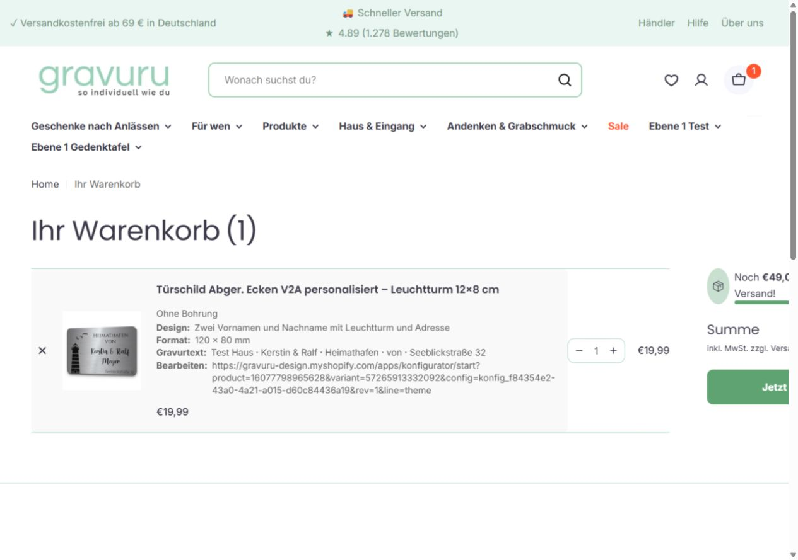
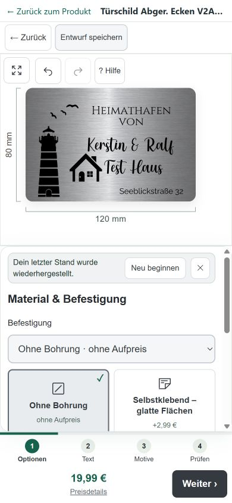
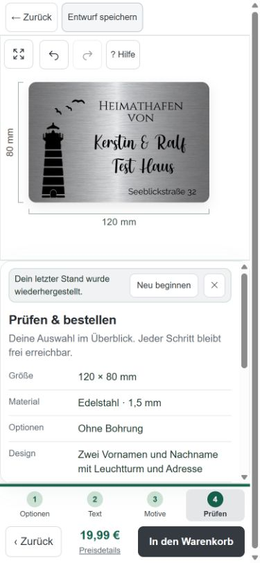

# Shop-Warenkorb: mobiler Anschluss und echter Hausmotiv-Test

Stand: 26.10.2026, Codex/Astra. Basis `main 13c0159406a2217479fea7a20cabf4acda60694b`.
Branch: `dev/shop-warenkorb-nachtrag-20261026-astra`.

Chris hat Fehlerbehebung, echten Produkt-/Hausmotivtest bis in den Warenkorb sowie PR, Merge und Bereitstellung ausdrücklich erlaubt. Keine Zahlung.

## Bestätigter Fehler und Korrektur

Unter 768 px verschob `mobile-steps.mjs` immer den alten `.fk-buy-button` in den Schritt „Prüfen“. Im öffentlichen Shop-Einstieg ist dieser lokale Knopf deaktiviert; der tatsächliche `[data-shop-cart]` blieb im geschlossenen Desktopdialog. Zusätzlich wurde der alte Hinweis „Lokaler Prüfstand · Bestellung noch nicht verbunden“ kopiert.

Mobile verwendet jetzt denselben vorhandenen Shopknopf samt Handler und Status wie Desktop. Es gibt keinen zweiten Speicher-/Warenkorbweg. Der echte Status wird verschoben, damit asynchrone Fortschritts- und Fehlermeldungen auch ohne Editor-Synchronisierung sichtbar bleiben. Beim Zurückwechseln bleiben Position, Listener und laufender Zustand erhalten. Nicht verbundene Vorschauen bleiben gesperrt; bestehende Commerce-Anbindungen behalten ihren Knopf.

Der Shopknopf erhält dieselbe kontrastreiche Darstellung wie andere Hauptaktionen im neutralen Design. Keine Änderung an Preisen, Produktkennungen, Schriftprüfung, Datenbankschema oder Katalog.

## Echte Shopprüfung vor dieser Korrektur

Normale [Produktseite](https://gravuru-design.myshopify.com/products/tuerschild-abger-ecken-v2a-personalisiert-leuchtturm-12x8) → „Jetzt personalisieren“ → Name „Test Haus“ → Bibliotheksmotiv „Haus“ hinzufügen → Desktopabschluss → „In den Warenkorb“ → normaler Shopify-Warenkorb `/cart`.

- Produkt `16077798965628`, Variante `57265913332092`, „Ohne Bohrung“, 120 × 80 mm, Menge 1, **19,99 €**.
- Echte importierte D8-Vorlage mit Ashley/Cinzel/Raleway und zusätzlichem Haus `import-b56d5711a75f34c1fa8d9c30`.
- Warenkorb zeigte Design, Format, Gravurtext „Test Haus …“ und Bearbeiten-URL. Readback über Shop-Warenkorbtool bestätigte genau eine Position und 19,99 €.
- Beim Wiederöffnen blieb die Gestaltung mit sieben Ebenen und sichtbarem Haus erhalten.
- Der in PR #29 gemeldete 422-Schriftfehler trat in dieser konkreten Browserfolge **nicht** auf. Deshalb keine pauschale Freigabe unbekannter Schriften und keine Behauptung, die frühere Ursache damit behoben zu haben.
- Die Motivbibliothek brauchte beim ersten Laden deutlich länger; erst nach dem Laden war das Haus auswählbar.
- Theme zeigt weiterhin das Standardproduktbild und die Bearbeiten-Adresse als Rohtext. Die Theme-Snippet-Installation gehört zu Claudes offenem Anschluss; diese PR ändert das Theme nicht.

## Prüfungen der Korrektur

- Gezielt: `node --test app/configurator/variant-m/mobile-steps.test.mjs app/configurator/variant-m/shop-cart.test.mjs app/configurator/variant-m/cart-edit.test.mjs app/configurator/variant-m/acrylic-draft-client.test.mjs` → **21/21 bestanden**.
- Vollauf aller `app/configurator/variant-m/*.test.mjs`: vorher **289 / 281 bestanden / 8 fehlgeschlagen**, nachher **292 / 284 bestanden / dieselben 8 fehlgeschlagen**, keine übersprungen.
- Vorher-Vergleich: unveränderter PR-#29-Quellstand, dessen Konfigurator-Dateien mit aktuellem main identisch sind (main änderte danach nur STATUS und workshop/konfis.test.mjs).
- Acht identische Fehlernamen: zwei Bundle-Dateiumbenennungen mit Windows `EPERM`, ein Kontur-PDF-Test und fünf Druck-/ZIP-Tests in der vorhandenen Python-/Ausführungsumgebung. Kein neuer Fehler. Dieser Lauf ist **kein Werkstatt-Vollauf**; dort wird in dieser PR nichts geändert.
- Drei neue Tests prüfen echte Knotenverschiebung mit erhaltenen Listenern, laufende Status-/Fehleranzeige beim Größenwechsel sowie weiterhin gesperrte lokale Vorschau und bestehende Commerce-Anbindung.
- Lokale Browserprüfung bei 390 × 844 und 1280 × 900: echte D8-Editoroberfläche mit den geänderten Modulen; Warenkorbknopf aktiv; Sicherungsfortschritt und gezielt ausgelöster lokaler Fehler sichtbar; Desktopdialog nach Größenwechsel weiterhin bedienbar. Der lokale Speicherdienst war absichtlich simuliert und schrieb keinen Shop-Warenkorb.

## Übergabe und Abgrenzung

Live-Abnahme der mobilen Korrektur nach Merge/Bereitstellung wird im PR ergänzt. Der oben dokumentierte echte Desktop-Warenkorb wurde bereits auf dem zuvor laufenden Stand erreicht.

Claudes weiteren PR-#29-Nachträge F1/F3/F4 und die `hasOwn`-Absicherung bleiben separat offen; diese eng begrenzte Korrektur behauptet deren Abschluss nicht. Der ursprüngliche Schriftbefund benötigt bei erneutem Auftreten die konkrete fehlschlagende Objekt-/Schriftauswahl.
