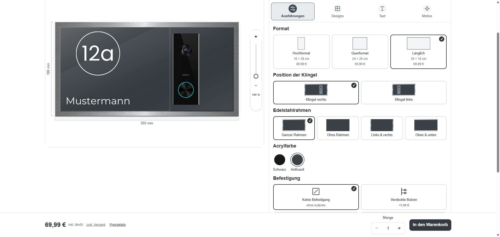
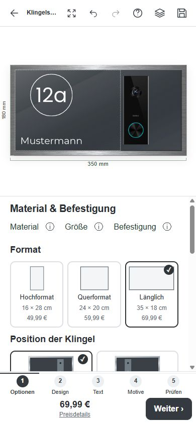

# Nachtrag: AOSU-Auswahl und Materialdarstellung
29.10.2026 · Codex/Astra · Ergänzung zu PR #60, Basis `bc34ebc`

Chris korrigiert den vorigen Entwurf: runde Farbauswahl, kompakte Formatwahl nahe dem AOSU-Muster. **Ausführungen, Designs, Text und Motive bleiben oben unverändert.** Zusätzlich soll die Edelstahlplatte realistisch erscheinen und Acrylglas mehr Tiefe/Glanz erhalten.

## Umsetzung und Quellen
- Keine Änderung an Tabs, Navigation oder Options-/Preislogik.
- Runde 44-px-Farbfelder Schwarz/Anthrazit, Beschriftung separat, Auswahlring statt großer Produktkarte.
- Drei kompakte Format-Silhouetten in einer Zeile, Maße und bestehende Preise sichtbar. Vier Rahmen-Silhouetten nach dem vorhandenen AOSU-Muster. Position weiterhin direkt nach Format mit zwei Abbildungen.
- Referenz: `app/references/aosu-upgrade-2026-09-21/verification/editor-source.html`, `FunkklingelBetaCSS` und `fk-frame-pictures`; Materialfarben wie dort `#151719` / `#3b4046`.
- Die vorhandene **leere** Edelstahltextur aus `app/designs/aosu-labrador/runtime/images/gravuru-edelstahl-feine-maserung-vorschau.png` liegt hinter dem Acryl. Kein Leuchtturm-/Schriftmotiv aus dem gestalteten Edelstahl-v4-Muster übernommen. Herkunft und Grenzen: `MATERIALREFERENZEN.md`.
- Acrylkante aus der im Profil gespeicherten Stärke, dezenter Lichtverlauf und Reflex. Reine 2D-Vorschau-Näherung; kein Herstellerfoto oder physikalisch kalibriertes Material behauptet. Originalkonturen, Maße, Gerätepositionen, Preise und Fertigungsdaten unverändert. Vorschauflächen sind als `data-role=guide` gekennzeichnet.
- Oberfläche verwendet die bestehende statische Bilddatei (1.440.952 Bytes) über dieselbe URL für alle Modelle; keine eingebetteten Bildkopien pro Auswahlkachel. Format/Rahmen/Position selbst sind kleine SVG-Silhouetten ohne Produktfotos.

## Prüfung
24/24 gezielte Tests grün, einschließlich unveränderter Geometrie und korrekter Materialreferenz. Erneuter lesender Matrixlauf: 126 Produkte / 42 Modelle / 30.240 Auswahlfälle / 1.512 Bildgruppen, Quellen unverändert.
Build: `editor-b1c8cb941c37bf78.mjs`, 113 Module, 14 Styles, 1.188.872 Bytes, gzip 387.909 Bytes.
Echte lokale Browserprüfung und Screenshots unten. Aktuelle Bilder ersetzen die Optionsdarstellung des ersten PR-Entwurfs. Die getrennte Katalogvorbereitung und ihre noch offenen Abnahmen aus dem Hauptbericht bleiben unverändert.

## Bilder

Kein Merge, Deployment oder Shopify-Schreiben. Änderungen bleiben auf dem eigenen Branch in PR #60.

