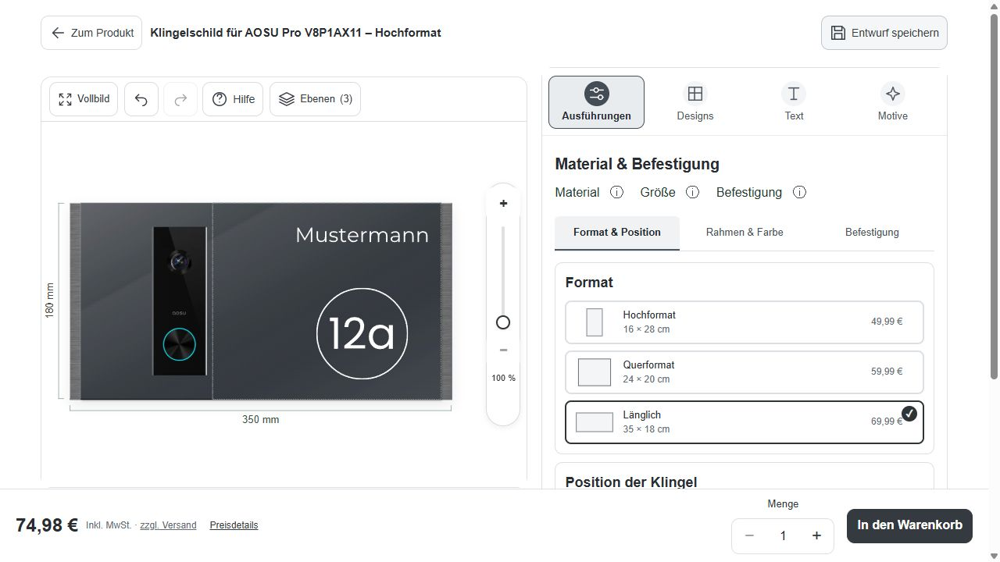
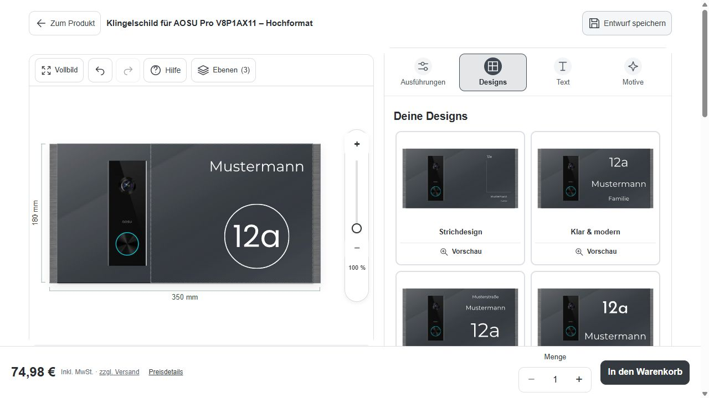
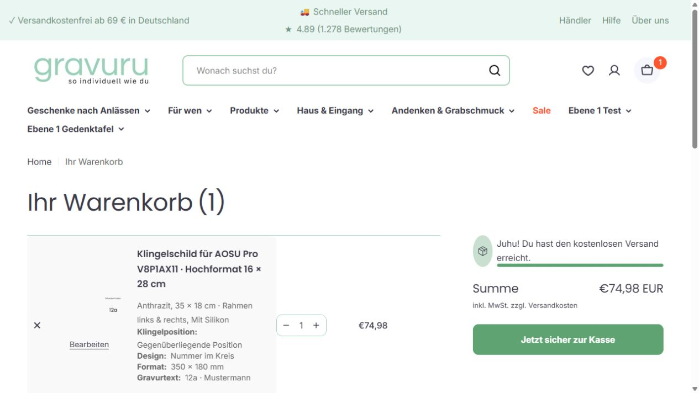

# Funkklingeln: veröffentlichte Oberfläche und Designrevisionen – 29.10.2026

Chris' Freigabe im Chat: „stell es live“. Plesk-Anmeldung anschließend bestätigt. Umsetzung auf eigenen Aufgabenbranches; kein erneuter Freigabeschritt erforderlich.

## Veröffentlichter Stand

- Oberfläche PR #60, Merge 092303d73ff5546bb4208b2b7a360756f69602b1, Head c76c3cfcfbf1ddaaae7fc4ed276db3d5a3b5cd96.
- Gezielte Warenkorb-Korrektur PR #73, Merge 915c102a7bd2720a8bb27805149ed79264559dc3, Head a0757e1894367c99af19fc1935be86f0507c9f1e.
- Katalog-PR #7 gemergt: 7d53958399badd1fd3aaba3eb59c084b0ccbddeb. Maßgebliche Gestaltungsvorgabe: [Design-Master](https://github.com/Chris83638w/gravuru-katalog./blob/main/designs/DESIGN-MASTER.md).
- Plesk Git Pull → Jetzt bereitstellen → Node-App neu starten. Laufzeitdateien gegenüber geprüftem Stand verglichen; gebündelte Oberfläche editor-b4bda7d8086a9bd1.mjs, 1.194.447 Bytes / 389.067 Bytes gzip. Dies ist eine Paketgröße, keine behauptete Ladezeit.

## Verhalten

Vier Hauptschritte Ausführungen / Designs / Text / Motive bleiben. Unter Ausführungen: Format & Position, Rahmen & Farbe, Befestigung. Format und Klingelposition sind getrennte bebilderte Blöcke; Farben rund; kompakte Rahmen- und Befestigungsauswahl mit Silikontube. Große Vorschau mit anliegenden Maßlinien, gebürsteter Edelstahl und Acrylkante/Glanz. Unterschiedliche native Designs einschließlich Originalmotiven für Quer-/Langformat. Freigegebene Texte und Motive verschieb-/löschbar, Motive ersetzbar; technische Elemente unverändert.

Die Rechte sind in neuen Produktrevisionen persistiert, kein Frontend-Bypass. prepareDoorbellDesignRevision prüft, dass außerhalb von Design-/Elementrechten insbesondere Maße, Positionen, Rahmen, Farbe, Befestigung, Preise und Modellbezug unverändert sind.

## Abnahme

- Linux: 28/28 UI-/Design-/Revisionsprüfungen; Build erfolgreich.
- Warenkorb-Fix: 38/38 Linux-Prüfungen einschließlich echter generierter Reviews für drei Formate × zwei Positionen, unbekannter/fehlender Blocker und Legacy-Fall sowie bestehender Theme-Cart-Strecke. Ein erster Lauf scheiterte an einer in der isolierten Kopie fehlenden Testfixture; unveränderte vorhandene Fixture ergänzt, vollständiger Lauf anschließend grün.
- Store-Kopie: 126 Konfigurationen / 42 Modelle / 15.120 Varianten vorab geprüft.
- Reale Live-Bedienung: AOSU Pro V8P1AX11, Formatwechsel, Gegenposition, Löschen/Rückgängig, unabhängiges Verschieben des Kreismotivs.
- Echter Shopify-Warenkorb: Länglich 35×18, Anthrazit, Rahmen links/rechts, Silikon, Gegenposition, Design „Nummer im Kreis“, 12a · Mustermann → 74,98 EUR; Bearbeiten-Link öffnete gespeicherte Gestaltung mit gleicher Auswahl. Eigenen Testartikel anschließend entfernt, keine Bestellung ausgelöst.
- Einstieg über „Jetzt personalisieren“ direkt von der Produktseite öffnete den neuen Editor. Kein Theme geändert.
- Die Warenkorb-Vorschau überträgt derzeit nur die Gestaltungsebene, nicht die vollständige Material-/Klingelszene; das ist kein Nachweis einer fertigen Checkout-Bildkorrektur (PR #54 bleibt separat).

Der zusätzliche Abschlussprüfer unterscheidet den SHA der gespeicherten JSON-Bytes (Revision/Freigabe) vom kanonisch sortierten Dokument-SHA der aktiven Bindung. Ein erster Prüfversuch verwendete dort irrtümlich denselben SHA; nur der lesende Prüfer wurde korrigiert, keine Produktdaten angepasst.

## Datenabschluss

Abschlussabgleich 2026-10-29T20:09:04.283Z: **126 Konfigurationen / 42 Modelle / 15.120 aktive Variantenbindungen auf Revision 2 / 126 passende Freigaben**. Alle 126 alten Revisionen bytegenau erhalten; Optionen und Geometrie bei allen 126 unverändert. Keine Fehler. App-Startdatei unverändert. Null Shopify-Produktmutationen durch den Revisions-/Bindungslauf.

Maschinenlesbarer Nachweis: [final-live-audit.json](assets/2026-10-29-doorbell-live/final-live-audit.json).

## Sichtbare Nachweise







## Ablauf / private Nachweise

Private Release-Artefakte: /private/funkklingeln-ui-release-20261029 unter dem bestehenden Vhost. snapshot/ ist die ursprüngliche Kopie; before-live/ die unmittelbar vor dem Pilot erstellte Sicherung; trial/ die getrennte Schreibprobe. Originalkopien nicht als Testziel verwendet.

```sh
# Bestehende Repository-/Bindungswege innerhalb des geprüften Wrappers:
export GRAVURU_PYTHON=/var/www/vhosts/gravuru-designwerkstatt.de/private/gravuru-2027-test-python311/bin/python
/opt/plesk/node/24/bin/node /var/www/vhosts/gravuru-designwerkstatt.de/private/funkklingeln-ui-release-20261029/apply-revisions.mjs copy pilot
/opt/plesk/node/24/bin/node /var/www/vhosts/gravuru-designwerkstatt.de/private/funkklingeln-ui-release-20261029/apply-revisions.mjs live pilot
# Erst nach erfolgreichem realen Warenkorb:
/opt/plesk/node/24/bin/node /var/www/vhosts/gravuru-designwerkstatt.de/private/funkklingeln-ui-release-20261029/apply-revisions.mjs live rest
```

Der Wrapper verwendet repository.importBatch und applyDoorbellBindings. Shopify-Client verweigert Mutationen; frische Shopify-Lesebelege werden blockweise geprüft und gebunden. Journalschlüssel doorbell-ui-20261029:<cfg-id>, Freigabenachweis chris-chat-ui-live-20261029. Berichte: stage-report.json, copy-pilot-apply.json, live-pilot-apply.json, live-rest-apply.json, final-live-audit.json; private Datenbanken und Zugangsdaten nicht ins Repository kopieren.

## Ablaufgrenze

Der Restlauf aktualisierte zuerst die neuen Bindungen und erstellte danach gesammelt die revisionsgebundenen Freigaben. Zwischen diesen Schritten konnten die betroffenen neuen Stände an der Freigabeprüfung blockiert werden; ein unterbrechungsfreier Rollout ist daher nicht belegt. Für Folge-Releases produktweise Revision → 120 Bindungen → Freigabe abschließen, bevor das nächste Produkt folgt. Bestehende Schutzprüfungen wurden nicht umgangen.

## Rückweg / Grenzen

Historische Revision 1 und Bindungshistorie bleiben erhalten. Rückweg für betroffene Produkte: über repository.restore(id, {expectedRevision: 2, revision: 1}) den alten Dokumentinhalt als weitere neue Revision speichern (normalerweise Revision 3; bei inzwischen geändertem Kopf abbrechen und neu prüfen); danach Manifest auf diese neue Revision setzen, bestehenden Dry-run/Shopify-Leseabgleich durchführen und über applyDoorbellBindings samt expliziter Revisionsfreigabe neu anbinden. Nicht direkt auf eine alte Kopfnummer zurücksetzen: der Bindungsweg verlangt requireHead=true. Keine gesamte Live-Datenbank zurückkopieren, da zwischenzeitliche Kundenentwürfe/Bestellungen verloren gingen. Dieser Rückweg wurde nicht live ausgeführt. Code-Rückweg: Release-Commits gezielt revertieren und über denselben Plesk-Weg bereitstellen.

Kein Shopify-Produkt, keine Publikation, kein Metafeld, Theme, Webhook oder globaler Live-Schalter in diesem UI-Release geändert. 126 Konfigurationen sind nicht gleichbedeutend mit 126 in allen Verkaufskanälen publizierten Shopify-Seiten. Keine bezahlte Testbestellung, Maschinenabnahme oder vollständige Prüfung von PR #54. Kein kompletter Design-Kontaktbogen aller Modelle und kein vollständiger Katalog-PDF-Neubau in diesem Lauf.

Nächster getrennt zu behandelnder Punkt: PR #54 / vollständige Bestell- und Fertigungsstrecke sowie Warenkorb-/Checkout-Bildkorrektur; vorhandene Publikations-/Produktmarker-Aufgaben anhand ihres eigenen aktuellen Nachweises behandeln.
