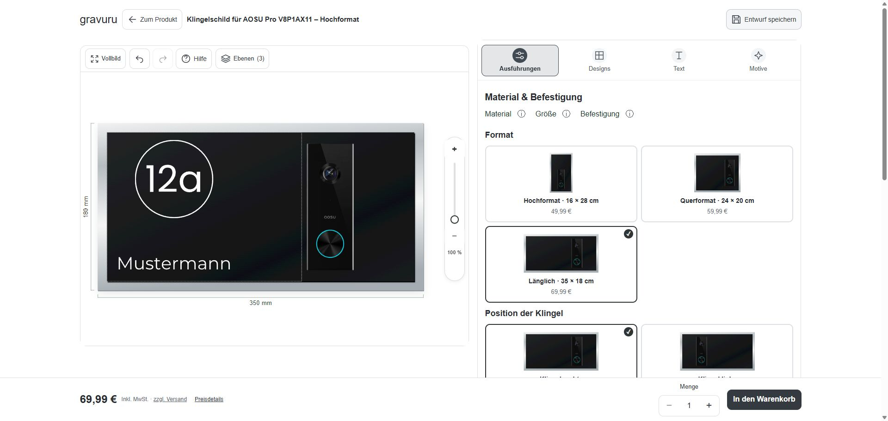
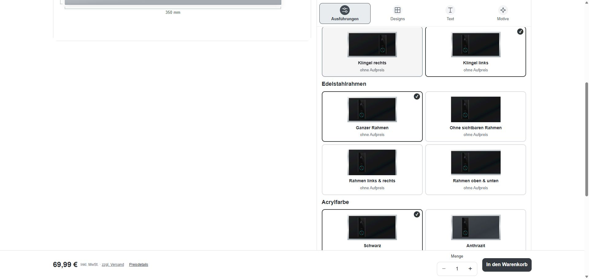
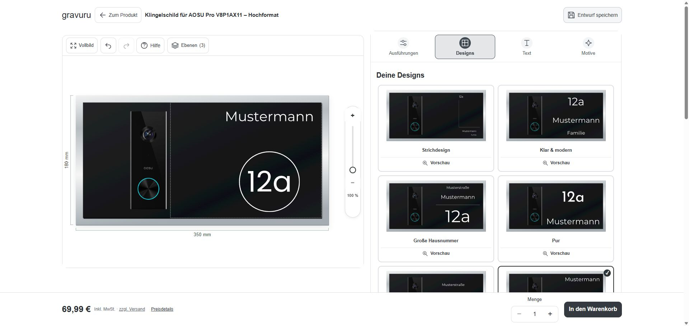
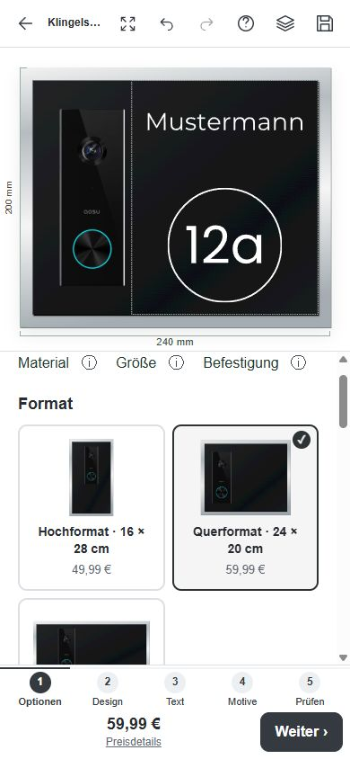

# Funkklingeln: große Vorschau und echte Bildauswahl
29.10.2026 · Codex/Astra · eigener Branch `dev/funkklingeln-vorschau-bildauswahl-20261029-astra`
Basis: `2717da599366df8ad8cbdc4645624d236a42ab23`.

## Auftrag und fachliche Quellen
Chris meldet im Chat eine zu kleine Platte, falsche Maßlinien, fehlende Bildauswahl für Format/Rahmen/Farbe/Position sowie wiederholte Designs. Position soll unmittelbar oben in der Auswahl erscheinen.
Maße, Lochgeometrie, Farben, Rahmen, Optionen und Preise stammen unverändert aus den versionierten Funkklingelprofilen. Gegenposition folgt der vorhandenen 180°-Positionsabbildung; das Gerätebild bleibt aufrecht.
[Design-Master](https://github.com/Chris83638w/gravuru-katalog./blob/main/designs/DESIGN-MASTER.md): vorhandene Vorlagen als starke Referenz, Motive/Schriften erhalten, keine Verzerrung. Die 5% Randfläche im Korrekturplan ist ausschließlich ein sichtbarer Gestaltungsvorschlag, keine Fertigungsregel. Keine neuen Mindestgrößen, Preise, Rechte oder Bohrabstände eingeführt.

## Codekorrektur
- `doorbell-ui.mjs`: Formatwechsel aktualisiert auch die von usability auf der Stage gesetzten CSS-Variablen. Die veraltete Hochformat-Proportion beschränkte vorher Querformat und Maßlinien.
- `doorbell-presentation.mjs`: bestehender Options-Handler erhält bildliche Auswahl in der Reihenfolge Format → Position → Rahmen → Farbe → Befestigung. SVGs werden aus derselben Geometrie wie das Schild erzeugt, einschließlich tatsächlichem Gerätebild; keine parallele Geometrie-/Preistabelle. 3/2/4/2/5 Auswahlmöglichkeiten bleiben erhalten.
- `product-design-gallery.mjs`: native Funkklingeln verwenden die vorhandenen 16 Designvorlagen; keine dreifach über mehrere Produkte und Formate wiederholten Karten. Nicht-Funkklingel-Galerien unverändert.
- `customer-rights.mjs`: Reparatur verwendet die aktuell ausgewählte Format-/Positionsvorlage. Vorher wurde nach Formatwechsel das Motiv des Startformats zurückgesetzt und die Preisprüfung meldete „Vorlagenmotiv darf nicht zusätzlich eingefügt werden“. Rechte werden nicht erweitert.
- `workflow.mjs`: vorhandene Texte und deren Galerie-Vorschau werden auf der wirklichen Acrylfläche eingepasst. Die größte freie Teilfläche bleibt für die Platzierung neuer Elemente; sie darf gültige vorhandene Texte neben/unter der Klingel nicht verkleinern.

## Getrennte Katalogkorrektur
Die 16 Designs unterscheiden sich bereits in Text/Schrift. In den übernommenen Quer-/Langformaten gingen jedoch unterschiedliche Ziermotive verloren: etwa „Nummer im Kreis“ wurde zu einer geraden Linie.
`scripts/prepare-doorbell-design-repair.mjs` bereitet die Originalkompositionen aus 16×28 als proportionale Referenz für 24×20 und 35×18 vor. Alle Objekt-IDs, Motivreferenzen, Schriften und Texte bleiben erhalten. Geometrie, Rahmen, Preise und Ausgangsdateien bleiben unverändert.
42 Korrekturrezepte / 1.344 Designzuordnungen im separaten Katalog-Branch; alle mit `freigabe:null`. Die 42 Quellen stimmen bytegenau mit Katalog-main `eb4a4c61a411a2b1753cb3ff691551b577c68fe0` überein.
**Das sind prüfbare Vorschläge, noch keine geänderten Live-Revisionen.** Der vorhandene Importer prüft außerdem gegen die ursprünglichen Modellquellen. Neue freigegebene Revisionen und deren erneute Bindung sind ein eigener nachfolgender Schritt; kein Austausch bestehender Bestellrevisionen.

## Ausgeführte Prüfungen
- Windows/Node: 50/50 gezielte Tests grün (Bildoptionen, Format/Position, Preis, Rechte, Ressourcen, Galerie, Textwerkzeuge, Designübertragung).
- Build: 112 Module / 14 Styles; Bundle `editor-712546cdf6d6ee27.mjs`, 1.182.008 Bytes, gzip 386.236 Bytes. Zuwachs gegenüber Ausgangsstand ~1,8 KB gzip.
- Lesender Exportabgleich: 126 Produkte / 42 Modelle / 378 Format-Designsätze / 1.512 Bildoptionsgruppen / 30.240 Options- und Positionskombinationen; Preise passen, Quellen unverändert.
- Zusätzlich derselbe Lauf mit Katalogvorschlag: 30.240 Kombinationen plus 8.064 Prüfungen der adaptierten Designs einschließlich Gegenposition; Originalmotive bleiben erhalten, keine Geometriefehler.
- Echte lokale Chrome-UI: AOSU, Hochformat/Querformat/länglich, Gegenposition, Bildoptionen, unterschiedliche Galerievorlagen und Preiswechsel. 390×844 responsive Ansicht geprüft; kein physisches iPhone/Safari.
- Lokaler Vorschauserver ist nur lesend; die Screenshots zeigen die Codekorrektur **plus** Katalogvorschlag. Keine API-Schreibzugriffe und kein Warenkorb-/Bestellnachweis.
- Katalog-Builder auf vorhandener separater Familienkopie ausgeführt: 11 Familien und Excel erzeugt; PDF-Neubau scheitert in der verfügbaren Python-Umgebung an fehlendem `cairosvg`. Deshalb kein vollständig grüner Katalog-Build behauptet und keine erzeugten Bestandsdateien übernommen. Der Familien-Builder verarbeitet die Rezepte unter `migrationen/` ohnehin nicht.
- Kein neuer Linux-Vollauf, keine vollständige manuelle 1:1-Kontaktbogenabnahme aller 1.344 Vorschläge. Die automatischen Prüfungen ersetzen diese Sichtabnahme nicht.

## Sichtnachweise aus dem echten lokalen Konfigurator
Große Platte, passende Maße, bebilderte Formate und Position:


Rahmen und Farben:


Unterschiedliche vorhandene Designs:


Schmale Ansicht:


## Wiederholen
```sh
node --test app/configurator/variant-m/doorbell-presentation.test.mjs app/configurator/variant-m/doorbell-state.test.mjs app/configurator/variant-m/doorbell-ui.test.mjs app/configurator/variant-m/doorbell-selection.test.mjs app/configurator/variant-m/doorbell-lazy-designs.test.mjs app/configurator/variant-m/element-rights.test.mjs app/configurator/variant-m/workflow.test.mjs scripts/prepare-doorbell-design-repair.test.mjs
node app/configurator/variant-m/build.mjs
node scripts/check-doorbell-presentation.mjs <privater-modellexport>
node scripts/check-doorbell-presentation.mjs <privater-modellexport> --repair-proposal
node scripts/prepare-doorbell-design-repair.mjs <katalog-native-inputs> <neuer-reviewordner>
```

## Nächster Schritt / Rückweg
Claude prüft Code-Diff (besonders Überschneidung mit Issue #48 D) und die getrennten Katalogrezepte. Vor Livegang: finaler Linux-Lauf, echte Kontaktbögen Original/neue Formate, neue Revisionsplanung und Pilot. Anschließend bei Freigabe zuerst ein Pilot mit Warenkorb und Ressourcen-/Preiskontrolle.
Kein Merge, Deployment, Neustart oder Shopify-Schreiben in diesem Paket. Die letzte Live-Aktion bleibt das ausdrücklich freigegebene eine Metafeld aus PR #56; 41 weitere Metafelder und 84 Veröffentlichungen unverändert offen. Rückweg der Vorbereitung: Branch/PR verwerfen; Live-Rückweg erst mit konkreten neu erzeugten Revisionskennungen festlegen.


