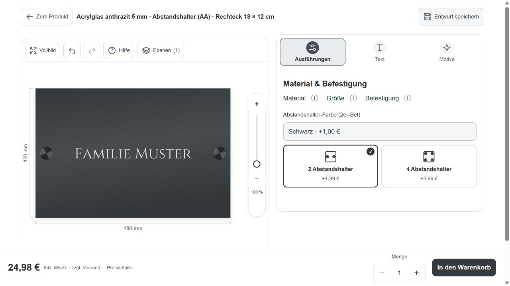
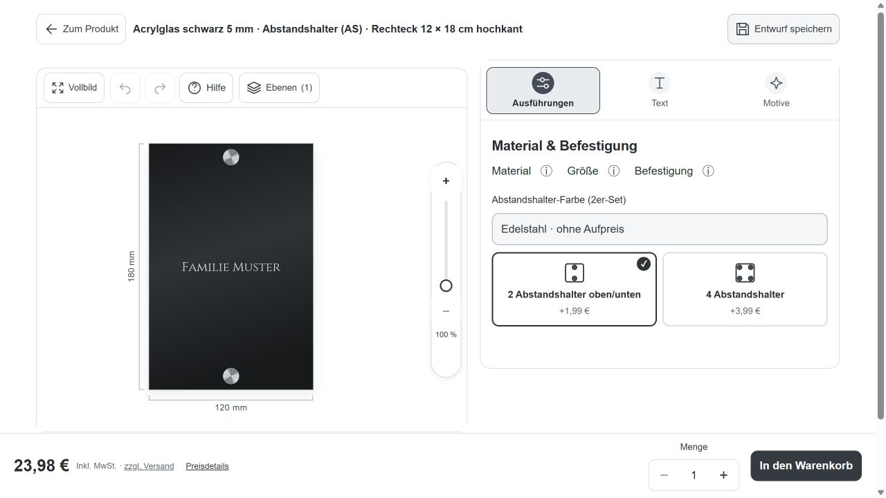
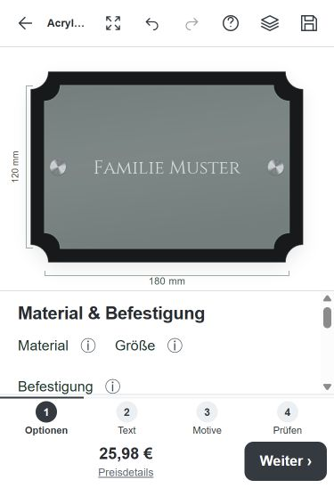
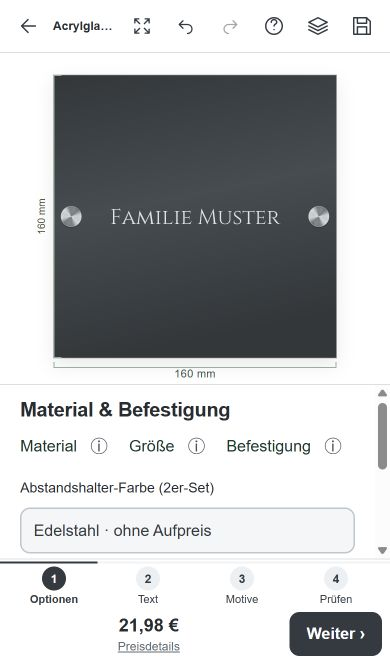

# Issue #48 · Teil B · Acrylfamilien AA/AS/S/S

Codex/Astra, 29.10.2026. Eigener Branch dev/konfi-acryl-abstandshalter-20261029-astra. Basis enthält main 2468bd1 und Claudes Optionsgruppenstand fa7eaae (einschließlich 96be03e). Nur lokale Implementierung und Entwurfs-PR; keine Katalog-/Shopify-/Live-Änderung.

## Ergebnis

Der Acryl-Familienadapter übernimmt AA anthrazit, AS schwarz und S/S satiniert aus dem fixierten Katalogstand 680f1744d0488137e5d7d3cf183788308070bef4 (Branch dev/hausnummern-preise-20261029-astra3). Alle 162 Größen mit 630 gültigen Preis-/Halter-/Farbkombinationen geprüft. Prüfdaten sind bytegleiche JSON-Kopien mit Herkunft und SHA-256 in app/workshop/test-fixtures/acrylic-families/provenance.json, keine neue Katalogwahrheit.

Rechteck 3:2 und Hochformate laufen; übrige Formen einschließlich Quadrat und eingezogener Ecken ebenfalls. Bohrzentren, Durchmesser und Preise kommen aus der Familie. AA/AS erscheinen lesbar in der Vorschau und werden hinten gespiegelt graviert; S/S vorne. Bei S/S ist die schwarze Rückplatte rundum 10 mm größer, mit den überlieferten Konturradien; nur die Front wird gestaltet. Halterfarbe verwendet ausschließlich Claudes familyOptionGroups/selectedProfile. Verdeckte Gruppen bleiben unsichtbar und unberechnet.

Produktvorschau enthält die Halter und Rückplatte, die Gravurausgabe ausschließlich die Frontgestaltung mit eigener Kontur und Bohrungen. Größere Rückplatte bleibt vollständig im Vorschaufenster; Maßpfeile und Zeigerkoordinaten beziehen sich auf die Front. Keine roten Bohrschutzringe in der normalen Ansicht.

Die Testvorlage „Familie Muster“ ist eine technische neutrale Anschlussvorlage, kein freigegebenes Design. Die Produkte bleiben reviewOnly/local-review, orderEnabled und productionConfirmed false. Der reale Durchmesser des Halterkopfs ist weiterhin offen; die bisherige illustrative 12-mm-Grafik wurde übernommen, kein Produktionsmaß erfunden.

## Prüfung

- 66 verschiedene gezielte Tests bestanden (26 Familien/Anschluss, 21 UI, 16 Zoom, 3 Rückplatten-Viewport), nach letzter UI-Änderung 40/40.
- Vorheriger Windows-Vollauf: 1816 gesamt, 1809 bestanden, 2 Fehler, 5 übersprungen. Fehler 1: gemeinsame S/S-Fixture verschob Katalogzählung. Claudes Korrektur fa7eaae jetzt übernommen, ursprüngliche Assertion unverändert. Fehler 2: Kontur-Worker im Excel-Export; erneute Prüfung noch laufend.
- Abschließender Vollauf auf aktualisierter Basis wurde gestartet; Zähler werden in diesem Bericht nachgetragen. Kein grüner Abschluss behauptet, solange er fehlt.
- Build vor dem Basisabgleich bestanden. Die Prüfstände verändern keine Katalogdatei, Bestellung oder Freigabe.

## Bilder und Grenzen

Alle Bilder in issue48-acryl-20261029 stammen aus dem echten lokalen Konfigurator mit der neutralen Prüfvorlage. Desktop 1280 × 720, iPhone 13 390 × 664, iPhone SE 375 × 548. Dateinamen benennen Material, Format und Auswahl. Die vorhandene Desktopaufnahme desktop-ss-4er-weiss-vor-viewport-fix.jpg ist ausdrücklich historisch vor dem letzten Rückplatten-Viewport-Fix und kein finaler Abnahmebeleg. Die aktuellen SE-/iPhone-Aufnahmen zeigen die korrigierte Fläche. Eine neue Desktop-S/S-Aufnahme ist wegen derzeit nicht antwortender Browserverbindung offen.

## Übergabe / nächster Schritt

Claude prüft den Entwurf und Linux. Aktueller Testabschluss und neue Desktop-S/S-Aufnahme stehen aus; danach Rechteck-Designpilot durch den Produktanlage-Chat. Keine Installationsfreigabe enthalten.

C hat Vorrang und liegt separat in PR #54. B und C ändern beide acrylic-artwork.mjs: beim späteren Zusammenführen sowohl die familyAcrylic-Schemaerkennung aus B als auch die validierte eingefrorene Schriftliste aus C behalten. Lesender merge-tree-Test hat an dieser Stelle einen Konflikt bestätigt; kein main-Merge durchgeführt. Anschließend die Familien-/Schrift-/Fertigungstests gemeinsam laufen lassen.
