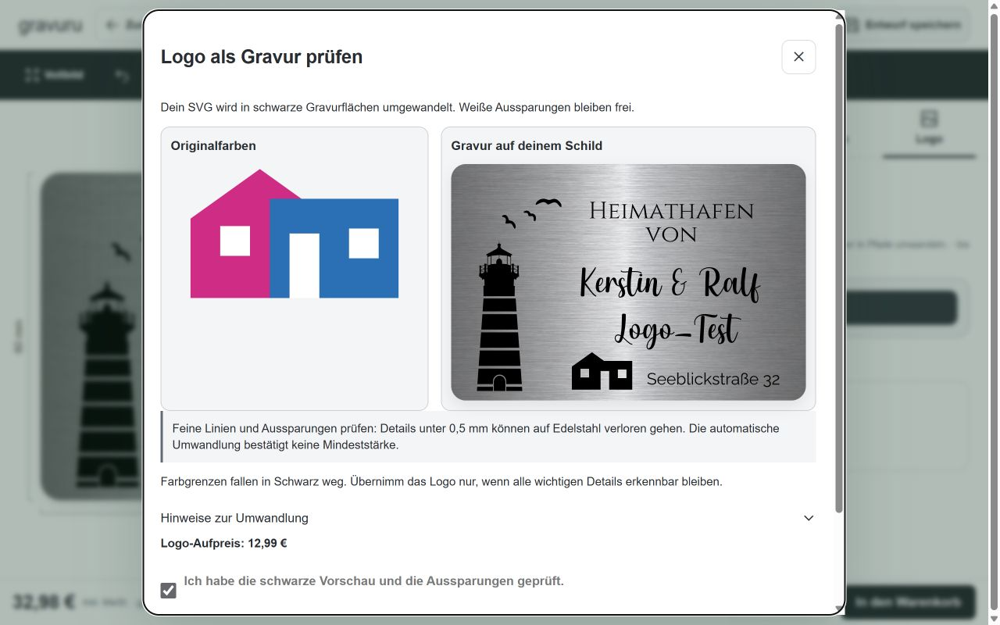

# Kundenlogos für Edelstahlgravur · 29.10.2026 · Astra

## Auftrag und Stand

Chris hat den besprochenen Logo-Konverter ausdrücklich zur Umsetzung freigegeben und anschließend **12,99 € je hochgeladenem Logo** festgelegt. Umfang: SVG-Vektorlogos, auch mehrfarbige Quellen, sichere schwarze Vorschau mit erhaltenen Aussparungen; keine Fotos auf Edelstahl. Die darunter gesammelten Layoutpunkte sind weiterhin nur aufgenommen.

Implementiert auf `dev/konfi-bedienung-issue48-d-20261029-astra`, [Entwurfs-PR #58](https://github.com/Chris83638w/gravuru-2027/pull/58). Kein Merge nach main, keine Shopify-Schreibzugriffe, kein Deploy. Bestehende Produkt-/Bestellrevisionen werden nicht verändert.

## Ergebnis

- Ein ausdrücklich neuer Produktvertrag `logo:{enabled:true,vectorUpload:true,extraPriceCents:1299}` erlaubt den Upload bei Edelstahlgravur; dazu muss `photo.enabled:false` gelten. Ohne Opt-in bleibt der Altvertrag unverändert.
- SVG bis 2 MB, höchstens vier Uploads insgesamt. Echte gefüllte Vektorformen/Kurven und Strichkonturen werden normalisiert. Fotos, eingebettete Bilder, Schriften ohne Pfade, externe Referenzen, Skripte, Verläufe, Transparenz und nicht unterstützte Effekte werden abgewiesen.
- picosvg/Skia-PathOps vereinigen schwarze Flächen und ziehen weiße Formen in Zeichenreihenfolge ab. Farbgrenzen können bei Schwarz verschwinden; dies wird ausdrücklich gezeigt. Es wird keine verlustfreie Umwandlung beliebiger farbiger Logos behauptet.
- Originalfarben und schwarze Gravur auf der tatsächlichen Platte stehen im Bestätigungsdialog. Ohne angehakten Sichtvergleich bleibt „Gravur übernehmen“ gesperrt. Abbrechen ändert weder Gestaltung noch Preis. Ein neues Logo erhält unter Verwendung der bestehenden Platzsuche eine freie Position, soweit möglich; Seitenverhältnis bleibt erhalten.
- Originaldatei und bestätigte Schwarz-SVG bleiben getrennt und mit SHA-256/Version erhalten. Beim Sichern einschließlich Kontoentwürfen konvertiert der Server erneut und verlangt identische Metadaten und Schwarzbytes. Warenkorb-Wiederherstellung und Produktion lesen das unveränderliche, hashgeprüfte Paket; die Produktion prüft zusätzlich Logo-Metadaten und Original-/Schwarzdatei-Hashes.
- Die Produktion übernimmt tatsächliche Pfade, keine aus dem Logo erzeugte Bitmap. Original und Schwarz-SVG bleiben im unveränderlichen Gesamtpaket. Der Produktionsbericht kennzeichnet Vektoren ohne falsche DPI-Warnung.
- Preis und Zähler sind serverseitig getrennt: Logos kosten je 1299 Cent und nutzen keine Foto-Inklusivmenge. Mengenstaffeln folgen dem vorhandenen Produktvertrag. V2-Preisbindung ist erforderlich; alte Preisbindungen akzeptieren neue Logostände nicht. Der ältere Commerce-Export lehnt Vektorlogos verständlich ab.
- Browser-Bildbearbeitung wandelt die bestätigte SVG nicht nachträglich in eine Bitmap um. Verschieben, Skalieren und Drehen bleiben über die vorhandenen Elementgriffe möglich.

## Geprüft

**196/196 gezielte Tests bestanden, 0 Fehler, 0 Skips.** Vollständiges Protokoll: [tests-196.tap](issue48-logos-20261029/tests-196.tap). Enthalten sind Konverter, Client, Preisvertrag, authentifizierte Shop-/Werkstattrouten, Konto, Wiederherstellung, alte Foto-/Rasterlogo-Pfade und echte Produktions-PDF.

Zusätzlich **6/6 Erwartungen am tatsächlich lokal kompilierten V2-WASM** erfüllt: neuer Logo-Preis, gemischte Staffel, unverändertes V1 und drei erwartete Ablehnungen. [Build-/Runner-Nachweis](../../ops/shopify/checkout-image/local-logo-v2-wasm-proof.json). Eine lokale Function-Ablehnung ist kein Beweis für eine aktive Shopify-Checkout-Sperre.

Browserprüfung nur im separaten lokalen Workshop auf Port 8154, geklonter D8-Kandidat mit synthetischem zweifarbigem Hauslogo:
- Original vs Schwarz mit zwei Fenster-Aussparungen und freier Tür; keine Vektor-Dopplungen an der Farbüberlappung.
- Abbrechen: fünf Elemente / 19,99 € unverändert.
- Bestätigen: sechs Elemente / 32,98 € = 19,99 € + 12,99 €; Ersetzen zählt nicht doppelt.
- Echte lokale Sicherung als Revision 1 erfolgreich; Original und geprüfte Gravurfassung im Backend. Kein Shopify-Warenkorb angelegt.
- Desktop 1280 × 800, iPhone-13-Viewport 390 × 664 und SE-Viewport 375 × 548. Keine Hardware-Safari-Abnahme.
- Chris' vorhandene Gestaltung auf 8152/8153 bleibt unangetastet.



[Handyvergleich](issue48-logos-20261029/vergleich-iphone13.jpg) · [Handybestätigung](issue48-logos-20261029/bestaetigung-iphone13.jpg) · [SE-Bestätigung](issue48-logos-20261029/bestaetigung-iphone-se.jpg) · [lokal gesichert](issue48-logos-20261029/lokal-gesichert.jpg)

Die ersten kombinierten Läufe fanden ausschließlich anzupassende Testadapter/Fixtures: alter Dateidialog-Ausdruck, Wiederherstellungstext, extrahierte Handler-Closure sowie Foto-Freigabe im neuen Shop-Test. Assertions wurden an die autorisierte SVG-Erweiterung angepasst; Altverhalten wird weiterhin ausdrücklich geprüft. Kein Test gestrichen. Die Sicherheitsprüfung fand außerdem einen möglichen mehrfachen Konverteraufruf bei doppelten Konto-Medien; maximal vier eindeutige Medien werden jetzt vor Beginn der Konvertierung verlangt.

Testumgebung: gebündeltes Python über `GRAVURU_PYTHON`, vorhandenes `work/pydeps` über `PYTHONPATH`, neue lokal installierte Pakete aus `app/workshop/requirements-logo.txt`, Workspace-TEMP/TMP. Anfangs fehlende Python-Aliase/PDF-Pakete sind damit für diesen gezielten Abschlusslauf aufgelöst. Kein neuer Vollauf; die zuvor dokumentierten 23 Baseline-Befunde bleiben separat offen.

Reproduzierbarer Abschlusslauf (mit passender Python-Umgebung):

```text
node --test --test-concurrency=1 app/configurator/variant-m/logo-upload.test.mjs app/configurator/variant-m/ui-event-regressions.test.mjs app/configurator/variant-m/account-drafts.test.mjs app/configurator/variant-m/shop-cart.test.mjs app/configurator/variant-m/commerce.test.mjs app/configurator/variant-m/photo-position-ui.test.mjs app/configurator/variant-m/decision-help.test.mjs app/configurator/variant-m/toolbar-placement-ui.test.mjs app/workshop/customer-vector-logo-media.test.mjs app/workshop/customer-vector-logo.test.mjs app/workshop/customer-vector-logo-pricing.test.mjs app/workshop/shop-entry.test.mjs app/workshop/shop-entry-client.test.mjs app/workshop/customer-draft-store.test.mjs app/workshop/account-draft-http.test.mjs app/workshop/cart-edit-revision.test.mjs app/workshop/acrylic-artwork.test.mjs app/workshop/cart-personalization.test.mjs app/workshop/checkout-design-image.test.mjs app/configurator/variant-m/photo-upload.test.mjs app/configurator/variant-m/photo-editor.test.mjs app/configurator/variant-m/session-guard.test.mjs app/configurator/variant-m/image-processing.test.mjs
```

## Offene Freigabe-/Installationsschritte für Claude

1. Code-/Linuxprüfung und echte iPhone/Safari-Bedienung.
2. Laufzeit mit den fest gepinnten Paketen aus `requirements-logo.txt` vorbereiten; Konverter-Smoke-Test auf Zielsystem. Ohne Pakete verständlicher Nichtverfügbarkeitsfehler, kein unsicherer Fallback.
3. Neue Produktrevision ausdrücklich anlegen/prüfen und V2-Preisbindung samt aktiver Cart-Transform-Version abgleichen. Erst nach Chris' Installationssatz veröffentlichen; Rückweg auf unveränderte alte Produktrevision/Function behalten.
4. Nach autorisierter Installation echter Warenkorb/Checkout und Wiederbearbeitung. Lokale Tests ersetzen diesen Nachweis nicht.
5. **Mindeststärke und Gravurergebnis bleiben eine reale Werkstattprüfung.** Für beliebige gefüllte Pfade wird keine automatische 0,5-mm-Mindeststärkenmessung behauptet. Manifest/Produktionsbericht tragen `detailCheck:"manual-required"`, `minFeatureUnits:null`. Schmale Stege, Aussparungen und farblich getrennte Buchstaben in endgültiger Größe prüfen.

## Gesammelte Layoutpunkte – inzwischen umgesetzt

Diese Rückmeldungen nach Wahl von Designrichtung 6 wurden anschließend von Chris zur Umsetzung freigegeben. Umsetzung, Bilder und Prüfungen stehen im [Nachtrag vom 30.10.](2026-10-30-konfi-layout-nachtrag-astra.md). Die Liste bleibt als ursprüngliche Anforderung erhalten:

1. Direktes Texteingabefeld auf der Platte moderner, Editiertext größer.
2. Schriftübernahme-Dialog: „Nur diesen Text ändern“ links, „Auf ausgewählte Texte übertragen“ rechts.
3. Mehr Bestseller und deutlich erkennbare Fortsetzung; verbindliche Motive liefert Chris.
4. Textwerkzeugleiste wieder unmittelbar über dem Schild, invers/hell mit dunklen Bedienelementen und erkennbarem Rahmen.
5. Kopfzeile mit Logo, Zurück, Produkttitel und Entwurf speichern in den dunklen Balken.
6. Designauswahl wieder sichtbar anbieten.
7. Hinweis „Wähle ein weiteres Motiv. Das vorhandene Motiv bleibt erhalten …“ entfernen.
8. Auswahlrahmen pink, exakt dieselbe Farbe wie Ausrichtungshinweise.
9. Texte bei Überlappung immer über anderen Gestaltungselementen.

Der in diesem Paket freigegebene Logo-Konverter ist davon getrennt umgesetzt. Keine Bestseller, Kennungen oder Katalogdaten erfunden.
