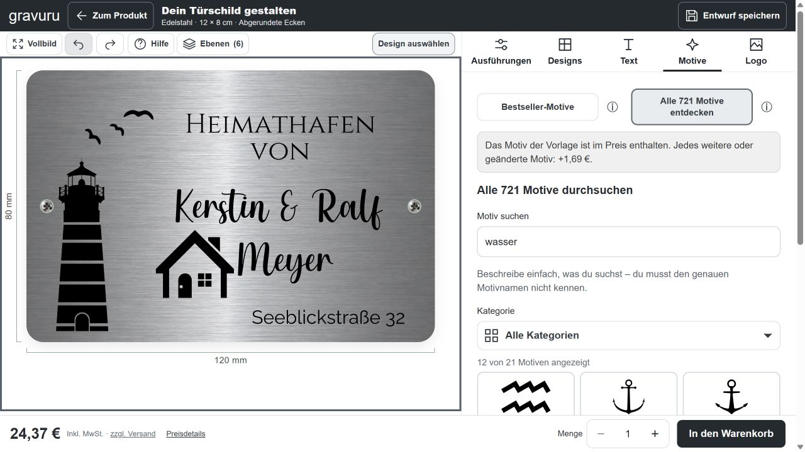
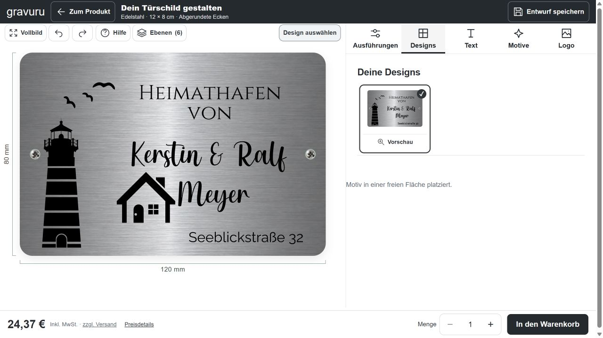
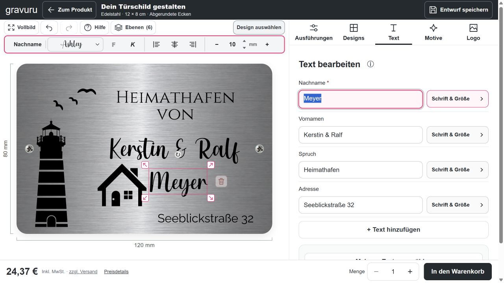
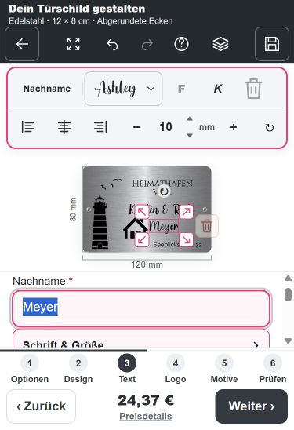
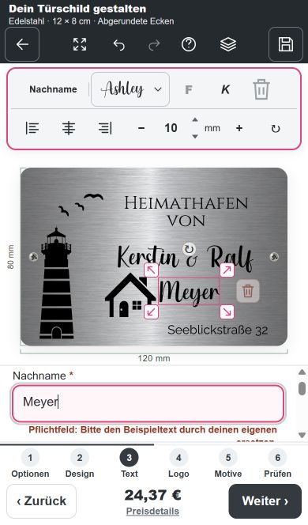
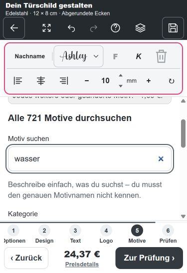

# Direkte Sichtung: Motive inline, ruhige Designkarten und Schrauben

Stand: 30.10.2026, Codex/Astra, bestehender Entwurfs-PR #58, Basis dieses Nachtrags `da7139f`. Chris hat die gesammelten Punkte mit „umsetzen“ freigegeben. Weiterhin nur lokale Prüfung, kein Merge nach main und keine Installation. Aktuell direkte Abstimmung mit Chris; keine neue Nachricht an Claude.

## Änderungen

- Designkarten zeigen Vorschau und Auswahl, keine sichtbaren Beschreibungen. Der zugängliche Name bleibt erhalten, ebenso die Vergrößerung. Auch die produktübergreifende Galerie hat keine sichtbaren Titel mehr.
- Die Größenpfeile sind eigene graue Pfeile mit transparentem Hintergrund statt der weißen Browser-Spinner. Sie benutzen denselben vorhandenen Größenhandler wie −/+, einschließlich Rechteprüfung. Große −/+-Tasten bleiben für Touch verfügbar. Die Leiste bleibt auf dem Handy zweizeilig.
- Schraubenköpfe verwenden die unveränderte vorhandene WebP-Referenz `app/designs/aosu-labrador/runtime/images/gravuru-schraubenkopf-fotorealistisch.webp`. Das Bild ist selbständig eingebettet, damit auch SVG-Bildvorschauen funktionieren. Sichtbare Alpha-Grenzen maßstäblich in einer 3,6 × 3,6 mm großen Vorschau; Bohrungen und Fertigungsgeometrie unverändert.
- „Alle Motive entdecken“ ersetzt die Bestseller im selben Bereich. Kein Motivdialog, kein neuer Tab. Die vorhandenen Such-/Kategorieelemente bleiben erhalten; Zurückwechseln verliert weder Suchbegriff noch bereits nachgeladene Treffer. Drei Spalten, weitere Treffer mit „Mehr anzeigen“. Motivklick fügt weiterhin hinzu und lässt die Bibliothek offen.
- Suchhinweis: „Beschreibe einfach, was du suchst – du musst den genauen Motivnamen nicht kennen.“ Die bestehende Suche nach verwandten Begriffen bleibt unverändert.

## Prüfung

**84/84 gezielte Tests, keine Skips**, verteilt auf zehn Dateien:

```text
inline-motif-browser.test.mjs
customer-orientation.test.mjs
ui-event-regressions.test.mjs
workflow.test.mjs
customer-tools.test.mjs
motif-tile-fit.test.mjs
toolbar-hosts.test.mjs
product-design-gallery-label.test.mjs
design-gallery.test.mjs
bundle.test.mjs
```

Davon 68/68 UI-/Geometrie-/Übernahmetests, zehn Galerietests und sechs Bündeltests. Zwei Bündeltests konnten zunächst im Windows-System-Temp nicht umbenennen (`EPERM`); mit TEMP/TMP in `.local-data/logo-ui-test` bestehen alle sechs unverändert. Build des gemeinsamen Prüfstands erfolgreich. Kein neuer Vollauf; die früheren Vollauf-Befunde sind damit nicht erledigt.

Browserprüfung im lokalen Chromium: Desktop 1280 × 720, Handyansichten 390 × 664 und 375 × 548. Auf Desktop: Suche „wasser“ → 21 Treffer; „Mehr anzeigen“ von 6 auf 12; Bestseller → Bibliothek behält Suche und zwölf Treffer; Anker hinzufügen erhöht Ebenen von 6 auf 7 und Preis von 24,37 auf 26,06 €, Rückgängig stellt beides zurück. Größenpfeile 10 → 11 → 10 mm. Die Pfeile bleiben sichtbar ohne weißen Untergrund. Keine horizontale Überbreite der mobilen Textleiste; Preis/Schritte und Plattenbemaßung im Textschritt sichtbar. Nutzer-Originaltabs nicht neu geladen; eigenes Prüftab benutzt.

## Bilder








## Offen / nächster Schritt

Chris prüft die lokale Vorschau weiter. Echte Safari-/iPhone-Bedienung, Linux-Vollauf und spätere Shop-Abnahme bleiben offen. Keine Live-Daten, Freigaben oder Preise geändert. Chris' zusätzliche Bestseller-Motive stehen noch aus. Katalog-/Design-Masterdaten wurden nicht verändert.
