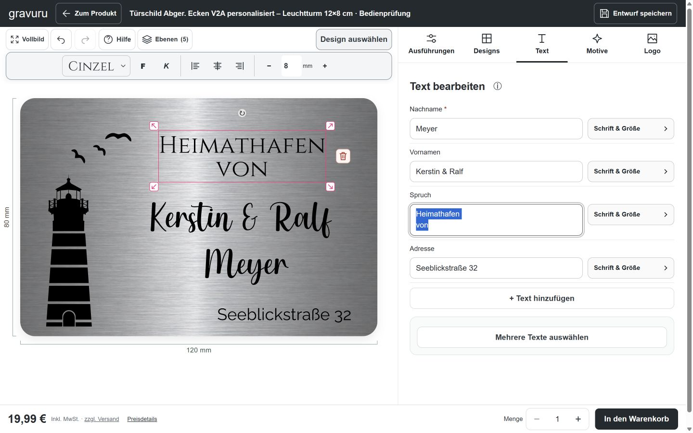
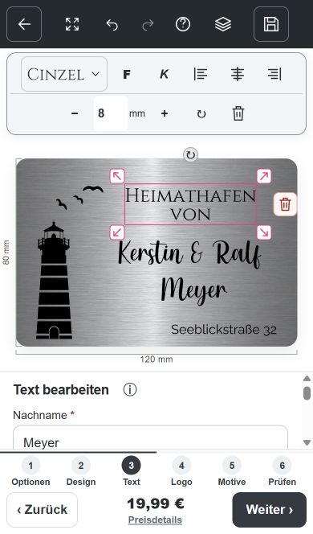
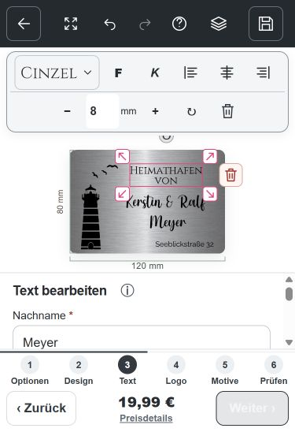

# Issue #48 · Gesammelte Layoutwünsche nach Designrichtung 6

Chris hat die zuvor gesammelten neun Punkte mit „ändere bitte alles was ich vorhin angegeben habe“ zur Umsetzung freigegeben. Dieser Nachtrag ersetzt die entsprechenden Layoutangaben in den Berichten zu Richtung 6 und Kundenlogos. PR #58 bleibt Entwurf, gestapelt auf #54. Keine Live-Änderung, kein Shopify-Schreibzugriff, kein Merge nach main.

## Ergebnis

| Wunsch | Umsetzung und Nachweis |
| --- | --- |
| Größere, moderne Direkteingabe | Helles, abgerundetes Eingabefeld auf der Platte; tatsächliche Schrift, am Desktop 26–42 px, mobil 22–32 px. Die Gravurhöhe in mm bleibt unverändert. Mehrzeiliges Feld wächst während der Eingabe; die geprüften zwei Zeilen passen am Desktop ohne Scrollbalken. |
| Schriftbuttons tauschen | „Nur diesen Text ändern“ links, „Auf ausgewählte Texte übertragen“ rechts. Beide bestehenden Aktionen bleiben erhalten. Dialog tatsächlich geöffnet und Einzelübernahme betätigt. |
| Unter den Bestsellern mehr Auswahl | Unter den acht vorhandenen Bestsellern folgen zwölf weitere vorhandene und erlaubte Bibliotheksmotive, drei nebeneinander, mit „Alle Motive entdecken“. Keine neuen Motive als Bestseller erfunden; Chris liefert die verbindlichen zusätzlichen Bestseller noch. Auswahl aus dem neuen Raster und Rückgängig geprüft. |
| Textleiste über dem Schild | Heller, umrandeter Block direkt vor der Plattenfläche, dunkle Bedienelemente; Desktop einreihig, kleine Handys zweireihig. Bestehende Buttons samt Rechten und Ereignissen werden verschoben. |
| Kopfzeile in dunklen Balken | Anthrazit mit heller Beschriftung; Desktop mit Marke, Zurück, Produkttitel und Speichern. Mobil kompakte Symbolleiste, ohne unleserlich abgeschnittenen Titelrest. |
| Designauswahl | Sichtbarer Desktop-Einstieg „Design auswählen“, Reiter „Designs“ und mobiler Schritt „Design“. Auch ein einzelnes tatsächlich verfügbares Design wird gezeigt. Keine fremden Linien oder ungeprüften Vorlagen ergänzt. |
| Zusatzmotiv-Hinweis entfernen | Der Satz „Wähle ein weiteres Motiv. Das vorhandene Motiv bleibt erhalten …“ entfällt; der erforderliche Preishinweis bleibt. Einstieg in die gesamte Bibliothek geprüft. |
| Auswahl pink | Auswahlrahmen und Größenpfeile verwenden #e0457b, dieselbe Farbe wie die Ausrichtungshilfen. Papierkorb und Drehgriff bleiben am Element. |
| Text immer oben | Neue Kundenstände erhalten `textOnTop:true`. Vorschau, Druckexport und Fertigung zeichnen Nichttexte vor Texten. Reihenfolge innerhalb beider Gruppen und Objektkennungen bleiben stabil. Vorhandene gespeicherte Pakete ohne Kennzeichnung behalten ihre alte Zeichenreihenfolge. |

## Prüfung

- **128/128 gezielte Tests bestanden**, 0 Fehler, 0 übersprungen: Werkzeugleisten, echte SVG-Reihenfolge, Vertragsprüfung, Textfelder, UI-Handler, mobile Schritte, Galerie, Druckexport, Entwürfe, Warenkorb, Bundle und unveränderliche Werkstattpakete. [Protokoll](issue48-layout-nachtrag-20261030/tests-128.tap).
- Nach der abschließenden Eingabeschrift-/Exportkorrektur **23/23 gezielte Build-/Druck-/Werkzeugleisten-/Reihenfolgefälle bestanden**, 0 Fehler, 0 übersprungen. [Protokoll](issue48-layout-nachtrag-20261030/tests-23.tap). Dies sind Nachprüfungen mit Überschneidung, keine 151 unterschiedlichen Fälle.
- Der neue Produktionstest speichert ein echtes Paket und vergleicht die tatsächliche SVG-Reihenfolge mit und ohne `textOnTop`; Originalobjekt-Reihenfolge bleibt unverändert. Ungültige Kennzeichnung wird abgewiesen.
- Lokale Bedienprüfung auf gesonderter D8-Kopie: 1440 × 900, 390 × 664 und 375 × 548. Kein horizontaler Überlauf in der Handyhülle. Textwerkzeuge enden bei y=168; Schrittleiste beginnt bei y=448 (SE) bzw. y=564 (13). Preis sichtbar, zwei Werkzeugzeilen.
- Direkteingabe mit Cinzel: tatsächlich berechnete Schrift 42 px, zwei Zeilen mit 121 px Höhe ohne inneren Überlauf. Angezeigte Gravurhöhe weiterhin 8 mm. Schriftübernahme, Designs und Motivbibliothek bedient.
- Build erfolgreich. Kein neuer Vollauf; zuvor dokumentierte 23 Baseline-Befunde bleiben offen. Der kurze Druck-Nachlauf wurde einmal ohne die erforderliche Python-Umgebung gestartet; nach derselben dokumentierten Umgebung wie im 128er-Lauf vollständig grün. Keine Assertions abgeschwächt und keine Tests gestrichen.

Python-Umgebung: gebündeltes Python über `GRAVURU_PYTHON`, vorhandenes `work/pydeps` über `PYTHONPATH`, Workspace-TEMP/TMP. Die Logo-Pakete aus dem vorigen Bericht bleiben erforderlich.

```text
node --test --test-concurrency=1 app/configurator/variant-m/toolbar-hosts.test.mjs app/configurator/variant-m/design-layer-order.test.mjs app/configurator/variant-m/contract.test.mjs app/configurator/variant-m/customer-tools.test.mjs app/configurator/variant-m/ui-event-regressions.test.mjs app/configurator/variant-m/text-ui.test.mjs app/configurator/variant-m/mobile-steps.test.mjs app/configurator/variant-m/design-gallery.test.mjs app/configurator/variant-m/print-export.test.mjs app/configurator/variant-m/account-drafts.test.mjs app/configurator/variant-m/shop-cart.test.mjs app/configurator/variant-m/bundle.test.mjs app/workshop/customer-vector-logo-media.test.mjs app/workshop/acrylic-review.test.mjs
```

## Bilder und Vorschau



[Große Direkteingabe](issue48-layout-nachtrag-20261030/direkteingabe-desktop.png) · [Getauschte Schriftbuttons](issue48-layout-nachtrag-20261030/schrift-buttons-desktop.png) · [Designauswahl Desktop](issue48-layout-nachtrag-20261030/designauswahl-desktop.png) · [Weitere Motive](issue48-layout-nachtrag-20261030/motive-fortsetzung-desktop.png)





[Designauswahl am Handy](issue48-layout-nachtrag-20261030/designauswahl-iphone13.png).

Gesonderte lokale Vorschau auf Port 8155; Chris' bisherige Tabs/Gestaltungen auf 8152/8153 wurden nicht neu geladen oder bearbeitet. Bilder sind tatsächliche Chromium-Aufnahmen, keine Hardware-iPhone-Prüfung. Nur eine echte Vorlage ist in der lokalen Produktkopie vorhanden; das ist keine Aussage über den live verfügbaren Katalog.

## Offen / Übergabe an Claude

1. Chris' gemeinsame Sichtabnahme sowie seine zusätzlichen Bestseller-Motive.
2. Code-/Linuxprüfung und echtes Safari/iPhone mit Bildschirmtastatur und Zwei-Finger-Zoom. Die mobile Platte teilt sich die Fläche mit der zweizeiligen Leiste; Vollbild und Ansichtszoom bleiben verfügbar.
3. Bestehende Logo-Installationsschritte bleiben offen: Konverter auf Zielsystem, neue freigegebene Produktrevision, Preisbindung/aktive Cart Transform und echter Shop-/Warenkorbtest erst nach Chris' ausdrücklicher Installationsfreigabe. 12,99 € je Kundenlogo und 1,69 € je zusätzlichem/geändertem Motiv bleiben unverändert.
4. Text-vorne-Regel gezielt mit einem überlagerten Logo in der realen Fertigung abnehmen. Alte Pakete werden nicht nachträglich umsortiert.

Katalogregeln bleiben aus dem [Design-Master](https://github.com/Chris83638w/gravuru-katalog./blob/main/designs/DESIGN-MASTER.md) maßgeblich. Keine Katalogdaten, Kennungen, Schriftdateien oder Freigaben geändert. Der [Logo-Bericht](2026-10-29-kundenlogos-gravur-astra.md) dokumentiert die getrennten Sicherheits-, Preis- und Produktionsnachweise.
