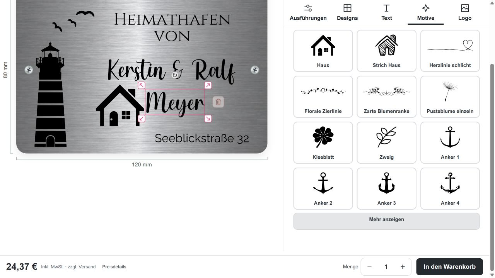
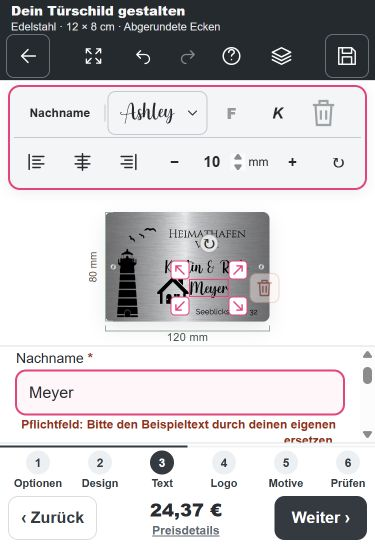

# 30.10.2026 · Textleiste und Motivübersicht nach direkter Sichtung

Chris' neue Rückmeldung im Prüfchat, ergänzend zum [Orientierungsbericht](2026-10-30-konfi-orientierung-astra.md). Bestehender Entwurfs-PR #58; keine Live-Änderung und keine neue Nachricht an Claude während der direkten Abstimmung.

- Rosa Rahmen um die obere Textleiste zur Sichtung, gleiche Farbe wie die Auswahlmarkierungen. Inhalt und Größenfeld neutral grau; die weiße Fläche hinter der Zahl entfällt. Native Größenpfeile bleiben im geprüften Browser auch ohne Hover/Fokus sichtbar. Die bestehenden großen −/+-Schaltflächen bleiben erhalten.
- Frühere Motivübersicht mit drei Spalten wiederhergestellt. Keine zusätzliche Gruppe „Weitere Motive“, kein doppelter Bibliotheks-/Hinzufügen-Knopf am Ende. Unter der Auswahl steht nur „Mehr anzeigen“ (nach dem Öffnen „Weniger anzeigen“).
- Ohne festgelegte Bestsellerliste wird die bisherige Startauswahl aus vorhandenen, im Produkt erlaubten Motiven auf bis zu 18 aufgefüllt. Zwölf sind sofort sichtbar, die nächsten sechs über „Mehr anzeigen“. Bestätigte Rankings und explizite Produktauswahlen einschließlich leerer Auswahl bleiben unverändert. Keine neuen Bestsellerkennzeichen, keine erfundenen Verkaufszahlen und keine Katalogänderung. Chris' angekündigte Bestsellerdateien stehen weiter aus.
- Ein Motivklick fügt weiterhin hinzu; Rechte, vorhandene Gestaltung und Preise unverändert.

## Prüfung

34/34 gezielte Tests bestanden: Profilauswahl einschließlich Auffüllen/Entdoppelung/Leerlisten, Bundle-Aufbau, echte UI-Handler und Motivkachel-Geometrie. Build und `git diff --check` erfolgreich. Kein Vollauf für diese begrenzte Änderung.

Browser Desktop 1280×720: rosa Rahmen, graues Feld und Pfeile ohne Fokus; Motivübersicht 12 → 18 → 12, genau ein unterer Knopf, keine zweite Motivgruppe. Handybreite 375×548: Textleiste weiter zweizeilig, beide Reihen ohne horizontalen Überlauf (je 347 px Inhalt/Breite); Preis und Bemaßung bleiben sichtbar. Safari/iPhone noch nicht separat geprüft.

Bestehende Nutzer-Tabs und Gestaltung nicht neu geladen. Prüfung in einem separaten Vorschautab; nur unsere neue Testvorschau wurde neu geladen.

