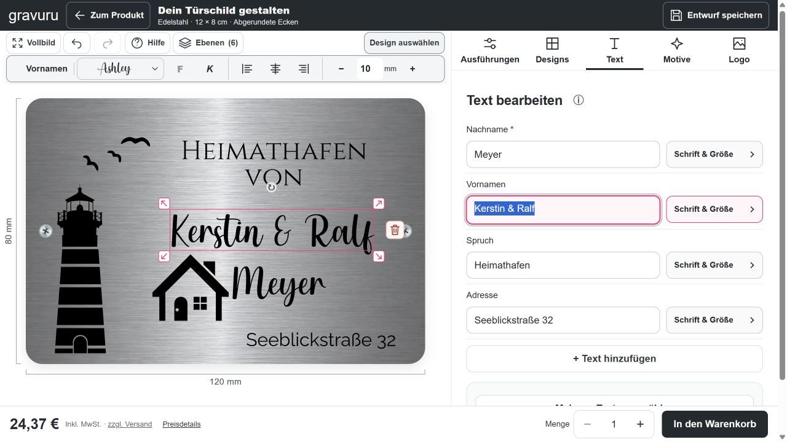
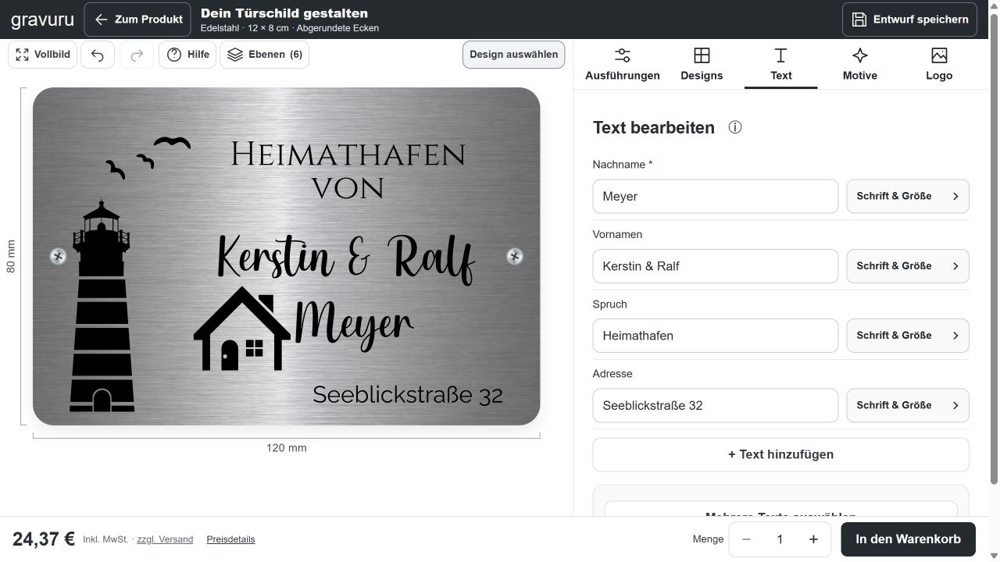
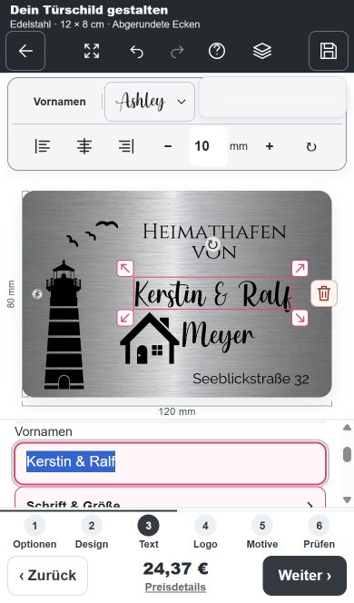
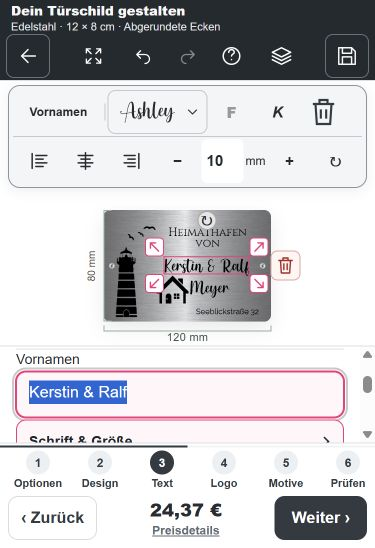
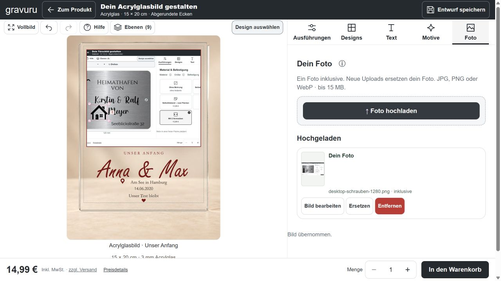
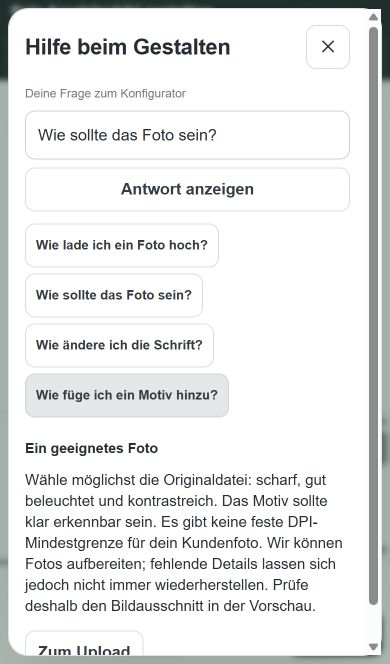

# 30.10.2026 · Orientierung, Übernahme und kompakte Vorschau

Direkte Abstimmung mit Chris im gemeinsamen Prüfchat, auf dem bestehenden Entwurfs-PR [#58](https://github.com/Chris83638w/gravuru-2027/pull/58). Dieser Nachtrag ergänzt den Layoutbericht vom 30.10. Kein Main-Merge, kein Deployment, keine Änderung in Shopify oder am Katalog. Während dieser Abstimmung werden keine neuen Claude-Aufträge eingemischt und keine neue Nachricht an Claude geschickt.

## Umgesetzt

| Wunsch | Verhalten |
| --- | --- |
| Kunde erkennt die aktive Textzeile | Eingabefeld und Schildtext werden gleichzeitig pink markiert. Vorn in der Werkzeugleiste steht der Feldname. Geöffnete Schrifteinstellungen wechseln zusammen mit der Auswahl; das aktive Feld wird bei kleiner Höhe sichtbar gescrollt. |
| Verständlicher, flacher Kopf | „Dein Türschild gestalten“ bzw. passende Produktart, darunter Material, tatsächliche Größe und Form. Interne Namenszusätze verschwinden auch aus dem Fenstertitel. Designs bleiben über Reiter und „Design auswählen“ erreichbar. |
| Untere Bemaßung sichtbar | Desktop-Leisten komprimiert; die Plattenfläche berücksichtigt die tatsächliche Höhe von Kopf, Werkzeugen und Preisleiste. Auf beiden Handygrößen bleibt die Textleiste zweizeilig. |
| Realistische Schrauben | Metallischer Glanz, feiner Rand und vertiefter Kreuzschlitz, Kopf genau **3,6 mm**. Nur Darstellung: originale Bohrungen und Fertigungsgeometrie unverändert. Gerätespezifische Schraubendaten der Funkklingeln bleiben separat. |
| Motivklick fügt hinzu | Jeder Klick erzeugt ein zusätzliches, eigenständiges Motiv. Vorhandene Motive bleiben erhalten; erlaubte Motivkennungen und Elementrechte werden weiter geprüft. Der überflüssige Hinweis „Motiv ersetzt“ entfällt. Bestehende drei Spalten mit Motiv und Titel bleiben. |
| Hilfe als Frage | Lokale Erkennung häufiger Fragen und ähnlicher Formulierungen, konkrete Anleitung und Sprung zum passenden Werkzeug. Produktabhängiger Foto-/Logozugang; keine Fotos auf Edelstahl. Fotoempfehlung: Originaldatei, scharf, gut beleuchtet, kontrastreich, **keine feste DPI-Mindestgrenze**. Unbekannte Fragen erhalten keine erfundene Antwort. Dies ist eine lokale Fragehilfe, kein angeschlossener KI-Dienst. |
| Designwechsel | Chris' letzte Präzisierung gilt: **eigene Texte und Fotos übernehmen**, Anordnung, Schriften und Motive aus der neuen Vorlage. Auch eigene Sprüche und zusätzliche Texte bleiben erhalten. Logos und zusätzliche Motive wandern nicht auf ein anderes Design. |
| Größenwechsel | Bestehender vollständiger Gestaltungsstand bleibt: Texte, Fotos, Logos und zusätzliche Motive. Die Kopfzeile folgt der tatsächlichen Plattengröße. |

## Schutz bei der Übernahme

- Die neue Vorlage wird zunächst ohne Änderung des bisherigen Zustands vorbereitet. Elementrechte und Textgrenzen gelten weiter. Kein Abschneiden von Kundentexten.
- Fotos übernehmen Originaldatei, bearbeitete Bilddatei und Bildausschnitt über den privaten, gleichursprünglichen Seitenkontext. Alte Blob-URLs, Warenkorbkennungen oder Rechte des Quellprodukts werden nicht übertragen.
- Kann die Zielvorlage nicht alle Fotos/Texte aufnehmen, bleibt die bisherige Gestaltung erhalten; der Kunde erhält einen konkreten Grund. Beim Wechsel zwischen Produktframes wird ein Fehler sofort an die geprüfte Elternseite gemeldet und der vorherige Frame wiederhergestellt.
- Neue Texte verwenden Schrift und Stil der Zielvorlage. Nicht zuordenbare Texte werden nur dort ergänzt, wo der Produktvertrag das erlaubt.

## Nachweise

**Windows: 146 Tests / 146 bestanden / 0 Fehler / 0 übersprungen.** Build und `git diff --check` erfolgreich. Kein neuer Vollauf: die 23 im vorigen Bericht auf der unveränderten Basis reproduzierten Befunde werden damit nicht als gelöst bezeichnet.

Enthaltene Testmodule: `customer-orientation`, `ui-event-regressions`, `product-design-transfer`, `text-ui`, `customer-tools`, `doorbell-state`, `toolbar-hosts`, `bundle-build`, `view-zoom`, `workflow`, `contract`, `element-rights`, `added-texts`, `mobile-steps`, `decision-help-ui`, sowie Workshop `shop-design-switch` und `shop-toolbar-query`.

Geprüft sind insbesondere echte Auswahl-/Wechselhandler, Rechte und Abbruch ohne Zustandsverlust, Foto-Dateibytes, sofortiger Rückweg zum ursprünglichen Frame, Größenrundreise einschließlich Foto/Logo/Zusatzmotiv, tatsächliche Acrylgröße im Titel und 3,6-mm-Schraubenköpfe bei unveränderten Löchern.

Lokaler Browser: Desktop 1280 × 720, iPhone-13-Viewport 390 × 664, SE-Viewport 375 × 548. Jeweils vollständige Bemaßung und sichtbarer Preis; aktives Feld zusammen mit Schildtext markiert. Mobiler Papierkorb nach der Umordnung auf beide Reihen vollständig sichtbar. Haus zusätzlich zum vorhandenen Vorlagenmotiv, 24,37 € inklusive Schrauben im privaten D8-Kandidaten. Fotohilfe auf Produkt mit Upload sowie korrekter Hinweis bei Edelstahl geprüft.

Separate Acryl-Testkopie: eigene Texte „Anna & Max“ und „Unser Test bleibt“, hochgeladenes synthetisches Testbild, Wechsel auf eine zweite Testvorlage und danach auf 20 × 26,67 cm. Texte und Bild blieben erhalten. Das Testbild ist ein Screenshot unserer eigenen Vorschau, kein Kundenfoto. Dabei gefundene veraltete Größenangabe im Kopf korrigiert und durch Test der tatsächlichen Geometrie abgesichert. Keine Originalgestaltung des Nutzers neu geladen oder verändert.

## Bilder

## Noch offen

Chris' gemeinsame Sichtabnahme, echtes Safari/iPhone samt Bildschirmtastatur und Zwei-Finger-Geste, Linux-Prüfung des neuen Standes. Der spätere freigegebene Shop-Test einschließlich Preisbindung/Cart-Transform, Kundenlogo und Warenkorb bleibt erforderlich. Die lokalen Vorschauen und erfolgreichen Modulprüfungen sind kein Live-Nachweis. Zusätzliche Bestseller-Motive von Chris stehen weiter aus.

Vorschau auf dem gemeinsamen Prüfbranch, getrennt von bestehenden Nutzerständen: `http://127.0.0.1:8156/`. Die bisherige Vorschau und Gestaltung auf 8152/8153/8155 bleiben unangetastet.
