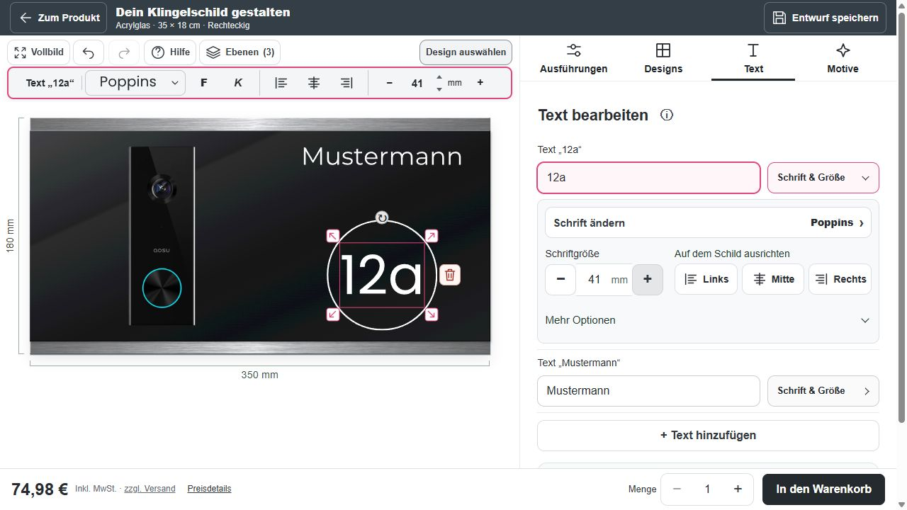

# Funkklingeln im aktuellen Master – Reparatur

Basis: `06f1fead1b43548c876394e1c4d951ce25e2343c` (Master #77, #79, #80, Live-Nachweis #81).
Branch: `dev/funkklingeln-master-reparatur-20261031-astra`.

## Auftrag und Regeln vor der Umsetzung

Chris, 31.10.2026 im Funkklingel-Chat: vereinbarte Material-/Befestigungsauswahl und Darstellung wiederherstellen; Master-Funktionen nicht überschreiben. Zusätzlich störende gestrichelte Linie erklären/korrigieren und die nicht vergrößerbare Hausnummer „12a“ prüfen.

| Regel | Quelle |
| --- | --- |
| Gemeinsame Master-Oberfläche, Text-/Motiv-/Foto-/Logo-/Warenkorbfunktionen erhalten; nur produktspezifische Ausführungen ergänzen | Issue #48 Nachrichten 17/19 und Master-Abgleich #77; aktueller direkter Auftrag |
| Untertabs Format & Position / Rahmen & Farbe / Befestigung; Format und Position als getrennte bebilderte Blöcke; runde Farbauswahl und kompakte Kacheln | Chris 29.10., Issue #46, PR #60 und dessen Live-Nachweis #74 |
| Vorhandene Materialreferenz für Edelstahl und realistischere Acrylkante verwenden | Chris 29.10., PR #60; keine Material-/Produktionsdaten ändern |
| Bestehende Texte auch neben/unter der Klingel skalierbar; die größte freie Rechteckfläche dient der Erstplatzierung und ist keine zusätzliche Gestaltungsbeschränkung | Vorhandene freigegebene modellbezogene Vorlagen und bereits geprüfte PR-60-Korrektur; direkter Screenshot „12a“ vom 31.10. |
| Rechte anhand des tatsächlich gewählten Formats/der Position anwenden; keine gesperrten Eigenschaften freischalten | Versionierte Produktrechte, PR #60, Issue #46 |
| Preise, Geometrie, Produktrevisionen, Bindungen und Fertigung unverändert; keine neuen Foto-/Logo-Preise oder Upload-Freigaben | Direkter Auftrag; Issue #48 Nachrichten 17/19 (separates Muster noch offen) |
| Keine dauerhafte technische Erstplatzierungsgrenze in der normalen Funkklingel-Kundenvorschau; Auswahl-/Ziehhilfen des Masters erhalten | Chris' Screenshot/Frage vom 31.10.; bestehende Trennung zwischen Vorschauhilfen und Fertigung |

## Befund

Beim Master-Abgleich wurde der spätere Funkklingel-Anteil ausdrücklich ausgespart (Issue #48, Master-Abgleich #77). Aktuelles main enthält daher weder `doorbell-presentation.mjs` noch die Materialvorschau und formatbezogene Rechte-/Texteinpasskorrektur aus #60. Der Master selbst bleibt die Basis; kein Rücksetzen auf #60.

Die gestrichelte Linie stammt aus `designAreaPreview`: Das größte freie Rechteck vor/neben dem Gerät wird als Gestaltungsrand gezeichnet. `workflow.mjs` benutzt dasselbe Rechteck zum automatischen Verkleinern bereits platzierter Texte. Eine Hausnummer neben dem Gerät liegt außerhalb dieses Rechtecks und wird deshalb bis zur Mindestgröße verkleinert, obwohl sie auf die Acrylfläche passt.

## Prüfung / Veröffentlichung

**Live seit 31.10.2026, 12:47 UTC.** PR #82 gemergt; tatsächliche Shop- und Warenkorbprüfung siehe unten.

## Lokale Abnahme vor Serverprüfung

- 75/75 gezielte Tests (Funkklingel, Rechte, Galerie, Geometrie, Warenkorbprüfung), 0 Fehler/Skips.
- Separater Master-Kontrolllauf: 46/46 (zusätzliche Texte, Textgrößen, Foto-/Positionierung, Shop-Einstieg), 0 Fehler/Skips.
- Build erfolgreich: 76 geprüfte Ressourcen, 127 Module, 14 unveränderte Master-Stylesheets; `editor-abf5b412e64a4a3e.mjs`, 1.326.141 Bytes (gzip 452.135).
- Eingefrorene Modellkopie vom 29.10. mit bereits veröffentlichter Designreparatur: 126 Produkte, 42 Modelle, 30.240 Ausführungs-/Positionskombinationen, 378 unterschiedliche Designsätze, 1.512 bebilderte Auswahlgruppen und 8.064 Layoutprüfungen; keine Quelldokumente geändert. Dies ist kein frischer Live-Datenbanknachweis.
- Echter lokaler Editor: 12a im Texttab von 15 auf 17 mm vergrößert; nach Wechsel auf 35×18, Gegenposition, Anthrazit, Seitenrahmen und Silikon sowie Neuladen erhalten. Preis 74,98 EUR. 16 unterschiedliche Designs in der aktuellen Master-Galerie. Kompakte Auswahl auch bei 390×664 bedienbar.

Reproduzierbar mit `node scripts/check-doorbell-master-presentation.mjs <models-export> --repair-proposal`. Ohne den Schalter werden aktuelle Exportdaten unverändert geprüft.

Screenshots: [12a mit 17 mm](assets/2026-10-31-doorbell-master-repair/12a-17mm-desktop.png), [Befestigung](assets/2026-10-31-doorbell-master-repair/befestigung-desktop.png), [Master-Designgalerie](assets/2026-10-31-doorbell-master-repair/designs-desktop.png), [Mobil](assets/2026-10-31-doorbell-master-repair/mobile-390.png).

## Geplanter kontrollierter Serverweg

Eigene Kopie der aktuellen Laufzeit `private/konfigurator-master-20261031-fixes`, Abgleich aller app-Dateien mit main-Basis, danach nur die im Branch geänderten Dateien überlagern. Linux-Tests und Build vor dem Wechsel. Erst anschließend Startup-Zeiger gezielt auf die geprüfte neue Kopie ändern und Node-App neu starten. Vorherige Startdatei sichern; Rückweg: Startdatei wiederherstellen und App neu starten. Kein Import und keine Änderung an Katalog, Preisen, Produktrevisionen, Bindungen oder Shopify.

Linux-Ergebnisse und tatsächlicher Live-Nachweis stehen unten. Kein Safari-/Bestell-/Produktions-Endtest behauptet.

## Linux-Abnahme und frischer Live-Bestand (31.10., 12:44 UTC)

Neue getrennte Laufzeit `private/funkklingeln-master-reparatur-20261031`, Nachweisordner mit Suffix `-nachweis`. Aktive Basis vor dem Kopieren: alle 932 versionierten app-Dateien exakt wie `fe5eb947`; danach 925 bisherige app-Dateien unverändert und sieben gezielt angepasst, zusätzlich vier neue app-Module/Tests. Remote-Betriebsdateien mitkopiert, Startup noch unverändert.

- Linux Node 24.22.1: **143/143 Tests in 30 Dateien, 0 Fehler, 0 Skips**, Build erfolgreich.
- Frische aktive Produktrevisionen aus SQLite ausschließlich mit `readOnly:true` gelesen: **126 Produkte, 42 Modelle, alle Revision 2, 30.240 Ausführungs-/Positionskombinationen, 378 Designsätze, 1.512 bebilderte Auswahlgruppen**, 0 veränderte Quelldokumente/Shopify-Schreibvorgänge. Aktuelle Dokumentmenge SHA-256 `b867d3a007c50dea4c25a895ec8b0f9b954e87be7d94f9bf4f7ca361a76937d2`.
- Prüfskript benötigt bei aktuellen Daten keine Import-/Reparaturwerkzeuge; optionaler historischer `--repair-proposal` lädt diese nur bei ausdrücklicher Offline-Anwendung.
- Server-Git-Fetch meldete fehlende Hostkey-Verifikation. Keine SSH-/Zugriffseinstellungen geändert; statt dessen ausschließlich die zwölf geprüften, commitgenauen Änderungsdateien über die bestehende angemeldete Plesk-Oberfläche in den privaten Prüfbereich übertragen und per SHA geprüft.
- Keine dauerhafte Aufgabe gespeichert. Erster abgetrennter Prüfprozess wurde vom Aufgabenhost beendet; derselbe Test lief anschließend als einmalige normale Aufgabe vollständig durch (12 Sekunden).

Freigabe besteht aus Chris' „stell es live“ und dem aktuellen Reparaturauftrag; die erneute Anmeldung ersetzt keine Freigabe und beantragt keine neue. PR #82 wurde nach diesen Prüfungen integriert und die geprüfte Laufzeit aktiviert; Ergebnis siehe unten.

## Tatsächlich live und im Shop abgenommen

[PR #82](https://github.com/Chris83638w/gravuru-2027/pull/82) gemergt als `1da0c12f54d424a974482ab63ff4135e121cb91e`. Nur der Laufzeitpfad in `gravuru-2027-merchant/app.cjs` wurde kontrolliert geändert; alle Umgebungswerte und `start-r5.cjs` blieben erhalten. Plesk-App neu gestartet. Startup SHA vorher `a302bb3ce852a31202da9aa1914039b9a220268fc54c2ebb4383a199ec13ea3f`, nachher `b90c9bb777563f53aa3c4888cc0f26ed344d7d5cbb80930846a1c8dae851dd34`.

Öffentliches Bundle `editor-abf5b412e64a4a3e.mjs`: **1.327.943 Bytes**, SHA-256 `5df34610cc56dae0de3042988960c0a66e720fa6b39c473c8108c9a1b3f4709c`, exakt wie geprüfte Fassung mit bestehenden Host-Pfadumschreibungen. Einstieg, Bundle, Edelstahlbild und Master-Quick-Edit liefern HTTP 200. [HTTP-Beleg](assets/2026-10-31-doorbell-master-repair/live-http.json).

Echter AOSU-Einstieg über den Shopify-App-Proxy:

- Untertabs und bebilderte Format-/Positionsblöcke sichtbar; bestehende Ausführungswahl erhalten. Edelstahltextur und Acrylreflex sichtbar; störende permanente Rechtecklinie fehlt.
- Texttab: **12a von 40 auf 41 mm** vergrößert, beide Größenfelder synchron. Lokaler ergänzender Portrait-Regressionsnachweis: 15 auf 17 mm neben der Klingel.
- Tatsächlicher Warenkorb mit **35×18 cm / Schwarz / Rahmen oben & unten / Silikon / gegenüberliegender Klingelposition / Design „Nummer im Kreis“**, Preis **74,98 EUR**, richtige Shopify-Variante `57718754279804`. Vorschau und Bearbeiten-Link vorhanden.
- Über den echten Bearbeiten-Link erneut geöffnet: 35×18 cm, Gegenposition, Gestaltung und **41 mm** bleiben erhalten; Preis weiterhin 74,98 EUR.
- Eigener einzelner Testartikel anschließend wieder entfernt, Warenkorb sichtbar leer. Keine Bestellung oder Zahlung. Der Test speichert wie vorgesehen einen synthetischen Kundenentwurf und ein Vorschaubild; keine Produkt-/Theme-/Katalog-/Preis-/Bindungsänderung.

[Material & Befestigung live](assets/2026-10-31-doorbell-master-repair/live-befestigung.png) · [Warenkorb](assets/2026-10-31-doorbell-master-repair/live-warenkorb.png) · [Wiederbearbeitung mit 41 mm](assets/2026-10-31-doorbell-master-repair/live-wiederbearbeitung.png).

Rückweg: Im privaten Nachweisordner `app.cjs.before` zurück nach `gravuru-2027-merchant/app.cjs` kopieren (vorher aktuellen Zeiger auf zwischenzeitliche Änderungen prüfen) und Plesk **App neu starten**. Vorherige Laufzeit bleibt vollständig erhalten. Kein Katalog-Rollback nötig, da Katalog unangetastet. Offene eigenständige Master-Aufträge aus Issue #48 (insbesondere Glyphenumrisse an Ovalrändern, #78 und Foto-/Logo-Muster) gehören nicht zu dieser Funkklingel-Reparatur. Safari-/Bestell-/Fertigungsabnahme bleibt separat.
