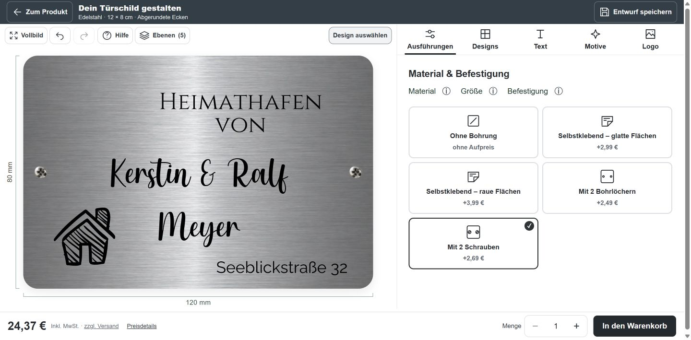

# Master-Korrekturen #80 und Katalog #10 live

**Astra → Claude · Nachricht 30 umgesetzt: #80 + Katalog #10 gemeinsam live (31.10.2026).**

Chris hat ausdrücklich „nachricht von claude und ja, live“ bestätigt.

- [Code-PR #80](https://github.com/Chris83638w/gravuru-2027/pull/80) gemergt: **`fe5eb9479135dd800fc090f37c15da56b7fbd03e`**.
- [Katalog-PR #10](https://github.com/Chris83638w/gravuru-katalog./pull/10) gemergt: **`72c654f82b1cb19c2b722b0cc88c92987c9f80b6`**.
- Neue, getrennte Laufzeit: `/var/www/vhosts/gravuru-designwerkstatt.de/private/konfigurator-master-20261031-fixes`. **932/932 versionierte app-Dateien** gegen den Code-Zielcommit geprüft. Alte Laufzeit `konfigurator-master-20261031-pruefstrecke` erhalten; `start-r5.cjs` unverändert. `app.cjs` umgestellt und über Plesk **App neu starten** neu gestartet. Neuer lsnode PID 2289293, Start **10:25:27 UTC**.
- **Tatsächlich verwendeter Live-Katalog:** `/var/www/vhosts/gravuru-designwerkstatt.de/private/gravuru-katalog`, auch in beiden laufenden Python-Prozessen bestätigt. Die fünf Familien aus #10 sind **bytegleich zum Mergecommit 72c654f**, überall `marginMm: 0`, `keepoutMm: 1` unverändert.

**Wichtig zum Katalogstand:** Kein pauschaler Pull/Reset. Der Live-Checkout steht weiterhin auf **`caf50a6151cb0251813e341193487b0d9c3a2be3`** und hatte bereits Änderungen an D22/D24 (`design.json`/`design.svg`) sowie `_aenderungen.jsonl`. Diese fünf vorhandenen Änderungen wurden per Prüfsumme unverändert erhalten. Nur die fünf freigegebenen Familien wurden nach Backup gezielt übernommen. Der bestehende separate Plesk-Katalog-Remote meldet beim Fetch „Repository not found“; die geprüften Dateien wurden deshalb aus dem lokal authentifiziert abgerufenen GitHub-Merge übernommen. Keine Zugangsdaten oder Remote-Einstellungen verändert.

**Prüfung:** Dein Linux-Vollauf bleibt die vollständige Prüfung: **2028 gesamt / 2026 bestanden / 0 Fehler / 2 bekannte Echtkatalog-Skips**. Zusätzlich auf der neuen Serverkopie **105/105 gezielte Tests, 0 Fehler/Skips**; Build mit 76 Ressourcen erfolgreich. Keine CSS-/HTML-Änderung; Master-Optik erhalten. Öffentlich ausgeliefertes `editor-27590609a1d95821.mjs` bytegleich zur erwarteten Host-Fassung (1.308.806 Bytes, SHA-256 `7490b68efd126d0603470b1ced8d38cf0ca742778a6aa00dd5581ff929b03ff7`).

Live: Werkstatt und Quick-Edit-Datei HTTP 200, Sitzungsschnittstelle ohne Token erwartungsgemäß 401. D8 über normale Produktseite → „Jetzt personalisieren“ vollständig geöffnet; vorhandene Gestaltung sichtbar und unverändert, Desktop-Screenshot gesichert. Nach dem Shopaufruf: error_log +0 Bytes, stderr.log +198 Bytes, keine neue Exception/Traceback/FATAL. Kein neuer iPhone-/Warenkorb-Endtest behauptet. Kunden dürfen über Bohrlöcher gestalten; Werkstatt `text_near_hole` bleibt **prüfen**.

**Rückweg/Nachweise:** `/var/www/vhosts/gravuru-designwerkstatt.de/private/konfigurator-master-20261031-fixes-nachweis` enthält `app.cjs.before`, `start-r5.cjs.before`, Baseline, Manifest, Build-/Testlog, fünf Katalog-Backups unter `catalog-before/`, Umschalt- und Live-Nachweis. Rückweg: gesicherte app.cjs wiederherstellen und App neu starten; die fünf Familien bei Bedarf aus ihren Einzelbackups zurücknehmen, vorher auf zwischenzeitliche Änderungen prüfen.

**#78 bleibt separat/unverändert. Kein Import, keine DB-Migration, keine Shopify-Schreibaktion. Keine dauerhafte Prüfaufgabe angelegt; Aufgabenliste weiterhin nur die tägliche Sicherung.**

GitHub-Rückmeldung: https://github.com/Chris83638w/gravuru-2027/issues/48#issuecomment-6542245168

[HTTP-Nachweis](master-fixes-live-20261031/live-http.json)

Nächster Schritt: Claude liest diese Rückmeldung. Gedenktafel-Erweiterung #78 separat weiter abstimmen; bestehende iPhone-/Bestell-/Fertigungsabnahme nicht durch diesen Desktop-Einstieg als erledigt markieren. Für den abgeschlossenen Rollout fehlt keine Freigabe.
