# N36 – beim Befestigungswechsel Bohrlöchern ausweichen

Stand 01.11.2026, Astra. Eigener Branch `dev/bohrloch-ausweichen-20261101-astra`, auf N39 (`9327ac7`, PR #97) aufgebaut. Katalogquelle `c70f4094` (Katalog-PR #17). Keine Katalog-, Shopify- oder Live-Daten geändert. Kein Merge durch Astra.

## Auftrag und verbindliche Regeln

- [Issue #48, N36](https://github.com/Chris83638w/gravuru-2027/issues/48#issuecomment-6547694969): Start ohne Befestigung; beim bewussten Wechsel auf Bohrlöcher/Schrauben Texte und Motive automatisch verschieben, erst bei Bedarf verkleinern. Zurück zu lochlos nimmt die automatische Änderung zurück. Spätere Handarbeit bleibt frei. Kein Kundenhinweis, keine neue Sperre.
- [Design-Master](https://github.com/Chris83638w/gravuru-katalog./blob/main/designs/DESIGN-MASTER.md): vorhandene Motive, Texte, Schriften und Hierarchie erhalten. Hier werden keine neuen Designs angelegt und keine Vorlagen umgeschrieben.
- Geometrie/Bohrbilder und Preise ausschließlich aus den drei Familien `steel-door-signs`, `acryl-3mm-tuerschilder-schwarz`, `acryl-3mm-tuerschilder-anthrazit` im genannten Katalogstand. Kein zusätzlicher Aufpreis.
- Schraubenkopf 4,5 mm: Chris' letzte ausdrückliche Vorgabe im Chat, bereits vorhandene Vorschau. Vorschau und Ausweichen teilen jetzt dieselbe Konstante. Sicherheitsfläche ist die Vereinigung von Loch und Kopf (`max(Durchmesser, 4,5) / 2`), kein verändertes Bohrmaß. Sie wird auch bei nur gebohrten Optionen reserviert, damit B02/B02S nicht hin- und herspringen.
- Mindestschrift 3 mm nach Paket M / bestehender Zielprüfung. Bereits kleinere Vorlagenschrift wird hier nicht weiter verkleinert. Keine neue Bestellvalidierung oder Kundenbegrenzung.

## Verhalten und Anschluss

Der Optionshandler ruft die Hilfe ausschließlich bei einer tatsächlichen Befestigungsänderung auf. Freie Bewegung, Zoomen, Zeichnen, Preisprüfung und Export lösen sie nicht aus. Die Master-Oberfläche und Produktpreise bleiben unverändert.

Die Suche bevorzugt bei gleicher Entfernung die Richtung zur Mitte. Ist diese belegt, nimmt sie die nächste freie Richtung, ohne über getrennt angeordnete Nachbarelemente zu springen. Zuerst werden Verschiebungen geprüft, danach proportionale Verkleinerungen. Rotierte Kästen, reale Plattenkontur und Rückseitenbohrungen werden berücksichtigt. Bestehende beabsichtigte Überlagerungen dürfen nicht größer werden; neue Überlagerungen werden ausgeschlossen. Das ist eine diskrete Suche mit verfeinerten Strecken, kein Beweis eines global mathematisch kleinsten Layouts.

Die Hilfe speichert ihre eigenen Änderungen im Sitzungs-/Undo-Zustand. Zurück zu K00 bzw. einer lochlosen Klebeoption stellt die vorige Geometrie wieder her; zwischenzeitliche Kundentexte, Drehungen und manuelle Verschiebungen bleiben erhalten. Wechsel B02 ↔ B02S summiert keine Verschiebungen. Neue Vorlage, Größenwechsel und Laden eines gespeicherten Entwurfs verwerfen den alten Rücknahmestand. Entwurfsdateien speichern weiterhin die tatsächliche Gestaltung; sie enthalten keine zusätzliche Layout-Historie.

Bestehende Katalogprodukte erhalten ihre Familienzuordnung aus `categoryIds`, bevor die Werkstatt die Profil-ID durch die Kunden-ID ersetzt. Diese Laufzeitinformation erfordert keinen Neuimport und verändert keine gespeicherten Produktstände. N39 nutzt die bereits vorhandene ausgewählte Familie. Gedenktafeln und Funkklingeln erhalten diese Hilfe nicht.

## Prüfungen

- **132 unterschiedliche Tests bestanden**, 0 verbleibende Fehler, 0 Skip: 15 neue und 117 vorhandene Prüfungen. Erster Sammellauf 122/124; genau zwei lokale HTTP-Tests hatten `EACCES 127.0.0.1`. Mit freigegebenem lokalem Zugriff bestanden beide unverändert. Zusätzlich 1 Werkstatt-Zuordnungstest und 7 HTTP-/Bohrlochregressionen. Die 14 neuen Geometrietests wurden nach dem Anschluss nochmals grün ausgeführt; nicht doppelt gezählt.
- **240/240 Familiengrößen** starten K00 ohne Löcher, **0 Ausnahmen** und 0 Auswertungsfehler. [Einzelnachweis](startwerte.json). Das ist eine Prüfung der aktuellen Katalog-/Konfigurationsquelle, kein Lesen aller Live-Datensätze.
- **8 echte Browser-Klickfolgen** auf dem lokalen Konfigurator: K00 → Schrauben → K00, exaktes Bohrbild, keine Konsolenfehler, kein Bohrlochhinweis; Texte/Motive vollständig erhalten. [Nachweis](browserpruefung.json). Inhalt wird exakt, Geometrie mit Toleranz `1e-9 mm` verglichen: der bestehende Textnormalisierer kann `9.528` als `9.528000000000002` zurückgeben.
- Alle 8 nach der Auswahl konfliktfrei; [Verschiebungen und Faktoren](geometriepruefung.json). 6 Beispiele kommen ohne Verkleinerung aus. TAE D15: Text auf 97 %, TRE D13: Motiv auf 91 %. Keine Motive getauscht, keine Texte gelöscht.
- Bestehende Werkstatt-/Kunden-Hinweisregeln, Materialdarstellung, Preisvertrag und LF geprüft. Linux-Vollauf und gestalterische Sichtabnahme durch Claude offen. Kein Live- oder Warenkorbtest behauptet.

Bei beliebig dicht belegten Kundengestaltungen kann es ohne neue Überlagerung oder zu kleine Schrift keine sichere Lösung geben. Dann bleibt das betreffende Element vollständig unverändert und weiterhin frei bearbeitbar. Das erzeugt weder Sperre noch Hinweis. Die acht beauftragten Quellen haben keine solchen offenen Fälle.

## Vorher / nachher – lokale Katalogkopie, echte Konfiguratorbilder

TAE „8×5“ ist laut Originalquelle tatsächlich **80×53,3 mm**; diese Geometrie wurde nicht auf 80×50 normiert. Die zwei ausdrücklich abweichenden Zielgrößen sind unten benannt.

| Quelle / Ziel | Ohne Befestigung | Mit Schrauben |
|---|---|---|
| TAE-V2A-8x5-D15 · 80×53,3 mm |  | 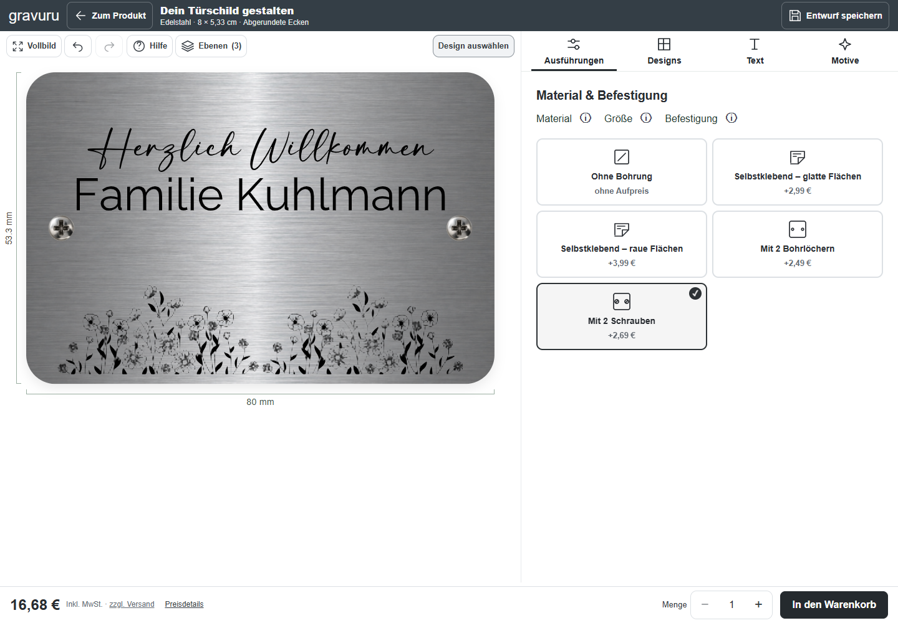 |
| TAE-V2A-8x5-D8 · 80×53,3 mm | 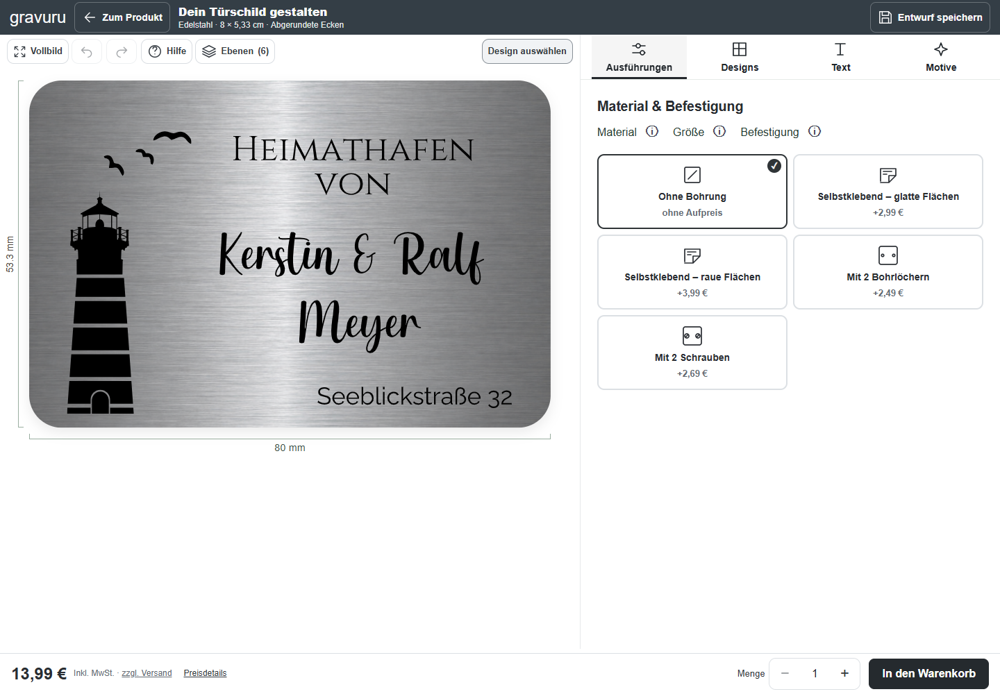 | 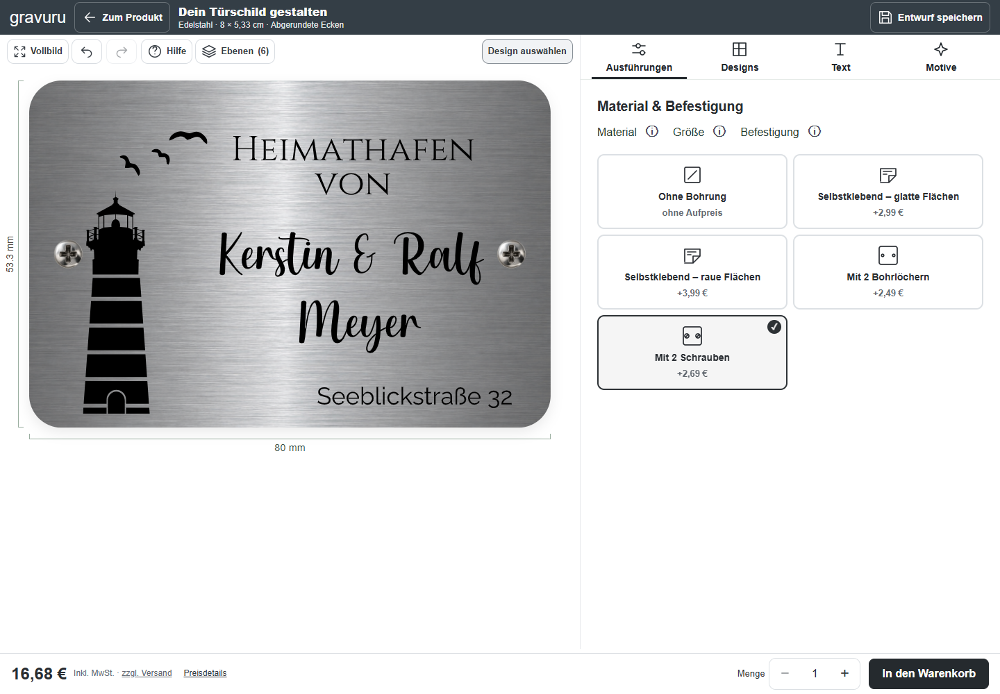 |
| TR1-V2A-9x6-D65 · 90×60 mm | 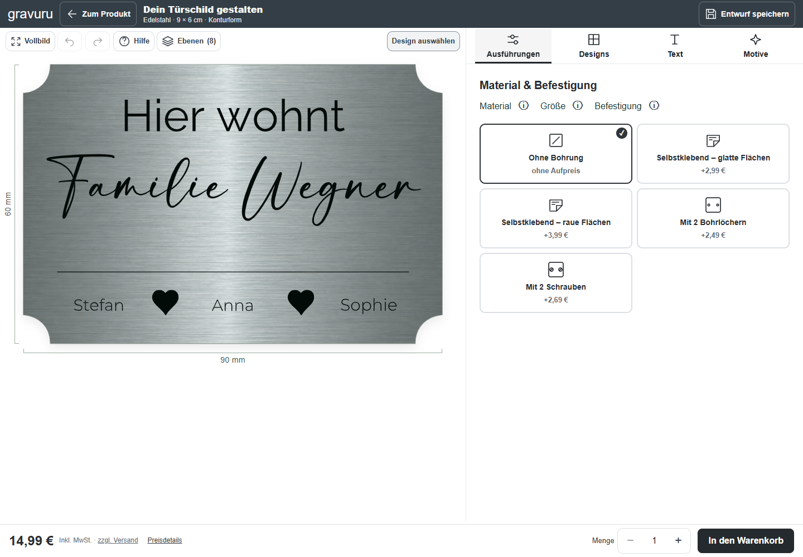 |  |
| TRE-V2A-5x2-D5 · 50×20 mm | 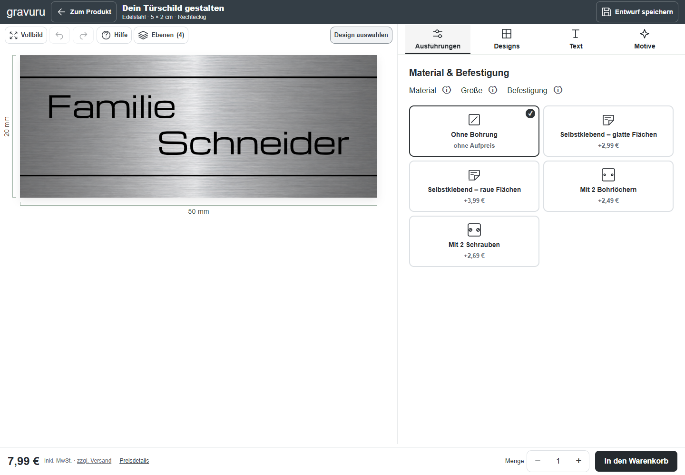 | 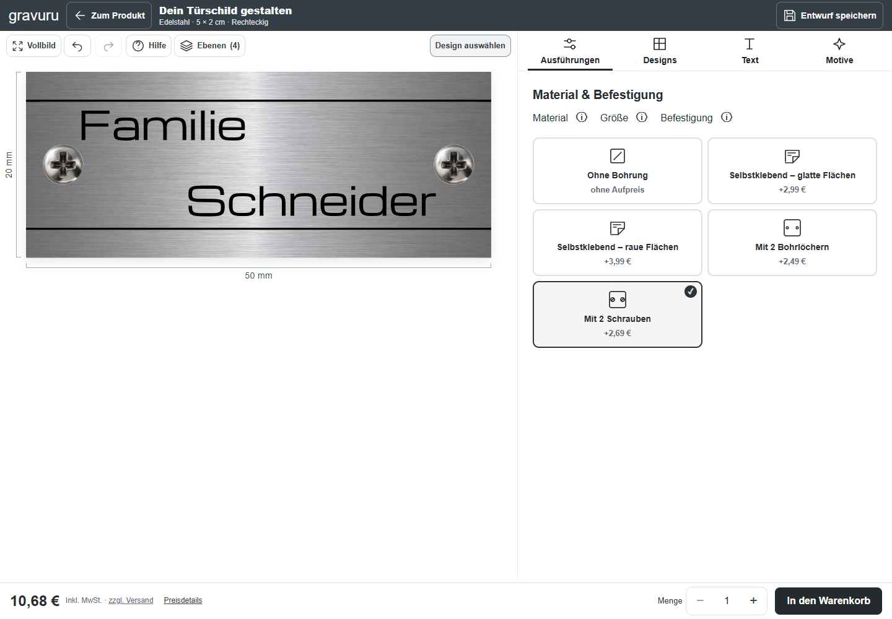 |
| TRE-V2A-5x2-D45 · 50×20 mm | 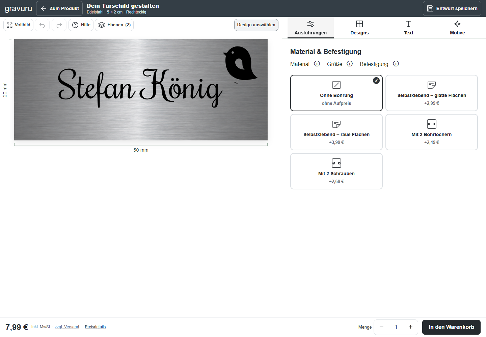 | 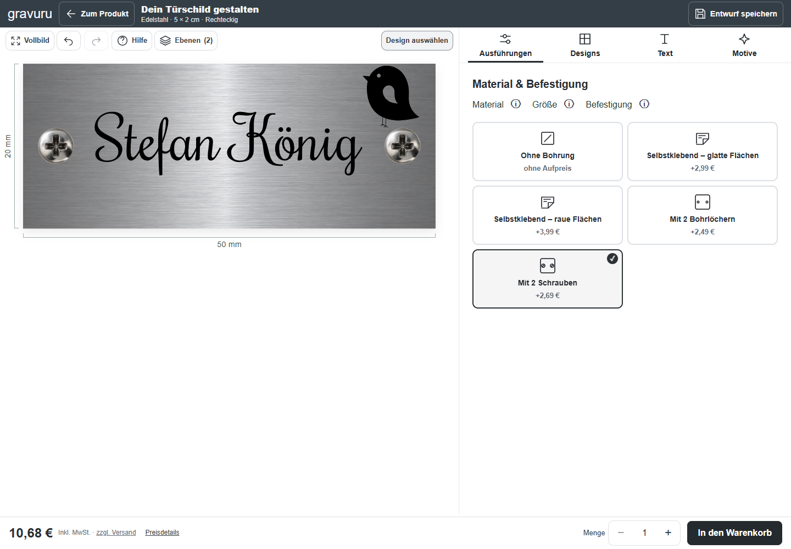 |
| TRE-V2A-9x3-D73 · 90×30 mm | 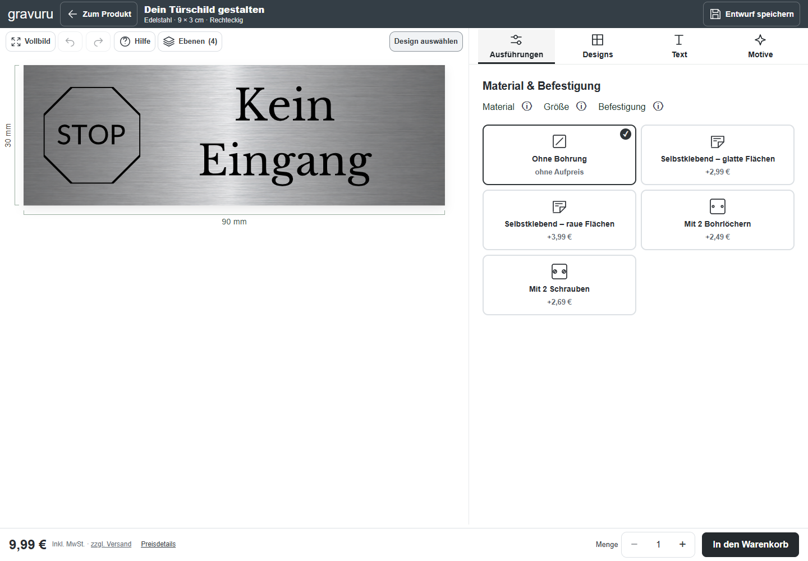 | 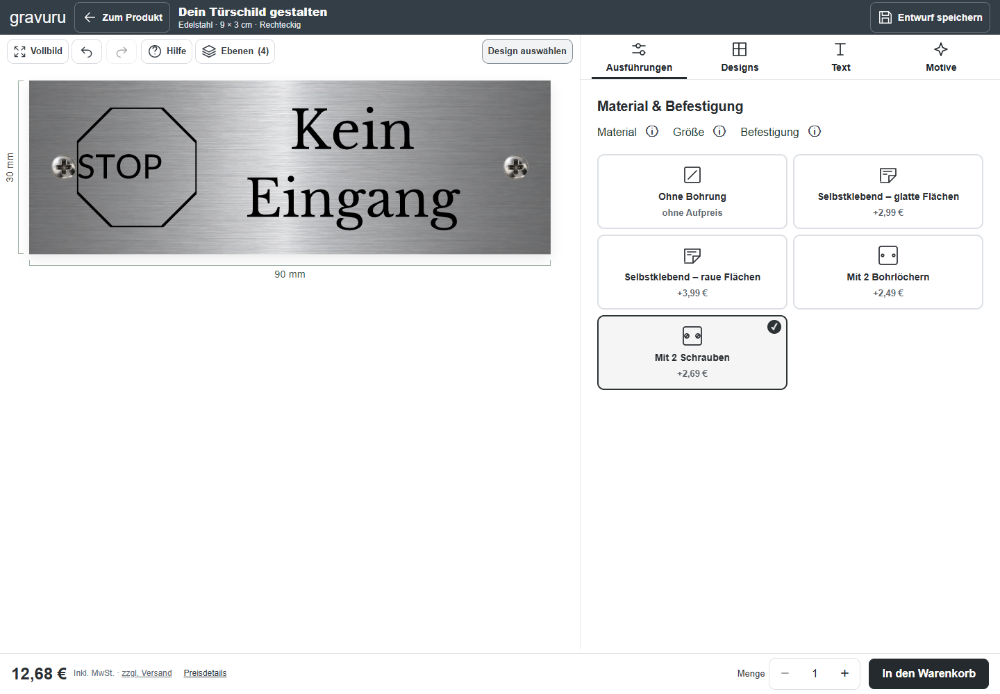 |
| TRE-V2A-8x5-D13 → **90×60 mm** | 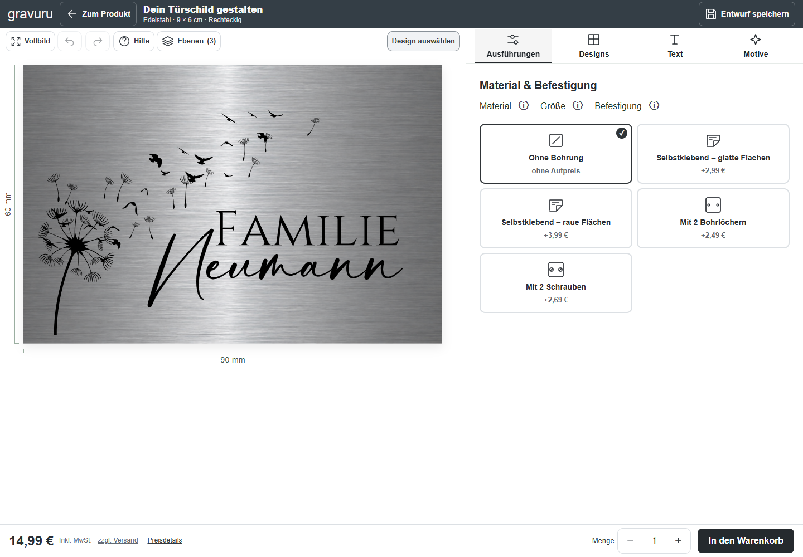 |  |
| TQ-V2A-8x8-D15 → **160×160 mm**, 4 Ecklöcher | 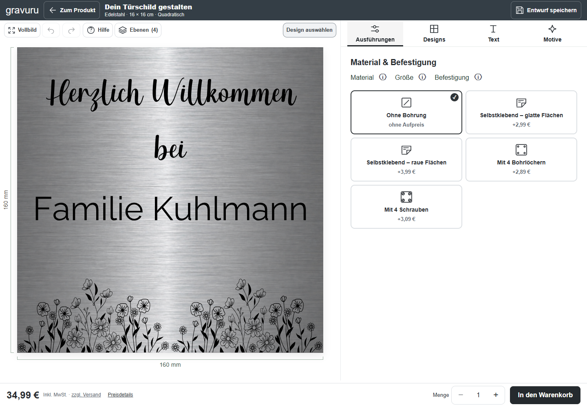 | 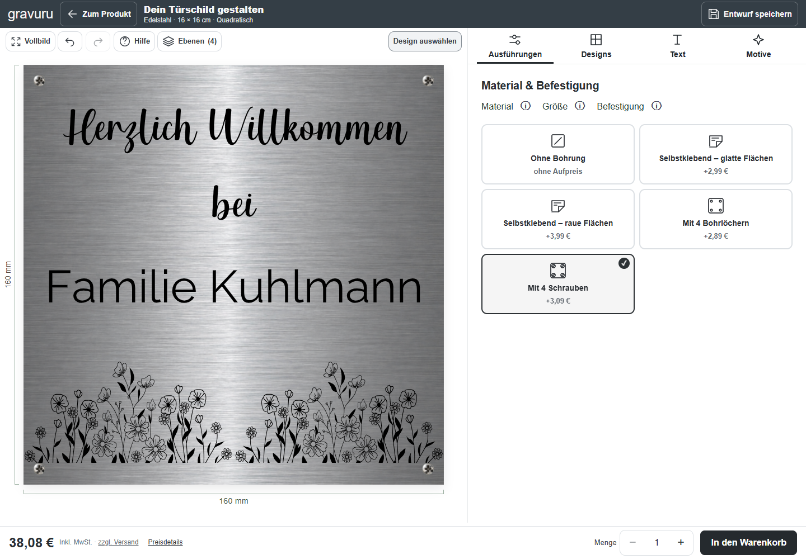 |

## Wiederholen / nächster Schritt

Quellenprüfung mit vorhandenem Katalog und funktionsfähigem Font-Importer:

```sh
node scripts/prove-mounting-placement.mjs /pfad/zum/katalog /neuer/lokaler/ausgabeordner
node --test app/configurator/variant-m/mounting-placement.test.mjs app/workshop/mounting-placement-model.test.mjs
```

Das Skript schreibt nur einen neuen lokalen Ausgabeordner: Startwertaudit, acht Konfigurationen und Geometriebericht. Die Konfigurationen enthalten lokale Glyphenressourcen und gehören nicht ins Code-Repo.

Claude: N39 zuerst prüfen, danach den darauf aufbauenden N36-Diff. Anschließend den PR auf `main` umstellen/abgleichen; kein Force-Push. Linux-Prüfung und Sichtabnahme der Bildpaare vor einer gesonderten Freigabe für Live. Rückweg vor Veröffentlichung: PR nicht übernehmen; weder Datenmigration noch Live-Rücknahme erforderlich.
