# N39 · Form & Größe im unveränderten Konfigurator-Master

Codebasis main 10eee72; Katalogbasis c70f4094 (Katalog-PR #17 auf main d7d99b6f2). Eigener Prüfbranch, kein Import, keine Freigabe, kein Shopify-Schreibzugriff, kein Merge und nichts live.

## Fachregeln und Quellen

- [Nachricht 39](https://github.com/Chris83638w/gravuru-2027/issues/48#issuecomment-6554563538): AB 12×8 cm / K00 als Start; eigene Form-/Größenauswahl, gleiche D-Nummer, eigene Texte erhalten und nötigenfalls einpassen, nur vorhandene Zielvorlagen. Bohrbilder und Preise ausschließlich aus den drei Familien. Keine generische Konturfreigabe für freie steelFormats.
- [Clarification](https://github.com/Chris83638w/gravuru-2027/issues/48#issuecomment-6555080054): genau sieben Kundenformen, **ein Oval** mit allen Verhältnissen, interne OV/EL-Kennungen unverändert. 30×10 keine erfundenen Shop-/Konfigurations-IDs.
- Katalogfamilien: steel-door-signs, acryl-3mm-tuerschilder-schwarz/-anthrazit. Exakte Kontur, Größe, Lochmitten, Befestigungen und Centpreise werden in einer versionierten lokalen Konfiguration gespeichert. Black/Anthrazit bleibt 3 mm, hinten graviert.
- 3 mm Mindestschrift: bestehende Zielprüfung/design-target-rules.mjs (Paket M). Keine neue Kundensperre wegen Löchern; N36 folgt getrennt.
- [Shopify](https://help.shopify.com/en/manual/products/variants/add-variants): maximal 3 Optionen und 2.048 Varianten. Deshalb Form+Größe als **eine** Shopoption, dazu Farbe bei Acryl und Befestigung. Im Konfi Form und Größe getrennt bedienbar.

## Ergebnis und Grenzen

Ein Plan je vorhandener Unterkategorie: 16 Produkte. Je Edelstahlprodukt 404, je Acrylprodukt 808 mögliche Kombinationen; keine Varianten-ID angelegt. [Edelstahlplan](edelstahl-tuerschilder.json), [Acrylplan](acryl-tuerschilder.json) enthalten jede Kombination mit Quellenkennung, Preis und separat den verfügbaren Zielstand je Unterkategorie.

Strenger Freigabefilter: derzeit nur ein freigegebenes Edelstahl-Ziel (32 verfügbare Varianten jeweils in Namens-/Familienschildern), kein freigegebenes Acryl-Ziel. Ohne freigegebene AB-Startvorlage erzeugt der Planer **kein Ersatzprodukt**. Verborgene/fremde Themen sind ausgeschlossen. Das ist eine lokale Produktplanung; Import/Shop-Anbindung sind bewusst noch nicht freigeschaltet.

Die Bildfolge nutzt acht vorhandene D1-Master mit offenen Zielen in einer ausdrücklich lokalen Prüfkopie. Keine Katalogfreigaben gesetzt. Acht Master und drei Familien gegen aktuellen Katalog nachverglichen: [Quellenprüfung](quellenpruefung.json). Nicht durch diese acht Vorlagen belegte Größen erscheinen im Prüfstand deaktiviert; das ist keine Behauptung, dort existiere im ganzen Katalog keine Vorlage. Rund bleibt ohne passende freigegebene Quelle gesperrt.

Formwechsel: gleiche D-Nummer bevorzugt; sonst vorhandene freigegebene Vorlage. Eigene Texte werden über bestehende Feldzuordnung übertragen, unzugeordnete Texte behalten, Uploads erhalten. Größenwechsel transformiert einmal proportional; Undo/Entwurf stellt den gespeicherten Zustand ohne zweite Transformation her. Fertigungsprüfung, Preisprüfung und SVG verwenden die gewählte Familiengeometrie. Der Master außerhalb Ausführungen bleibt unverändert.

## Prüfung

163 unterschiedliche Tests bestanden, 0 Fehler, 0 Skip: 138 Vertrags-/Preis-/Produkt-/Fertigungstests (inklusive 23 neuer Formattests), 3 Planertests, 22 Bündel-/Lade-/Servertests. Build erfolgreich. Linux-Vollauf durch Claude offen.

16 tatsächliche Browserwechsel RE → OV → RT2 → QU mit eigenem Text „Mia“, gleicher D1, Bohrlöchern und Preisvergleich gegen die Quellen: Edelstahl und Acryl am Desktop 1440×1000; Edelstahl 390×664; Acryl 375×548. [Messwerte](results.json). Chrome emuliert die Handygrößen, kein echtes Safari/iPhone-Testgerät. Die Browserprüfung fand und beseitigte einen Zugriff der alten Galerie auf vormals gültige IDs; die native Galerie übernimmt jetzt deren Aktualisierung. Keine Fehler danach. Beide Acrylfarben zusätzlich im Vertrags-/Produktionsmodell geprüft.

| Ansicht | Rechteck | Oval | Retro 2 | Quadrat |
|---|---|---|---|---|
| Edelstahl Desktop | 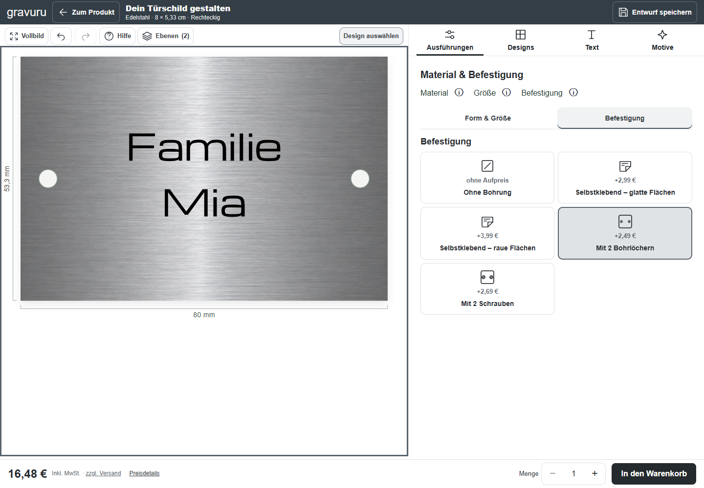 | 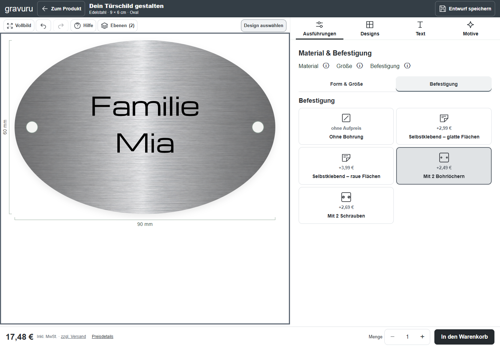 | 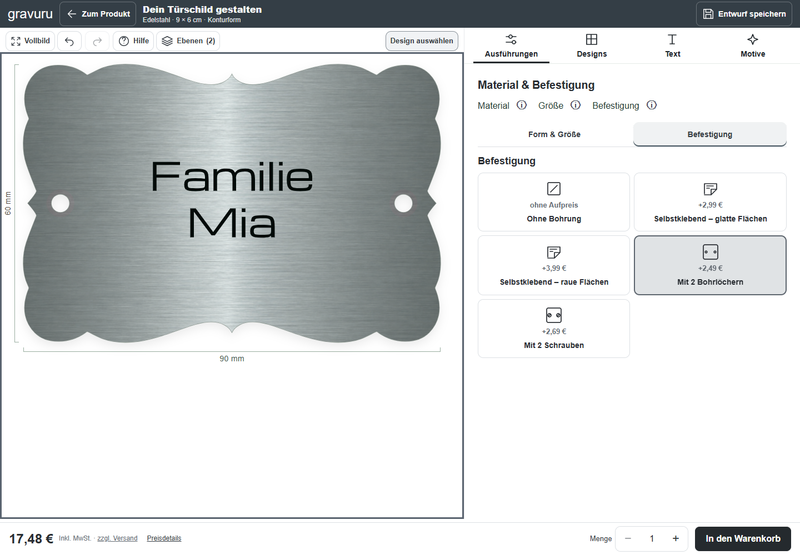 | 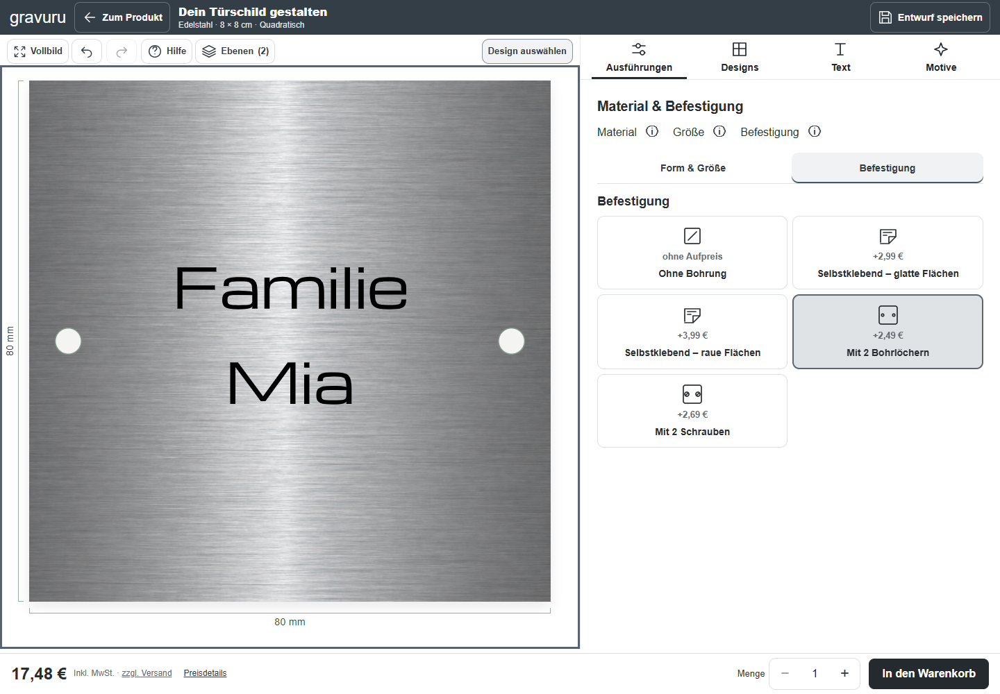 |
| Acryl Desktop | 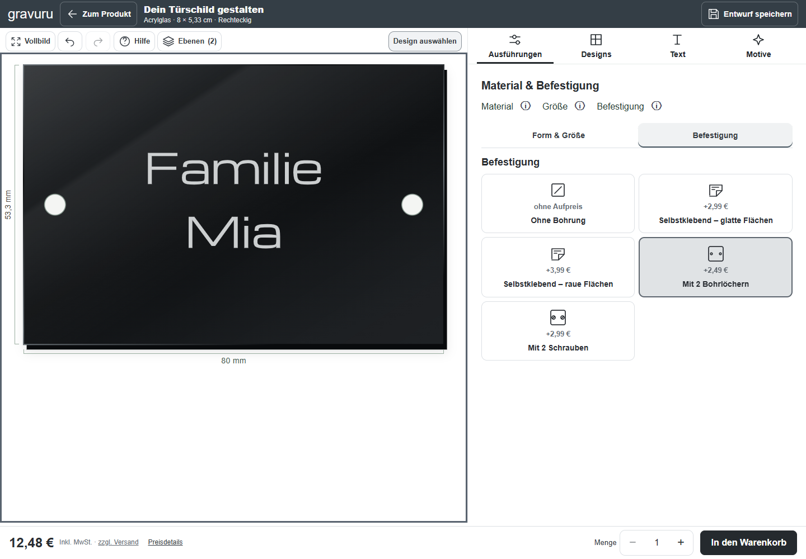 | 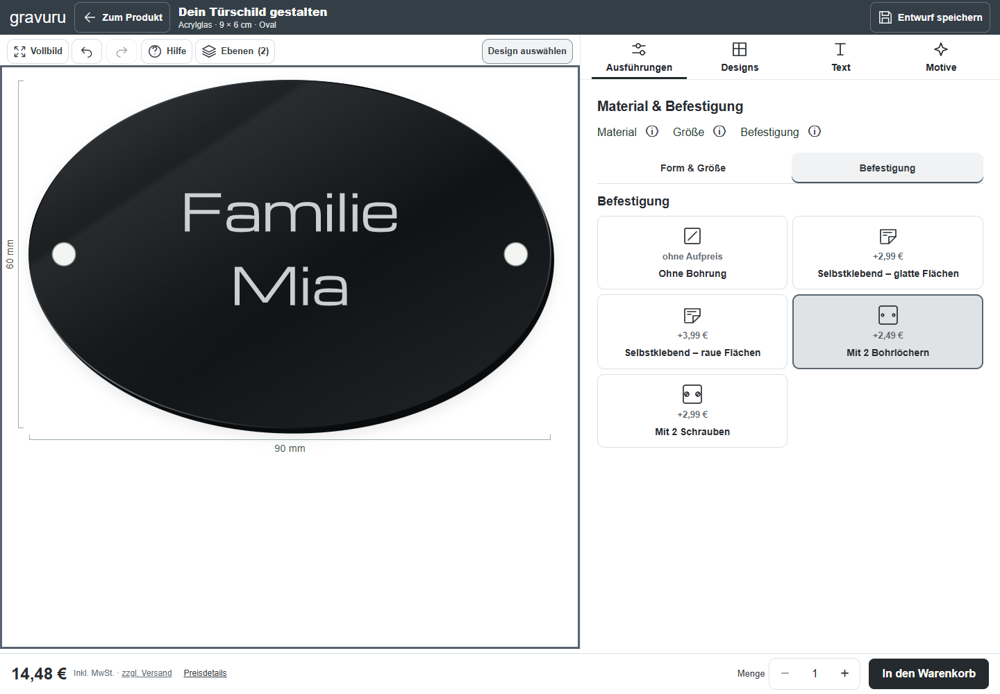 | 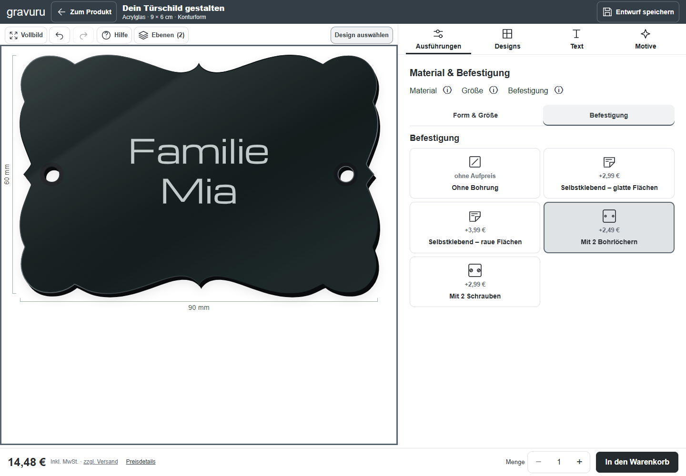 | 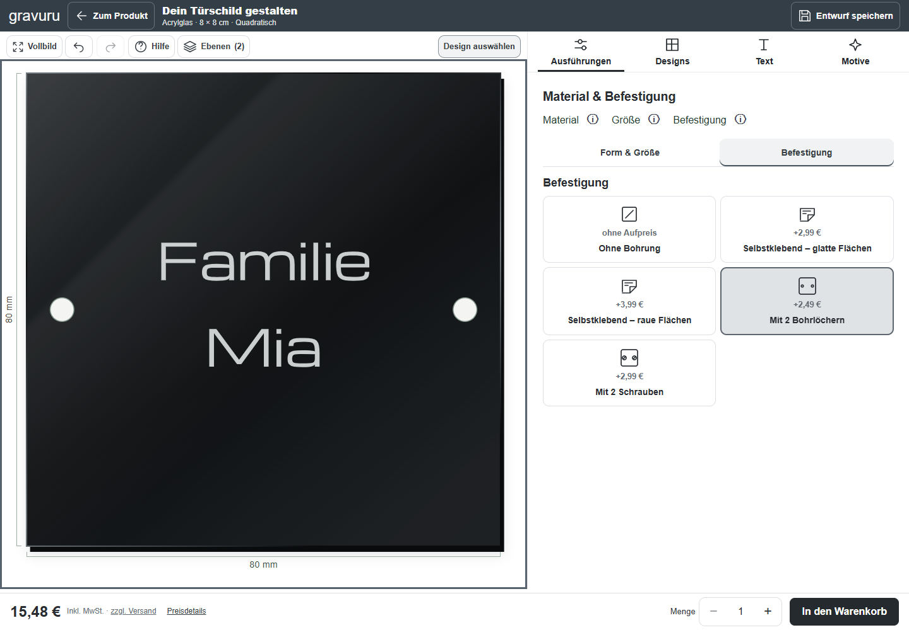 |
| 390×664 | 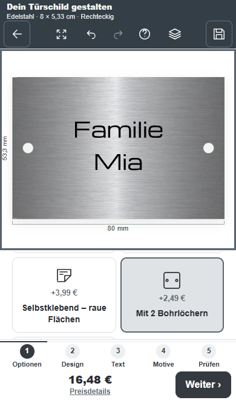 | 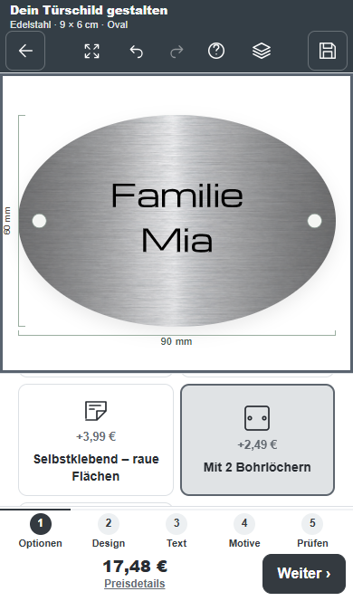 | 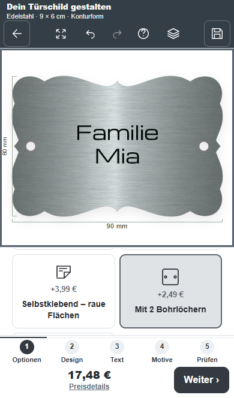 | 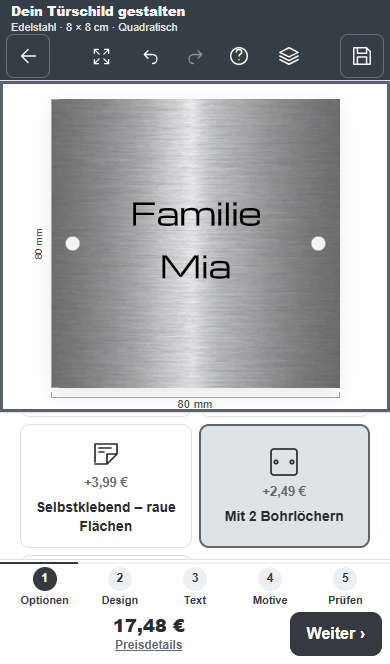 |
| 375×548 | 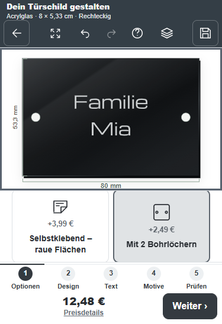 | 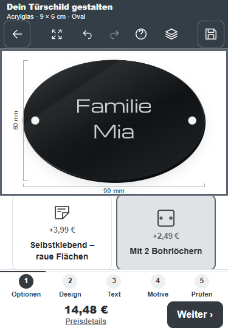 | 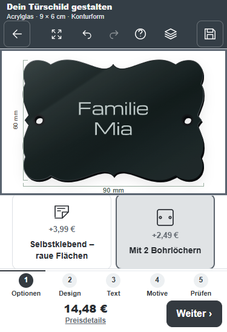 | 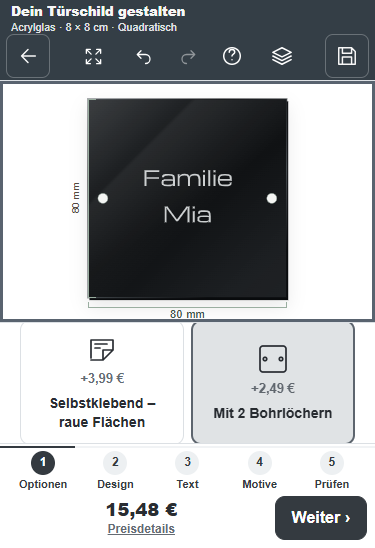 |

## Lokal wiederholen

Aus dem Code-Repo: node scripts/plan-family-formats.mjs --katalog=Katalogpfad --linie=edelstahl-tuerschilder --unterkategorie=familienschilder --output=NEUER_AUSGABEORDNER. Ohne Zusatzflag strikt freigegebene Ziele; --pruefvorlagen nur für die explizite lokale Prüfkopie. Das Skript hat keine Commit-/Import-/Live-Option und überschreibt keinen vorhandenen Ausgabeordner. Schriftdateien bleiben ausschließlich im Katalog. Modelle/Schriftpfade werden lokal erzeugt und sind nicht Bestandteil dieses Code-PRs.

Offen: Claude Linux-Vollauf/Review; freizugebende Zielvorlagen durch Chris; Shopify-Export inklusive 30×10 nach eigener Freigabe; danach separates N36 (reversibles Ausweichen bei Befestigungswechsel). Kein Warenkorb-/Live-Test für dieses Paket behauptet.
