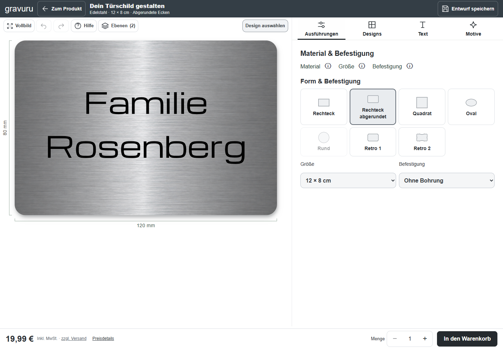
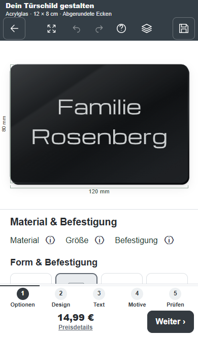
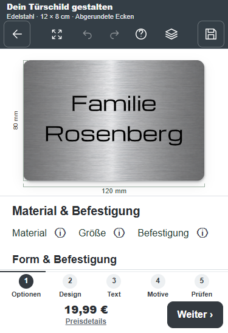
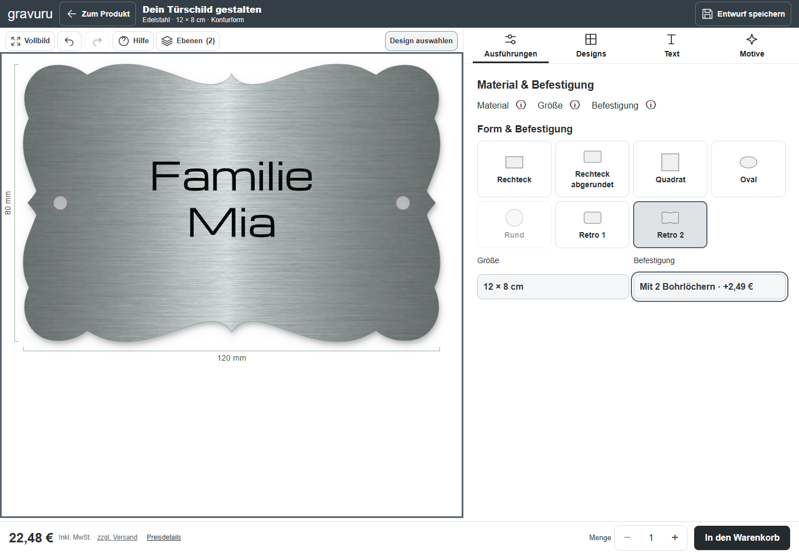
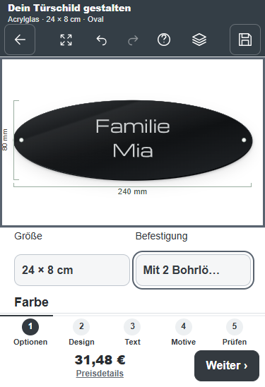

# Kompakte Ausführungen und Plattenschatten

Chris hat am 01.11.2026 im Chat die Anordnung aus seinem Bild bestätigt: Formkacheln, darunter Größe und Befestigung nebeneinander, neutrale Master-Farben. Zusätzlich fehlt ihm Tiefe durch einen Plattenschatten. Eigener Branch auf PR #98 b57fdc5a, damit N39 (#97) und N36 (#98) unverändert prüfbar bleiben. Kein Merge, Import oder Live-Schritt.

## Ergebnis

- Sieben bestehende Formkacheln, vier Spalten; Oval bleibt die gemeinsame Kundenform für OV/EL. Die beiden Untertabs entfallen. Größe und Befestigung sind native, beschriftete Auswahlfelder mit sichtbarem Auswahlpfeil. Acrylfarbe bleibt separat. Verfügbarkeit und Befestigungsaufschläge kommen unverändert aus dem vorhandenen Modell; keine neue Regel, Freigabe oder Quelle.
- Änderungen laufen weiterhin über uxChangeOption: Form-/Größenwechsel erhalten Kundentexte, Befestigung verwendet das vorhandene N36-Ausweichen. Nach Neuzeichnung bleibt der Tastaturfokus auf dem Auswahlfeld.
- Konturgenauer, dezenter Schatten als eigene nicht interaktive Vorschau-Ebene hinter der Platte. Materialbild, Gravur, Originale, Maße und Bohrungen werden nicht verändert. Nur die expliziten N39-Familien verwenden ihn. Der Bestell-/Fertigungs-SVG-Aufruf sowie einzelne Objekte enthalten keinen Schatten. Funkklingel- und Gedenktafeldarstellung bleiben unverändert.
- Die bestehende lokale Designbank bleibt auf den acht D1-Prüfvorlagen. Chris verlangt die vollständige Auswahl je Form/Größe und hat angewiesen, Claude zu fragen: [offene Rückfrage in Issue #48](https://github.com/Chris83638w/gravuru-2027/issues/48#issuecomment-6556092310). Keine offenen Ziele freigegeben oder Vorlagen erfunden. Designs werden erst nach dieser Klärung bestückt.

## Prüfung

46/46 gezielte Node-Tests, 0 Fehler/Skip: family-formats, material-surface-preview (zwei neue Prüfungen für unveränderte Quelle und korrekte Schattensilhouette), doorbell-presentation und mounting-placement. Build mit 133 Modulen/14 Styles erfolgreich.

16 Browser-Formwechsel RE → OV → RT2 → QU mit anschließendem Größenwechsel und Befestigung/K00: Edelstahl und Acryl Desktop 1440×1000, Edelstahl 390×664, Acryl 375×548. Eigener Text Mia erhalten, Preise und Löcher exakt gegen die Quellkonfiguration, nebeneinander liegende Auswahlfelder, Fokus erhalten, Schatten in der Vorschau und nicht in el.svg(), keine Browserfehler. [Messwerte](checks.json). Handygrößen in Chrome emuliert, kein echter Safari-/Linux-Vollauf und kein Warenkorbtest. Eine anfängliche Fokus-Erwartung im Test wurde nach explizitem Fokussieren des Testfelds wiederholt; keine Laufzeit-Assertion entfernt. Lokaler Browserzugriff musste außerhalb der beschränkten Netzwerkumgebung erfolgen.

## Bilder

Desktop:

390×664 und 375×548 (Optionsbereich auf dem Handy separat scrollbar):

Konturbeispiele aus dem Bedienlauf (noch vor der abschließenden CSS-Auswahlpfeil-Korrektur):

Offen: Chris' Sichtabnahme, Claudes Designzuordnung sowie unabhängiger Linux-/Safari-Check. Lokale Links sind Prüfkopien, keine Kundenfreigabe.
