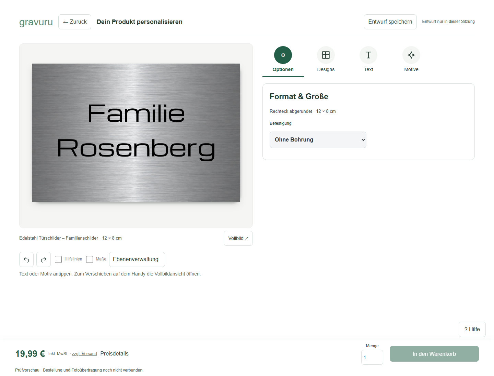
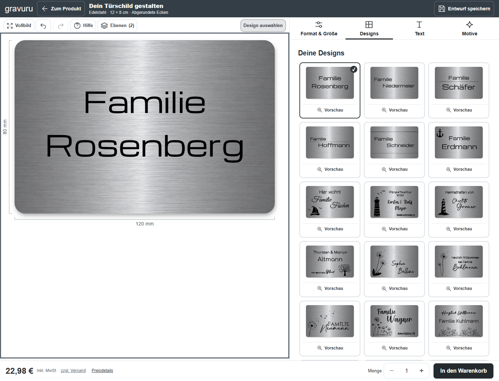
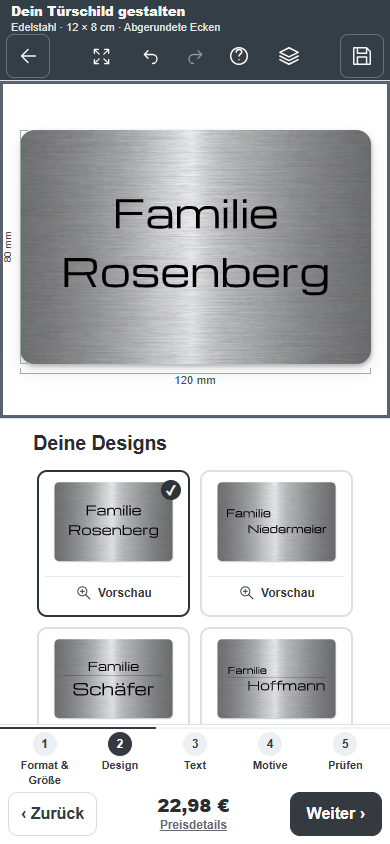

# Issue #139 · Konfi-Vorstufe, Zwischenlieferung · Codex · 02.11.2026

Auftrag: beide Rollen Astra 1 und Astra gravuru. Issue einschließlich Konfi-Vorstufe und Theme-Nachtrag gelesen. Codebasis `06987af88ca0ff0e78f708873f6f36569ddbfebf`, Katalogbasis `33f9336e7451504a1e90597934526e5162456a07`. Eigener Branch `dev/issue139-upload-20261102`. Katalog-Zwischenstand: signierter Commit `3e1ac81b1263c6695914d60805d9e125ac861936`.

## Umgesetzt

- Türschild-Planer: optionaler fester Produktschnitt `sizeKey/themeId/defaultDesignId`. Produkt-Metafeld `custom.gravuru_product_cut` als JSON; `--shop-product=<datei>` liest den Metafeld-Datensatz oder dessen Wert. Eine Größe/Form, Befestigung und Acrylfarbe bleiben wählbar. Unterkategorie zuerst, andere freigegebene textführende Designs bleiben verfügbar. Unfreigegebene Ziele und reine Motivdesigns ohne Text werden nicht hochgestuft. Fehlender Start oder fremde Größe führen zu einem Fehler.
- Genaue Varianten-/Designmenge für die Bindungsprüfung. Kein unsichtbares Größen-Optionsfeld in einer festen Produktbindung. Mehr als 100 freigegebene Katalogdesigns sind erlaubt; das **Schriftgrößenlimit bleibt 100 mm**. Die allgemeine Händler-Designgrenze bleibt unverändert.
- Textrotation: Drehpunkt und zusammengesetzte Translation/Rotation werden einmal angewendet. SVG-Striche: geerbte Farben, Füllregel, Strichbreite, Linienenden, Ecken und Deckkraft; sichtbare Strichgrenzen werden nicht abgeschnitten. Der Speicherrundlauf behält die Stricheigenschaften.
- Grabstecker: Quellkopf und Kopf + 10 mm als Arbeitsansicht, neutraler Starter vollständig im Kopf. 33 Größen gegen die Schnittquelle geprüft. Vollständige Außenkontur und 33 Innenausschnitte über 12 Größen bleiben im Produktionskonturmodell; keine Kürzung des Stiels. Katalog-PDF/SVG zeichnet Ausschnitte mit.
- Theme-Prüffassung unter `ops/shopify/issue139-theme-review/`: 90-Euro-Hinweis/Schwelle und neue Vorlage `product.konfi`. Nicht auf Shopify angewandt.

## Echte lokale Beispiele

Der Planer liest die freigegebenen Katalogziele, keine synthetischen Designbestände:

- Edelstahl AB 12×8, `TAE-V2A-8x5-D1`: 208 Designs, fünf Befestigungen, Grundpreis 19,99 €. Selbstklebend glatt +2,99 € → 22,98 €. Desktop und 390×844 geprüft; keine Form-/Größenauswahl, kein Foto-/Logo-Reiter.
- Acryl Rechteck 12×8, `TRE-V2A-8x5-D1`: zehn Varianten (zwei Farben × fünf Befestigungen). Lokales Modell ohne blockierte Varianten gebaut. Schwarz → Anthrazit, Galerie und 390×844-Ansicht im Browser geprüft. Grundpreis 14,99 €.





Browserprüfung mit separatem Chrome/Playwright per CLI, ausdrücklich von Chris erlaubt. Die vorherige Browser-Erweiterung scheiterte an der URL-Erkennung; der Shell-Weg lädt erfolgreich. Große Galerien sind langsam; **noch kein bestandener mobiler Ladezeitnachweis**. Keine persönlichen Browserprofile verwendet. Katalog-Draft: https://github.com/Chris83638w/gravuru-katalog./pull/156 · Code-Draft: https://github.com/Chris83638w/gravuru-2027/pull/142.

## Prüfungen

Gezielt: 60 Tests vor der letzten Härtung; danach 32 Produktschnitt-/Familienformat-Tests sowie 26 Writeback-Tests unter Linux grün. 33/33 Grabstecker-Quellprüfungen (`grabstecker-audit.json`). Katalog-Vollbau mit 16 Familien erfolgreich. Der erste vollständige Linux-Lauf nach Umgebungsreparatur ergab 2.066/2.067 Tests; die verbliebene Strich-Bounds-Annahme wurde durch getrennte Kontur-/Sichtgrenzen und einen echten Roundtrip-Test korrigiert. Ein frischer Vollauf auf festem Snapshot wird separat in `linux-final-summary.json` dokumentiert, sobald er abgeschlossen ist. Nur dessen tatsächliche Zähler gelten als Vollnachweis.

Reproduktion:

```sh
node scripts/plan-family-formats.mjs --katalog=/path/katalog --linie=edelstahl-tuerschilder --unterkategorie=familienschilder --shop-product=/path/steel-product.json --output=/tmp/steel-fixed
node scripts/audit-grabstecker.mjs /path/katalog
python scripts/build-katalog.py --katalog /path/katalog
node scripts/test-portability/run-full-tests.mjs --run --repo /path/code --python /opt/venv/bin/python --temp /tmp/tests --output /tmp/results --label final139
```

## Keine Gesamt-Abnahme / konkret offen

Diese Lieferung ist **ein Zwischenstand**, keine Erledigung beider Rollen und keine Upload-Freigabe. Der feste Planer ist bisher für Edelstahl-Türschilder und Acryl 3 mm angeschlossen. Metafeld-Lesen in der tatsächlichen Shopify-Importstrecke, Kundenbindung, Warenkorb/Testbestellung und fertige Produktionsdatei je Linie fehlen noch; lokale Review-Produkte bleiben nicht bestellbar.

- Schiefer: finale Liste 29.10. ersetzt die alten Lochbilder. Fehlende Herz-/Kordel-/Form-/Naturfamilien, Fotopreise und aktuelles Zubehör müssen noch vollständig in das Produktmodell. Die bestehenden vier Familien sind kein Nachweis dieser neuen Liste. Premium-Stärke ist weiterhin null.
- AE: 2-Loch-Aufpreise fehlen in der neuen Preisquelle; Rahmen-Quadrat-Bohrbilder offen. Größenabhängige Rückplatten-/Rahmenpreise, 3/5-mm-Wechsel und Acryl-only-Produktion müssen noch angeschlossen und getestet werden. Fragen in #139 Kommentar 6574302966.
- Weitere offene Linien: AA/AS/SS und Rasseschilder mit freigegebenen Zielen. Der Katalogstand nennt die neue Rasse-Lieferung mit Freigabe null; nicht eigenmächtig freigeben.
- Mindestens zwei feste Starterprodukte je Größe, Bilder/SEO/Keywordnachweise, SKU-/Duplikatprüfung, vollständige erste Unterkategorie je Linie als Shopify-Draft fehlen.
- Versandtarife, Filter, Google-Daten, Tracking, GPSR/Lieferzeit/Widerruf, Theme-Vorschau/Abnahme und Rückweg vor Import fehlen.

Nächster Schritt: Claude prüft die technische Zwischenlieferung und beantwortet die Quellenfragen. Danach restliche Familien/Preisstrecke und Bindungen ergänzen, je Linie Galerie/Starter/Preis/Warenkorb/Produktionsdatei nachweisen. **Vor diesem vollständigen Nachweis und Claudes Abnahme weder Uploadwelle noch Theme-Veröffentlichung.**

Design-Master: https://github.com/Chris83638w/gravuru-katalog./blob/main/designs/DESIGN-MASTER.md. Keine neuen Designs, Motive oder Designfreigaben in dieser Lieferung.
