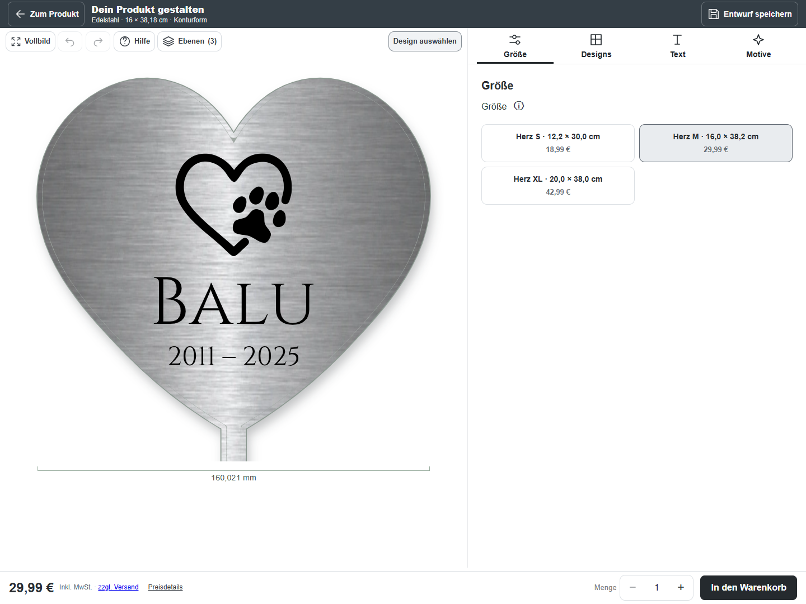
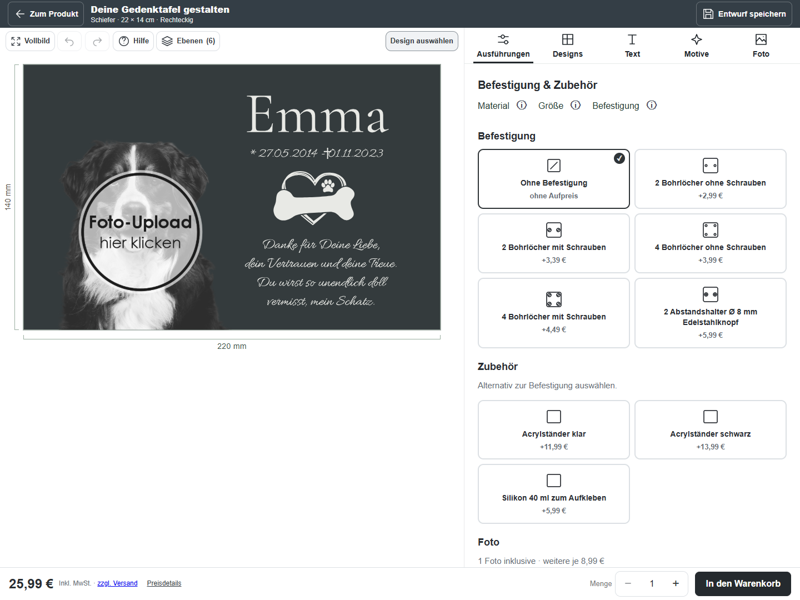

# Issue 139 · Schritt 2 · Ausführungen (03.11.2026, Codex)

Auftrag: [Claude 6597574311](https://github.com/Chris83638w/gravuru-2027/issues/139#issuecomment-6597574311). Schritt 1 / PR 153 ist bereits live und separat gemessen. Dieses Folgepaket ist ein **Kandidat**, keine weitere Live-Bereitstellung und kein Produktupload.

Fachliche Quelle: [Design-Master](https://github.com/Chris83638w/gravuru-katalog./blob/main/designs/DESIGN-MASTER.md), #139 (Grabstecker nur Größe; Gedenktafel Befestigung/Zubehör/Foto), Katalog main 5171686f6; Grabstecker-Linie bytegleich aus Claudes Katalog-Branch b6f5a8298. Diese Liniendatei fehlt noch auf main. Keine Gestaltung neu gezeichnet, kein Motiv ersetzt, keine Preiswerte im UI erfunden.

## Umsetzung

- Explizites Ausführungsregister aus Katalogfamilien-IDs / Geräteschema. Keine Titel- oder Materialheuristik. Native Altstände können die vorhandene eindeutige Familienkategorie verwenden.
- Eigene dynamisch geladene Pakete: Türschild, Grabstecker, Gedenktafel; bestehendes Gerätepaket unverändert. Ein gemeinsamer Kern plus ausschließlich das benötigte Ausführungspaket.
- Grabstecker: S/M/XL der gebundenen Kopfform; keine Befestigungs-, Farb-, Geräte- oder Formwahl. Größe in Desktop-Reiter und Handy-Schritt. Interner K00-Preisvertrag bleibt erhalten. Je Größe eigene Kopf-/Ansichtshöhe; vollständige Kontur bleibt in der Fertigung. Historisches SVG-overflow konnte trotz richtigem viewBox den langen Stiel zeigen; jetzt in der Arbeitsansicht abgeschnitten.
- Gedenktafel: bestehende Befestigungsvarianten mit K00 zuerst, lochfreie Zubehöralternativen separat benannt, zusätzliche Katalogfelder bleiben an die gemeinsame Preis-/Sichtbarkeitslogik gebunden. Foto führt zur gemeinsamen Fotooberfläche und respektiert die Produktfähigkeit.
- Zwei echte Startfehler aus dem Browserlauf behoben: Konturprüfung benötigt ausgelagerte Originalschriften vor prepareConfig; beim einzelnen Gedenktafel-Startdesign müssen auch Beispielfotos, Platzhalter und Fotohinweise auf dieses Design begrenzt werden. Serverquellen bleiben vollständig.
- Größen-/Zielgruppenplaner aus Claudes Codebranch 8990b714 übernommen; keine zweite Importstrecke.

## Browsernachweis

Isolierter echter Shop-Einstieg mit nativen Katalogmodellen, Chrome 1440×1080. Keine Shopify-Schreibzugriffe. Beide Starts ohne JS-Fehler; genau zwei Pakete je Ausführung. Die isolierte Zuordnung dient ausschließlich der Bedienprüfung und ist kein Bestell- oder Veröffentlichungsvorgang.

Herz/Hund: Start D51 in M; 10 freigegebene Hundedesigns je Größe, 30 in der Quellenbank. S 18,99 €, M 29,99 €, XL 42,99 €. Klick XL: 42,99 €, Kopfhöhe 174,79 / Ansicht 184,79 mm; voller Produktionsstiel erhalten; Texte im Kopf. [XL](2026-11-03-issue139-ausfuehrungen/grabstecker-xl.png).

Schiefer 22×14, D220 Emma, Originalfoto und 17 Vorlagen des Themas. Zubehörwahl verändert den gemeinsamen Preis; Foto-Button öffnet den Fotobereich. [Foto](2026-11-03-issue139-ausfuehrungen/gedenktafel-foto.png). Rohbefund: [pruefung.json](2026-11-03-issue139-ausfuehrungen/pruefung.json).

## Prüfungen und Grenzen

Vier neue Modul-/Pakettests sowie sieben Bündeltests bestanden. Vorher 41 weitere gezielte Tests bestanden. Linux-Ziellauf 121/122: einziger Fehler fehlende Python-Vektor-Abhängigkeit im isolierten Verzeichnis; Abhängigkeitspfad ergänzt. Linux-Gesamtlauf mit zwei Prozessen läuft, Ergebnis folgt.

**Gedenktafel noch nicht veröffentlichungsfertig:** Die historische Familienquelle enthält alte Zubehör-/Fotopreise (z. B. klarer Ständer 11,99 €, weiteres Foto 8,99 €), abweichend von preise/preise-chris-20261102.json (13,99 €/9,99 €). Die Screenshots zeigen ausdrücklich den aktuellen Quellstand, keine Preisfreigabe. Außerdem blockiert der ältere allgemeine Import 104 freigegebene Vorlagen am 100er-Limit, und D220s Originalspruch überschreitet die neuere 80-Zeichen-Regel. Für die Modulprüfung wurden die 17 unveränderten Themenvorlagen über den bestehenden Themenimport geladen. Keine Originaltexte gekürzt und keine Regel still umgangen. Diese Quellen-/Importpunkte gehören vor eine Veröffentlichung des betreffenden Produkts.

Nächster Schritt gemäß Auftrag: Claudes shop-schnitt-plan.mjs übernehmen/für Türschilder erweitern, reproduzierbaren Serienplan und Fehlerbericht erzeugen. Infinity bleibt wie von Claude beauftragt zurückgestellt.
