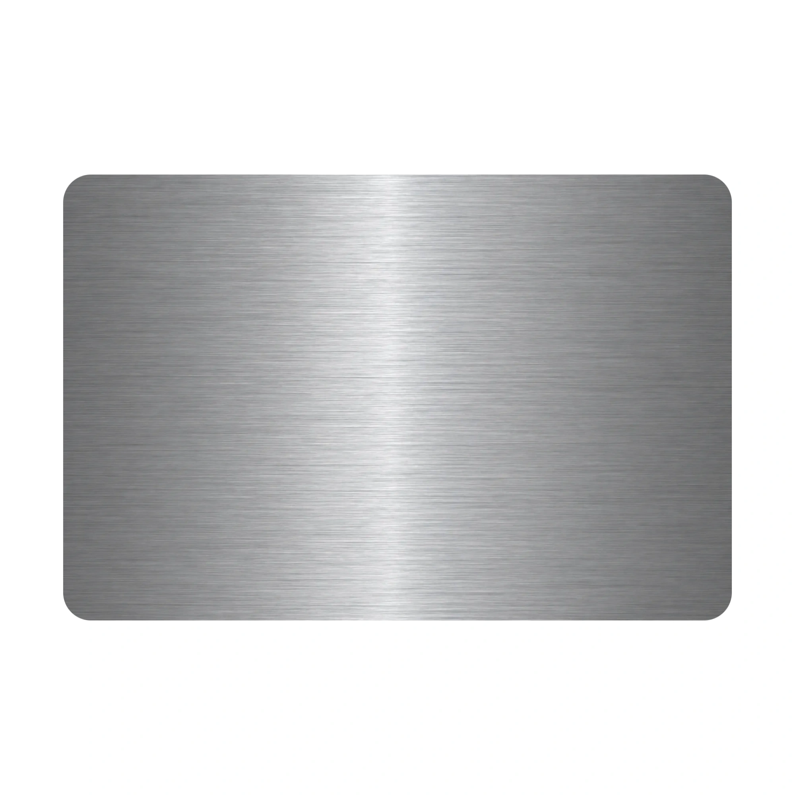
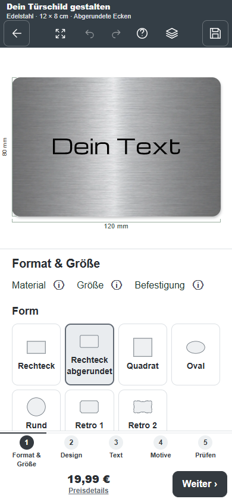
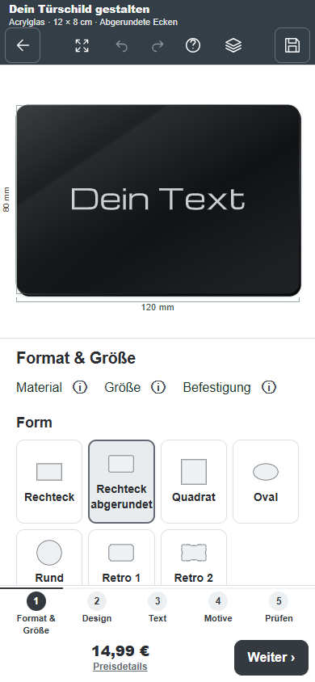

# Zwei Türschild-Entwürfe ohne Designs · #139 / PR #156

03.11.2026 · Codex/Astra 1. Auftrag vollständig ausgeführt: **2 neue DRAFT-Produkte, 1.212 gebundene Varianten, 2 READY-Hauptbilder, neu veröffentlicht: 0**. Abschließende Shopify-Lesekontrolle: 2026-11-03T14:59:57.828Z.

## Auftrag und freigegebener Stand

Chris im Chat: „Lies jetzt den neuesten Kommentar in #139. Wenn der Testlauf grün ist, merge PR #156 und lege die zwei Produkte als Entwurf an: Edelstahl 404, Acryl 808 Varianten. Unseren bisherigen Edelstahl nehmen, nichts veröffentlichen.“ Maßgeblich: [Claude-Auftrag 6606558845](https://github.com/Chris83638w/gravuru-2027/issues/139#issuecomment-6606558845), Entscheidungen 4.43 und 5.25. [Design-Master](https://github.com/Chris83638w/gravuru-katalog./blob/main/designs/DESIGN-MASTER.md) gilt für spätere Designs; jetzt nur die freigegebenen leeren Vorlagen mit „Dein Text“.

Finaler PR-Kopf bc503a4b3215fec233ba5e57b57fea8d1c6454e6, [Testnachweis im PR](https://github.com/Chris83638w/gravuru-2027/pull/156#issuecomment-6606558474): **2.110/2.110 bestanden, 0 Fehler**, exakt dieser Kopf übernommen. Signierter GitHub-Merge mit zwei Eltern: **3eb2ea43c5383571094b8da1017ade9f4884eb72**. Keine Wiederholung des unveränderten Volltests. Bereitstellung auf app-2027: **1.345 Quelldateien stimmen mit dem Merge überein**, Hauptbündel und vier Teilbündel HTTP 200 und bytegenau gegen die Serverdateien geprüft. Die im Browser zuletzt geladene Datei editor-c419119a6ef437c6.mjs ist das Familienformat-Teilbündel; editor-089c3dff6aa84f5b.mjs ist das gemeinsame Hauptbündel.

## Produkte und direkt nutzbare Entwurfsvorschauen

| Material | Shopify-Produkt | Varianten gebunden | Nativer Konfigurator |
|---|---|---:|---|
| Edelstahl | [16190784438652](https://admin.shopify.com/store/gravuru-design/products/16190784438652) | 404/404 | [edelstahl öffnen](https://gravuru-design.myshopify.com/apps/konfigurator/start?product=16190784438652&variant=58104606556540) |
| Acrylglas 3 mm | [16190784602492](https://admin.shopify.com/store/gravuru-design/products/16190784602492) | 808/808 | [acryl öffnen](https://gravuru-design.myshopify.com/apps/konfigurator/start?product=16190784602492&variant=58104626479484) |

Beide beginnen mit **Rechteck abgerundet 12 × 8 cm, ohne Befestigung**; Acryl schwarz. Je Material 80 Größen, sieben Formen. Produktvorlage konfi, Beschreibungen leer, Titel exakt wie beauftragt. custom.gravuru_product_cut ist jeweils der unveränderte Produktschnitt aus plan.json mit groessenWahl=alle und vorlagen=leer. Kein Bestands-Tracking; Preise und Zubehör aus dem aktuellen Katalog. Alle 1.212 Varianten samt Preisvertrag und nativer Auswahlbindung geprüft. Keine Corel-Maße, Außenkonturen oder Bohrungen geändert.

## Bisheriger Edelstahl und Bilder

Materialquelle ist die **tatsächlich vorhandene Kundenkonfiguration des bisherigen Leuchtturm-Türschilds**, Produkt 16077798965628, Variante 57265913332092, native Konfiguration cfg_98436fb0-886d-4af8-bc11-f45ef809684c. Exakte vorhandene materialSurface übernommen; SHA-256 50e74d27e1f6f49408396a856082bd92d3d7e5831486b50c7188e7f6a33ee4fb, WebP 97.754 Bytes. Quelle auf dem Host: private/issue139-doors-156-nachweis/existing-steel-surface156.json. In beiden neuen Edelstahl-Browserprüfungen derselbe Hash bestätigt. Keine fremde Textur oder KI-Oberfläche.

Die zwei Hauptbilder wurden aus der echten nativen Vorschau exportiert: 12 × 8 cm, ohne Befestigung und ohne Text/Motiv, WebP 2.000 × 2.000 auf Weiß. Leeren Text ausschließlich im flüchtigen Browserzustand für den Bildexport gewählt; gespeicherte Konfiguration bleibt mit „Dein Text“. Acryl verwendet die vorhandene native Materialdarstellung. Shopify liest je ein READY-Bild zurück. Finale Hauptbilder erst zusammen mit späteren Startdesigns.

## Sichtbare Prüfung

Vier echte Browserprüfungen über den Shopify-App-Proxy: beide Produkte jeweils 1.440 × 1.100 und 390 × 844. Alle bestanden, keine JavaScript-Fehler oder fehlerhaften Shop-Entry-Antworten. Sieben Formen und 80 Größen verfügbar; Formwechsel auf Retro 2, Größe auf 30 × 20 cm, Befestigung KGL, Acryl zusätzlich Anthrazit. „Familie Koch“ bleibt beim Wechsel erhalten. Alle geprüften Anzeigen stimmen exakt mit der jeweiligen gebundenen Shopify-Variante überein: Edelstahl 19,99 → 82,98 €, Acryl 14,99 → 47,98 €.

Einmalige Startmessungen ohne Netz-/CPU-Drosselung, keine belastbare Mobilfunk-Benchmarkreihe: Edelstahl Desktop 4,528 s / Handyformat 6,558 s; Acryl Desktop 6,890 s / Handyformat 3,141 s. Claude kann mit den obigen Links separat am echten Handy messen.

## Ausführung, Sicherungen und Grenzen

Katalog-main **84282a7fb60ee54b62db35e06a48f499f0d5aa79** in separatem Host-Arbeitsbaum private/issue139-doors-catalog-156. Beide Konfigurationen mit dem unveränderten scripts/konfi-ohne-designs.mjs erzeugt. productSet asynchron einmal je Produkt; Preisvertrag; native Bindung in sofort geprüften 100er-Blöcken. Wiederanlauf nutzt gespeicherte Vorgangs-/Produkt-IDs und überschreibt keine fremden Produkte. [Ausführungsskripte](2026-11-03-issue139-zwei-tuerschild-entwuerfe-belege/ablauf/) und [Nachweis](2026-11-03-issue139-zwei-tuerschild-entwuerfe-belege/nachweis.json), [Browserwerte](2026-11-03-issue139-zwei-tuerschild-entwuerfe-belege/browserpruefung.json).

Vor dem Import SQLite-Backup mit integrity_check: workshop.sqlite, design-assets.sqlite, profiles.sqlite unter **private/issue139-doors-156-nachweis/data-before/**. Laufzeit in private/issue139-doors-156-20261103, vorherige Laufzeit private/issue139-stakes-20261103 unverändert erhalten. Originaler Startpunkt app.before.cjs und stage.json/activate.json im Nachweisordner. Ein Rückweg darf nur die gesicherte Startdatei nach Prüfung des aktuellen Stands wiederherstellen; keine pauschale Datenbankrücksetzung, weil weitere Arbeit enthalten sein kann.

**0 Publikationen**, beide weiterhin DRAFT, publishedAt=null und resourcePublicationsCount=0; keine ACTIVE-Änderung, Navigation oder Veröffentlichung. Die zehn bisherigen festen Türschilder, 102 Grabstecker und Variante C nicht bearbeitet. Für genau diese zwei Entwürfe ist der native Vorschau-Einstieg freigegeben; productionReady=false. Produktseiten-Overlay, Kauf/Warenkorb, Bestellung und Produktion sind durch diese Vorschauprüfung **nicht** abgenommen; kein Warenkorbaufruf oder Checkout ausgeführt.

**Nächster Schritt:** Claude prüft die beiden Vorschauen und liefert Beschreibungen/Designs. Neue Veröffentlichung und endgültige Bilder bleiben offen. Keine zusätzliche Freigabe für die hier erledigte Entwurfsanlage nötig.
