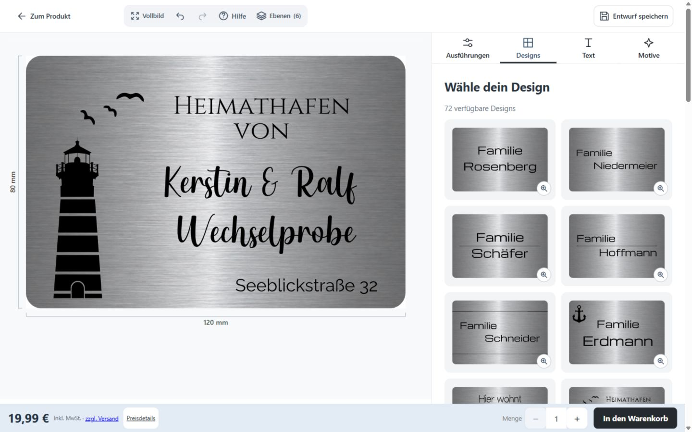
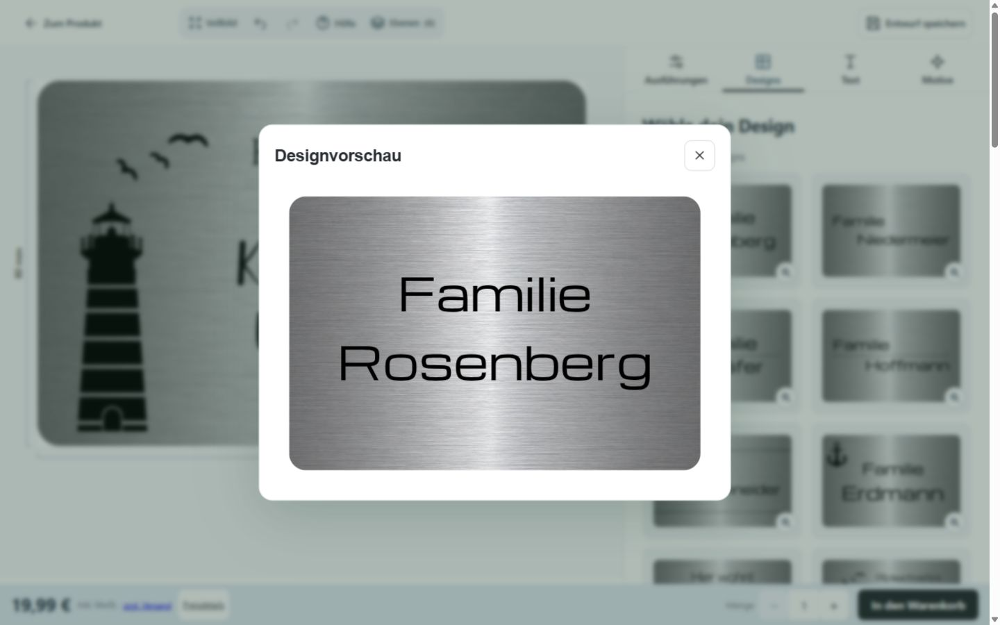
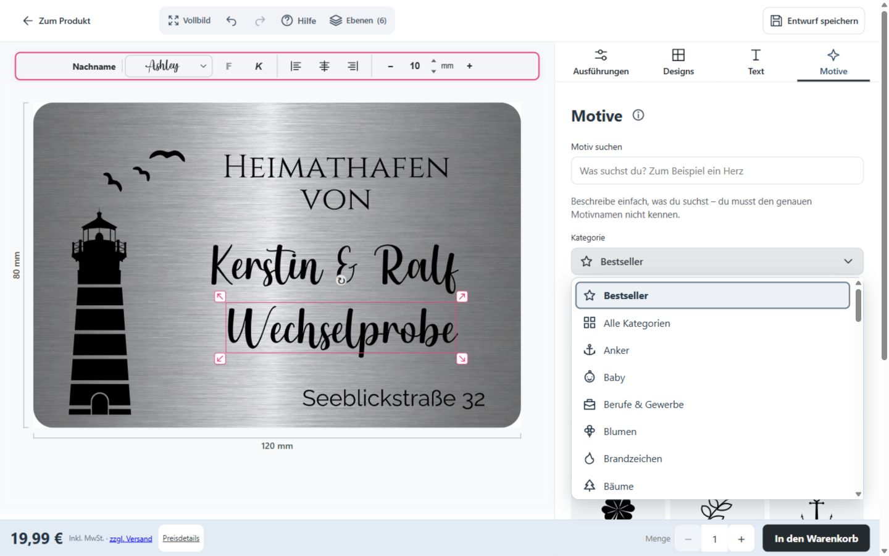
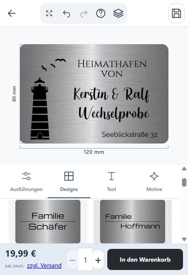
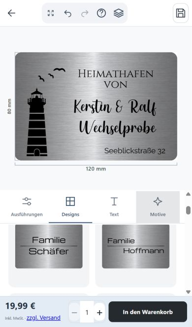

# Konfigurator: Designwechsel, Galerie und Dialoge

Stand 04.11.2026, Astra. Branch `dev/konfi-dialoge-designs-20261104-astra`. **Lokal geprüft, nicht live und nicht gemergt.**

## Grundlage und Entscheidungen

Chris' gesammelte Bedienkorrekturen aus diesem Chat, aufgenommen in [Issue #48](https://github.com/Chris83638w/gravuru-2027/issues/48#issuecomment-6638393681). Letzter Nachtrag: **„mobil kein zoom und desktop die lupe kleiner“** betrifft die Designkacheln: mobil keine Lupe/Vergrößerungsansicht, Desktop kompakte Lupe unten rechts. Der Ansichtszoom zur Bearbeitung des Schildes bleibt erhalten.

Basis 85553eb (nur Dokumentationsnachträge gegenüber dem aktiven Funktionsstand 2206775). PR baut auf [Mikas PR #174](https://github.com/Chris83638w/gravuru-2027/pull/174), Branch `dev/mika-schiefer-upload-20261104`, auf. So enthält der neue PR ausschließlich dieses Paket statt sämtlicher noch offener Vorgängeränderungen. Bei Integration zuerst die Abhängigkeit übernehmen, dann diesen PR auf main umstellen. Kein Force-Push.

Fachregeln unverändert: nur freigegebene Ziele der eigenen Produktlinie; bei Funkklingeln weiterhin das passende Modell. Namen/Originalmotive aus dem Katalog, vorhandene Motivpreise unverändert. Texte und Fotos werden beim Wechsel über die bestehende Übernahmefunktion erhalten; Anordnung und Vorlagenmotive stammen vom neuen Design. Keine neue Preis-, Freigabe-, Material- oder Geometrieregel. Mikas mobile Höhenkorrektur und Astras Master-Layout bleiben erhalten.

## Fertig

- Design anklicken übernimmt direkt; der zusätzliche Bestätigungsdialog entfällt. Rückweg zur vorherigen Gestaltung bleibt. Desktop-Lupe öffnet nur eine Vorschau und wählt das Design nicht aus. Mobil bleibt die direkte Designwahl ohne Lupe.
- Alle gemeinsamen Dialoge schließen bei Klick links/rechts außerhalb. Ein Ziehen aus dem Dialog heraus schließt ihn nicht versehentlich; der schließende Klick wird nicht an die darunterliegende Gestaltung weitergegeben.
- Galerie nach Designwechsel wieder lesbar: der neue aktive Editor durfte bisher während seiner Initialisierung keine Galerie-/Vorschaudaten anfordern. Lesende Aufrufe sind jetzt möglich; veraltete Frames und gleichzeitig gestartete weitere Wechsel bleiben gesperrt.
- Nachladen überspringt bei Fehlern keine Seiten. Filter-/Formatwechsel invalidieren ausstehende Antworten. Alte Antworten überschreiben keine neue Auswahl. Vorschaubilder laden höchstens zu zweit; große Desktop-Vorschau verwendet dasselbe Bild.
- Die serverseitige Produktlinienbegrenzung war bereits vorhanden. Ein neuer Test prüft alle Seiten mit 86 Türschilddesigns und schließt Gedenktafeln/Funkklingeln aus. Es wurde kein globaler Designpool freigeschaltet.
- Motivkategorie mit sichtbarem Pfeil, Symbolen und Tastaturbedienung. Bestseller bleibt vorausgewählt; alle ursprünglichen Kategorien/Werte bleiben über das vorhandene Select erhalten. Keine erfundenen Motivnamen.
- Hilfe-, Info- und Warnsymbole als klare SVGs. „Motiv in einer freien Fläche platziert.“ entfällt; Fehler-/Konflikthinweise bleiben.

## Prüfungen

| Prüfung | Ergebnis |
|---|---|
| Gezielt: Dialoge, Seitennachladen, Galerie, Wechsel, Hilfe, Bundle | 50/50 bestanden |
| Vollauf `npm test` unter Windows | 2.158 Tests: 1.937 bestanden, 208 fehlgeschlagen, 13 übersprungen |
| Gegenprobe aller 59 betroffenen Testdateien auf unverändertem 85553eb | 363 Tests: 155 bestanden, **dieselben 208 Fehlernamen**, keine neuen Fehlernamen durch dieses Paket |
| Build | 76 Ressourcen, 141 Module, 16 Styles; `editor-9ed7174627ae5aa1.mjs` |
| Browser | Echter lokaler Editor, Desktop 1440×900, Handy 390×664 und 375×548 |

Windows hat kein funktionsfähiges Python (Windows-Store-Alias/Exit 9009). Foto-/Vektor-/Kontur-/Exportprüfungen scheitern unter anderem daran bzw. an fehlenden Python-Abhängigkeiten. Die Gegenprobe belegt, dass alle 208 verbleibenden Fehler auch ohne dieses Paket auftreten; **kein grüner Vollauf behauptet**. Linux-Vollauf mit vorhandener Python-Umgebung ist vor Merge offen. Zwei zuvor fehlgeschlagene gezielte Tests wurden korrekt angepasst: SVG-Info statt Textzeichen im DOM-Stub; Bundle-Inventar berücksichtigt die bereits in der Basis vorhandenen beiden modernen Styles, der strikte Inhaltsvergleich bleibt bestehen.

[Maschinenlesbare Zähler, Log-Hashes und Fehlernamen](konfi-dialoge-20261104/verification.json).

### Sichtbare lokale Bedienung

Archivierte echte Türschildvorlagen (72 Stück), lokale Bindungen ohne Shopify-Schreibzugriff. 40→72 Kacheln nachgeladen. Eigener Name „Wechselprobe“ wechselt direkt in „Zwei Zeilen, versetzt“ und per Rückweg in den ursprünglichen Leuchtturm. Kategorie Anker per Tastatur gewählt; sechs benannte Motive statt Platzhaltern. Anker hinzugefügt (+169 Cent), keine Erfolgsmeldung, anschließend rückgängig. Dialog links und rechts außerhalb geschlossen. Kein neuer Live-Warenkorbversuch; Chris' Originalgestaltung und vorhandener Warenkorb wurden nicht angefasst.

## Noch offen / nächster Schritt

Claude prüft den PR inklusive Linux-Vollauf und anschließend die Integration mit #174. Vor einer separaten Veröffentlichung: echter Shopify-Designwechsel mit Galerie-Nachladen und Warenkorbübergabe sowie echtes iOS prüfen. Dieses Paket stellt nichts live.

Bereits separat in #48 gemeldete Punkte sind dadurch nicht erledigt: Homage-Zeichenlücke bei ß/Hinweis am Feld, Zusammenführung „Heimathafen von“ in den Katalogvorlagen, thematische Bestseller statt alphabetischen Auffüllens, präzises Gestalten bei kleinem SE nach Textauswahl und der Browser-Zurück-Zustand nach Warenkorbübergabe. Kein pauschaler Abschluss aller Produktlinien/Foto-/Logo-/Bestellpfade.
