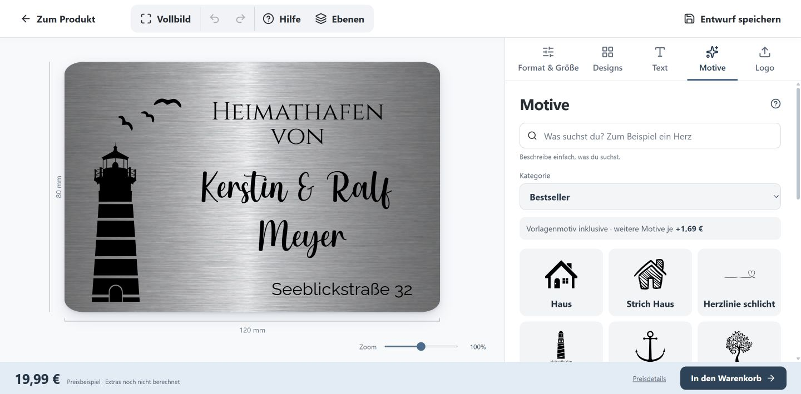

# Übergabe an Claude und alle Projekt-KIs: Konfi ohne Vorschauleiste

04.11.2026 · Codex/Astra · Entwurfs-PR [#161](https://github.com/Chris83638w/gravuru-2027/pull/161), Branch `dev/konfi-produktprofile-vorschau-20261103-astra`, Vorgänger `5910368`.

## Chris' aktuelle Entscheidung

„lass die oberste leiste weg und setze es um und informiere alle Kis insbesondere Claude“. Die oberste lokale Leiste mit „Lokale Vorschau“, Profilumschaltung und „Keine Shop-Verbindung“ entfällt. Die eigentliche Werkzeugzeile bleibt: Zum Produkt links, gemeinsame Werkzeuge mittig über dem Canvas, Speichern ganz rechts. Kein dunkler Produktkopf und kein neuer Produktumschalter in der Kundenansicht. Die weiteren Gestaltungsentscheidungen aus dem [Bericht vom 03.11.](2026-11-03-produktprofile-vorschau.md) bleiben bestehen, einschließlich thematischer Bestseller und getrennter Andenken Menschen/Tiere.

## Umsetzung / Prüfung

`App.jsx`: Vorschauleiste und Umschalthandler entfernt; lokales Profil aus geprüftem URL-Wert. `modern.css`: entfallenen Platz freigegeben, Handyhöhe angepasst. Fünf Direktaufrufe im Browser erfolgreich, optionsloses Beispiel startet ohne leeren Optionsbereich. Desktop und 375×548: Werkzeugzeile oben, Bemaßung sowie Warenkorb sichtbar. 20/20 bestehende Vorschau-/Profil-/Hostingtests, null Fehler/Skips; Vite-Build erfolgreich, LF und `git diff --check` sauber.

[Handy 375×548](2026-11-04-konfi-ohne-vorschauleiste/handy-375.jpg).

## Lokale Links bei Chris

- [Türschild](http://127.0.0.1:8171/)
- [Andenken Menschen](http://127.0.0.1:8171/?profile=memorial)
- [Andenken Tiere](http://127.0.0.1:8171/?profile=memorialPet)
- [Funkklingel](http://127.0.0.1:8171/?profile=doorbell)
- [Ohne Optionen](http://127.0.0.1:8171/?profile=simple)

## Stand und nächster Schritt

Nur lokale Layout-/Bedienstudie, keine Shopify-Verbindung. Keine Produktionspreise oder verbindlichen Produktoptionen aus Beispielen ableiten. Vollständige Schrift-/Objektbearbeitung, Designtransfer, Produkt-/Preisbindung und Warenkorb sind weiterhin im bestehenden Master zu integrieren. Kein Merge, keine Live-Aktion; Chris' vorherige Anweisung „Noch nichts live stellen“ bleibt gültig. Neue Rückmeldung in Issue #48, damit Claude und weitere Accounts denselben Stand haben. GitHub meldete PR #161 beim Lesen als Draft/open und nicht konfliktfrei mergebar; vor späterer Integration auf aktuellen main abstimmen, diese Änderung ist keine Merge-Freigabe.
