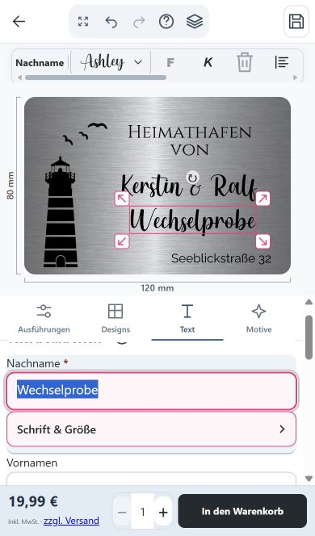
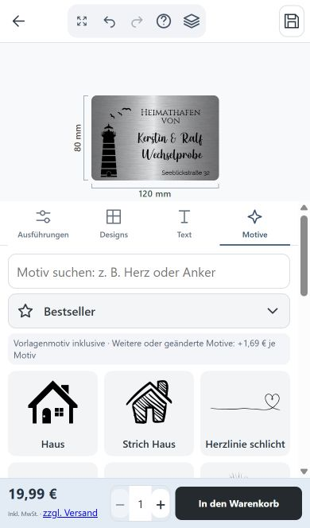
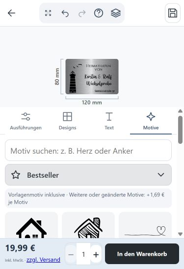
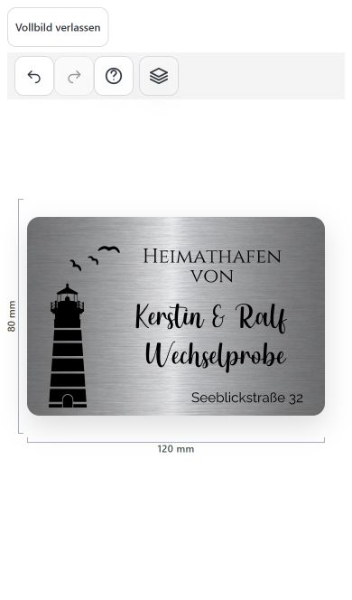
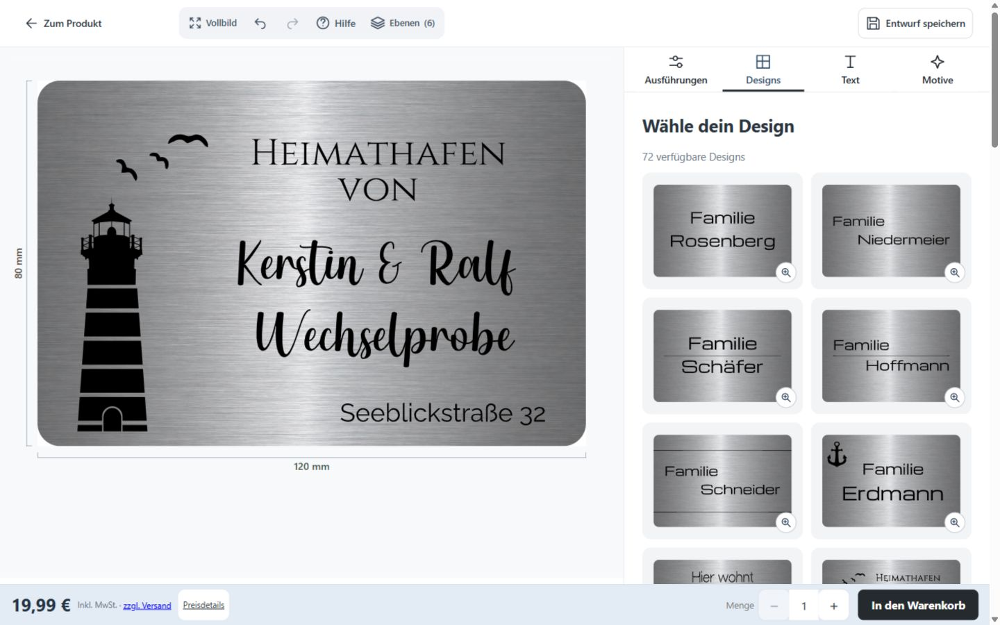
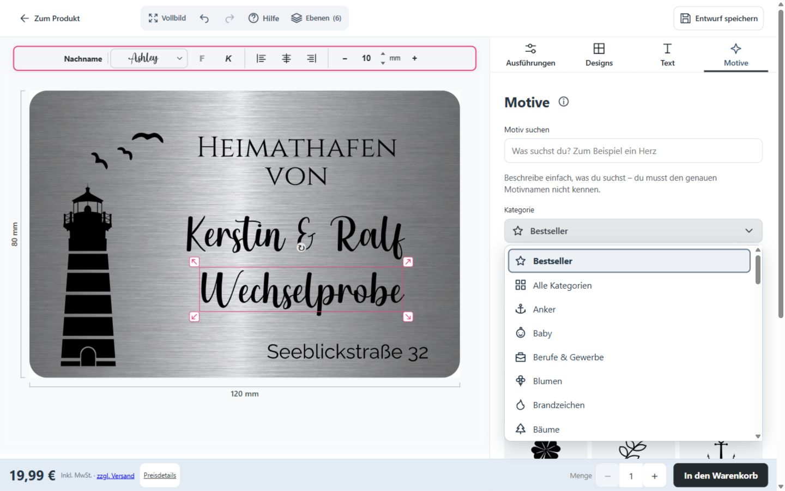

# Konfigurator – Gesamtübergabe an Astra Mika

Stand **05.11.2026, Astra**, auf Chris' Auftrag: „gib alles was du hast vom Konfi an Github ‘Astra Mika’“. Zentrale Übergabe statt weiterer lokaler Einzelstände. **Diese Übergabe veröffentlicht nichts im Shop und ändert keine Konfigurator-Funktion.**

**Hier anfangen:** [PR #177](https://github.com/Chris83638w/gravuru-2027/pull/177), Funktionscommit **8b26efdb3d9a4b9d14a5e67070736cce25313939**, Branch **dev/konfi-dialoge-designs-20261104-astra**. Das ist der neueste hier übergebene Konfi, einschließlich Chris' letzter Handy-Korrekturen. Der Dokumentationscommit dieser Datei kommt zusätzlich dazu; er ersetzt keinen Funktionsstand.

**Postfach:** [#168 – Astra Mika](https://github.com/Chris83638w/gravuru-2027/issues/168). Gemeinsame Konfi-Abstimmung mit Claude und allen Accounts: [#48](https://github.com/Chris83638w/gravuru-2027/issues/48). Neue Befunde dort beantworten und diese Übergabe verlinken. Keine Kopierkette über Chris nötig.

## 1. Welcher Stand ist welcher?

GitHub-Status am 05.11.2026 gelesen; Server heute nicht erneut geprüft.

| Stand | Bedeutung / Status |
|---|---|
| [#161](https://github.com/Chris83638w/gravuru-2027/pull/161), db4f4a4 | Frühere visuelle Master-/Produktprofilstudie, weiterhin Entwurf gegen main. Hilfreich für Absicht und Beispiele, **nicht separat als aktuelle App installieren**. |
| [#176](https://github.com/Chris83638w/gravuru-2027/pull/176), 87ba78e | Mobile Bühne/sticky Vorschau, in Mikas Branch integriert; PR geschlossen/gemergt, nicht mit einem Merge nach main verwechseln. |
| [#174](https://github.com/Chris83638w/gravuru-2027/pull/174), HEAD 85553eb | Gemeinsamer Vorgängerbranch dev/mika-schiefer-upload-20261104; PR offen, selbst auf dev/mika-schiefer-produktgruppen-20261104 aufgebaut. Funktionsstand 2206775, danach Dokumentation. |
| 2206775 | Am 04.11. als aktiver Serverstand bestätigt. Astra hat daran unabhängig den echten Leuchtturm mit Hausmotiv bis in den Shopify-Warenkorb geprüft. Historischer Live-Nachweis, keine Aussage zum heutigen Server. |
| [#177](https://github.com/Chris83638w/gravuru-2027/pull/177), 569c830 → **8b26efd** | Neueste eigene Dialog-/Galerie-/Bedienkorrekturen plus Handy-Nachtrag. Offen, **Entwurf**, Basis #174/85553eb. Lokal/geschützt geprüft, **nicht live und nicht gemergt**. |

Die ursprüngliche Wochenübersicht in #168 beschreibt teilweise den früheren Stand #161. Für die aktuelle Konfi-Übergabe gilt die obige Trennung. Vor Integration die gesamte PR-Abhängigkeit prüfen, keine fremden Zwischenänderungen überschreiben und keinen Force-Push machen.

## 2. Was im aktuellen Paket fertig ist

Details, Bilder und die Grenzen stehen im [Paketbericht](../2026-11-04-konfi-dialoge-designs-astra.md).

- Design direkt wählen, ohne den störenden Bestätigungsdialog. Eigene Texte/Fotos über die vorhandene Übernahmefunktion mitnehmen; neue Anordnung und Vorlagenmotive kommen vom gewählten Design. Rückweg zur vorherigen Gestaltung bleibt.
- Neuer Editor darf die Galerie schon während seiner Initialisierung lesen. Alte Frames und parallele weitere Wechsel dürfen nicht schreiben. Nachladen wiederholt fehlgeschlagene Seiten; überholte Filterantworten werden verworfen. Maximal zwei gleichzeitige Vorschaubildanfragen.
- Türschildgalerie bleibt auf der Produktlinie begrenzt, Funkklingel zusätzlich auf dem Modell. 86-Design-Mehrseitentest schließt fremde Linien aus. Der lokale 72-Design-Datensatz ist davon getrennt.
- Gemeinsame Dialoge schließen links/rechts außerhalb; Ziehen aus einem Dialog schließt nicht versehentlich, der Außenklick bearbeitet kein Element darunter.
- Kategorien mit erkennbarer Aufklappfunktion, Symbolen und Tastaturbedienung. Bestseller vorausgewählt, alle Kategorien und Originalnamen bleiben.
- Klare SVG-Hilfe-/Info-/Warnsymbole. Keine unnötige Meldung „Motiv in einer freien Fläche platziert.“; echte Fehler bleiben.
- **Designkacheln:** mobil keine Lupe/Vergrößerungsansicht, Desktop 30×30-px-Knopf mit 16-px-Symbol unten rechts. Das ist unabhängig vom Ansichtszoom beim Bearbeiten.
- **Mobil:** Vorschau bleibt über der scrollbaren Auswahl; bewusstes Herunterscrollen verkleinert sie, Zurückscrollen vergrößert sie. Motive starten kompakt, damit Bilder schnell sichtbar sind.
- **Textleiste:** permanenter Platz von 48 px, eigentliche Leiste 44 px hoch, einzeilig und seitlich scrollbar. Auswahl/Abwahl/automatisches Sichtbarmachen des Feldes ändert die Schildgröße nicht.
- Linke Maßzahl/-linie im Vollbild innerhalb des Bildschirms. Weniger Abstand zwischen unterer Bemaßung und Reitern. Motive mit kompakten Filtern, kurzem Preistext und drei Bildspalten.

## 3. Verbindliche Produkt- und Bedienentscheidungen aus Chris' Chat

Dies ist eine Übergabe der Entscheidungen, **keine pauschale Behauptung, dass jede Regel über alle Produktlinien fertig geprüft ist**. Spätere konkrete Entscheidungen im Chat ersetzen frühere widersprechende Wünsche.

| Bereich | Vorgabe / Abgrenzung |
|---|---|
| Gemeinsamer Master | Eine gemeinsame Konfi-Oberfläche. Pro Produktlinie unterschiedliche Ausführungs-/Optionsdaten; keine voneinander wegentwickelten Oberflächen. Funkklingel ergänzt Farbe, Klingelposition, Halter usw. Gedenktafeln/LED/Lineale haben andere Möglichkeiten; ohne Optionen kann der Bereich entfallen. |
| Daten statt Annahmen | Zulässige Optionen, Maße, Preise, Befestigungen und Zubehör aus Excel/Katalog/Produktprofil. Kennungen stabil. Kein Zubehör oder Preis aus Beispielen erfinden. Foto/Logo nur anzeigen, wo das Produkt es erlaubt. |
| Kopf / Bühne / Fuß | Zusätzliche große Titel-/Farbleiste weg. Zurück zum Produkt links, Vollbild/Undo/Redo/Hilfe/Ebenen mittig über der Bühne, Speichern rechts auf einer Höhe. Schmale farbige Warenkorbleiste. Bühne nur geringfügig kleiner, lesbare Maße, keine Auswahl-bedingten Sprünge. |
| Auswahl / Bearbeiten | Textobjekt, zugehöriges Feld und Schrifteinstellungen wechseln gemeinsam. Aktive Zeile vorne in der Textleiste. Rosa Auswahl wie Ausrichtungshilfen; keine pinken mm-Zahlen beim Ausrichten. Löschen und Drehen am Element, Pfeilgriffe zum Skalieren. |
| Rechte | Texte/Motive grundsätzlich verschiebbar, skalierbar, drehbar und bearbeitbar, keine unbegründeten Einschränkungen bei Funkklingeln. Nur tatsächlich als feste Einheit verkaufte Druckdesigns benötigen bewusstes Entsperren. Fertigungs-/Sicherheitsvalidierung bleibt. |
| Text | Mehrzeilig; zusammengehörige Zeilen wie „Heimathafen von“ in ein Feld. Allgemein 80 Zeichen, für Gedenktafeln ausdrücklich längere Sprüche erlaubt. Feld beim Bearbeiten vergrößern, beim Verlassen kompakt. Keine unbegründete Zwei-Zeilen-Sperre. Ganze mm über Größenbedienung, lesbare Pfeile ohne weißen Fremdhintergrund. |
| Überlagerung | Text bei Überlagerung oben; Hinweis kompakt. Bohrlochdarstellung ist Vorschau, kein Abschneiden des Produktionsmotivs. Mechanische Schutzrahmen nicht dauerhaft als rote Rahmen zeigen. |
| Designs | Bilder im Vordergrund, keine langen Beschreibungen/Preisabsätze. Eigene Produktlinie; alle passenden Formen/Größen berücksichtigen, Funkklingel passendes Modell. Nachladen muss funktionieren. Desktop kleine Bildlupe, mobil keine. |
| Designwechsel | Letzte ausdrückliche Entscheidung: **eigene Texte und Fotos** übernehmen; Anordnung und Motive der neuen Vorlage. Die frühere Bitte, die komplette alte Anordnung/Motive immer zu behalten, wurde damit korrigiert. Größenwechsel soll keine Kundeneingaben verlieren; nicht in diesem Paket über alle Linien geprüft. |
| Motive | Anklicken fügt hinzu, ersetzt nicht still das vorhandene Motiv. Drei Kacheln nebeneinander, Bild + verständlicher Originalname, niemals „Motiv 1“. Suche oben, Kategorien darunter, Bestseller vorausgewählt. Alle Kategorien verfügbar; mehr Bilder unten im selben Bereich, kein neuer Tab. |
| Bestseller | Themenbezogen: Türschilder anders als Andenken; Andenken nach Menschen und Tieren unterscheiden. Tatsächliche von Chris gewünschte Auswahl fehlt noch teilweise; kein alphabetisches Auffüllen als fachliche Freigabe ausgeben. |
| Motivpreis | Letzte Preisentscheidung: ursprüngliches Vorlagenmotiv enthalten; jedes zusätzliche/geänderte Motiv 1,69 €. Preisnotiz sichtbar, aber knapp. Vorhandenen versionierten Preisvertrag nutzen; keine bloße UI-Preisbehauptung. |
| Logo | Kundenlogo 12,99 € pro Logo als Entscheidung. Für Gravur geeignete Vektoren, mehrfarbige Ausgangsdateien möglich, schwarze Konvertierung/Vorschau und geometrische Prüfung. Keine Foto-Gravur auf Edelstahl. Fachlich geeignete Verarbeitung prüfen, keine verlustfreie Foto-Vektorisierung versprechen. Aktuelle Türschildprüfung hatte keinen Logo-Reiter. |
| Fotos | Echte Vorlagen-PNGs erhalten, kein ungewolltes Spiegeln oder Qualitätsverlust. Kundenupload bei Schiefer/Acryl-Gravur initial Graustufen, Original unter Bearbeiten wiederherstellbar. Foto samt Herz-/anderer Maske verschiebbar, kein sichtbarer schwarzer Rahmen. Qualität erhalten; Aufwertung ersetzt keine verlorenen Bilddetails. |
| Hilfe | Natürliche Fragen und verständliche Antworten passend zum Produkt. Keine erfundene DPI-Sperre. Fotohinweise etwa kontrastreich; keine Fotooption anbieten, wenn das Verfahren sie nicht unterstützt. |
| Gedenktafel-Ausführung | Befestigung je Excel: ohne, 2/4 Bohrungen, Abstandshalter und ggf. Silikon. **Ständer separat:** ohne/klar/schwarz. **Spray separat:** ohne/mit. Auswahlpunkt oben, kurze zweizeilige Beschriftungen. Farbzuschläge Abstandshalter nur aus Preisquelle, nicht raten. |
| Beschläge / Bilder | Chris lieferte echte Ständer-, Spray-, Silikon- und Abstandshalterbilder. Draufsichten Gold/Edelstahl/Weiß/Bronze für Vorschau; Schwarz von oben fehlte. Schraubenkopf zuletzt **4,5 mm**. Keine neu erfundenen Geometrien. |
| Shopartikel / Katalog | Für Edelstahl genau ein Artikel je Form und Größe, passende Designs im Konfi. SEO/Bilder/Alttexte über gesonderten Produktauftrag. Nicht aus der lokalen Review-Galerie importieren oder veröffentlichen. |
| Zoom | Verlauf enthielt mehrere Änderungen. Aktuelles Paket bewahrt Canvas-Zoom; letzte konkrete Bitte betrifft **keine mobile Designlupe, kleine Desktoplupe**. Zwei Finger verändern Ansicht, nicht Schriftgröße. Reales Geräteverhalten noch abnehmen. |

## 4. Quellenkarte für Mika

| Aufgabe | Einstieg im Code |
|---|---|
| Gemeinsames Layout / mobile Höhe | [modern-layout.css](../../../app/configurator/variant-m/modern-layout.css), [modern-navigation.css](../../../app/configurator/variant-m/modern-navigation.css), [mobile-preview-layout.mjs](../../../app/configurator/variant-m/mobile-preview-layout.mjs), [modern-mobile-navigation.mjs](../../../app/configurator/variant-m/modern-mobile-navigation.mjs) |
| Text-/Objektbearbeitung | [direct-editing.mjs](../../../app/configurator/variant-m/direct-editing.mjs), [workflow.mjs](../../../app/configurator/variant-m/workflow.mjs), [customer-tools.mjs](../../../app/configurator/variant-m/customer-tools.mjs) |
| Galerie / Wechsel | [product-design-gallery.mjs](../../../app/configurator/variant-m/product-design-gallery.mjs), [gallery-pager.mjs](../../../app/configurator/variant-m/gallery-pager.mjs), [shop-design-switch.mjs](../../../app/workshop/ui/shop-design-switch.mjs) |
| Kategorien / Dialoge / Icons | [category-picker.mjs](../../../app/configurator/variant-m/category-picker.mjs), [dialog-dismiss.mjs](../../../app/configurator/variant-m/dialog-dismiss.mjs), [ui-icons.mjs](../../../app/configurator/variant-m/ui-icons.mjs), [modern-motif-browser.mjs](../../../app/configurator/variant-m/modern-motif-browser.mjs) |
| Produktdaten / Optionen | [product-model.mjs](../../../app/workshop/product-model.mjs), [product-families.mjs](../../../app/workshop/product-families.mjs), [product-profile-assignments.mjs](../../../app/workshop/product-profile-assignments.mjs), [katalog-import.mjs](../../../app/workshop/katalog-import.mjs). Autoritative Familien/Linien/Designziele im [Katalog-Repo](https://github.com/Chris83638w/gravuru-katalog.). |
| Shop-Einstieg / Übergabe | [shop-entry.mjs](../../../app/workshop/shop-entry.mjs), [shop-entry-page.mjs](../../../app/workshop/ui/shop-entry-page.mjs), [shop-entry-client.mjs](../../../app/workshop/ui/shop-entry-client.mjs). Lokaler Harness ersetzt diese Serverbindung nur zum Anschauen. |
| Foto / Logo | [customer-photo.mjs](../../../app/workshop/customer-photo.mjs), [photo-frame-coverage.mjs](../../../app/workshop/photo-frame-coverage.mjs), [customer-vector-logo.mjs](../../../app/workshop/customer-vector-logo.mjs) und jeweilige Tests. Produktberechtigung und Preisvertrag gesondert prüfen. |
| Build / Ladezeit | [build.mjs](../../../app/configurator/variant-m/build.mjs), [lazy-resources-build.mjs](../../../app/configurator/variant-m/lazy-resources-build.mjs). Fonts/Motive bedarfsweise laden, nicht wieder sämtliche Konturen beim Einstieg übertragen. |

Bestehende Vorläufer: [Mikas gemeinsame Laufzeit](../2026-11-04-konfi-motive-navigation-mika.md), [mobile Bühnenkorrektur](../2026-11-04-konfi-mobile-bedienfehler-astra.md), [historischer Master vom 30.10.](../2026-10-30-konfigurator-master-live.md). Letzterer ist **Historie**, keine aktuelle Bereitstellungsanleitung.

## 5. Ausgeführte Prüfungen – genaue Grenzen

| Stand / Prüfung | Tatsächliches Ergebnis |
|---|---|
| 569c830, gezielt | 50/50 bestanden; abschließender Bundlelauf 7/7 bestanden. |
| 569c830, Windows-Vollauf | **2.158 Tests: 1.937 bestanden, 208 Fehler, 13 übersprungen.** |
| Unveränderte Basis 85553eb, Gegenprobe der 59 betroffenen Dateien | 363 Tests: 155 bestanden, dieselben 208 Fehlernamen, keine neuen Fehlernamen gegenüber dieser Gegenprobe. Windows-Python nicht funktionsfähig (9009), weitere Umgebungsabhängigkeiten. Kein grüner Vollauf. |
| **8b26efd**, Handy-Nachtrag | **50/50**: 37 mobile/Toolbar, 6 Motive, 7 Bundle. Erste eingeschränkte Bundleausführung 4 EPERM/EACCES-Umgebungsfehler; derselbe Lauf danach 7/7. Vollauf nach diesem Nachtrag **nicht wiederholt**. |
| 8b26efd, Build | 76 Ressourcen, 142 Module, 16 Styles; editor-589bddfcecfee489.mjs, 1.377.632 Byte / gzip 464.801 Byte. |
| Lokaler Browser | Echter gebündelter Editor, keine statische Bildschirmattrappe. Desktop 1440×900, 390×664 und 375×548; 40→72 Designs, eigener Text beim Wechsel/Rückweg erhalten, Außenklick, Kategorien und Motivpreis geprüft. |
| Mobile Geometrie | Auswahl hält Platte x30/y120 bei 330×220 px; Leiste 44 px; Scrollhöhe 312→199→312 px. Vollbild ausgewählt/abgewählt Halterrahmen x30/y220, 330×260 px; linke „80 mm“ bei x6…18 sichtbar. |
| Historischer echter Warenkorb, 04.11. / 2206775 | Leuchtturm + zusätzliches Haus **21,68 €** (19,99 + 1,69), individuelle Vorschau und Bearbeiten-Link unter dem Bild. Keine Bestellung. Originalgestaltung wiederhergestellt, vorhandene Gedenktafel unberührt. **Kein Warenkorbnachweis für 8b26efd.** |

Maschinenlesbar: [Vollauf und Gegenprobe](../konfi-dialoge-20261104/verification.json), [Nachtrag](../konfi-dialoge-20261104/mobile-verification.json), [Geometriemessungen](../konfi-dialoge-20261104/mobile-geometry-verification.json).

Zusätzlich jetzt archiviert: [unabhängige Shop-Abnahme](historische-pruefungen/shop-pruefbericht.json), [Bedienprüfung mit Befunden](historische-pruefungen/bedienung-pruefbericht.json). Deren Screenshots zeigen bewusst den damaligen Zustand, teils **vor** #177. Das Warenkorb-Gesamtbild mit einer anderen bestehenden Gestaltung wird nicht dupliziert; der öffentliche Übergabekommentar enthält den Prüfbericht: [Cart-Nachweis](https://github.com/Chris83638w/gravuru-2027/issues/48#issuecomment-6637308309).

## 6. So lässt sich die aktuelle Vorschau wieder starten

Node **24 oder neuer**. Eigene Arbeitskopie des Branches verwenden; keine vorhandenen Änderungen zurücksetzen. Im Repository:

    git fetch origin
    git switch dev/konfi-dialoge-designs-20261104-astra
    npm run build

Der Standardstart ist npm start; er verwendet den eingebauten Acryl-Piloten, **nicht** automatisch die 72 Türschilddesigns. Für genau unsere lokale Türschildprüfung liegt hier der portable [Review-Server](review-server.mjs) mit [Hostseite](review.html) und [fontfreiem Datensatz](review-snapshot.json).

Der Datensatz enthält 72 archivierte echte Türschilddesigns, die 74 dafür verwendeten Motivressourcen, die vorhandene Materialoberfläche und relevante Elementrechte. Er ist eine **eingefrorene Bedienfixture**, keine aktuelle Katalogfreigabe: lokaler Basispreis 19,99 €, feste Prüffläche 120×80, keine echten Shopbindungen, keine Bestellung. Nicht importieren.

**Schriftkonturen werden bewusst nicht neu ins Code-Repo kopiert.** [source-manifest.json](source-manifest.json) nennt 20 benötigte Originalschriftfamilien und deren SHA-256. Der Server nimmt sie aus einer vorhandenen lokalen Ressourcen-JSON mit localResources.fonts oder fonts; exakt passende bereits vorhandene Build-Schriften können verwendet werden. Fehlende/abweichende Konturen stoppen mit Namen statt unbemerkt eine Ersatzschrift zu zeigen.

Auf dem bisherigen Rechner steht die vollständige Original-Prüfdatei hier:

    C:\Users\Christopher Koch\Documents\Codex\2026-10-23\files-pasted-by-the-user-du\outputs\n36-20261101\full-gallery\steel\review-config.json

Start (Pfad zu autorisierten Original-Schriftressourcen bei anderem Rechner anpassen):

    node docs/handoffs/2026-11-05-konfi-gesamtuebergabe-astra-mika/review-server.mjs --port 8193 --fonts-config "C:\Users\Christopher Koch\Documents\Codex\2026-10-23\files-pasted-by-the-user-du\outputs\n36-20261101\full-gallery\steel\review-config.json"

Dann **http://127.0.0.1:8193/review** auf demselben Rechner öffnen. Der Server lauscht nur lokal und akzeptiert nur GET. Keine Shopify-Zugangsdaten nötig. Die bestehenden 8191-/Handy-Sitzungen werden dadurch nicht verändert. Beim Betrieb auf einem anderen Rechner Original-Schriftressourcen aus der berechtigten Katalog-/Werkstattquelle bereitstellen; die JSON mit Schriftkonturen nicht ins Code-Repo committen.

Ein 127.0.0.1-Link funktioniert **nicht auf Chris' Handy**. Der bisherige Cloudflare-Zugang war eine separat genehmigte, geschützte 24-Stunden-Vorschau. Linkschlüssel/Proxy-Zugang bleiben außerhalb GitHub. Diese Übergabe verlängert den Zugang nicht und ist kein neuer öffentlicher Host. Für dauerhafte Handy-Abnahme einen separat autorisierten geschützten Vorschauhost verwenden.

## 7. Offene Arbeiten in sinnvoller Reihenfolge

1. **Review des finalen #177 inkl. Abhängigkeiten, Linux-Vollauf** mit funktionierender Python-Umgebung. Der letzte 50/50-Nachtrag ist kein Ersatz für diesen Vollauf. Bestehende Tests/Assertions nicht abschwächen.
2. **Echtes Handy:** Chris prüft Wischen abwärts/aufwärts, keine Größensprünge bei Auswahl/Feldfokus, horizontale Textleiste, Softwaretastatur, Vollbild mit linker Bemaßung, sofort sichtbare Motive. Responsive Browsergrößen belegen kein reales Safari-/Android-Touchverhalten.
3. **Echter Shopify-Pfad nach separat freigegebener Integration:** neue/warme Sitzung, Designwechsel und alle Galerieseiten, Textübernahme, Motive hinzufügen/entfernen, Vorschau/Preis/Warenkorb/Bearbeiten. Kein Checkout/Bestellen als stillschweigender Folgeschritt.
4. **Bekannter Browser-Zurück-Fehler:** Nach erfolgreichem Cart bleibt aus dem Seitencache „Im Warenkorb – einen Moment …“ über dem Editor. Reload öffnet den gespeicherten Entwurf wieder. Wiederherstellung beim Zurückgehen separat reparieren/prüfen.
5. **Homage/ß:** fehlendes Zeichen als Kästchen, globale Warnung zu weit weg; direkt am betroffenen Feld erklären und passende Schriftwahl ermöglichen. Kein stilles Entfernen von Buchstaben.
6. **Katalog „Heimathafen von“:** weiterhin zwei Felder in manchen echten Vorlagen. Zusammengehörig in ein mehrzeiliges Textobjekt überführen, Quelle/Schrift/Geometrie/Übernahme berücksichtigen. Nicht durch pauschales Namensheuristik-Mergen im Editor lösen.
7. **Themenbezogene Bestseller:** Menschen-/Tier-Andenken und Türschilder sauber trennen. Aktuelle echte Türschildliste wirkt teilweise alphabetisch aufgefüllt; Chris' gewünschte Auswahl und Katalogtags abgleichen.
8. **Produktlinien-Abnahme:** Gedenktafel-Foto/Masken, Logo, Größenwechsel, farbige Halter/Aufpreise, Silikon, Ständer/Spray und Funkklingel-Positionen nicht durch diesen Türschild-UI-Lauf als fertig markieren. Originalbilder und Excel-/Katalogpreise maßgeblich.
9. **Ladezeit am tatsächlichen Host:** kalter Start, langsames Handynetz, Galerie und Motivsuche messen. Lokaler Datensatz und Bundlegrößen allein belegen keinen behobenen Live-502/keine allgemeine Performance-Abnahme.

Nichts von diesen offenen Punkten wurde bei dieser reinen Übergabe heimlich implementiert, importiert, gemergt oder live gestellt.

## 8. Sichtbarer aktueller Stand

Alle vorhandenen Paketbilder/Messwerte im [Nachweisordner](../konfi-dialoge-20261104/). Veraltete Zwischenbilder mit mobiler Designlupe sind ausdrücklich **nicht** der letzte Wunsch und nicht Bestandteil der aktuellen Abnahme.

## 9. Vollständigkeit, Sicherung und Wiederaufnahme

- Code und vollständige Git-Historie im Aufgabenbranch; Vergleich **85553eb…8b26efd** umfasst 43 Dateien des eigentlichen Pakets. Quellen unverändert erhalten, spätere Übergabedateien kommen dazu.
- [files-sha256.json](files-sha256.json) führt die Paketdateien, diese Übergabe, Prüfbilder und den lokalen Review-Start mit Hashes auf. Manifest selbst wird naturgemäß nicht in sich gehasht.
- [source-manifest.json](source-manifest.json) belegt Original-Prüfdatei und fontfreien Ausschnitt. Keine Schriftdateien/Schriftkonturen neu veröffentlicht. Kein neuer Katalog-/Datenbankstand.
- [handoff-verification.json](handoff-verification.json) dokumentiert ausschließlich die Kontrolle dieser Übergabe/Startbarkeit. Alte 50/50-Zähler werden nicht als heute neu gelaufen ausgegeben.
- Bewusst außerhalb: Zugangsschlüssel, .env, lokale Datenbanken, echte Kundenuploads, Cloudflare-Programm und -Zugangsdatei, Schriftkonturen. Sie sind weder für Code-Review noch als GitHub-Backup geeignet.
- Wiederaufnahme: diese Datei → Paketbericht → Diff/Tests → offene Punkte oben. Frühere Referenz-ZIPs nicht über den Arbeitsstand entpacken. Nur nach konkreter Freigabe integrieren/veröffentlichen, dann tatsächlich ausgelieferten Commit/Bundles und Shop-Pfad prüfen.
