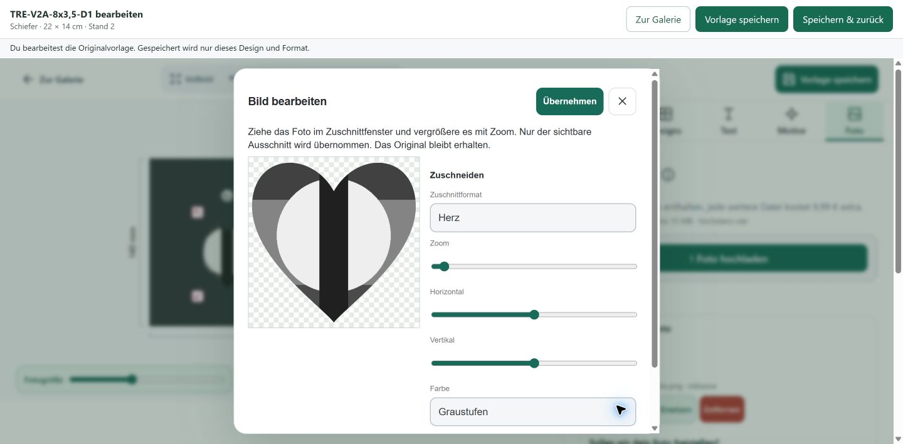
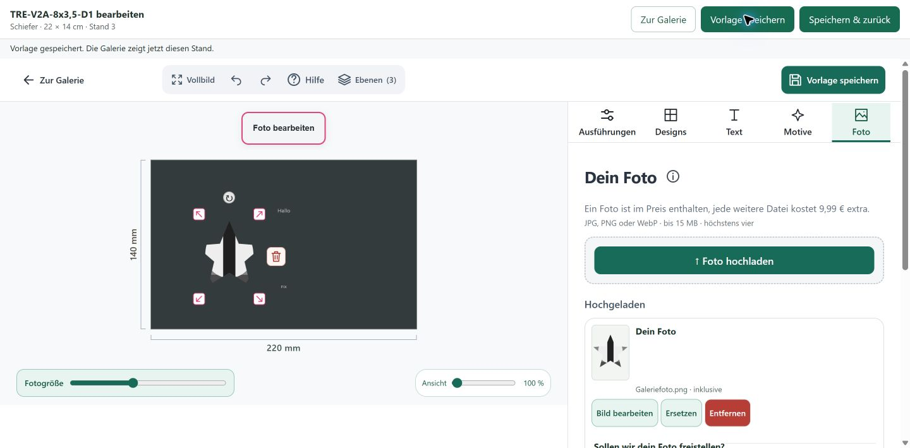

# Galerie → vollständiger Konfi → dieselbe Vorlage

Stand: 06.11.2026, Codex/Mika, Branch `dev/mika-galerie-saveback-20261106`. Dieses Paket ist privat und ungepublished. Kein Main-Merge, Kundenhost-Deployment, Shopify-Schreibzugriff oder echte Designfreigabe.

Auftrag: [vollständige Astra-Übergabe in #168](https://github.com/Chris83638w/gravuru-2027/issues/168#issuecomment-6683765158), [bestehende Galerie #180](https://github.com/Chris83638w/gravuru-2027/pull/180), [Katalog-Edelstahlpilot #183](https://github.com/Chris83638w/gravuru-katalog./pull/183). Maßgeblich für Designs bleibt der [Design-Master](https://github.com/Chris83638w/gravuru-katalog./blob/main/designs/DESIGN-MASTER.md). Es werden keine Designs neu erfunden oder Motive automatisch ersetzt.

## Quellstand und Trennung

- PR180 `b7e6d6fc9f2b6517b2c41c997d112cdb5895c79a` war die Galeriebasis.
- Der vollständige, bereits vorhandene R12-Editor `8cb8c3caa63f9066020252e79932a5c984e951dc` wurde im isolierten Branch integriert (`66f5c991`). PR180 allein enthielt die aktuellen Fotozuschnitte, Medienwiederherstellung und Bedienkorrekturen nicht. Das ist Quellenintegration, kein erneutes Kunden-Deployment. Der spätere R13-Werkzeugleistenprototyp ist nicht enthalten.
- Astras materialfähiger Import-/Galerieadapter `b2e6857517fa0694887bba3f20c8b2a6099cf5a6` wurde übernommen (`9ff22bea`). Sein Import wird nicht parallel nachgebaut. Der PR ist auf diesen Pilotbranch gestapelt.
- Erster Saveback-Checkpoint `367a92db`; auf Nutzerwunsch ausdrücklich als laufend gesicherter Stand `2a8b8abe69bcf52be04f30a1cbd0dfbb8fa29b73`. Die zentrale Sicherungsakte liegt in [Dokumentations-PR #183](https://github.com/Chris83638w/gravuru-2027/pull/183); dieser Code-PR enthält die Weiterentwicklung nach dieser Sicherung.

## Fertiger privater Weg

`Bearbeiten` öffnet `/originale/editor` und darin den vollständigen vorhandenen Editor. Der Server bindet ausdrücklich `productId`, `nativeDesignId`, `originalId`, Material, `sizeKey`, Millimetermaße und Produktrevision. Eine Native-ID wird niemals zurück in eine Katalog-ID geraten. Kommas in `TRE-V2A-8x3,5-D1` bleiben erhalten.

`Vorlage speichern` schreibt nur die gewählte native Gestaltung derselben `cfg_…`-Produktgruppe. `Speichern & zurück` kehrt zur richtigen Karte und zum richtigen Format zurück. Filter, Kommentare und andere Gestaltungen bleiben erhalten. Die Schnellbearbeitung lädt denselben neuen Stand. Der bestehende Fingerprint macht eine alte Freigabe dieser geänderten Gestaltung ungültig; eine unveränderte Nachbargestaltung behält ihren Fingerprint und ihre Freigabe.

Die Produktrevision ist ein Vergleichsstand für die gesamte Produktgruppe. Bei paralleler Änderung antwortet der Server mit Konflikt; die ungesicherte Gestaltung bleibt offen, und ein Link öffnet den aktuellen Stand separat. Es erfolgt keine automatische Zusammenführung oder stille Überschreibung.

Unverändertes Öffnen/Speichern erzeugt keine neue Produktrevision, auch bei Koordinaten mit mehr als zwei Nachkommastellen. Operatorrechte gelten ausschließlich im privaten ausgelieferten Modell. Bestehende Kundenrechte werden beim Speichern beibehalten; technische Ebenen bleiben geschützt. Der Galerieeditor zeigt keine Kaufleiste und stellt `Zur Galerie` / `Vorlage speichern` dar.

## Fotos, Masken und Motive

- Bestehende Beispielbilder werden aus dem nativen privaten Ressourcenbestand geladen. Keine Übernahme eines zufälligen Kundenentwurfs oder Browser-Sitzungsstandes.
- Originaldatei, verarbeitete Datei, erneute Bearbeitungsquelle und Rezept werden dauerhaft und unveränderlich in der bestehenden `design-assets.sqlite` gesichert. Neue Tabelle: `review_photo_edits`; Binärdaten bleiben im vorhandenen Inhaltsadressspeicher `design_sources`. Der bestehende `photo_example_sources`-Index verweist weiterhin auf die Originalbytes, auch für vorhandene AI-/Fotoquellenfunktionen.
- Native Vorlagen enthalten nur dauerhafte `photoExamples`-Referenzen. Keine `blob:`-URL, temporäre Upload-ID oder Kundenmedienreferenz wird als Galerievorlage gespeichert. Das Originalmasken-Asset bleibt erhalten. Verschieben/Skalieren, wiederholte Bearbeitung und Zuschnittrezept werden geprüft.
- Ein unverändertes Bild verwendet sein vorhandenes Asset erneut. Veränderte Originalbytes, Bildfassung oder Rezepte erzeugen eine andere native Ressource und damit einen anderen Prüf-Fingerprint.
- Neue/ersetzte Fotos verwenden dieselbe wirksame Standardfarbe wie der Editor. Farboperationen für passive native Vorschaubilder werden im vorhandenen Fotoworker eingebrannt; Originalbytes bleiben unverändert. Der SVG-Validator wurde nicht gelockert.
- Hinzugefügte Bibliotheksmotive, darunter beide aktuellen Haus-IDs, werden über den vorhandenen geprüften passiven Assetimport übernommen. Alte vererbte SVG-Farbe kommt aus `formMotif`; rohe Bibliotheksfragmente werden nicht in die eng validierten lokalen Ressourcen kopiert.
- Fehlende Fotos verhindern die Speicherbereitschaft und melden den Fehler an den Host. Ausbleibende Start-/Snapshot-Antworten enden sichtbar statt mit dauerhaft deaktiviertem Speichern.

Haupteinstiege: `app/workshop/gallery-editor.mjs`, `gallery-photo-media.mjs`, `app/configurator/variant-m/gallery-workbench.mjs`, `app/workshop/ui/gallery-editor.*`, `scripts/lib/gallery-editor-http.mjs`. `service.save()` ist wegen des geprüften Motivimports asynchron und muss mit `await` aufgerufen werden.

## Prüfnachweise

150/150 betroffene Node-Tests bestanden. Enthalten: 7 Serviceprüfungen, 1 HTTP-Gesamtfluss, 3 Bridgeprüfungen sowie bestehende Galerie-/Freigabe-/Kommentar-/Inline-, Foto-/Masken-/Farbausgabe-, AI-Originalzugriff-, Rechte- und Bundleprüfungen. `git diff --check` sauber. Python/Pillow sind für den vorhandenen Foto- und Assetworker erforderlich; keine neue Abhängigkeit.

```powershell
node --test app/configurator/variant-m/gallery-workbench.test.mjs app/configurator/variant-m/element-rights.test.mjs app/configurator/variant-m/bundle.test.mjs app/configurator/variant-m/image-processing.test.mjs app/configurator/variant-m/photo-editor.test.mjs app/configurator/variant-m/photo-position.test.mjs app/configurator/variant-m/photo-upload.test.mjs app/configurator/variant-m/photo-upload-geometry.test.mjs app/workshop/gallery-editor.test.mjs app/workshop/gallery-editor-http.test.mjs app/workshop/ai-image.test.mjs app/workshop/photo-color-export.test.mjs app/workshop/photo-mask-position.test.mjs app/workshop/photo-frame-coverage.test.mjs app/workshop/katalog-photo-assets.test.mjs app/workshop/slate-review-positions.test.mjs scripts/design-review-targets.test.mjs scripts/design-review-approvals.test.mjs scripts/review-material-gallery.test.mjs scripts/slate-review-gallery.test.mjs scripts/slate-review-gallery-navigation.test.mjs scripts/slate-review-comments.test.mjs scripts/slate-review-approvals-ui.test.mjs scripts/slate-review-inline-ui.test.mjs
```

Zusätzlich unabhängige echte Katalogprüfung durch Root: 146 Zielbindungen geöffnet und mit Quellen/Geometrie verglichen; acht unveränderte Speicherungen ohne Revision oder Dokumentänderung. PC: Komma-ID bei 120 × 52,5 mm geändert, zurück zur richtigen Karte, Freigabe der Nachbargestaltung und Kommentar erhalten; Inline-Nachänderung im Voll-Konfi sichtbar; veralteter paralleler Tab ausdrücklich abgefangen. Mobile Browseransicht: beide kleinen Ovaloriginale bei 150 × 80 mm geöffnet, Text/Schrift geändert, Haus hinzugefügt und zurückgespeichert. Bei `TO-V2A-15x8-D3` wurde das gespeicherte Haus nach erneutem Öffnen über den Papierkorb gelöscht und Revision 5 zurückgelesen; ursprüngliche Linie und Texte blieben erhalten. Eine ausschließlich im Testtab blockierte Editorressource führte zu sichtbarer Fehlermeldung in Host und Iframe sowie gesperrten Speicherknöpfen. Nach Aufheben der Blockade ließ sich normal weiterbearbeiten; keine Browserblockade oder Ansichtsüberschreibung blieb bestehen. Dies ist Browserprüfung mit mobiler Ansicht, keine Behauptung eines physischen Handytests.

Die unabhängigen Browsernachweise: [Rückkehr zur richtigen PC-Karte](galerie-saveback-20261106/rueckspeichern-pc.jpg), [abgefangener Speicherkonflikt](galerie-saveback-20261106/speicherkonflikt-pc.jpg), [gespeichertes Motiv und Schrift in mobiler Ansicht](galerie-saveback-20261106/motiv-schrift-handy.jpg), [sichtbarer Ladefehler mit gesperrtem Speichern](galerie-saveback-20261106/ladefehler-handy.jpg).

Synthetischer Foto-Browsertest auf eigenem isolierten Store: unveränderte Beispielaufnahme ohne Revision gespeichert; Herz/Spiegelung → Revision 2; nach Neuladen Herz-Rezept wieder geöffnet; erneuter Sternzuschnitt → Revision 3; neues unbearbeitetes Foto ohne Farbeingriff → Revision 4. Originalbytes beider Fotos nach Rücklesen identisch zur Testdatei. Zwei Nachweise:




Die Bilder zeigen ausdrücklich synthetische Testgrafiken und keine neue Produktgestaltung. Private Testdatenbanken und lokale Sicherungen werden nicht ins Repository aufgenommen.

## Offene Grenzen und nächster Schritt

1. **Logo-Umfang geprüft:** Alle 73 tatsächlichen Stahl-Pilotprodukte liefern `logo.enabled=false` und `photo.enabled=false`; auch das vorhandene 43-Hundedesigns-Modell `22x14.json` hat `logo.enabled=false` (Foto aktiviert). Keine aktivierte Logo-Funktion dieser Prüfprofile fehlt deshalb. Vorhandene native Katalogmotive/-grafiken bleiben erhalten. Neue Logo-Uploads für künftig aktivierte Profile sind dagegen noch nicht nativ verbunden und werden sichtbar zurückgewiesen. Technische Grenze: Der Kundeneditor hält Logos als transiente `image`/`uxUploadId`-Objekte; geprüfte Vektorlogos benötigen unveränderte SVG-Originale, bestätigte Schwarzfassung und `svg-black-v1`-Prüfsummen. Ein Import nur als Motiv würde Original-/Prüfbezug und erneutes Ersetzen als Logo verlieren. Rasterlogos brauchen zusätzlich ihren Farb- und Quellenstand. Dafür ist eine explizite native Asset-/Provenienz-Anbindung nötig; diese Produktfähigkeit wurde hier nicht ungefragt aktiviert oder in den Kundenmodellen verändert.
2. Technische Führungen und Rasterteile bleiben unverändert. Synthetische Gestaltungslinien werden im Galerieeditor als native Quelllinien angezeigt, nicht still als bearbeitbare Schattenobjekte gespeichert.
3. Dies ist die Rückspeicherung in den privaten nativen Galerie-/Werkstattstand, kein Commit veränderter Katalogquelldateien, kein Shopify-Spiegel und kein Shop-Publish. Astra verantwortet weiter Import und Galerieübernahme. Die private HTTPS-Veröffentlichung dieser Änderung ist noch nicht erfolgt.
4. Vorschlag zur separaten Optimierung: Der vorhandene Rendererfingerprint hasht die gesamte `http.mjs`. Ein serverseitiger API-Umbau kann dadurch alle alten Sichtfreigaben entwerten, obwohl andere Designs gleich aussehen. Die Fingerprintgrenze sollte separat auf tatsächliche Renderabhängigkeiten präzisiert werden; hier wurde sie bewusst nicht abgeschwächt.

Genau nächster Schritt: PR gemeinsam mit Astras Pilotbranch prüfen und danach einen ausdrücklich autorisierten privaten Hoststand mit frischer Datenbanksicherung abnehmen. Einen Logoanschluss vor dem ersten Prüfprofil mit aktiviertem Logo separat konkretisieren. Kunden-Live bleibt außerhalb dieses Auftrags.
