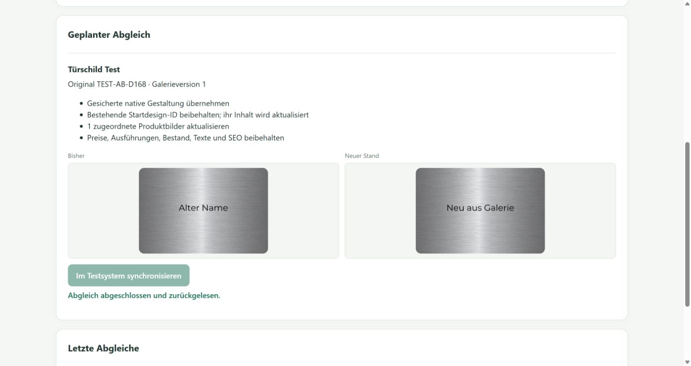
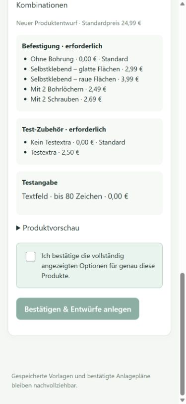

# Galerie-Synchronisierung und bestätigte Produktgruppen

Stand: 06.11.2026, Codex/Mika. Branch `dev/mika-galerie-sync-vorlagen-20261106`, auf `f8e55358272fe9fabdb29de7db15c6592f2cfecc` aus [PR #184](https://github.com/Chris83638w/gravuru-2027/pull/184). Eigener gestapelter PR; kein Main-Merge, keine Hostübernahme und kein Zugriff mit Schreibwirkung auf den Live-Shop.

## Verbindlicher Auftrag und vorhandene Sicherung

Mikail: „Ja, setze die Synchronisierung und die Produktgruppen-Vorlagen so um. Die Optionen müssen vor dem Anlegen bestätigt werden. Stimm dich mit Astra ab und ändere noch nichts am Live-Shop.“

Gemeint ist: Galerievorlage bearbeiten, konkrete Änderungen prüfen, bewusst synchronisieren. Unterkategorien bestimmen angebotene Materialfamilien. Vor jeder konkreten Produktneuanlage werden alle tatsächlichen Optionsbereiche bestätigt. Klebeband, Bohrungen usw. waren Beispiele; daraus werden keine Angebote abgeleitet. Eine Gruppe kann beliebig benannte bestehende Optionsbereiche und Zusatzfelder enthalten. Preise und technische Regeln kommen weiterhin aus den nativen Quellen.

Die vorherige umfassende Sicherung bleibt unverändert: [Gesamtakte / Dokumentations-PR #183](https://github.com/Chris83638w/gravuru-2027/pull/183), `docs/handoffs/2026-11-06-mika-konfi-gesamtstand-und-sicherung.md`, insbesondere Abschnitte 8, 12 und 13. Lokale Checkpoints und Datenbankkopien sind dort inventarisiert. Dieses Paket entstand in einem neuen Worktree; der alte Arbeitsstand wurde nicht überschrieben. Private Datenbanken, Testprodukte, Rohbilder und Zugangsdaten werden nicht mit Git eingecheckt. Das ist keine neue vollständige Sicherung des laufenden Shopify-/Hostsystems.

Abstimmung: [Startnachricht in #168](https://github.com/Chris83638w/gravuru-2027/issues/168#issuecomment-6686949586). Astra behält den Import-/Materialzieladapter. Drei Unteragenten teilten Vorlagen/Bestätigung, Sync/Medien sowie Materialauswahl/Review auf. Der `design-review-targets`-Vertrag wurde nicht parallel ersetzt. Bis zum Abschluss dieser Arbeit lag keine neue Antwort von Astra auf diese Startnachricht vor; abschließende Nachweise werden ebenfalls in #168 hinterlegt.

Der [Design-Master](https://github.com/Chris83638w/gravuru-katalog./blob/main/designs/DESIGN-MASTER.md) bleibt maßgeblich. Dieses Paket erfindet keine Verkaufsdesigns. Die Screenshots zeigen ausdrücklich synthetische Testprodukte.

## Bedienung und gespeicherte Daten

Die private Galerie besitzt jetzt den Einstieg **Produktgruppen & Synchronisierung öffnen** unter `/originale/verwaltung`.

1. **Produktgruppen:** Linie, Unterkategorie und vorhandene Material-/Größenstände wählen. Bestehende Optionsbereiche und Werte einschränken, Bezeichnungen, Pflichtangaben und Standards festlegen. Alle Preise und technischen Regeln bleiben aus der Quelle erhalten. Offene Angaben werden ausdrücklich gespeichert und verhindern eine Anlage.
2. **Produkte anlegen:** Gespeicherte Vorlage und konkrete Produkte auswählen. Die Übersicht zeigt alle angebotenen Werte, Aufpreise, bedingte Verfügbarkeit, Zusatzfelder, Standardauswahl, Formate, gültige Kombinationen und native Vorschau. Erst das ausdrücklich gesetzte Häkchen und **Bestätigen & Entwürfe anlegen** erzeugen lokale Produktentwürfe.
3. **Synchronisieren:** Zugeordnete bestehende Produkte auswählen. Vorher/Nachher, Original und Quellrevision prüfen. Der Abgleich verwendet den bearbeiteten nativen Galeriestand, nicht einen erneuten Import alter Katalog-SVGs. Gespeicherte Vorgänge bleiben nach Neuladen wieder öffnungsfähig.

Vorlagen, Versionen, konkrete Anlagepläne und Bestätigungen liegen in den neuen `product_group_*`-Tabellen der privaten Werkstattdatenbank. Produkte selbst entstehen ausschließlich durch den vorhandenen `repository.importBatch` samt Importjournal. Keine zweite Produktdatenbank oder duplizierten Grundplatten. Eine andere Material-/Formatfassung braucht weiterhin ihre tatsächliche native Geometrie und einen expliziten Quellstand.

Die Bestätigung bindet Template-ID/-Revision, konkrete Namen und Zuordnungen, vollständige native Dokumente, Quellrevisionen sowie den Materialstand der Unterkategorie. Nach einer relevanten Änderung ist eine neue Prüfung erforderlich. Der letzte Vergleich erfolgt unter der Schreibtransaktion der echten Produktanlage. Wiederholung und Wiederaufnahme verwenden denselben Importumfang, ohne Produkte doppelt anzulegen.

Auf dem privaten Galeriehost leitet ein vorgeschaltetes Gate alte unmittelbare native Neuanlagen mit HTTP 428 zur neuen Strecke. Es umfasst Produkte, Kopien, Formprodukte, Familienprodukte, Bestellkopien, neue Variantengruppen und alte Tabellen-Commits. Alte Tabellen-Commits werden dort vollständig gesperrt, auch reine Update-Tabellen; bestehende Einzelbearbeitungen bleiben möglich. Katalogeinträge, die nur die Planung beschreiben, Vorschauen und CLI-Importe bleiben getrennte Werkzeuge. Der allgemeine Kundenserver wird durch dieses private Gate nicht verändert.

## Materialauswahl je Unterkategorie

Ein gemeinsamer Resolver liest `subcategories[].familyIdsOffered`:

- fehlend oder `null`: Vorgabe der Produktlinie übernehmen;
- `[]`: keine neuen Materialangebote aus dieser Unterkategorie;
- Liste echter Familien-IDs: ausdrücklich ausgewählte Familien.

Der vorhandene Katalogeditor zeigt diese Auswahl. `PATCH /api/workshop/catalog-structure` mit `action: "materials"` benötigt Linie, Unterkategorie, Auswahl und den aktuellen `sourceSha256`. Der vorhandene Katalog-Lock, atomare Transaktion und `_aenderungen.jsonl` sichern die Änderung. Andere Änderungen werden nicht still überschrieben. UI, Importplan, gemeinsame Formatauswahl, Schiefer-Hauptprodukte und Angebotsanzeigen verwenden denselben Resolver. Quellidentität und Design-Inferenz bleiben unverändert.

AA/AS bleiben die eigenen 5-mm-Familien `acryl-aa-abstandshalter` / `acryl-as-abstandshalter`. Ein gewähltes Material ist noch keine fertige Produkt-/Formatanbindung. `familyFormatsSupported` / `unsupportedFamilyFormatIds` bezeichnet ausschließlich den vorhandenen gemeinsamen Türschild-Formatadapter; unabhängig vorbereitete Einzelprodukte werden dadurch nicht pauschal als unbrauchbar bezeichnet. Eine Abwahl löscht oder archiviert keine vorhandenen Produkte.

## Synchronisierung und Shopanschluss

Serverseitige Zuordnung, niemals aus frei eingegebenen Browser-IDs:

```js
{
  id: 'feste-zuordnung', label: 'Produktbezeichnung',
  source: { productId: 'cfg_…', designId: '…', originalId: '…' },
  target: { productId: 'cfg_…', designId: '…' },
  shopifyProductId: 'gid://shopify/Product/…',
  shopifyVariantIds: ['gid://shopify/ProductVariant/…'],
  media: [{ id: 'gid://shopify/MediaImage/…' }]
}
```

Die Galeriequelle muss aktuell für genau das Original/Material/Format sichtgeprüft sein. Der bestehende Zielanschluss muss bereits seine Katalogfreigabe, vollständigen Varianten und Preise besitzen. Original-ID, tatsächliches Startdesign, Geometrie, Material und Fertigungsverfahren werden geprüft; unbekannte Aliase oder Formatumrechnungen werden blockiert. Ein Sync ändert keine Startdesign-ID. Native Objekte, Fotooriginale, Bearbeitungsquelle, Zuschnittmasken und Ressourcen werden erhalten. Gleich benannte abweichende Ressourcen überschreiben keine anderen Designs.

Der Plan ist unveränderlich. Ein separates privates SQLite-Journal speichert geplante, laufende, unklare und abgeschlossene Vorgänge. Dauerhafte Besitzsperren je Konfi- und Shopify-Produkt verhindern auch bei zwei vorab angelegten Plänen doppelte Übertragungen. Unklare Antworten verlieren diesen Schutz nicht durch Zeitablauf. Jede Schreibabsicht wird vorher festgehalten.

Eine neue Zielrevision wird vorbereitet; Shopify erhält nur die zugeordneten Bilddateiänderungen und das abgeglichene `gravuru.gallery_release`-Metafield. Die Antwort wird erneut gelesen. Erst nach belegtem Ergebnis wechseln vorhandene Variantenbindungen und Katalogfreigabe in derselben Datenbanktransaktion auf den neuen Stand. Alte Produktrevisionen und bezahlte Bestellstände bleiben unverändert. Preise, Ausführungen, Bestand, Produkttexte und SEO werden nicht neu geschrieben.

Eine unklare Schreibantwort wird ausschließlich zurückgelesen, nicht automatisch noch einmal gesendet. Ein Konflikt vor Änderungen gibt das Ziel frei. Ein Konflikt nach begonnener Übertragung bleibt gesperrt und benötigt eine gezielte Klärung; es gibt keinen automatischen Shop-Rollback. Ein Batch ist keine verteilte atomare Transaktion zwischen Shopify und SQLite. Die Oberfläche zeigt deshalb einen solchen Zustand als offen/angehalten, niemals als erfolgreichen Gesamtabschluss.

### Tatsächlich montierbarer Anschluss

`scripts/lib/gallery-shop-connection.mjs` exportiert `createGalleryShopConnection`. Sie verbindet die vorhandenen Werkstätten, den authentifizierten serverseitigen GraphQL-Transport, echte Bindungen, PNG-Vorbereitung, Medienadapter und die Freigabeprüfung. `executionEnabled` und `writesEnabled` sind **standardmäßig false**. Die Konstruktion sendet keinen Shopify-Aufruf. Der Journalspeicher muss vom Produkt-/Bestellspeicher getrennt sein.

Der Galeriehandler akzeptiert:

```js
management: {
  filename: absoluteWorkshopDatabase,
  synchronizer: ({workshop, sourceApproval}) => createGalleryShopConnection({
    sourceWorkshop: workshop, targetWorkshop,
    shopDomain, targets, journalFilename,
    graphql, imagePreparation, mediaAdapter, sourceApproval
    // Schreibschalter bleiben aus.
  })
}
```

Zugangsdaten, Zielregistry, Domain, öffentliche Bildadresse und Signierschlüssel kommen ausschließlich aus der Serverkonfiguration. Die jetzige Standard-Prüfgalerie enthält absichtlich keine geratenen Live-Zuordnungen. `serve-slate-review.mjs` akzeptiert zusätzlich `--katalog <Arbeitskopie>` für den bestehenden Katalogeditor. Ein zugehöriger Katalog-Commit und `build-katalog.py` sind erst beim späteren tatsächlichen Katalogdatenpaket erforderlich; hier wurde keine echte Liniendatei geändert.

### Produktbilder

`createGallerySyncImagePreparation` speichert ausschließlich aus der nativen Vorschau abgeleitete PNGs, unveränderlich und getrennt von Originalfotos/Archiven. `createGallerySyncBrowserRasterizer` verwendet einen ausdrücklich serverseitigen, isolierten Offline-Chromium mit dem vorhandenen SVG; keine zweite Design-/Schriftlogik und kein Benutzerprofil. Vorhandene Textpfade, Platte, Fotomaske und Seitenverhältnis bleiben erhalten. Nur Editor-Hilfslinien werden nicht ins Produktbild übernommen.

Die öffentlich erreichbare Auslieferung ist nur GET/HEAD über `matches`/`read` unter `/galerie-produktbilder/<tenant>/<sha>/<HMAC>.png`, `image/png`, `nosniff` und unveränderlichem Cache. Andere Dateien, SVGs und Originaluploads sind darüber nicht erreichbar. Freigegebene Bild-URLs benötigen eine richtige HTTPS-Hostroute. PNG-Ablage, Signierschlüssel und Browserprozess sind Betreiberkonfiguration, keine Browserfelder.

`createGallerySyncShopifyMedia` verwendet gezieltes `fileUpdate({id, originalSource})` für registrierte MediaImage-IDs. Keine Media-Liste, Variantenzuordnung oder fremden Dateiattribute werden ersetzt. Der Adapter prüft die Originalbytes mit SHA-256 und den abgeschlossenen Verarbeitungsstand. Er scannt vollständig die Produktmedien vor/nach dem Update und blockiert gemeinsame Produktdateien. `dedicatedProductFiles: true` ist zusätzlich ausdrücklich erforderlich: Shopify bietet keine atomare Sperre gegen gleichzeitig geänderte Referenzen und keinen vollständigen Rückverweis auf Verwendung in Theme-/Beschreibungstexten.

Der Bildadapter schreibt standardmäßig nicht. Der vollständige Medienscan ist bewusst konservativ und kann bei großen Shops teuer sein (standardmäßig begrenzt auf 10.000 Produkte und 1.000 zusätzliche Medienseiten). Eine unvollständige Prüfung blockiert. Speicher-Origins werden serverseitig freigegeben; Standard ist `https://cdn.shopify.com`. Die kurzlebige Originaldatei-URL wird nur zum Beleg gelesen, nicht als dauerhafte Shopbildadresse gespeichert.

Primärquellen: [fileUpdate](https://shopify.dev/docs/api/admin-graphql/latest/mutations/fileUpdate), [MediaImageOriginalSource](https://shopify.dev/docs/api/admin-graphql/2026-07/objects/MediaImageOriginalSource), [Shopify-CDN-Verhalten bei Dateiänderungen](https://shopify.dev/changelog/posts/replacing-or-deleting-a-shopify-hosted-file-no-longer-purges-its-cdn-url), [Metafield-CAS](https://shopify.dev/docs/api/admin-graphql/2026-10/mutations/metafieldsSet). Diese Quellen begründen die enge Aktualisierung und das erneute Lesen tatsächlicher Inhalte.

## Prüfnachweise

203 unterschiedliche gezielte Tests erfolgreich. Im kombinierten Lauf waren zunächst 202 erfolgreich und ein alter Galerie-HTTP-Test beanstandete eine unnötige Beschränkung der serverseitig gelieferten CSRF-Token auf Hexzeichen. Der vorhandene Vertrag erlaubt auch andere opake Token; das wurde kompatibel korrigiert. Der betroffene Alt-Test und beide neuen HTTP-Integrationstests bestanden anschließend (3/3). Keine Testwerte wurden an ein fehlerhaftes Produktergebnis angepasst.

Abgedeckt: native Entwurfsanlage und historische Versionen, echte Repository-Transaktionen und Bindungsspeicher, alle Optionsbereiche/Abhängigkeiten, Standardpreise, ausdrückliche Bestätigung, ungültiger/geänderter Materialstand, Wiederholung/Neustart, fremder Mandant/Shop, Original-ID an beiden Designorten, tatsächliches Startdesign, Format-/Materialkonflikte, Fotos/Masken zwischen getrennten Assetstores, bezahlte synthetische Bestellung, alte Bestellarchive, zwei konkurrierende Pläne, Unterbrechungen nach Draft/Shopantwort/Aktivierung, Medienpaginierung, echte Datei-SHA, HTTP-CSRF und native Galerie-Rückspeicherung.

Der gemeinsame Anschluss-Test nutzt reale Werkstätten, realen Medienadapter und echte Bindungstransaktionen. Nur Shopify-GraphQL und Dateidownload werden simuliert: exakt `fileUpdate` → Metafield-CAS → erneuter Inhaltsnachweis → Bindung auf Revision 2. Wiederholen erzeugt keine weiteren Schreibvorgänge. Ein gesonderter Test rasterisiert mit einem echten lokal gestarteten Offline-Chromium, inklusive Foto/Ovalmaske.

Sichtbare Browserprüfung am PC und bei **390 × 844 CSS-Pixeln**: Vorlage mit zwei Größen speichern, Optionswerte ausschließen, Anlagebutton ohne Bestätigung gesperrt, bestätigte interne Entwürfe anlegen, Materialauswahl speichern und zurücklesen, Galerie-Sichtfreigabe, Vorher/Nachher, Test-Synchronisierung, Neuladen und denselben gespeicherten Vorgang öffnen. Keine Prüfung auf einem physischen Handy behauptet. Kein echter Shopify-Warenkorb oder Live-Kauf gehört zu dieser isolierten Abnahme.





Testdateien des kombinierten Laufs: `product-group-templates`, `subcategory-materials`, `gallery-shop-sync`, `gallery-shop-sync-media`, `gallery-management-creation-gate`, `gallery-shop-connection`, `scripts/gallery-management`, `catalog-structure`, `katalog-linien`, `katalog-source`, `katalog-family-formats`, `katalog-import`, `slate-product-groups`, `design-dashboard-startdesigns`, `design-target-dashboard`, `design-dashboard`, `repository`, `shop-product-binding-store`, `shop-product-binding-adapter`, `catalog-live-orders`, `gallery-editor`, `gallery-editor-http`, `scripts/slate-review-gallery`, `scripts/review-material-gallery` (jeweils `.test.mjs`). Lauf mit `node --test --test-concurrency=2`, vorhandenem Python/fontTools/Pillow und ausdrücklich gesetzten lokalen Playwright-/Chromium-Pfaden. Kein Download oder Installieren neuer Pakete erforderlich.

Reproduzierbare private Browserumgebung: `node scripts/serve-gallery-management-test.mjs --synthetic-only --data <NEUER_ORDNER> --port 8203`. Sie verwendet lokale echte Werkstattdatenbanken und einen nachgebildeten Shop ohne Netzwerktransport. Vorhandene Datenverzeichnisse werden nicht überschrieben.

## Bewusste Grenzen und nächster Schritt

- Kein Main-Merge, Live-Deployment, tatsächlicher Shopify-Abgleich oder Freischalten von Kundenprodukten. Keine echten Verkaufsdesigns freigegeben.
- Der gezielte Sync aktualisiert vorhandene zugeordnete Hauptprodukte. Neue Shopify-Produkte, allgemeine bidirektionale Shopspiegelung, Lager-/Bestellverwaltung und Preisänderungen sind keine impliziten Nebenwirkungen.
- Neue Produktgruppen werden als **lokale native Entwürfe** angelegt. Die bisherige Erstverbindung/Verkaufsfreigabe bleibt ein gesonderter Schritt. Eine Materialauswahl erzeugt nicht automatisch alle Formatadapter.
- Der native Produktvalidator bleibt maßgeblich. Ein altes Mehrformatmodell, dessen zusätzliche eingebettete Formatdaten eine Einschränkung ignorieren würden, wird nicht scheinbar erfolgreich bestätigt. Auch materialspezifische feste Optionsregeln werden nicht umgangen. Neue technische Optionstypen benötigen passende Stammdaten und ihren bestehenden nativen Anschluss.
- Sync zwischen unterschiedlichen Geometrien/Verfahren und Mehrformat-/Mehrmaterial-Shopprodukten benötigt explizit geprüfte einzelne Zieladapter von Astra. Der bisherige Originalzeilen-Materialvertrag bleibt bestehen; keine künstlich duplizierten Originale als Umweg.
- Nächster Schritt: Astra prüft diesen gestapelten PR mit dem Importvertrag; anschließend eine Produktgruppe mit echten Zuordnungen in einer privaten Kopie abnehmen. Vor späterer Live-Anbindung neue vollständige Host-/Datenbanksicherung, eindeutige Shop-/Medienregistry, kontrollierte Bildroute und ausdrückliche Freigabe. Der jetzige Auftrag gibt keine Live-Freigabe.

Optimierungsvorschlag, **nicht zusätzlich umgesetzt**: vor dem späteren Start die wiederkehrende Prüfung exklusiver Produktbild-Dateien über eine belastbare verwaltete Registry beschleunigen. Eine solche Optimierung darf den Nachweis gemeinsamer Dateinutzung und paralleler Änderungen nicht abschwächen.
