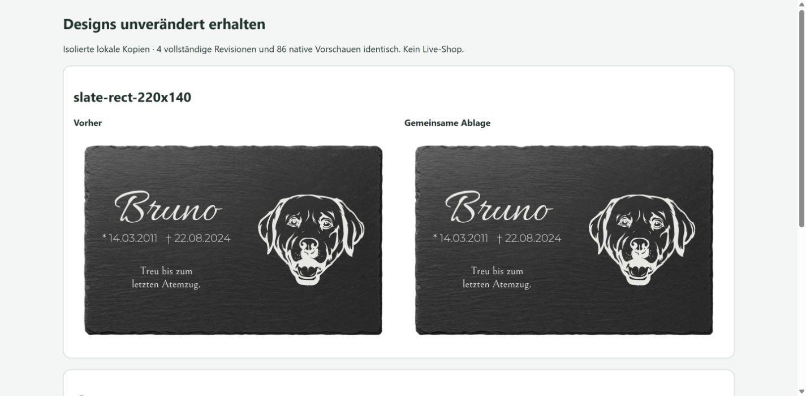

# Mika · Gemeinsame Grundplatten und Schriften

Stand: 07.11.2026. Eigener Branch `dev/mika-gemeinsame-ressourcen-20261107`, Ausgangscommit `3ad2cdc3947db211c1c5864c3acb8faa1883fa62` aus Draft-PR #189. Dieses Paket ist noch kein Main- oder Online-Stand.

## Auftrag und unveränderte Fachregeln

Mikail: „Ja, setze die gemeinsame Ablage für Grundplatten und Schriften um. Vorher bitte sichern. Die Designs müssen gleich bleiben. Arbeite getrennt weiter, ohne Astra zu stören oder etwas am Live-Shop zu ändern.“

Die Umsetzung ändert die interne Speicherung. Maße, Bohrungen, Konturen, Preise, Optionen, Freigaben, Fotos, Masken, Motivquellen und Schriftzeichen werden nicht neu definiert. Quelle dieser Grenze ist der ausdrückliche Nutzerauftrag. Der [Design-Master](https://github.com/Chris83638w/gravuru-katalog./blob/main/designs/DESIGN-MASTER.md) gilt weiterhin; kein Design wird umgestaltet. Keine Nachricht an Astra, kein Wechsel seiner Arbeitskopie, keine Umschaltung der privaten Online-Galerie oder des Shops.

## Gemeinsame Ablage

Die neue interne Tabelle `product_document_resources` liegt in derselben `workshop.sqlite` wie die Produkte. Identische vollständige Schriftobjekte und eingebettete Grundplattenbilder werden je Mandant nur einmal gespeichert. Unveränderliche Referenzen enthalten Art und SHA-256 des exakten Inhalts. Unterschiedliche Bilder oder Schriftstände behalten getrennte Einträge.

Der Speicheradapter löst Referenzen vor der Übergabe an Konfi, Galerie, Preise, Sync, Produktion und Bestellprüfung wieder vollständig auf. Das öffentliche Produktformat bleibt gleich. Alle Schriftvarianten und Zeichen bleiben erhalten; kein Subsetting, keine Bildkonvertierung und kein Austausch einer Vorlage. Abweichend formatierter älterer JSON-Text bleibt unverändert eingebettet, damit bestehende Freigabehashes nicht durch eine Normalisierung ungültig werden.

Neue Produktrevisionen verwenden die Ablage automatisch. Bestehende Revisionen werden beim normalen Öffnen nicht umgeschrieben. Für den Altbestand gibt es ein ausdrücklich aufzurufendes Kopierwerkzeug: zuerst eine vollständige neue Sicherung, danach eine neue Zielkopie. Die Quelle wird nicht überschrieben. Ein Rückweg erweitert die Referenzen wieder zu vollständigen Dokumenten in einer weiteren neuen Kopie.

Schema V5 verhindert, dass ältere Anwendungen kompakte Dokumente versehentlich falsch lesen. Aktive direkte Datenbankleser wurden auf denselben Adapter umgestellt, einschließlich Freigabe-/HMAC-Hashing, Rückschreiben, Import und Cloudbackup. Fehlende, beschädigte oder einem anderen Mandanten gehörende Ressourcen werden nicht stillschweigend ersetzt.

## Grundplatten und skalierbare Größen

Im gesicherten Edelstahl-Prüfbestand nutzen 73 Produktgruppen dieselbe vorhandene Bilddatei. Diese wird gemeinsam gespeichert; jedes Produkt behält seine eigene tatsächliche Größe und Kontur. Das Bild ist die Materialdarstellung, nicht die Maß- oder Bohrschablone.

Die beiden vorhandenen Schieferbilder für 22 × 14 und 30 × 20 cm unterscheiden sich tatsächlich. Sie bleiben getrennt. Eine Zusammenführung allein nach Materialname, Dateiname oder ähnlichem Aussehen wäre keine unveränderte Darstellung. Auch verschiedene Seitenverhältnisse werden nicht gleichgesetzt. Ein gemeinsames Bild erzeugt keine neuen erlaubten Größen oder Befestigungen.

## Sicherung vor der Umsetzung

Privater Sicherungsordner im gemeinsamen Codex-Arbeitsbereich: `work/checkpoints/shared-resources-20261107T090130Z`.

- Vollständiges Codearchiv `code-3ad2cdc3-before.zip`, SHA-256 `c1431f000ffcedab9f52a979c24bdc222b401e7a5028690fb96241019dce30b8`; ZIP-Integrität geprüft.
- Erstes Manifest `BACKUP.json`: 237 Dateien, 13 Datenbanken, 800.771.954 Bytes. SHA-256 `a1b16d58fd03b8de7fcaf0a7f49167dadb4e5cce6b2a86ac74b7ee86c1abf05d`. Alle Datenbanken mit erfolgreicher Integritätsprüfung, Kopien mit Dateihashes.
- Zusätzlich `steel-current` und `photo-current`: jeweils fünf aktuelle lokale Datenbanken über SQLite-Sicherung einschließlich bestätigter WAL-Inhalte. Nach der Sicherung ist der jeweilige Quellfingerprint unverändert. Manifeste: `16f8358d81254692e7127e95e1f82c618400fc75bf0da6cac78e045968eaf7e5` und `ae6b7c5bd801355581a4ba359f6002d7e9236ada5bffff258fade1b079f3726e`.
- Datenbanken und private Bild-/Bestelldaten bleiben lokal und gehören nicht in Git. Auf GitHub liegen Code, diese Übergabe und bereinigte Prüfnachweise. Das ist ausdrücklich keine frische Sicherung des laufenden Plesk-Servers.

## Reproduzierbare Umstellung

Alle drei Verzeichnisse müssen getrennt sein; Ziel und Sicherung dürfen noch nicht existieren. Lokale Schreibvorgänge während der Sicherung anhalten. Nie den laufenden Datenbestand als Ziel verwenden.

```text
node scripts/migrate-product-document-resources.mjs --source DATA --target NEW_COMPACT_DATA --backup NEW_BACKUP --mode compact
node scripts/migrate-product-document-resources.mjs --source NEW_COMPACT_DATA --target NEW_EXPANDED_DATA --backup ANOTHER_BACKUP --mode expand
node scripts/check-product-resource-parity.mjs --before ISOLATED_INLINE_COPY --after ISOLATED_COMPACT_COPY --out NEW_REPORT
```

Das Prüfwerkzeug verwendet Kopien, weil das Öffnen der nativen Anwendung vorhandene interne Tabellen initialisieren kann. Geschützte Sicherungen werden nicht direkt als Anwendung geöffnet. Fehlgeschlagene Umstellungsversuche bleiben als solche mit Bericht erhalten und werden nicht als verwendbare Ziele ausgegeben.

## Abnahme und belegte Ersparnis

[Bereinigter Gesamtbeleg](../reviews/2026-11-07-gemeinsame-ressourcen/acceptance.json), [erneute Sicherungsprüfung](../reviews/2026-11-07-gemeinsame-ressourcen/backup-recheck.json).

| Gesicherter lokaler Bestand | Revisionen | Werkstattdatei vorher | Kompakte Werkstattdatei | Gemeinsame Ressourcen |
|---|---:|---:|---:|---|
| Edelstahl-Prüfbestand einschließlich älterer Fontänderung | 81 | 179.855.360 Bytes | 5.386.240 Bytes | 6 vollständige Schriftstände, 1 Grundplattenbild |
| Hund/Schiefer, 22 × 14 und 30 × 20 | 4 | 86.564.864 Bytes | 46.997.504 Bytes | 30 vollständige Schriftstände, 2 unterschiedliche Grundplattenbilder |
| Synthetische Foto-/Maskenprüfung | 5 | 3.248.128 Bytes | 1.732.608 Bytes | 3 vollständige Schriftstände |

**Alle 90 vollständigen historischen Dokumenttexte sind vor/nach Umstellung bytegleich auflösbar.** 78 Produktköpfe, Preise/Optionen und 236 native Vorschauen wurden verglichen. Bei 14 Edelstahl-Konturvorschauen nummeriert der bereits bestehende Renderer interne Masken fortlaufend (`m-design-area-N`); ausschließlich diese lokalen IDs samt zugehörigen Referenzen wurden für den Vergleich vereinheitlicht. Text, Pfade, Bildbytes, Geometrie und Darstellung sind unverändert. Die anderen 222 SVG-Vorschauen sind unmittelbar bytegleich. Der Renderer wurde dafür nicht verändert.

Sieben repräsentative Fertigungsausgaben haben identische SVGs und Konturen: Edelstahl rechteckig/oval/Freiform, beide Schiefergrößen und zwei Fälle der Foto-Testvorlage einschließlich ursprünglicher Bild-/Maskenquellen. Für Pflichtnamen erhielt jeder Vergleich denselben temporären Kundenwert mit vorhandenen Zeichen; das speichert keine Designänderung. Die unveränderte Acryl-Seedvorlage verlangt ein eigenes Kundenfoto und wurde für diesen Fertigungsvergleich ausdrücklich ausgelassen. Ihre Dokument-/Quellen-/Vorschauparität wurde trotzdem geprüft. Dies ist keine Maschinen- oder Verkaufsfreigabe.

**Rückweg:** Alle drei Bestände wurden in neue V4-Kopien erweitert; null verbleibende gemeinsame Referenzen. Die unveränderte Repository-Anwendung vom Ausgangscommit `3ad2cdc3` konnte anschließend alle 90 Revisionen öffnen. Tabellenwerte, Metadaten, alte Archive und auch interne Zeilen-IDs werden bei der Migration geprüft. Wenn `VACUUM` eine solche Zeilen-ID verändert, wird der neue Zielversuch als fehlgeschlagen markiert; die Quelle und Sicherung bleiben erhalten. Ein absichtlich lückenhafter Testbestand belegt diesen Schutz.

**194 unterschiedliche gezielte Tests bestanden:** 37 Speicheradapter/Repository/Katalog, 98 direkte Leser/Bindings/Bestellungen/Import/Backup, 42 Galerie/Sync/native Ausgabe/Mandanten, 17 Kopieren/Migration/Rückweg. Fehlende bzw. falsche Ressourcen, Mandantengrenzen, Rollback, WAL-Sicherung, unerwartete Nebeneffekte und alte Freigabe-/Bestellhashes sind enthalten. Unabhängige Unteragentenprüfung fand nach Korrektur der privaten Dateirechte und Zeilen-ID-Prüfung keine offene aktive Leselücke. Der historische Formprodukt-Exporter unter `handoff/acryl-20261022/` betrifft keine ausgelagerten Felder und gehört nicht zur aktiven Runtime.

Die zusätzlichen Akzeptanzskripte wurden zunächst an zwei korrekten bestehenden Regeln gestoppt: Pflichtnamen dürfen nicht unverändert als Kundenbestellung eingereicht werden, und Fertigung braucht das vorhandene gepinnte Laufzeitmodell. Der Prüfaufruf wurde entsprechend berichtigt, ohne die Fachregeln oder Designs anzupassen. Der fortlaufende lokale Maskenname wurde als reiner SVG-Bezeichner dokumentiert. Fehlversuchsberichte bleiben lokal erhalten.

**Sichtprüfung:** Neue lokale Browserkopie, Desktop und mobile Browseransicht 390 × 844, kein physisches Handytest. Vollständiger Konfi mit Text und zwei synthetischen Foto-/Maskenelementen; R4 → Textänderung → R5 → Rücksprung zur richtigen Karte → erneutes Öffnen. Wiederherstellung des Testtexts erzeugt R6 mit allen ursprünglichen Dokumentwerten einschließlich Foto-/Masken-/Positionswerten. Eine neue Revision kann dabei die Reihenfolge von JSON-Schlüsseln ändern; die vorhandene R4 bleibt unverändert. Der Ressourcenpool bleibt bei drei Einträgen. Alle 251 zuvor manifestierten Sicherungsdateien bestehen auch nach der Abnahme erneut die Hashprüfung.



[Desktop-Rückspeicherung](../reviews/2026-11-07-gemeinsame-ressourcen/desktop-test-rueckgespeichert.jpg) · [Mobile Testansicht](../reviews/2026-11-07-gemeinsame-ressourcen/handyansicht-test.jpg).

Testdateien, ausgeführt in getrennten Läufen mit gebündeltem Node/Python, `GRAVURU_PYTHON` und vorhandenen Python-Prüfabhängigkeiten; native Buildläufe unter Windows sequenziell:

```text
node --test --test-concurrency=1 app/workshop/product-document-resources.test.mjs app/workshop/repository-resources.test.mjs app/workshop/repository.test.mjs app/workshop/repository-head.test.mjs app/workshop/product-catalog.test.mjs
node --test --test-concurrency=1 app/workshop/order-intake.test.mjs app/workshop/shop-product-binding-store.test.mjs app/workshop/catalog-live-orders.test.mjs app/workshop/katalog-writeback.test.mjs scripts/doorbell-shop-bind.test.mjs scripts/doorbell-pilot-bind.test.mjs scripts/doorbell-webhooks.test.mjs scripts/slate-group-import.test.mjs scripts/slate-group-shop-plan.test.mjs scripts/product-resource-consumers.test.mjs
node --test --test-concurrency=1 app/workshop/gallery-editor.test.mjs app/workshop/gallery-editor-http.test.mjs app/workshop/gallery-shop-sync.test.mjs app/workshop/gallery-shop-sync-materialidentity.test.mjs app/workshop/native-review-resources.test.mjs app/workshop/issue48-drill-export.test.mjs app/workshop/hidden-motif-export.test.mjs app/workshop/tenant.test.mjs
node --test scripts/migrate-product-document-resources.test.mjs
```

## Grenzen und nächster Schritt

Die gemeinsame Speicherung reduziert wiederholte Datenbankinhalte. Sie ist noch kein Nachweis einer schnelleren Browserübertragung: Konfi und API erhalten weiterhin vollständige Dokumente. Gestuftes Laden bzw. gemeinsame Browserdateien sind ein getrennt zu besprechender Optimierungsvorschlag.

Nach Abschluss der lokalen Abnahme: eigenen Draft-PR prüfen und später mit Astras dann aktuellem Stand zusammenführen. Vor einer genehmigten Umschaltung braucht der tatsächlich laufende Server eine frische Sicherung, dieselbe Kopier-/Paritätsprüfung und eine private Bedienabnahme. Kein automatischer Shopify-Abgleich wird durch dieses Paket eingeschaltet.
