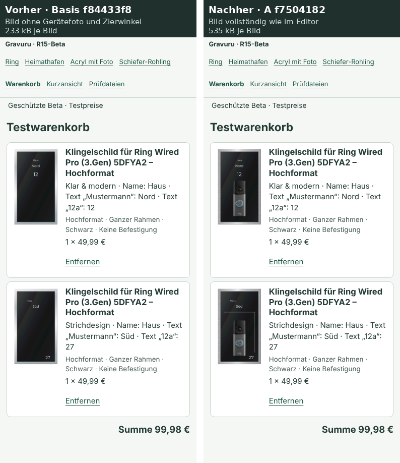

# #267 · Prüfung der R15-Tempo-Patches von Team A und Team B (Claude, 19.11.2026)

Auftrag: die [Kurskorrektur von Chris in #267](https://github.com/Chris83638w/gravuru-2027/issues/267) und davor der [Prüfauftrag in #265](https://github.com/Chris83638w/gravuru-2027/issues/265#issuecomment-7012429273). Meine Rolle: nur prüfen und vergleichen.

**Keine Live-, Main-, Preis- oder Maschinenfreigabe durch diese Prüfung.** Alles lief lokal auf meiner Prüfmaschine. Nichts an den Branches der Teams, am Shop, an Servern oder Preisen geändert, keine Bestellung, kein Warenkorb im Shop. Der öffentliche Produktdatensatz des Ring-Schilds wurde einmal gelesen.

## Geprüfte Stände

| | Commit | Was es ist |
| --- | --- | --- |
| Vorher | `f84433f8` | gemeinsamer R15-Ausgangsstand |
| Team A (Astra) | `f7504182` | Freeze in PR #268. Enthält das frühere Paket bis `347aa63f` und vier neue Tempo-Commits |
| Team B (Grok/Cursor) | `60f05317` | Freeze in PR #269. Ein kleiner Warenkorb-Patch, der Musterwarenkorb ist entfernt |

Die früheren Stände (A `347aa63f`, B `b85bc416` und `949dae02`) habe ich vor der Kurskorrektur geprüft. Das Ergebnis steht in [fruehere-staende.md](2026-11-19-beta-267-claude-schiedsrichter/fruehere-staende.md).

Kennzeichnung: **S** = selbst reproduziert · **F** = fremder Bericht · **N** = nicht prüfbar.

## Ergebnis

1. **Designkarten und Designwechsel: A ist messbar schneller und funktionsgleich.** B hat an diesen beiden Punkten nichts geändert.
2. **Warenkorb: bei keinem ist ein Gewinn belegt.** Beide Patches wirken auf Schritte mit Shopify, die es lokal nicht gibt. A bleibt funktionsgleich. B ist es nicht: Ist die Shopify-Datei beim Klick noch nicht fertig, läuft das Bild wieder über das Gerät des Kunden, und der Position fehlt das Bild für die Kasse.
3. **A ist im Handyprofil beim letzten Klick bis zum Bild lokal langsamer als vorher.** Das Bild ist jetzt vollständig und dadurch 2,3-mal so groß.
4. **Kein neuer Fehlschlag in den Tests**, weder bei A noch bei B.
5. **Empfehlung:** den Pfad von A übernehmen. Für den Warenkorb fehlt noch die Messung am Testshop, und das Warenkorbbild muss kleiner werden. Von B die Idee „nicht auf Shopify warten“ erst übernehmen, wenn das Kassenbild nachgetragen wird und nichts über das Kundengerät läuft.

## Vorher und nachher (S)

Meine Messung. Gleicher lokaler Prüfstand (Astras Werkzeug, auch auf den Basis-Code gesetzt), gleiches Ring-Schild, gleiches Skript, je drei Läufe, Median und Spanne in Sekunden. Handyprofil: 390 × 844, Rechner 4-fach gebremst, 150 ms, 1,6/0,75 Mbit/s. Hinter dem Prüfstand steht kein Shopify.

| Messpunkt | Vorher `f84433f8` | A `f7504182` | B `60f05317` |
| --- | ---: | ---: | --- |
| **1 Designkarten**, Handy, nach Scrollen ans Ende, bis alle sichtbaren Karten gezeichnet sind | 10,32 (10,31–10,39) | **5,03** (4,95–5,14) | wie vorher, Editor unverändert |
| **1 Designkarten**, Handy im Datensparmodus | nicht fertig: 1 von 4 Karten nach 20 s | **3,74** (3,73–3,77), 4 von 4 | wie vorher |
| **1 Designkarten**, PC | 0,16 (0,14–0,33) | 0,09 (0,08–0,11) | wie vorher |
| **2 Designwechsel**, Handy | 4,15 (2,85–5,70) | **1,90** (1,64–2,37) | wie vorher |
| **2 Designwechsel**, PC | 0,78 (0,56–0,97) | **0,37** (0,28–0,42) | wie vorher |
| **3 Letzter Klick bis Bild**, Handy, eine Position | 5,75 (5,71–5,88) | 7,42 (6,99–7,49) | lokal nicht messbar |
| **3 Letzter Klick bis Bild**, Handy, zwei Positionen | 6,68 (6,52–7,00) | 9,98 (9,78–10,20) | lokal nicht messbar |
| **3 Letzter Klick bis Bild**, PC, eine / zwei Positionen | 1,32 / 1,41 | 1,30 / 1,38 | lokal nicht messbar |
| Editor bedienbar ab Seitenaufruf, Handy | 11,85 (11,82–12,51) | 9,57 (9,56–9,71) | wie vorher |
| Größe eines Warenkorbbilds | 233 kB, ohne Gerätefoto | 535 kB, vollständig | – |

Die Karten direkt nach dem Öffnen sind in allen Ständen sofort da. Der Unterschied entsteht beim Scrollen. „Wie vorher“ bei B heißt: Der Patch ändert den Editor nicht. Die Zwischenspeicherung der Seitenmodule wirkt nur im Shop-Einstieg und ist am Prüfstand nicht messbar.

Zu Punkt 3 gehört dieses Bild. Vorher war der Warenkorb schneller, zeigte aber das falsche Bild:

**Was die Tabelle nicht zeigt:** die Zeit, in der der Server auf Shopify wartet. Live habe ich dafür in Phase A 1,8 bis 3,1 s gemessen, Grok 3,8 s. Genau dort setzen die Warenkorb-Patches beider Teams an. Ohne Lauf im Testshop bleibt ihr Gewinn eine Rechnung.

## Woher der Gewinn bei A kommt (S)

Dasselbe Skript an drei Ständen, Handyprofil, Median in Sekunden.

| Messpunkt | Vorher `f84433f8` | A `347aa63f` | A `f7504182` |
| --- | ---: | ---: | ---: |
| Designwechsel | 4,15 | 2,09 | 1,90 |
| Letzter Klick bis Bild, eine / zwei Positionen | 5,75 / 6,68 | 7,27 / 10,13 | 7,42 / 9,98 |
| Editor bedienbar | 11,85 | 9,98 | 9,57 |

Der größte Teil des Gewinns beim Designwechsel steckt im früheren Paket bis `347aa63f`. Das ist der Teil, der noch nicht von Schieferregel, Fototests und Snippet getrennt ist. Die vier neuen Commits ändern am Warenkorb lokal nichts Messbares. Sie zielen auf Schritte mit Shopify.

Astra meldet von der geschützten Beta für `347aa63f` nach `f7504182`: erste Karte 4,19 nach 2,78 s, Designwechsel 366 nach 229 ms, Warenkorb 4,15 nach 3,81 s, Warenkorb auf Handybreite 4,15 nach 5,22 s (F). Die Verschlechterung auf Handybreite sehe ich lokal nicht: ohne Drossel 1,27 und 1,35 s vorher, 1,31 und 1,25 s nachher. Sie kommt demnach nicht aus den vier Commits. Astra nennt selbst die Festplattengrenze des Hosts als mögliche Ursache.

## Funktionsgleichheit

| Prüfung | A `f7504182` | B `60f05317` |
| --- | --- | --- |
| Gesamtsuite (Umfang wie `npm test`) | **2.792 von 2.797** bestanden, 1 Fehler schon vorher, 4 übersprungen (S) | **2.786 von 2.794** bestanden, 4 Fehler schon vorher, 4 übersprungen (S) |
| Preis, Variante, Revision, zehn manipulierte Zustellungen, Storno | unverändert richtig (S) | unverändert richtig (S) |
| SVG, Druck- und Kontur-PDF: Maße 150 × 200 mm, wiederholbar | alle drei bytegleich (S) | Kontur-PDF nicht bytegleich, wie vorher (S) |
| Zwei Ring-Gestaltungen derselben Variante `57471227756924`, je 49,99 €, eigene Bilder, vergrößern, einzeln entfernen, kein Bearbeiten | Astras Browserprüfung am Freeze bestanden, PC und 390 px (S). Die Bilder sind pixelgleich mit dem Stand `347aa63f` | kein Stand mit Editor; der Kundenweg bis zum Klick ist unverändert |
| Aufpreis im Browser: „Verdeckte Bolzen“ ergibt 55,98 €, Variante `57471227789692`, wie in Shopify | geprüft an `347aa63f` (S), am Freeze nicht wiederholt | unverändert |
| Acryl mit Foto bis zu SVG, Kontur-PDF, Druck-PDF und Paket mit Original | bestanden, Dateigrößen gleich wie an `347aa63f` (S) | unverändert |
| Warenkorb, wenn die Shopify-Datei beim Klick noch nicht fertig ist | wartet wie bisher, Kassenbild bleibt (S, Code und Test) | **nicht funktionsgleich** (S), siehe unten |

## Befunde nach Art

**Neu durch den Patch**

1. **B, Warenkorb.** Ist die Shopify-Datei nicht sofort fertig, antwortet der Server in 2 ms. In der Antwort steckt dann das ganze Bild (713.900 Zeichen bei einem Bild von 535 kB), und der unveränderte Warenkorb-Client lädt es als Datei über das Kundengerät zu Shopify hoch. Die Position bekommt kein `_gravuru_checkout_image`. Die Bildfunktion für die Kasse setzt ohne diese Angabe kein Bild. Im Handyprofil kostet der Umweg rechnerisch 3,4 s herunter und 5,4 s hinauf, mehr als die gesparte Wartezeit. Auf schnellen Leitungen ist der Patch schneller. Beleg: [b-warenkorb-probe/ergebnis.json](2026-11-19-beta-267-claude-schiedsrichter/b-warenkorb-probe/ergebnis.json). Teil eins bestätigt Bs eigener Test.
2. **A, Bildgröße.** Das Warenkorbbild zeigt jetzt Gerätefoto und Zierwinkel. Es ist ein PNG mit 535 kB statt 233 kB. Im Handyprofil kostet das 1,7 s bei einer Position und 3,3 s bei zwei. Kein Funktionsfehler, aber ein Nachteil genau am dritten Tempopunkt. Ein kleines Bild für die Zeile und das große erst beim Vergrößern behebt das.
3. **B, Seitenmodule.** Sie dürfen fünf Minuten im Browser liegen. Nach einer Auslieferung kann ein Browser so lange alte Module mit einer neuen Seite mischen. Kein nachgewiesener Fehler, aber eine Änderung am gemeinsamen Kern ohne Schalter.

**Schon vorher vorhanden**

- Warenkorbbild ohne Gerätefoto und Zierwinkel. Bei A behoben.
- Designkarten bleiben im Datensparmodus leer. Bei A behoben.
- Kontur-PDF bei Wiederholung nicht bytegleich. Bei A behoben, bei B weiter so.
- Drei rote Tests zur Fotoauflösung. Bei A an die Regel in `PRIO-KONFI.md`, Zeile 47, angepasst und grün, bei B weiter rot.
- Ein roter Test zur Werkstatt-Kopfzeile (`konfis.test.mjs`). In allen Ständen, kein Bezug zu #267.
- Der Server wartet im Klickweg auf Shopify.

**Test- oder Vergleichsproblem**

- Der lokale Prüfstand ruft die Preis- und Angebotsprüfung direkt auf, nicht die Shop-Route mit Shopify. Die Warenkorb-Patches beider Teams lassen sich dort nicht messen.
- Bs „unter 100 ms“ ist gegen eine nachgestellte Wartezeit gemessen (F). As Gewinn durch die vorgezogene Shopify-Anmeldung ist noch nicht gemessen.
- „CI grün“: An `60f05317` und `c01ad06a` gibt es nur den Lauf `compare`, und der wurde übersprungen. An `f7504182` gibt es keinen Lauf. Die Suiten habe ich selbst ausgeführt.
- Bs eigener Suite-Lauf hatte 47 Fehler aus der Umgebung. Mein Lauf mit vollständiger Umgebung steht oben.

**Anderes Thema**

- PR #268 enthält am Freeze weiter die Ständerregel für Schiefer, die Fototests und das Warenkorb-Snippet. Chris hat die Trennung vom Tempo-Patch verlangt. Die vier neuen Commits sind getrennt, das frühere Paket noch nicht.
- Feldnamen im Warenkorb („Text „Mustermann“: Süd“), Beispieltexte ohne Rückfrage bestellbar, Bearbeiten-Link als verdeckte Eigenschaft. Alles schon vorher so, siehe [fruehere-staende.md](2026-11-19-beta-267-claude-schiedsrichter/fruehere-staende.md).

## Was vor einer Auswahl fehlt

1. Messung des Warenkorbwegs am Testshop, vorher und nachher, mit beiden Patches. Dafür braucht es die konkrete Freigabe von Chris.
2. Kleineres Warenkorbbild bei A.
3. Bei B: Kassenbild nachtragen und den Upload über das Kundengerät vermeiden. Sonst ist der Patch nicht auswählbar.
4. Echtes Handy mit Gerätemodell und Browser.
5. Abstimmung der Kernänderungen mit Mika und Mikail.

Offen bei Chris: die Freigabe zu Punkt 1, und ob ich einen privaten Zugang zur geschützten Beta bekommen soll.

## Nicht geprüft

Geschützte Beta von A (kein Zugang, Kennwörter erfrage ich nicht). Echter Shopify-Warenkorb, Kasse, Bestellung, Erstattung. Echtes Handy. Maschine. Die Messwerte, die beide Teams für ihre neuen Stände noch angekündigt haben.

## Wiederholen

Voraussetzungen: Node 24, Python mit PyMuPDF, Chrome, Playwright, `liquidjs`. `python3` muss auf die Umgebung mit PyMuPDF zeigen.

| Prüfung | Aufruf | Rohwerte |
| --- | --- | --- |
| Prüfstand je Stand | Ordner `tools/beta-267` aus `f7504182` in die Arbeitskopie legen, `node tools/beta-267/preview.mjs <Port>` mit `GRAVURU_KATALOG` und `GRAVURU_SCHIEFERREGISTER` | – |
| Zeitreihe Editor, Wechsel, Warenkorb | `node tempo/zeitreihe.cjs <Port> <Ausgabe.json> [--drossel]` | [tempo/](2026-11-19-beta-267-claude-schiedsrichter/tempo/) |
| Designkarten | `node tempo/karten.cjs <Port> <Ausgabe.json> [--drossel] [--sparen] [--pc]` | [tempo/](2026-11-19-beta-267-claude-schiedsrichter/tempo/) |
| Warenkorb-Probe B | `node b-warenkorb-probe/probe.mjs <Arbeitskopie B> <Vorschau.png>` | [b-warenkorb-probe/ergebnis.json](2026-11-19-beta-267-claude-schiedsrichter/b-warenkorb-probe/ergebnis.json) |
| Gegenprobe Bestellung und Dateien | `python3 gegenprobe/bauen.py <Arbeitskopie> <Ziel>`, dann `node --test <Ziel>` | [gegenprobe/ergebnis.json](2026-11-19-beta-267-claude-schiedsrichter/gegenprobe/ergebnis.json) |
| Gesamtsuite | `node --test app/configurator/variant-m/*.test.mjs app/workshop/*.test.mjs` | [suiten/zusammenfassung.md](2026-11-19-beta-267-claude-schiedsrichter/suiten/zusammenfassung.md) |
| Astras Browserprüfung | `node tools/beta-267/preview-cart-browser.cjs <Port> <Ordner>` | [a-stand/abnahme-protokoll-f7504182.json](2026-11-19-beta-267-claude-schiedsrichter/a-stand/abnahme-protokoll-f7504182.json) |

## Bilder

- [Warenkorb vorher und nachher, 390 px](2026-11-19-beta-267-claude-schiedsrichter/bilder/07-warenkorb-vorher-nachher-390px.png)
- [Designkarten im Datensparmodus, vorher](2026-11-19-beta-267-claude-schiedsrichter/bilder/08-karten-datensparen-basis.png)
- [Designkarten im Datensparmodus, A](2026-11-19-beta-267-claude-schiedsrichter/bilder/09-karten-datensparen-A.png)
- [Vorschaubilder von A in voller Größe](2026-11-19-beta-267-claude-schiedsrichter/bilder/03-A-vorschau-nord-sued.png)
