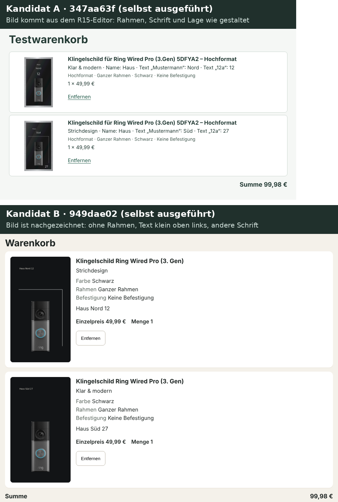

# Frühere Stände: A `347aa63f` gegen B `b85bc416` und `949dae02` (Claude, 19.11.2026)

> Dieser Vergleich entstand nach dem [Prüfauftrag in #265](https://github.com/Chris83638w/gravuru-2027/issues/265#issuecomment-7012429273), bevor die Kurskorrektur von Chris in #267 galt. Team B hat seinen Musterwarenkorb und den Ring-Prüfstand danach selbst zurückgezogen. Der aktuelle Bericht steht in [../2026-11-19-beta-267-claude-schiedsrichter.md](../2026-11-19-beta-267-claude-schiedsrichter.md). Die Belege unten bleiben als Ausgangswerte gültig.

Auftrag: [Prüfauftrag in #265](https://github.com/Chris83638w/gravuru-2027/issues/265#issuecomment-7012429273). Meine Rolle ist die unabhängige Abnahme, kein drittes Entwicklerteam.

**Keine Live-, Main-, Preis- oder Maschinenfreigabe durch diese Prüfung.** Alles lief lokal auf meiner Prüfmaschine. Nichts an den Branches der Teams, am Shop, an Servern oder Preisen geändert, keine Bestellung, kein Warenkorb im Live-Shop. Der öffentliche Produktdatensatz des Ring-Schilds wurde einmal gelesen.

## Geprüfte Stände

| | Commit | Was es ist |
| --- | --- | --- |
| Basis beider | `f84433f8` | gemeinsamer R15-Ausgangsstand |
| Kandidat A (Astra) | `347aa63f` | Freeze, PR #268 |
| Kandidat B (Grok/Cursor) | `b85bc416` | V0, PR #269 |
| Kandidat B, Nachtrag | `949dae02` | Ring-Fall, von Team B um 14:54 UTC als Freeze gemeldet (nach meinem Auftrag). Der Fairness halber mitgeprüft |

Der Branch von A hat inzwischen zwei neuere Commits (Spitze `f8c2d583`): Belege und eine Teständerung. Sie sind nicht Teil dieser Prüfung.

Kennzeichnung: **S** = selbst reproduziert · **F** = fremder Bericht · **N** = nicht prüfbar.

## Urteil

1. **Funktion und sichere Bestellung: ein Weg, Kandidat A als Grundlage.** A zeigt im Warenkorb das Bild, das der Kunde im R15-Editor gestaltet hat: Rahmen, Schrift, Lage, Gerätefoto und Zierwinkel stimmen mit dem Editor überein. B zeichnet das Bild mit einem eigenen kleinen Programm nach. Dort fehlen der Rahmen und die gestaltete Textlage, die Schrift ist eine andere. Ein zweiter Zeichner neben dem Editor ist für eine persönliche Vorschau der falsche Weg, unabhängig vom Prüfstand.
2. **Geschwindigkeit: noch kein fairer Sieger.** B hat keinen Stand mit dem echten Editor. Das Ziel von rund 5 Sekunden ist bei keinem der beiden belegt.
3. **Kein Go für Live oder Main.** Die Blocker stehen unten.

## Tabelle

| Pflichtprüfung | A `347aa63f` | B `b85bc416` / `949dae02` |
| --- | --- | --- |
| **1** Zwei Gestaltungen derselben Ring-Variante `57471227756924`, je 49,99 €, eigene Bilder und Revisionen | **Pass (S).** Astras Browserprüfung von mir ausgeführt, 6 von 6 Läufen (PC und 390 px). Variante, Artikelnummer `FK-AV2A-16x28-1441`, Summe 99,98 €. Am öffentlichen Produktdatensatz gegengelesen | **Teilweise (S).** Erst an `949dae02`. Preis und Variante sind fest hinterlegt und stimmen. Die Bilder sind nachgezeichnet. V0 nutzte eine andere Ausführung zu 54,98 € mit Platzhalterbildern |
| **1** Warenkorbseite und Kurzansicht: vergrößern, entfernen, kein Bearbeiten | **Pass (S)** am lokalen Prüfwarenkorb. **Teilweise** für das echte Theme: Das Snippet hat keinen Bearbeiten-Link mehr, neun Zeilenfälle habe ich selbst gerendert, vier Theme-Tests bestehen. Im Shop ist es nicht eingebaut | **Pass (S)** in der eigenen Musterseite. **Fehler (S)** im eingebundenen Snippet: Bearbeiten-Link und Rückfall auf das Standard-Produktbild bleiben. Das neue Snippet ist richtig, aber nicht eingebunden und ohne Test |
| **1** Pixel- und Originalvergleich: Kamerabild, beide weißen Schenkel im Strichdesign | **Pass (S).** Vorschau 952 × 1600 px, Sichtprüfung gegen den Editor, 24 von 24 Gerätestichproben | **Fehler (S).** Gerätebild und Winkel sind da. Das Bild hat aber keinen Rahmen, der Text steht klein oben links statt wie gestaltet, die Schrift ist eine andere (meldet B selbst). Der Test lief bei mir erst mit nachgereichter Schriftdatei, weil der Pfad fest verdrahtet ist |
| **1** Keine Standardbilder, vertauschten Texte oder versprochenen PNGs | **Pass (S).** Fehlt das Bild, steht ein Hinweis | Eingebunden **Fehler (S)** (Standardbild). Neues Snippet **Pass (S)** |
| **2** Funktionsparität | **Teilweise (S).** Gesamtsuite 2.790 von 2.795 bestanden, 1 Fehler besteht schon an der Basis, 4 übersprungen. Aufpreis im Browser: „Verdeckte Bolzen“ ergibt 55,98 €, Variante `57471227789692`, Artikelnummer `FK-AV2A-16x28-1442`, wie in Shopify. 16 Ring-Ausführungswerte geprüft. 48 Schieferplatten: 31 mit Ständer, 17 ohne, wie meine eigene Nachrechnung. Acryl mit Foto bis zu den vier Fertigungsdateien. Edelstahl und Schiefer wurden nur geöffnet. Bohrlöcher, Imprägnierung und Vorlagenverwaltung nicht einzeln im Browser geprüft | **Teilweise (S).** Gesamtsuite 2.794 von 2.802 bestanden, 4 Fehler bestehen schon an der Basis, 4 übersprungen. Der Bestand ist unverändert, weil B den Editor kaum anfasst. Es gibt keinen Stand mit Editor. Edelstahl, Acryl und Schiefer: „Preis offen“ |
| **3** Preis und Variante centgenau, gebundene Revision, Manipulationen | **Pass (S).** Meine Gegenprobe: zehn manipulierte oder wiederholte Zustellungen richtig behandelt, eine spätere Änderung lässt die bestellte Revision unberührt, Storno wird erkannt | **Pass (S).** Identisch, weil B den Kaufweg von R15 nicht verändert. Bs eigene Warenkorb-Buchführung ist eine Nachbildung neben dem Kaufweg |
| **3** Originale, SVG, Druck- und Kontur-PDF: Maße, wiederholbar | **Pass (S).** 150 × 200 mm. Alle drei Dateien bei Wiederholung bytegleich | **Teilweise (S).** Maße richtig. Das Kontur-PDF ist bei Wiederholung nicht bytegleich (Fehler der Basis, bei A behoben). SVG und PDF für den Ring: offen, meldet B selbst |
| **3** Storno, Erstattung, doppelte Zustellung, falsche Signatur, fehlendes Bild | **Pass (S)** lokal: Gegenprobe und die vier vorhandenen Erstattungstests. Echte Bestellung und Erstattung: **N** | **Pass (S)** lokal, identisch. Echte Bestellung: **N** |
| **4** Berechtigungen, anonyme Entwürfe und Löschfrist, Schriftlizenzen | Offen, unverändert. Keine dieser Dateien wurde berührt (S) | Offen, unverändert (S) |
| **4** Fotoauflösung | **Pass (S).** Die drei an der Basis roten Tests bestehen. A hat die veralteten Sollwerte an die Regel in `PRIO-KONFI.md` angepasst („Fotos vollständig einfügen, erst auf bewussten Zuschnitt beschneiden“) | **Fehler (S).** Die drei Tests bleiben rot |
| **5** Geschwindigkeit | Nicht vergleichbar, siehe unten | Nicht vergleichbar, siehe unten |

### Geschwindigkeit, getrennt nach Herkunft

| Messung | Wert | Einordnung |
| --- | --- | --- |
| A, geschützte Beta, ohne Netzdrossel (F) | letzter Klick bis Bild: PC 3,68 s kalt, 4,09 s warm · 390 px 6,15 s kalt, 4,08 s warm | Von mir nicht prüfbar, kein Zugang |
| A, mein lokaler Lauf, ohne Drossel (S) | PC 3,28 s kalt, 3,32 s warm · 390 px 2,28 s kalt, 2,42 s warm (Median aus je drei) | Parallel lief die Testsuite, die Werte sind eher zu hoch. Kein Shopify dahinter |
| A, mein lokaler Lauf, Handyprofil (S) | letzter Klick bis Bild: 7,75 s mit einer Position, 10,31 s mit zwei Positionen · Einstieg bis gewähltes Design 12,29 s kalt, 10,21 s warm (Median aus je drei) | Rechner 4-fach gebremst, 150 ms, 1,6/0,75 Mbit/s. Kein Shopify dahinter. Jedes Vorschaubild ist ein PNG mit rund 0,5 MB und kostet in diesem Profil rund 2,7 s |
| B, eigene Musterseite mit drei Klicks (S) | 0,3 bis 0,5 s ohne Drossel · 5,7 s im Handyprofil | Kein Editor im Weg. B meldet selbst 5,6 s und „Ziel nicht nachgewiesen“ |
| Live-Shop heute, meine Phase A (S) | Handyprofil: letzter Tipp bis Position 7,6 s, ganzer Weg 20,5 s | Ausgangswert für beide |

Echtes Handy: **N**. Ein Sieger lässt sich daraus nicht ableiten.

## Go-/No-Go-Blocker

**Kandidat A**

1. Der echte Shopify-Warenkorb, die Kurzansicht des Themes und die Kasse sind mit diesem Stand nicht geprüft. Belegt sind der lokale Prüfwarenkorb und das gerenderte Snippet. Nötig ist ein Lauf im Testshop mit konkreter Freigabe von Chris.
2. Die Wartezeit auf die Shopify-Bilddatei steckt weiter im echten Weg. A hat `shop-entry.mjs` nicht geändert. Im Live-Shop habe ich dafür 1,8 bis 3,1 s gemessen. In allen Beta-Zahlen fehlt dieser Schritt.
3. 25 Code-, Test- und Theme-Dateien (ohne Belege und Werkzeuge) greifen in den gemeinsamen R15-Kern ein (`adapter`, `ux`, `workflow`, `material-surface`). Das braucht die Abstimmung mit Mika und Mikail und getrennt prüfbare Commits. Die Ständerregel für Schiefer ist inhaltlich richtig und belegt (Chris, 18.11.), gehört aber in einen eigenen Commit.
4. Das Zeitziel ist nicht belegt. Im Handyprofil dauert bei mir schon der letzte Klick bis zum Bild 7,75 s, mit zwei Positionen 10,31 s.

**Kandidat B**

1. Die Vorschau kommt nicht aus dem Editor, sondern aus einem zweiten Zeichenprogramm. Das Bild entspricht nicht der Gestaltung des Kunden.
2. Der Schalter `checkoutPreviewFirst` lässt sich am geprüften Stand über die Serverkonfiguration nicht einschalten (`configurator-integration.mjs` kennt ihn nicht). Ist die Shopify-Datei nicht sofort fertig, bleibt das Bild in der Antwort und der Browser des Kunden lädt es als Datei hoch (`theme-cart-client.mjs`, Zeilen 85 bis 91). Diesen Umweg hat #252 am 16.11. entfernt. Er kostete damals auf dem Handy 17,5 s und 45,7 s.
3. Das eingebundene Warenkorb-Snippet ist das alte mit Bearbeiten-Link und Standardbild. Das neue ist nicht eingebunden und hat keinen Test.
4. Es gibt keinen Stand mit dem echten Editor. Der Ring-Test läuft nur mit einer Schriftdatei unter einem festen Pfad, die nicht im Repository liegt.
5. Geerbt und nicht behoben: Kontur-PDF nicht wiederholbar, drei rote Fototests.

## Die drei größten verbleibenden Risiken (für den empfohlenen Weg)

1. **Der Shop-Weg ist unbewiesen.** Alles Grüne ist lokal. Theme, Kurzansicht, Kassenbild, Bestellung und Erstattung im Shop fehlen, dazu die Shopify-Bildwartezeit.
2. **Zu viel in einem Paket.** Tempo, Warenkorb, Vorschau-Export, Kontur-PDF und eine preiswirksame Regel liegen in einem Branch. Ein Fehler in einem Teil hält alles auf, und ein Rückweg je Teil ist so nicht möglich.
3. **Zeitziel und echtes Handy.** A meldet auf der geschützten Beta ohne Netzdrossel 6,15 s vom letzten Klick bis zum Bild (390 px, kalt). In meinem Handyprofil sind es lokal 7,75 s, mit zwei Positionen 10,31 s. Der ganze Weg lag live bei 20,5 s. Ein schneller Hebel liegt offen: Das Warenkorbbild ist ein PNG mit rund 0,5 MB je Position. Ein kleines Bild für die Zeile und das große erst beim Vergrößern spart im Handyprofil rechnerisch rund 2,5 s je Position.

## Von B übernehmen

- Die richtige Diagnose: Der Warenkorb soll nicht auf die Shopify-Bilddatei warten. Umsetzen lässt sich das auf A, denn dessen Snippet zeigt bereits das Bild vom eigenen Server. Der Upload über das Kundengerät darf dabei nicht zurückkommen.
- Seitenmodule mit Prüfsumme statt „nicht speichern“ ausliefern (spart beim erneuten Öffnen). Das ist eine Änderung am gemeinsamen R15-Kern ohne Schalter und gehört über Mika und Mikail.
- Groks Gegenprüfung von A als feste Rolle. Sie hat echte Punkte gefunden.

## Kleinere Befunde

- **Feldnamen im Warenkorb (A und Basis).** Die Zeile zeigt „Text „Mustermann“: Süd · Text „12a“: 27“. Die Felder heißen nach ihrem Beispieltext. Bild: [Editor](bilder/02-A-editor-feldnamen.png), [Warenkorb](bilder/04-A-warenkorb-mit-aufpreis.png).
- **Beispieltexte gehen unverändert in den Warenkorb.** „Familie“, „Mustermann“ und „12a“ lassen sich ohne Rückfrage bestellen (im Bild oben). Die Frage dazu an Chris ist noch offen.
- **Der Bearbeiten-Link bleibt als verdeckte Eigenschaft** `_gravuru_bearbeiten` in jeder Zeile, bei A und B gleich. Sichtbar wird er nur, wenn ein Theme-Teil ihn ausgibt.
- **Bildmaße im Snippet (A und B).** `width="160" height="120"` beschreibt ein Querformat, die Vorschau ist hochkant. Beim Laden kann die Zeile springen.
- **A nennt als Quelle der Fotoregel „Chris’ aktuelle Vorgabe“.** Der Satz steht in `PRIO-KONFI.md`, Zeile 47. Im Statusbuch ist er am 05.11. als Nachtrag von Mikail vermerkt.
- **A hat die Theme-Tests gegen den Live-Export ersetzt** (9 Tests an der Basis, 4 neue bei A). Das passt zum neuen Ziel ohne Bearbeiten-Link. Vor einem Theme-Einbau muss der Unterschied zum Live-Theme neu geprüft werden.
- **„CI grün“ bei B.** Der einzige Lauf an `b85bc416` und `949dae02` heißt `compare` und wurde übersprungen. An `347aa63f` gibt es keinen Lauf. Die Suiten habe ich deshalb selbst ausgeführt.

## Nächster Schritt und fehlende Freigaben

Vorschlag für die Reihenfolge, entscheiden muss Chris:

1. Entscheidung „ein Weg, A als Grundlage“ ja oder nein. Bei Ja keine zweite geschützte Adresse für B aufsetzen. B prüft A gegen und liefert die zwei übernehmbaren Punkte als kleine, getrennte Vorschläge.
2. A in getrennt prüfbare Commits teilen (Warenkorb-Snippet, Vorschau-Export, Kontur-PDF, Schieferregel, Tempo) und mit Mika und Mikail abstimmen.
3. Warenkorbbild verkleinern und die Shopify-Bildwartezeit aus dem Klickweg nehmen, ohne den Upload über das Kundengerät.
4. Lauf im Testshop mit Theme-Kopie, Kurzansicht, Kasse und einer Testbestellung. Dafür fehlt die konkrete Freigabe von Chris.
5. Dieselbe Messreihe wie in Phase A, dazu ein echtes Handy mit Gerätemodell und Browser.

Offen bei Chris: die Entscheidung zu Punkt 1, die Freigabe zu Punkt 4, und ob ich einen privaten Zugang zur geschützten Beta bekommen soll, um A dort nachzumessen.

## Nicht geprüft

Geschützte Beta von A (kein Zugang, Kennwörter erfrage ich nicht). Echtes Handy. Echter Shopify-Warenkorb, Kasse, Bestellung, Erstattung. Maschine. Die neueren Branch-Spitzen.

## Wiederholen

Voraussetzungen: Node 24, Python mit PyMuPDF, Chrome, Playwright, `liquidjs`. `python3` muss auf die Umgebung mit PyMuPDF zeigen, weil einzelne Tests `python3 -c` direkt aufrufen. Ohne das schlagen mehrere hundert Tests fehl, die nichts mit den Kandidaten zu tun haben.

| Prüfung | Aufruf | Ergebnis |
| --- | --- | --- |
| Gesamtsuite | `node --test app/configurator/variant-m/*.test.mjs app/workshop/*.test.mjs` je Stand | [suiten/zusammenfassung.md](suiten/zusammenfassung.md) |
| Warenkorb-Snippets, neun gleiche Zeilen | `node snippet/render.mjs <A> <B>` | [snippet/ergebnis.json](snippet/ergebnis.json) |
| Gegenprobe Bestellung und Dateien | `python3 gegenprobe/bauen.py <Arbeitskopie> <Ziel>` und `node --test <Ziel>` | [gegenprobe/ergebnis.json](gegenprobe/ergebnis.json) |
| Browserprüfung A | lokaler Prüfstand laut Astras `MESSUNGEN.md`, dann `node tools/beta-267/preview-cart-browser.cjs 18267 <Ordner>` | [a-stand/abnahme-protokoll-lokal.json](a-stand/abnahme-protokoll-lokal.json) |
| Browserprüfung A im Handyprofil | dieselbe Prüfung mit drei zusätzlichen Zeilen für die Drosselung: [a-stand/drosselung.diff.txt](a-stand/drosselung.diff.txt) | [a-stand/abnahme-protokoll-handyprofil.json](a-stand/abnahme-protokoll-handyprofil.json) |
| Aufpreis A | `node a-stand/aufpreis.cjs 18267 <Ordner>` | [a-stand/aufpreis-ergebnis.json](a-stand/aufpreis-ergebnis.json) |
| Ring-Fall B | `node --test app/workshop/beta-267-ring.test.mjs` und `node scripts/beta-267-measure-path.mjs` an `949dae02` | [b-stand/ring-lauf.json](b-stand/ring-lauf.json) |

Die Theme-Tests beider Teams (`ops/shopify/cart-edit-r15-theme.test.mjs`) brauchen `liquidjs` unter `.local-data/liquidjs/package`. Mit Version 10.30.1 bestehen sie an Basis (9), A (4) und B (9).

## Bilder

- [Warenkorb A und B](bilder/01-warenkorb-A-und-B.png)
- [Editor von A mit Feldnamen](bilder/02-A-editor-feldnamen.png)
- [Vorschaubilder von A in voller Größe](bilder/03-A-vorschau-nord-sued.png)
- [Warenkorb von A mit Aufpreis](bilder/04-A-warenkorb-mit-aufpreis.png)
- [Warenkorb A, 390 px](bilder/05-A-warenkorb-390px.png)
- [Warenkorb B, 390 px](bilder/06-B-warenkorb-390px.png)
