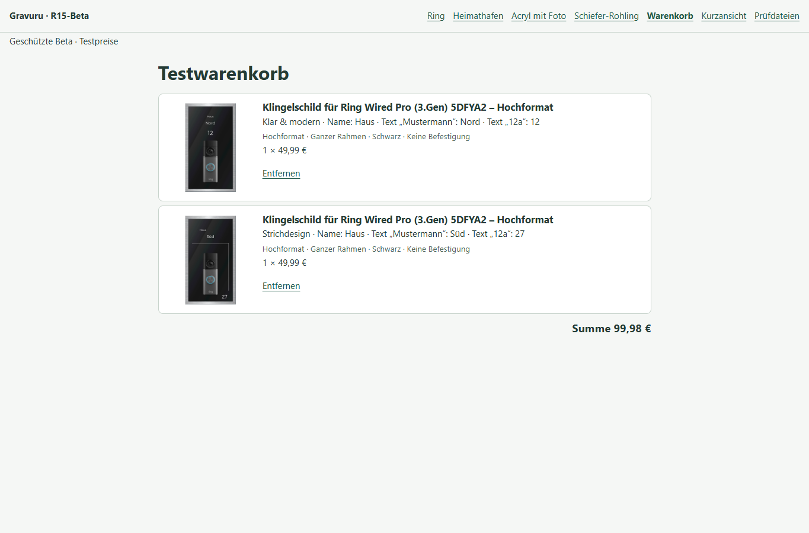
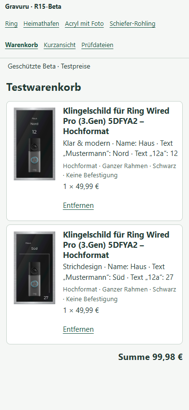

# Geschützter Kandidat A

Chris, Astra, Claude und Grok nutzen hier denselben R15-Code `f7504182`. Der Benutzername für Chris ist `chris`. Für den eigenen Versuch das Ring-Schild zweimal mit unterschiedlichen Namen gestalten. „Kurzansicht“ öffnet den kleinen Warenkorb. Die persönliche Vorschau lässt sich vergrößern und jede Position einzeln entfernen. [Geschützte Beta](https://konfi-beta.gravuru-designwerkstatt.de/) · [Aktueller Vorher-/Nachher-Vergleich und Fotos](tempo/README.md) · [Code der Messrunde](https://github.com/Chris83638w/gravuru-2027/commit/f7504182d117ba60d16498ae8bb43ba29a75609f)

## Frühere Abnahme auf `347aa63f`

Die folgenden Aufnahmen und Tabellen stammen vom früheren Referenzstand. [Früherer Freeze](https://github.com/Chris83638w/gravuru-2027/commit/347aa63f53b9c751c887faf2ac5a28e79dc8d36e)

| Desktop | Handybreite |
| --- | --- |
|  |  |

## Warenkorb und Bildabgleich

Sechs frische Chrome-Kontexte auf der geschützten HTTPS-Adresse erzeugten zwölf Ring-Positionen. In jedem Warenkorb liegen „Haus Nord 12“ und „Haus Süd 27“ auf **derselben** Variante 57471227756924, Artikelnummer FK-AV2A-16x28-1441, zu je **49,99 €**. Der Shopify-Produktdatensatz bestätigt Artikelnummer, Farbe Schwarz, ganzen Rahmen, fehlende Befestigung und Einzelpreis. Jede Gestaltung besitzt ein eigenes, gelesenes und gerendertes PNG. Beide Flächen zeigen den richtigen Entwurf auch nach dem Öffnen und Schließen der vergrößerten Ansicht. Entfernen und Neuladen erhält den zweiten Entwurf mit unverändertem Bild und Preis. [PC-Drawer](kandidat-a/PC-Kurzansicht.png) · [Mobiler Drawer](kandidat-a/Mobil-Kurzansicht.png) · [Rohdaten aller Durchläufe](kandidat-a/Protokoll.json)

Die Bildprüfung vergleicht die **tatsächlich dargestellte PNG-Datei** mit ihrem unveränderlichen Prüfpaket. Sie prüft separat markante Originalpixel des Ring-Geräts. Für „Strichdesign“ findet sie an beiden Schenkeln der Original-Zierlinie je 16 von 16 Messstellen. Im Kontrollentwurf sind beide Streifen frei. Frühere Stände verloren beim Rastern zuerst das Kamerafoto und zusätzlich die referenzierte Vektordekoration. Die Beta bettet die geprüften Produktbilder ein und kontrolliert die Prüfsumme des Motivs. Alte Warenkorbrevisionen behalten ihren damaligen Bildstand. [Bildmodule und Vergleichstest](../../../tools/beta-267/check-hosted.cjs)

Die eigenständige Beta-Werkstatt führt den Ring durch die bestehende Varianten-, Preis-, Angebots- und Revisionsprüfung. Der geschützte Shoptransport verwendet eine lokale Testdatenbank. Der Klick reicht bis zum bestätigten Testwarenkorb. Der frühere Shopify-Gastwarenkorb auf dem veröffentlichten Referenzstand und die historische Testbestellung #1017 sind getrennt belegt. Die Theme-Vorlage in #268 wurde mit der Liquid-Engine für native und ältere Positionen geprüft. Die Produktivumstellung und die Abnahme eines getrennten echten Shopify-Testshops mit genau diesem Kandidaten bleiben offen. [Shop-Verlauf](SHOP-UND-INTEGRATION.md) · [Theme-Prüfung](../../../ops/shopify/cart-edit-r15-theme.test.mjs)

## Geschwindigkeit

Drei frische Browserkontexte pro Anzeigegröße, PC 1365 × 900 und mobile Chrome-Emulation 390 × 844. Die Erstposition ist kalt, die zweite verwendet denselben Kontext. Der Endpunkt verlangt alle persönlichen Bilder, abgeschlossene Bilddekodierung und zwei Darstellungszyklen. Ohne künstliche Netzwerkdrosselung. Die letzte Spalte misst den automatisiert bedienten Gesamtweg einschließlich Texteingabe, Bedienaktionen und Prüfschritten. Diese Gesamtzeit enthält auch die Laufzeit der Teststeuerung.

| Gerät | Kontext | Letzter Klick bis Bild, Median (Spanne) | Gesamter Prüfweg, Median |
| --- | --- | ---: | ---: |
| PC | kalt | 3,68 s (3,61–3,76) | 7,84 s |
| PC | warm | 4,09 s (3,89–8,77) | 8,08 s |
| Mobil | kalt | 6,15 s (6,12–8,65) | 10,36 s |
| Mobil | warm | 4,08 s (3,97–4,08) | 7,49 s |

Die Stichprobe zeigt die Schwankung und belegt das Fünf-Sekunden-Ziel für den gesamten Weg noch nicht. [Maschinenlesbare Messgrenzen und Testergebnis](kandidat-a/Abnahme.json)

## Werkstatt, Zugang und weitere Abnahme

- 337 von 337 automatisierten Fällen bestanden am Code-Freeze. Die gesonderte Gravurprüfung umfasst 6 Fälle einschließlich Eiche, Buche und Kirsche, Fotooriginalen, Graustufen, Konturen und reproduzierbaren Fertigungsdateien. Für den Windows-Prüfer verwendet das Testskript den konfigurierten Python-Interpreter. Das Holzgravur-Profil ist geprüft. Die Zuordnung eines freigegebenen Holzartikels zum Testkatalog bleibt offen. [Materialregister](../../../scripts/data/review-material-overview-20261106.json)
- Ring, Edelstahl „Heimathafen“, Acryl mit Foto und Naturschiefer SL-21 wurden über denselben Kundeneditor aufgerufen. In beiden Anzeigegrößen wurde ein synthetisches Foto im Acryl-Entwurf gespeichert. SVG, Kontur-PDF, Druck-PDF und ZIP mit Entwurf und Original wurden anschließend wirklich heruntergeladen und als Dateien gelesen. Die bestehende synthetische Kaufprüfung belegt zusätzlich die gebundene Bestellrevision, originale Fotobytes und physische PDF-Maße. [Paritätsmatrix](README.md) · [Claudes getrennte Prüfung des früheren Rev.-3-Stands](https://github.com/Chris83638w/gravuru-2027/issues/267#issuecomment-7008562836)
- Eigenes HTTPS-Zertifikat, eigener Webspace, eigenes Systemkonto, eigene Testdaten und vier getrennte Prüferzugänge. Ohne Zugang antworten Startseite, Editor und Sitzung mit HTTP 401. Alle vier vorgesehenen Zugänge wurden bestätigt. Die Mitarbeiterplattform läuft separat. Der Betrieb nutzt den vorhandenen Server. Zusätzliche monatliche Kosten sind nicht nachgewiesen.
- Prüfdaten liegen außerhalb des öffentlichen Verzeichnisses. Der Neustarttest öffnet die gespeicherte Datenbank erneut, prüft die genaue Bildrevision und die getrennten Warenkörbe. Als Rückweg kann der Betreiber allein diese Beta stoppen oder das vorherige Paket wieder aktivieren. Kundentests verwenden Beispieldaten. Für eine Betriebsübernahme fehlen unter anderem physische Handy-/Maschinenabnahmen, Lizenz- und Aufbewahrungsnachweise sowie die fachliche Abnahme weiterer Produktionsprofile.
- Grok hat einen eigenständigen V0-Stand auf `b85bc416` in PR #269 abgelegt. Sein Bericht verwendet eine andere Testausführung zu 54,98 € und eine simulierte Shopify-Bildwartezeit. Für die direkte Gegenüberstellung braucht Claude dieselbe gebundene Ring-Ausführung und denselben Messendpunkt. Die Wahl liegt bei Chris. [Grok-Kandidat B](https://github.com/Chris83638w/gravuru-2027/pull/269) · [Auftrag an Claude](https://github.com/Chris83638w/gravuru-2027/issues/265#issuecomment-7009596577)
