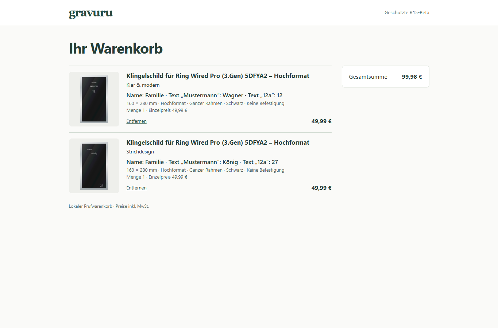
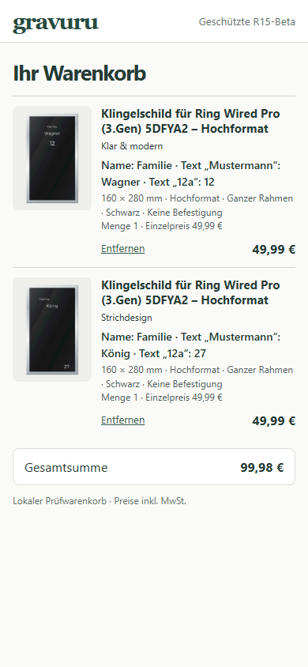

# Persönliche Warenkorbvorschauen

Der folgende lokale Versuch ist die frühere Vergleichsserie. Am danach ausgelieferten Kandidaten prüft der Browser zusätzlich das Gerätefoto der Ring-Klingel und beide Schenkel der originalen Zierlinie. [Bilder und Zeiten des geschützten Kandidaten](GESCHUETZTE-BETA.md)

Chris hat den Kundenweg am 19. November auf eine schreibgeschützte Bildvorschau je Warenkorbposition festgelegt. Kunden gestalten ihr Produkt vor der Übergabe. Im Warenkorb lassen sich persönliche Bilder ansehen, vergrößern und Positionen entfernen. Eine neue Gestaltung beginnt wieder an der Produktseite. [Verbindliche Entscheidung](https://github.com/Chris83638w/gravuru-2027/issues/267#issuecomment-7008823567)

| PC | Handybreite |
| --- | --- |
|  |  |

## Zwei Gestaltungen derselben Variante

Der Browser gestaltete den Ring-Artikel in der vorhandenen R15-Oberfläche zweimal. „Klar & modern“ erhielt die Beschriftung „Familie Wagner · 12“, „Strichdesign“ erhielt „Familie König · 27“. Beide wurden gegen dieselbe gebundene Shopify-Variante 57471227756924 und denselben Einzelpreis von 49,99 € aufgelöst. Der Prüfwarenkorb enthielt zwei unterschiedliche Konfigurationskennungen mit jeweils Revision 1, Menge 1 und insgesamt 99,98 €.

Die lokale Werkstatt erzeugte für jede Gestaltung einen privaten Entwurf, ein unveränderliches Paket und ein serverseitiges Warenkorbangebot aus der vorhandenen R15-Logik. Das persönliche PNG stammt aus genau diesem Paket. Der Browsertest verglich die empfangenen Bilddateien mit den getrennten SHA-256-Prüfsummen ihrer Pakete. Er öffnete die zweite Vorschau als Bild, entfernte anschließend die erste Position und prüfte, dass die zweite Gestaltung und ihr Preis erhalten blieben. [Quellstand](https://github.com/Chris83638w/gravuru-2027/commit/1b4ae2aae8185d348637aad41aaa513de2d1aef8) · [Wiederholbarer Browsertest](../../../tools/beta-267/preview-cart-browser.cjs)

## Zeit bis zum sichtbaren persönlichen Bild

Drei getrennte anonyme Browserkontexte je Gerät. Der erste Durchgang beginnt im frischen Kontext, der zweite fügt derselben Sitzung eine weitere Gestaltung hinzu. Gemessen vom letzten Klick im Editor bis zum neuen Warenkorb mit allen dekodierten persönlichen Bildern und zwei Zeichenzyklen. PC 1365 × 900, mobile Emulation 390 × 844, jeweils ohne künstliche Netz- oder CPU-Drosselung. Der isolierte Transport spricht den lokalen Prüfshop an. [Alle Messwerte](warenkorb-vorschau.json)

| Zustand | PC · Median (Spanne) | Handybreite · Median (Spanne) |
| --- | ---: | ---: |
| Erste Position und erstes Bild | 1,124 s (1,121–1,226) | 1,186 s (1,084–1,205) |
| Zweite Position und beide Bilder | 1,145 s (1,050–1,157) | 1,127 s (1,088–1,133) |

Vor der neuen Entscheidung wurden auf dem veröffentlichten Shopify-Stand für zwei verschiedene Gestaltungen derselben Variante bereits 6,295 und 5,940 s bis zur bestätigten Position gemessen. Die Bilddekodierung wurde dabei nicht mitgemessen. Für das Fünf-Sekunden-Ziel ist der gesamte Kundenweg auf der freigegebenen externen Beta mit dem vorgesehenen Shoptransport zu messen. Die früheren Wiederaufrufe sind historische Belege für die Revisionszuordnung. [Frühere Live-Messung](SHOP-UND-INTEGRATION.md)

Zum Wiederholen den lokalen Prüfstand entsprechend dem [Messprotokoll](MESSUNGEN.md) starten, dann `node tools/beta-267/preview-cart-browser.cjs PORT AUSGABEORDNER` ausführen. Drei Läufe je Gerät sind voreingestellt. Die Portnummer kann frei gewählt werden. Der Test lässt sich ausschließlich gegen die Loopback-Adresse ausführen.
