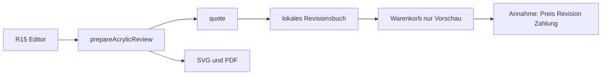

# Team B · Grok/Cursor · R15-Beta #267 · V0

Stand: 19.11.2026. Branch `dev/grok-r15-beta-267-20261119`, Ausgang `f84433f8475a410065edd9d1b09af07adea95a87`. Kein Merge, kein Live-Shop, kein Schreibzugriff auf Shopify. PR #268 wurde nicht verändert und kein Patch daraus übernommen.

## Gelesen

Issue #267 einschließlich der Kommentare bis 7009576693, insbesondere die Priorität „Warenkorb nur Vorschau“ (7008823567) und die Startfreigabe (7009402683). Dazu `AGENTS.md`, `PRIO-KONFI.md`, der Anfang von `STATUS.md` und `START_HERE.md`, die Warenkorbkette `shop-entry.mjs` / `theme-cart.mjs` / `gravuru-warenkorb-bearbeiten.liquid` und die Profilfunktion `selectedDoorbellProfile`. `ENTSCHEIDUNGEN.md` und `START_HERE.md` sind lang; für diese Lieferung gelten die jüngeren Festlegungen in #267 vor älteren Cart-Bearbeiten-Pflichten. Die 5-Sekunden-Formulierung aus #255 („diese 5 Sekunden Regel gibt es nicht“) bleibt historisch. Für diesen Vergleich gilt die neuere Zielangabe in #267.

## Architektur

Kein neuer Konfigurator. Der freigegebene R15-Kundenweg bleibt die Gestaltung. Die Beta ergänzt ihn an drei Stellen und stellt den Warenkorb lokal dar:

1. **Warenkorb nur Vorschau.** Jede Position trägt eigene Konfigurations-ID, Revision 1 und den SHA-256 der persönlichen PNG. Dieselbe Shopify-Variante darf mehrfach vorkommen. Anzeige: Bild (vergrößerbar, nur lesbar), Produkt, Optionen, Gravurtext, Einzelpreis, Menge, Entfernen. Kein Link und kein Button zurück in den Editor. Eine bestehende Position wird nicht still geändert.
2. **Preis und Fertigung bleiben die vorhandenen Funktionen.** Der Einzelpreis kommt aus `quote()`. Der Entwurf kommt aus `prepareAcrylicReview()`. SVG und PDF kommen aus `acrylicArtwork()` und `createAcrylicEngravingProof()`. Unbekannte Preise werden nicht ergänzt.
3. **Wartezeit nur dort kürzen, wo sie gemessen ist.** Profilauswahl wird zwischengespeichert und bei jeder Rückgabe kopiert. `cart/data` kann die gesicherte persönliche Vorschau sofort zurückgeben, statt auf Shopify `fileCreate` zu warten. Der Schalter `checkoutPreviewFirst` steht standardmäßig auf aus, damit der bisherige Warenkorbvertrag unverändert bleibt. Seitenmodule des Einstiegs antworten mit ETag und `public, max-age=300`; das HTML bleibt `no-store`.

## Was diese V0 nicht ist

Sie ist kein geschützter Host, kein Theme-Deploy und kein Nachweis, dass der ganze Kundenweg unter 5 Sekunden liegt. Die Live-Messung aus Kommentar 7008115794 bleibt der letzte Netzbefund. Diese Lieferung misst die geänderten lokalen Wartepunkte erneut.

Nächster Schritt: geschützte, von #268 getrennte Vorschau-Adresse, dort `checkoutPreviewFirst` nur für diesen Stand, danach dieselbe Messreihe für Ring, Edelstahl, Acryl und Schiefer.
