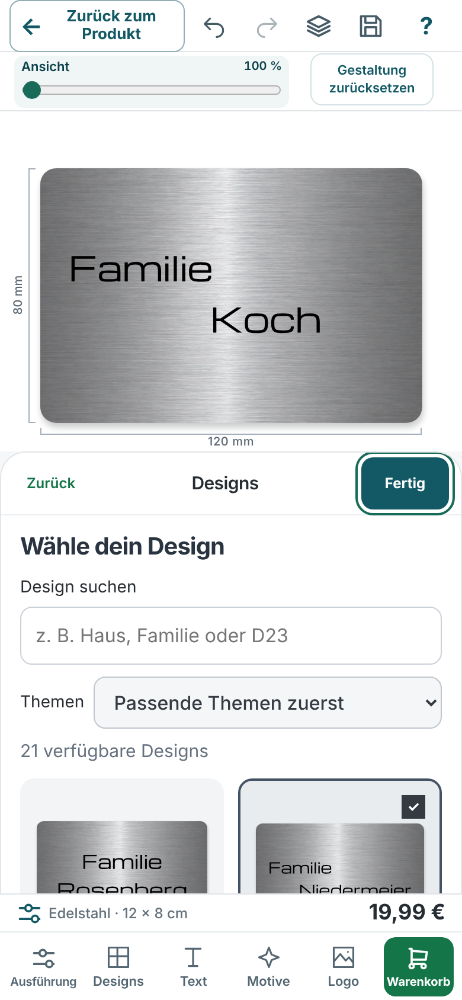
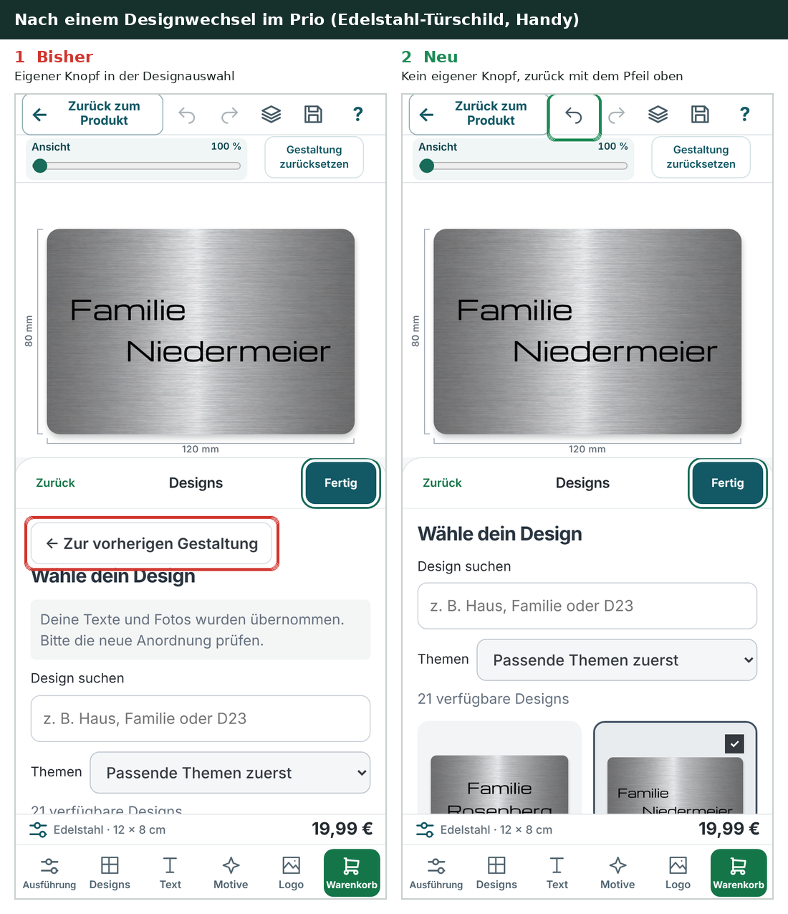
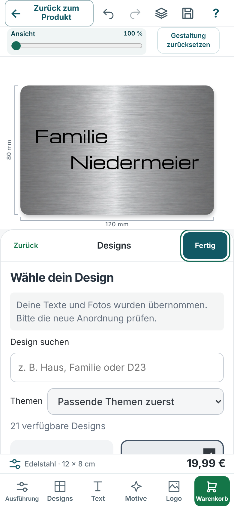

# Prio R15 mit der schnellen Technik von Variante C · Übergabe · 20.11.2026 (Claude)

Gestaltung und Design-Aufträge folgen dem [Design-Master](https://github.com/Chris83638w/gravuru-katalog./blob/main/designs/DESIGN-MASTER.md). Dieses Paket ändert keine Designs.

## Zweck und Auftrag

Chris hat mir am 20.11.2026 die technische Gesamtverantwortung für „Prio R15 als Master + schnelle Variante-C-Technik“ übertragen: [Auftrag in #265](https://github.com/Chris83638w/gravuru-2027/issues/265#issuecomment-7033770336), im Chat um 10:47 Uhr bestätigt mit „astra ist fertig. Prüfe was du überhaupt noch machen musst und setze es dann wie angegeben um. Du kannst es selbst programmieren, weil du der stärkste bist“.

Für dieses Thema ersetzt der Auftrag die Regel, dass den gemeinsamen Prio-Kern nur Mika mit Mikail ändert. Ich arbeite auf einem eigenen Zweig. Nichts ist aufgespielt.

Zur Freigabe: Chris schrieb um 10:05 Uhr „du kannst es direkt live setzen“ und um 10:06 Uhr „nein wir warten auf astra“. Ich lese das so: Testfassungen dürfen als eigener Testlink auf das echte System, der Kundenweg bleibt beim heutigen Prio, bis Chris selbst getestet und „live“ gesagt hat. So steht es auch im Auftrag.

## Stand

- Zweig `dev/claude-prio-c-20261120`, abgezweigt vom Live-Stand `2bd7bd8e` (`dev/astra-r15-live-267-20261119`).
- Stufe 1 ist gebaut und geprüft: Designwechsel im Gerät für Türschilder mit allen Größen.
- Stand `a38c9701` hatte einen Fehler bei Designs mit eigenem Motiv. Er ist mit `a4267e67` behoben, siehe „Nachtrag: Fehler in der ersten Fassung“.
- Astra hat `a38c9701` als geschützten Testpfad auf den Beta-Server gestellt. Ich selbst habe keinen Serverzugang.

## Was nicht mehr zu tun war

- **Test „Variante C → Edelstahl-Türschild → Shopify-Warenkorb“:** von Astra geliefert (Zweig `dev/astra-isolierter-variante-c-warenkorb-267`, Commit `17fbedf4`, geschützter Testlink). Nicht doppelt gebaut. Ich habe keinen Beta-Zugang und habe den Link nicht geöffnet; Astras Nachweis ist für mich ein fremder Bericht.
- **Astras vier Tempo-Änderungen vom 19.11.:** stecken schon im Live-Stand (`8a3d6c86`, `3b3b4626`, `44543823`, `5de3ce84`). Geprüft durch Übertragen der vier Commits auf `2bd7bd8e`: drei ergeben keine Änderung mehr, der vierte kollidiert nur mit seiner bereits eingebauten Fassung.

## Entscheidung: Weg A

Die C-Technik kommt in den Prio. Drei Gründe:

1. Variante C und Prio nutzen denselben Baustein `gravuru-configurator`. Bei den Funkklingeln wechselt der Prio das Design schon im Gerät.
2. In Variante C sind Bestellung, Preise, Motive und Logo abgeschaltet (`MASTER.md` im Repo `gravuru-shopify`). Weg B hieße, alle Prio-Funktionen und die gesicherte Warenkorb- und Fertigungsstrecke auf dem alten Stand neu zu bauen.
3. Die Zeit geht an einer benennbaren Stelle verloren, siehe Befund.

## Befund: warum der Designwechsel langsam war

Am 20.11. im Live-Shop nur lesend nachgesehen, Edelstahl-Türschild (Werkstattprodukt `cfg_ac514214…`, Stand 4, Format 12 × 8 cm):

- Die Designauswahl zeigt 21 Designs. Alle gehören zum selben Produkt, zum selben Stand und zur selben Shopify-Variante.
- Das geladene Modell hat 321 kB und enthält nur das Startdesign. So ist es entschieden (ENTSCHEIDUNGEN 4.42, Chris 03.11.2026: weitere Designs laden beim Klick).
- Beim Klick auf ein anderes Design lief bisher: Serveraufruf `design-switch` mit neuer Sitzung, neues Modell (wieder 321 kB), Ressourcen, dann ein vollständiger zweiter Editor in einem neuen Rahmen (`app/workshop/ui/shop-design-switch.mjs`, `choose`).
- Die Modelle für zwei Designs unterscheiden sich nur in den Design-Teilen: `profile.designs`, `familyFormats.designs` (15 Vorlagen, je rund 1 kB), `familyFormats.formats[].variants[].designIds`, `workshopElementRights` und die Angaben zum Startdesign. Alles andere ist zeichengleich.

Variante C hat alle Designs im Gerät und zeichnet beim Wechsel nur neu.

## Stufe 1: Designwechsel im Gerät

Beim Klick auf ein Design desselben Produktstands holt der Editor das Modell dieses Designs mit der bestehenden Sitzung, nimmt nur die Design-Teile in das laufende Modell auf und wählt das Design im laufenden Editor. Es gibt keine neue Sitzung, keinen Serveraufruf `design-switch` und keinen zweiten Editor. Ein schon geholtes Design wechselt danach ohne Netz.

| Datei | Änderung |
| --- | --- |
| `app/configurator/variant-m/design-adoption.mjs` (neu) | Vereinigt die Design-Teile zweier Modelle desselben Produktstands. Jede andere Abweichung (Preis, Material, Befestigung, Geometrie, Formate, Rechte) führt zur Ablehnung, das laufende Modell bleibt dann unverändert. |
| `app/configurator/variant-m/adapter.mjs` | Anschluss `el.uxAdoptDesignModel`; die Designliste des Formats wird danach neu gebildet. |
| `app/configurator/variant-m/product-design-gallery.mjs` | Karten desselben Produktstands: Design nachholen, Schriften und Motive nachladen, im Editor wählen. |
| `app/workshop/ui/shop-design-switch.mjs` | `loadDesign`: Modell eines weiteren Designs derselben Sitzung nur lesen; Produkt, Stand und Variante müssen übereinstimmen. |

Unverändert bleiben: der Server, die Sitzung, Preis und Variante, das Speichern, der Warenkorb, die Bestell- und Fertigungsstrecke, das Prio-Layout. Texte wandern wie bisher mit (dieselbe Funktion `chooseDesign` wie bei den Funkklingeln).

**Rückweg:** Scheitert das Nachholen oder weicht irgendetwas ab, greift der bisherige Wechsel über den Server.

**Bearbeiten aus dem Warenkorb:** Ein Entwurf aus dem Warenkorb ist auf dem Server fest an sein Design gebunden (`acrylic_draft_identity` in `shop-entry.mjs`). Dort wird nichts nachgeholt, es bleibt beim bisherigen Wechsel mit neuem Editor. Im normalen Ablauf legt der Editor je Design einen eigenen Entwurf an (`acrylic-draft-client.mjs`, Schlüssel aus Produkt, Stand und Design).

**Fachlogik:** Das Paket legt keine Regel, keine Sperre, keinen Preis und keinen Standardwert fest. „Laden beim Klick“ (4.42) bleibt.

## Prüfungen

- **Neue Tests:** `app/workshop/design-adoption.test.mjs` (4) und `app/workshop/shop-design-switch-adoption.test.mjs` (3). Die Modelle im Test kommen aus derselben Verkleinerung wie im Shop (`shopStartModel`) mit echten Katalogmaßen und -preisen. Geprüft: Das nachgeholte Design entspricht in jedem Format dem vollständigen Produkt, der Preis ist gleich, ein Größenwechsel findet es, elf Arten von Abweichung werden abgelehnt.
- **Gezielte bestehende Tests** zu Galerie, Designwechsel, Startmodell, Ablauf und Paketbau: 65 von 65 bestanden (mit den neuen).
- **Bedienprüfung am echten Edelstahl-Türschild** (Skript `geraetewechsel.mjs` im Nachweisordner): Der Server ist der Live-Server. Nur in meinem Browser habe ich das Hauptpaket des Editors und `shop-design-switch.mjs` durch den Bau aus meinem Zweig ersetzt. Vorher geprüft: Die Live-Dateien sind zeichengleich mit dem Bau aus `2bd7bd8e`, mein Bau unterscheidet sich nur im Hauptpaket. Kein Speichern, kein Warenkorb, keine Bestellung.
- **Gegenprobe** zu Preis, späterer Änderung, Fertigungsdateien, manipulierten Zustellungen und Storno: Ergebnis wie am Live-Stand.
- **Gesamtsuite** (`node --test app/configurator/variant-m/*.test.mjs app/workshop/*.test.mjs`): Live-Stand `2bd7bd8e` 2755 Tests, 2747 bestanden, 4 fehlgeschlagen, 4 übersprungen. Mein Stand `6375be57` 2761 Tests, 2753 bestanden, dieselben 4 fehlgeschlagen, 4 übersprungen. Die sechs zusätzlichen Tests sind die neuen. Die vier Fehlschläge gab es schon vorher („Werkstatt einheitlich …“ und drei Tests zur Fotoauflösung). Die Absicherung für das Bearbeiten aus dem Warenkorb kam danach dazu und ist mit einem siebten Test, den gezielten Tests und einem weiteren Bedienlauf geprüft.

### Ergebnis der Bedienprüfung

Je ein Lauf, keine Messreihe. Das Handyprofil ist eine Simulation (390 × 844, Rechenleistung ÷ 4, 150 ms, 1,6/0,75 Mbit/s). Geschwindigkeit und Bedienung testet Chris selbst.

| Schritt | PC bisher | PC neu | Handyprofil bisher | Handyprofil neu | Ergebnis |
| --- | --- | --- | --- | --- | --- |
| Zweites Design wählen | 2,09 s | 0,66 s | 6,27 s | 1,74 s | gleich |
| Drittes Design wählen | 1,81 s | 1,74 s | 5,69 s | 1,65 s | gleich |
| Zurück zum ersten Design | 1,94 s | 0,11 s | 5,34 s | 0,50 s | gleich |
| Noch einmal das zweite Design | 1,88 s | 0,10 s | 6,68 s | 0,63 s | gleich |
| Größe wechseln | 0,08 s | 0,08 s | 0,34 s | 0,41 s | gleich |
| Größe zurück | 0,08 s | 0,06 s | 0,33 s | 0,35 s | gleich |

„Gleich“ heißt: gleiches Design, gleiche Texte (der eigene Name „Koch“ wandert mit), gleiche Lage, Schrift und Größe wie beim bisherigen Wechsel. Bisher entstand je Wechsel ein neuer Editor, neu keiner. Kein Seitenfehler, kein Schreibzugriff.

Die Zeit bis zum offenen Editor ist in diesem Vergleich nicht aussagekräftig: Im ersetzten Lauf kommt das Hauptpaket unkomprimiert aus meinem Rechner. Am Start ändert Stufe 1 nichts.

## Nachtrag: Fehler in der ersten Fassung und Korrektur (20.11.2026, 12:45 Uhr)

**Fehler.** Astra hat `a38c9701` auf dem Beta-Server geprüft und gemeldet: Beim Design „Zwei Zeilen mit Trennlinie“ fehlt nach dem Wechsel im Gerät die Trennlinie, die Fertigungsprüfung hält vor dem Speichern an ([Meldung in #265](https://github.com/Chris83638w/gravuru-2027/issues/265#issuecomment-7036710071)). Ich habe das nachvollzogen und den Umfang bestimmt: Ich habe die Modelle aller 21 Designs mit dem Startmodell verglichen (nur lesend am Live-Shop). Zusätzlich zu den oben genannten Design-Teilen unterscheiden sie sich in `localResources.motifs`. 18 der 21 Designs bringen eigene Motive mit (Linien, Ornamente, Pfeile). Bei allen 18 fehlte nach dem Wechsel das Motiv. Eine falsche Bestellung war nicht möglich, weil die vorhandene Exportprüfung das Speichern anhält.

**Meine Lücke.** Mein Modellvergleich lief nur zwischen Design 1 und Design 2, beide ohne Motiv. Meine Bedienprüfung hat nur Texte verglichen. Den Punkt „Motive in Designs“ hatte ich als nicht geprüft genannt, die Fassung aber trotzdem zum Test gegeben.

**Korrektur.** Astras Vorschlag `a4267e67` ([PR #279](https://github.com/Chris83638w/gravuru-2027/pull/279)) habe ich gelesen, geprüft und übernommen. Er meldet die Motive der Vorlage beim laufenden Zeichner an und nimmt sie in beide Modellkopien auf. Angenommen werden nur eingebettete Motive aus reinen Pfaden; alles andere (Verweise, Bilder, abweichende Ressourcen, schon belegte Schlüssel) führt zum bisherigen Wechsel. Die Anmeldung entspricht dem Weg beim normalen Start (`build.mjs`: lokale Motive in die Motivliste, Schlüssel in `GravuruTemplateOnlyMotifKeys`, damit sie nicht in der Motivbibliothek des Kunden erscheinen).

**Prüfung der Korrektur.**

- Alle 21 Designs nacheinander gewählt, einmal mit dem bisherigen und einmal mit dem neuen Wechsel (Skript `alle-wechsel.mjs`, Rohwerte `alle-live-pc.json` und `alle-neu-pc.json`). Verglichen je Design: Design, Texte, Motive mit Lage und Größe, Anzahl der gezeichneten Pfade, Prüfsumme über alle Pfaddaten, Anzahl nicht umgewandelter Textelemente. Ergebnis: alle 20 Wechsel gleich, darunter die 18 Designs mit Motiv. Neu: kein Serverwechsel, ein Editor. Bisher: 20 Serverwechsel, 21 Editoren.
- Der Rückweg auf Design 1 ergibt im neuen Wechsel exakt den Startzustand (16 Pfade, gleiche Prüfsumme). Im bisherigen Wechsel zeigte mein Vergleich dort zwei noch nicht umgewandelte Texte; das ist ein Zeitpunkt meiner Aufnahme im frisch gestarteten Editor und kein Befund am neuen Weg.
- Gezielte Tests 68 von 68. Gesamtsuite auf `a4267e67`: 2765 Tests, 2757 bestanden, dieselben 4 Fehlschläge wie am Live-Stand, 4 übersprungen. Gegenprobe unverändert.
- Bedienprüfung mit eigenem Text, Größenwechsel und Rückgängig-Taste wiederholt: wie zuvor.

**Noch offen:** Der Durchlauf eines Designs mit Motiv bis in den Shopify-Warenkorb auf dem Beta-Server mit dem korrigierten Stand.

## Sichtbare Unterschiede und Entscheidung von Chris

Am echten Edelstahl-Türschild am Handy aufgenommen (Skript `knopf.mjs`):

| Punkt | Bisher | Neu | Entscheidung |
| --- | --- | --- | --- |
| Knopf „← Zur vorherigen Gestaltung“ in der Designauswahl | erscheint nach dem Wechsel | erscheint nicht; zurück führt die Rückgängig-Taste oder das Antippen des vorherigen Designs | weglassen |
| Hinweis „Deine Texte und Fotos wurden übernommen. Bitte die neue Anordnung prüfen.“ | erscheint nach dem Wechsel | fehlte in der ersten Fassung, ist seit dem Commit zum Hinweis wieder da | bleibt |
| Designliste am Handy | war nach dem Wechsel geschlossen (zweimal beobachtet, 0,9 s und 2,5 s nach dem Wechsel) | bleibt offen, mehrere Designs lassen sich nacheinander ausprobieren | so lassen |

Ich habe Chris die drei Punkte am 20.11.2026 um 12:58 Uhr im Chat mit Bild und je einer Empfehlung vorgelegt (Knopf weglassen, Hinweis wieder einbauen, Liste offen lassen). Seine Antwort um 13:00 Uhr, wörtlich: „ja passt“.

## Grenzen

- Stufe 1 gilt für Produkte mit allen Größen in einem Produkt (heute das Edelstahl-Türschild). Andere Galerie-Produkte, zum Beispiel mit fester Größe oder mit Fotofeldern, nutzen weiter den bisherigen Weg.
- Beim ersten Wechsel zu einem Design wird weiter das Modell mit 321 kB geholt. Eine schlanke Antwort nur mit den Design-Teilen (rund 16 kB) und das Vorladen sichtbarer Karten sind der nächste Schritt; das braucht eine kleine Serveränderung.
- Geprüft am Edelstahl-Türschild im Format 12 × 8 cm mit allen 21 Designs und einem Größenwechsel. Nicht geprüft: die anderen 79 Formate, Designs mit Bildern oder Verweisen im Motiv (sie nehmen den bisherigen Weg), echtes Handy.
- Start des Editors und „In den Warenkorb“ sind noch nicht angefasst.
- Nachtrag: Astra hat auf dem Beta-Server zwei Gestaltungen nach einem Wechsel im Gerät in den echten Warenkorb gelegt (zwei Positionen, je 19,99 €, Bilder stimmen). Das ist für mich ein fremder Bericht.
- **Speichern und Warenkorb nach einem Wechsel im Gerät habe ich nicht ausgeführt**, weil ich im Live-Shop nichts schreibe. Begründung, warum es gleich bleibt: Sitzung und Produktzuordnung sind dieselben wie vor dem Wechsel, der Server prüft beim Speichern Produkt und Stand der Sitzung und das Design gegen das vollständige Produkt, und der Editor legt je Design einen eigenen Entwurf an. Das ist eine Herleitung aus dem gelesenen Code, kein Nachweis. Der Nachweis gehört auf den Beta-Server: zwei Gestaltungen nach einem Wechsel im Gerät in den Warenkorb legen, Preis, Bild und Artikelnummer ablesen.
- Beobachtung ohne Einordnung: Zwischen 11:10 und 11:40 Uhr kam bei meinen Abrufen dreimal eine unvollständige Antwort (zweimal wurde der Editor in 120 s nicht bereit, einmal lieferte das Hauptpaket 12.149 statt 1.403.777 Zeichen bei Status 200). 28 weitere Abrufe waren in Ordnung. Die Ursache kann in meiner Umgebung liegen, die Abrufe laufen über einen Zwischenrechner.

## Nächster Schritt

1. Astra stellt den genannten Commit als getrennten Testpfad auf den Beta-Server. Chris testet selbst.
2. Stufe 2: schlanke Antwort und Vorladen, damit auch der erste Wechsel ohne Wartezeit läuft.
3. Stufe 3: Start des Editors. Stufe 4: Wartezeit bei „In den Warenkorb“.

## Freigabe für Stufe 1

Chris am 20.11.2026 um 13:03 Uhr im Chat, wörtlich: „was genau soll astra jetzt machen. ich möchte jetzt endlich alles live haben“. Daraus mein Auftrag an Astra in #267: Beta auf `921928f4`, ein Durchlauf mit einem Design mit Motiv bis in den Shopify-Warenkorb, bei Erfolg Stufe 1 live stellen, Rücknahme auf `2bd7bd8e` bereithalten. Den Durchlauf habe ich als Bedingung gesetzt. Stufe 2 bis 4 sind nicht gebaut und nicht Teil dieser Freigabe.

## Stufe 1 ist live (20.11.2026, 13:16 Uhr)

Astra hat `921928f4` nach einem Durchlauf auf der Beta live gestellt (D1 → „Zwei Zeilen mit Trennlinie“, „Neumann“, 19,99 €, Artikelnummer `156-GR-ES-AB-120X80-T15-K00`, Trennlinie im persönlichen Bild; Astras Bericht in #267). Ich habe danach im Shop nur lesend nachgesehen: die drei Shop-Dateien sind zeichengleich mit `921928f4`, der Wechsel bleibt im selben Editor, 0 Serverwechsel, 0 neue Editoren, erster Wechsel 0,6 bis 0,9 s, jeder weitere rund 0,1 s (ein Lauf am PC).

## Stufe 2: alle Designs im Gerät, wie bei Variante C

### Anweisung von Chris (20.11.2026, im Chat mit mir, wörtlich)

- 13:08 Uhr: „ja“ (auf meine Frage, ob ich direkt mit Stufe 2 weitermache), danach: „ich dachte das wäre schon fertig. Bitte macht jetzt alles endlich fertig.“ und 13:09 Uhr: „jetzt alles auf einmal“.
- 13:27 Uhr, nach seinem eigenen Test von Stufe 1: „bei mir dauert es viel länger beim designwechse“.
- 13:28 Uhr: „bitte so wie bei variante c […] Das kann doch nicht so schwer sein. Da sind es sogar viel mehr Elemente“, „das ist mein anweisung“, „nichts vergleichen […] ich habe dir gesagt was zu tun ist“.
- 13:30 Uhr: „Variante C läuft sehr gut und schnell […] Ich möchte den prio Konfi exakt so gebaut haben. Nur unser Layout und die Funktiopnen müssen beibehalten bleiben“, 13:31 Uhr: „also vom Prio das Design und die Funktionen“.

### Was Stufe 1 noch anders machte als Variante C

Stufe 1 holte jedes Design beim ersten Antippen einzeln vom Server, als ganzes Modell (310 kB), dazu seine Schrift. Variante C hat alle Designs von Anfang an im Gerät.

### Gebaut (Zweig `dev/claude-prio-c-stufe2-20261120`, auf `00db4970`)

| Commit | Inhalt |
| --- | --- |
| `2c42ea20` | Start-Seite fordert `shop-design-switch.mjs` und `shop-selection-transfer.mjs` gleich mit an (zwei Abrufe weniger in Folge vor dem Modell) |
| `5aef7425` | Design-Teile statt ganzer Modelle, Aufnahme aller Designs nach dem Start, Schriften im Hintergrund |
| `29b96b85` | Unveränderte Schriften und Motive nur einmal prüfen (`local-pilot.mjs`) |

Ablauf:

1. **Server, nur lesend, neu:** `GET /api/shop-entry/design-parts?designs=a,b,…` (höchstens 48). Liefert je Design nur die Design-Teile (`shopDesignParts` in `shop-start-model.mjs`: Vorlagen, Zuordnung je Ausführung, Rechte, eingebettete Motive) und den Fingerabdruck von allem anderen (`shopDesignBase`: Preise, Größen, Materialien, Befestigungen, Regeln, Schriftverweise). Dieselben Prüfungen wie beim Modellabruf: Sitzung, Zuordnung, Pause, Freigabe, Produktstand. Eigener kleiner Zwischenspeicher (64 Einträge, 32 MB), der Modellspeicher bleibt unberührt.
2. **Startantwort:** `model` trägt zusätzlich `designBase` (nur bei Produkten mit allen Größen). Sonst unverändert.
3. **Shop-Seite (`shop-design-switch.mjs`):** setzt Teile nur dann in das eigene Startmodell ein, wenn Fingerabdruck, Produktzuordnung und Produktstand übereinstimmen. Heraus kommt genau das Modell, das `model?design=` geliefert hätte. Sonst holt sie das vollständige Modell wie in Stufe 1. Beim Bearbeiten aus dem Warenkorb bleibt alles beim bisherigen Weg. Im Datensparmodus wird nichts ungefragt geholt.
4. **Editor (`product-design-gallery.mjs`):** nimmt nach der Designliste alle Designs desselben Produktstands in Sechsergruppen auf, in der Reihenfolge der Karten, über dieselbe geprüfte Übernahme wie beim Antippen (`design-adoption.mjs`), und lädt ihre Schriften und Motive mit niedriger Priorität. Danach ist jeder Wechsel nur noch ein Neuzeichnen.

Preise, Größen, Materialien und Regeln kommen nie über den neuen Abruf. Warenkorb, Entwurf, Prüfpaket und Bestellung sind nicht angefasst.

### Prüfungen

- Neue Tests: `shop-design-parts.test.mjs` (5), in `shop-entry-model-cache.test.mjs` (4), in `shop-design-switch-adoption.test.mjs` (5). Kern: eingesetzte Teile ergeben exakt das Modell von `model?design=`; die Übernahme endet im selben Zustand wie mit dem vollständigen Modell; anderer Fingerabdruck, andere Zuordnung, anderer Produktstand, Fehler, Warenkorb-Bearbeitung und Datensparmodus nehmen den bisherigen Weg; Pause, Freigabe und Produktstand werden bei jedem Abruf frisch geprüft.
- Gezielte Tests: 139 von 139. Gesamtlauf: siehe unten.
- Echte Daten ohne Schreibzugriff: An zwei am 20.11. im Shop gelesenen Modellen ergibt Einsetzen in beide Richtungen exakt das andere Modell; Fingerabdruck gleich (`teile-echt.mjs`).
- Bedienprüfung am echten Edelstahl-Türschild (`stufe2.mjs`): In meinem Browser ersetzt sind das Editor-Paket und die zwei Shop-Dateien. Den neuen Server-Abruf gibt es live noch nicht; er wird im Prüfbrowser aus den echten Live-Modellen mit denselben Funktionen nachgebildet. Ergebnis: 4 Abrufe für 20 Designs, alle 21 Designs und 22 Schriften im Gerät, bevor die Designauswahl geöffnet wird; die Startgestaltung bleibt dabei unverändert; 21 Wechsel mit 0 Modellabrufen, 0 Serverwechseln, 0 neuen Editoren; jedes der 20 Designs ist in Pfaden, Texten und Motiven gleich dem bisherigen Weg; zurück zu Design 1 ergibt den Startzustand.

### Zahlen (je ein Lauf, kein Mittelwert)

| | PC | Handy-Profil (CPU ×4, 1,6 Mbit/s) |
| --- | ---: | ---: |
| Wechsel zu einem beliebigen Design, auch zum ersten Mal | 0,18 bis 0,31 s | 1,0 bis 1,8 s |
| Rechenzeit der Aufnahme je Gruppe, im Hintergrund | 12 bis 48 ms | 69 bis 235 ms |

Datenmenge im Hintergrund nach dem Start: Design-Teile für 20 Designs zusammen rund 0,4 MB (mit Brotli Stufe 5 gerechnet; unkomprimiert 2,0 MB; eine Gruppe mit aufwendigen Motiven allein rund 0,33 MB), 23 Schriftdateien zusammen rund 2,5 MB.

Die Zeit im Handy-Profil ist reine Rechenzeit des Editors beim Neuzeichnen, ohne Netz. Sie verteilt sich auf viele kleine Schritte (Materialvorschau mit Bildauswertung, SVG-Aufbau, Abfragen im Dokument), keinen einzelnen großen. Das ist der nächste Hebel, siehe unten.

### Grenzen von Stufe 2

- **Nicht aufgespielt, nicht am echten Server gelaufen.** Der neue Abruf ist nur in Tests und im Nachbau geprüft. Die Kosten des ersten Abrufs je Gruppe am Server (Modellkopie von rund 12 MB, je Design eine dargestellte Kopie) habe ich nicht gemessen.
- **Speichern und Warenkorb nicht ausgeführt** (keine Schreibzugriffe im Shop). Der Zustand im Gerät ist derselbe wie nach einzelnen Übernahmen in Stufe 1 (Test), die Astra auf der Beta bis in den Warenkorb geprüft hat. Ein Durchlauf mit einem Design mit Motiv auf der Beta bleibt Bedingung vor live.
- Gilt wie Stufe 1 für Produkte mit allen Größen (heute das Edelstahl-Türschild). Nach einem Größenwechsel im Konfi zeigt die Liste Designs einer anderen Shopify-Variante; die nehmen weiter den bisherigen Weg.
- Rund 3 MB im Hintergrund je Öffnen. Im Datensparmodus und bei 2G wird nichts vorgeladen.
- Bei einem Größenwechsel sucht der Editor dieselbe Vorlage, sonst dieselbe Designnummer, sonst die erste der Liste. Der letzte Fall hängt von der Reihenfolge der Aufnahme ab und kann vom Server abweichen. Das gilt schon für Stufe 1. Die Aufnahme im Hintergrund hängt neue Vorlagen nur an und läuft nur, wenn die Designnummern je Ausführung eindeutig sind.
- Beobachtung: Abrufe aus meinem Prüfprogramm (nicht aus dem Browser) kamen heute mehrfach unvollständig an; mit `curl` waren dieselben Dateien vollständig. Ich ordne das meiner Umgebung zu.

### Was zu „exakt wie Variante C“ noch fehlt

1. **Rechenzeit je Änderung.** Jeder Wechsel und jede Eingabe läuft durch dieselbe Kette. Am PC rund 0,15 s, im Handy-Profil rund 1 s.
2. **Start.** Vom Tippen bis zum bereiten Editor: am PC 3,4 bis 3,9 s (fünf Läufe), im Handy-Profil 11,5 s (ein Lauf, `start.mjs`). Im Handy-Profil bestimmt das Editor-Paket (421 kB komprimiert, 1,4 MB) den Zeitpunkt, danach rund 4,8 s Rechenzeit. Variante C startet als fertige Seite ohne Sitzung und ohne Modellabruf.
3. **Warenkorb.** Nicht angefasst. Messung bei Astra angefragt (#267).
