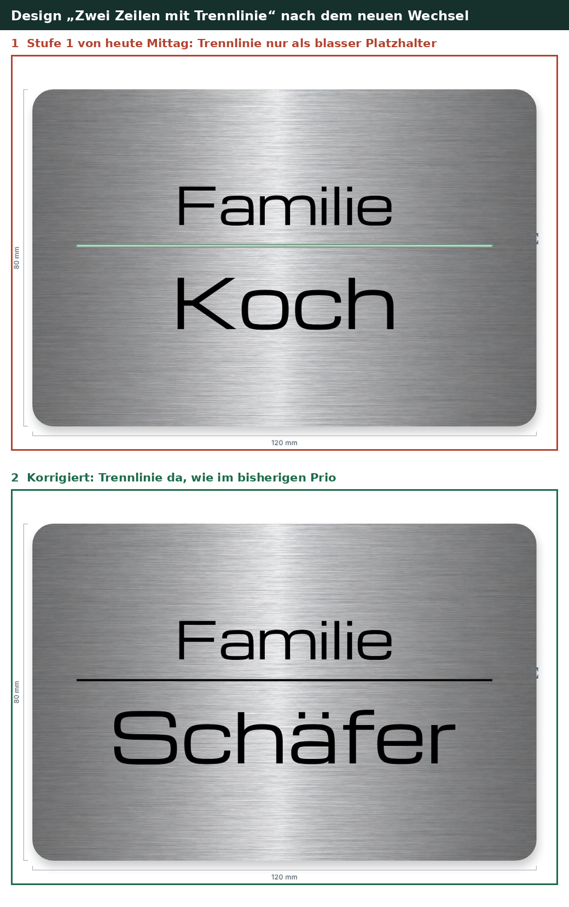

# Prio R15 mit der schnellen Technik von Variante C · Übergabe · 20.11.2026 (Claude)

Gestaltung und Design-Aufträge folgen dem [Design-Master](https://github.com/Chris83638w/gravuru-katalog./blob/main/designs/DESIGN-MASTER.md). Dieses Paket ändert keine Designs.

## Zweck und Auftrag

Chris hat mir am 20.11.2026 die technische Gesamtverantwortung für „Prio R15 als Master + schnelle Variante-C-Technik“ übertragen: [Auftrag in #265](https://github.com/Chris83638w/gravuru-2027/issues/265#issuecomment-7033770336), im Chat um 10:47 Uhr bestätigt mit „astra ist fertig. Prüfe was du überhaupt noch machen musst und setze es dann wie angegeben um. Du kannst es selbst programmieren, weil du der stärkste bist“.

Für dieses Thema ersetzt der Auftrag die Regel, dass den gemeinsamen Prio-Kern nur Mika mit Mikail ändert. Ich arbeite auf einem eigenen Zweig. Nichts ist aufgespielt.

Zur Freigabe: Chris schrieb um 10:05 Uhr „du kannst es direkt live setzen“ und um 10:06 Uhr „nein wir warten auf astra“. Ich lese das so: Testfassungen dürfen als eigener Testlink auf das echte System, der Kundenweg bleibt beim heutigen Prio, bis Chris selbst getestet und „live“ gesagt hat. So steht es auch im Auftrag.

## Stand

- Zweig `dev/claude-prio-c-20261120`, abgezweigt vom Live-Stand `2bd7bd8e` (`dev/astra-r15-live-267-20261119`).
- Stufe 1 ist gebaut und geprüft: Designwechsel im Gerät für Türschilder mit allen Größen.
- Stand `a38c9701` hatte einen Fehler bei Designs mit eigenem Motiv. Er ist mit `a4267e67` behoben, siehe „Nachtrag: Fehler in der ersten Fassung“.
- Astra hat `a38c9701` als geschützten Testpfad auf den Beta-Server gestellt. Ich selbst habe keinen Serverzugang.

## Was nicht mehr zu tun war

- **Test „Variante C → Edelstahl-Türschild → Shopify-Warenkorb“:** von Astra geliefert (Zweig `dev/astra-isolierter-variante-c-warenkorb-267`, Commit `17fbedf4`, geschützter Testlink). Nicht doppelt gebaut. Ich habe keinen Beta-Zugang und habe den Link nicht geöffnet; Astras Nachweis ist für mich ein fremder Bericht.
- **Astras vier Tempo-Änderungen vom 19.11.:** stecken schon im Live-Stand (`8a3d6c86`, `3b3b4626`, `44543823`, `5de3ce84`). Geprüft durch Übertragen der vier Commits auf `2bd7bd8e`: drei ergeben keine Änderung mehr, der vierte kollidiert nur mit seiner bereits eingebauten Fassung.

## Entscheidung: Weg A

Die C-Technik kommt in den Prio. Drei Gründe:

1. Variante C und Prio nutzen denselben Baustein `gravuru-configurator`. Bei den Funkklingeln wechselt der Prio das Design schon im Gerät.
2. In Variante C sind Bestellung, Preise, Motive und Logo abgeschaltet (`MASTER.md` im Repo `gravuru-shopify`). Weg B hieße, alle Prio-Funktionen und die gesicherte Warenkorb- und Fertigungsstrecke auf dem alten Stand neu zu bauen.
3. Die Zeit geht an einer benennbaren Stelle verloren, siehe Befund.

## Befund: warum der Designwechsel langsam war

Am 20.11. im Live-Shop nur lesend nachgesehen, Edelstahl-Türschild (Werkstattprodukt `cfg_ac514214…`, Stand 4, Format 12 × 8 cm):

- Die Designauswahl zeigt 21 Designs. Alle gehören zum selben Produkt, zum selben Stand und zur selben Shopify-Variante.
- Das geladene Modell hat 321 kB und enthält nur das Startdesign. So ist es entschieden (ENTSCHEIDUNGEN 4.42, Chris 03.11.2026: weitere Designs laden beim Klick).
- Beim Klick auf ein anderes Design lief bisher: Serveraufruf `design-switch` mit neuer Sitzung, neues Modell (wieder 321 kB), Ressourcen, dann ein vollständiger zweiter Editor in einem neuen Rahmen (`app/workshop/ui/shop-design-switch.mjs`, `choose`).
- Die Modelle für zwei Designs unterscheiden sich nur in den Design-Teilen: `profile.designs`, `familyFormats.designs` (15 Vorlagen, je rund 1 kB), `familyFormats.formats[].variants[].designIds`, `workshopElementRights` und die Angaben zum Startdesign. Alles andere ist zeichengleich.

Variante C hat alle Designs im Gerät und zeichnet beim Wechsel nur neu.

## Stufe 1: Designwechsel im Gerät

Beim Klick auf ein Design desselben Produktstands holt der Editor das Modell dieses Designs mit der bestehenden Sitzung, nimmt nur die Design-Teile in das laufende Modell auf und wählt das Design im laufenden Editor. Es gibt keine neue Sitzung, keinen Serveraufruf `design-switch` und keinen zweiten Editor. Ein schon geholtes Design wechselt danach ohne Netz.

| Datei | Änderung |
| --- | --- |
| `app/configurator/variant-m/design-adoption.mjs` (neu) | Vereinigt die Design-Teile zweier Modelle desselben Produktstands. Jede andere Abweichung (Preis, Material, Befestigung, Geometrie, Formate, Rechte) führt zur Ablehnung, das laufende Modell bleibt dann unverändert. |
| `app/configurator/variant-m/adapter.mjs` | Anschluss `el.uxAdoptDesignModel`; die Designliste des Formats wird danach neu gebildet. |
| `app/configurator/variant-m/product-design-gallery.mjs` | Karten desselben Produktstands: Design nachholen, Schriften und Motive nachladen, im Editor wählen. |
| `app/workshop/ui/shop-design-switch.mjs` | `loadDesign`: Modell eines weiteren Designs derselben Sitzung nur lesen; Produkt, Stand und Variante müssen übereinstimmen. |

Unverändert bleiben: der Server, die Sitzung, Preis und Variante, das Speichern, der Warenkorb, die Bestell- und Fertigungsstrecke, das Prio-Layout. Texte wandern wie bisher mit (dieselbe Funktion `chooseDesign` wie bei den Funkklingeln).

**Rückweg:** Scheitert das Nachholen oder weicht irgendetwas ab, greift der bisherige Wechsel über den Server.

**Bearbeiten aus dem Warenkorb:** Ein Entwurf aus dem Warenkorb ist auf dem Server fest an sein Design gebunden (`acrylic_draft_identity` in `shop-entry.mjs`). Dort wird nichts nachgeholt, es bleibt beim bisherigen Wechsel mit neuem Editor. Im normalen Ablauf legt der Editor je Design einen eigenen Entwurf an (`acrylic-draft-client.mjs`, Schlüssel aus Produkt, Stand und Design).

**Fachlogik:** Das Paket legt keine Regel, keine Sperre, keinen Preis und keinen Standardwert fest. „Laden beim Klick“ (4.42) bleibt.

## Prüfungen

- **Neue Tests:** `app/workshop/design-adoption.test.mjs` (4) und `app/workshop/shop-design-switch-adoption.test.mjs` (3). Die Modelle im Test kommen aus derselben Verkleinerung wie im Shop (`shopStartModel`) mit echten Katalogmaßen und -preisen. Geprüft: Das nachgeholte Design entspricht in jedem Format dem vollständigen Produkt, der Preis ist gleich, ein Größenwechsel findet es, elf Arten von Abweichung werden abgelehnt.
- **Gezielte bestehende Tests** zu Galerie, Designwechsel, Startmodell, Ablauf und Paketbau: 65 von 65 bestanden (mit den neuen).
- **Bedienprüfung am echten Edelstahl-Türschild** (Skript `geraetewechsel.mjs` im Nachweisordner): Der Server ist der Live-Server. Nur in meinem Browser habe ich das Hauptpaket des Editors und `shop-design-switch.mjs` durch den Bau aus meinem Zweig ersetzt. Vorher geprüft: Die Live-Dateien sind zeichengleich mit dem Bau aus `2bd7bd8e`, mein Bau unterscheidet sich nur im Hauptpaket. Kein Speichern, kein Warenkorb, keine Bestellung.
- **Gegenprobe** zu Preis, späterer Änderung, Fertigungsdateien, manipulierten Zustellungen und Storno: Ergebnis wie am Live-Stand.
- **Gesamtsuite** (`node --test app/configurator/variant-m/*.test.mjs app/workshop/*.test.mjs`): Live-Stand `2bd7bd8e` 2755 Tests, 2747 bestanden, 4 fehlgeschlagen, 4 übersprungen. Mein Stand `6375be57` 2761 Tests, 2753 bestanden, dieselben 4 fehlgeschlagen, 4 übersprungen. Die sechs zusätzlichen Tests sind die neuen. Die vier Fehlschläge gab es schon vorher („Werkstatt einheitlich …“ und drei Tests zur Fotoauflösung). Die Absicherung für das Bearbeiten aus dem Warenkorb kam danach dazu und ist mit einem siebten Test, den gezielten Tests und einem weiteren Bedienlauf geprüft.

### Ergebnis der Bedienprüfung

Je ein Lauf, keine Messreihe. Das Handyprofil ist eine Simulation (390 × 844, Rechenleistung ÷ 4, 150 ms, 1,6/0,75 Mbit/s). Geschwindigkeit und Bedienung testet Chris selbst.

| Schritt | PC bisher | PC neu | Handyprofil bisher | Handyprofil neu | Ergebnis |
| --- | --- | --- | --- | --- | --- |
| Zweites Design wählen | 2,09 s | 0,66 s | 6,27 s | 1,74 s | gleich |
| Drittes Design wählen | 1,81 s | 1,74 s | 5,69 s | 1,65 s | gleich |
| Zurück zum ersten Design | 1,94 s | 0,11 s | 5,34 s | 0,50 s | gleich |
| Noch einmal das zweite Design | 1,88 s | 0,10 s | 6,68 s | 0,63 s | gleich |
| Größe wechseln | 0,08 s | 0,08 s | 0,34 s | 0,41 s | gleich |
| Größe zurück | 0,08 s | 0,06 s | 0,33 s | 0,35 s | gleich |

„Gleich“ heißt: gleiches Design, gleiche Texte (der eigene Name „Koch“ wandert mit), gleiche Lage, Schrift und Größe wie beim bisherigen Wechsel. Bisher entstand je Wechsel ein neuer Editor, neu keiner. Kein Seitenfehler, kein Schreibzugriff.

Die Zeit bis zum offenen Editor ist in diesem Vergleich nicht aussagekräftig: Im ersetzten Lauf kommt das Hauptpaket unkomprimiert aus meinem Rechner. Am Start ändert Stufe 1 nichts.

## Nachtrag: Fehler in der ersten Fassung und Korrektur (20.11.2026, 12:45 Uhr)

**Fehler.** Astra hat `a38c9701` auf dem Beta-Server geprüft und gemeldet: Beim Design „Zwei Zeilen mit Trennlinie“ fehlt nach dem Wechsel im Gerät die Trennlinie, die Fertigungsprüfung hält vor dem Speichern an ([Meldung in #265](https://github.com/Chris83638w/gravuru-2027/issues/265#issuecomment-7036710071)). Ich habe das nachvollzogen und den Umfang bestimmt: Ich habe die Modelle aller 21 Designs mit dem Startmodell verglichen (nur lesend am Live-Shop). Zusätzlich zu den oben genannten Design-Teilen unterscheiden sie sich in `localResources.motifs`. 18 der 21 Designs bringen eigene Motive mit (Linien, Ornamente, Pfeile). Bei allen 18 fehlte nach dem Wechsel das Motiv. Eine falsche Bestellung war nicht möglich, weil die vorhandene Exportprüfung das Speichern anhält.

**Meine Lücke.** Mein Modellvergleich lief nur zwischen Design 1 und Design 2, beide ohne Motiv. Meine Bedienprüfung hat nur Texte verglichen. Den Punkt „Motive in Designs“ hatte ich als nicht geprüft genannt, die Fassung aber trotzdem zum Test gegeben.

**Korrektur.** Astras Vorschlag `a4267e67` ([PR #279](https://github.com/Chris83638w/gravuru-2027/pull/279)) habe ich gelesen, geprüft und übernommen. Er meldet die Motive der Vorlage beim laufenden Zeichner an und nimmt sie in beide Modellkopien auf. Angenommen werden nur eingebettete Motive aus reinen Pfaden; alles andere (Verweise, Bilder, abweichende Ressourcen, schon belegte Schlüssel) führt zum bisherigen Wechsel. Die Anmeldung entspricht dem Weg beim normalen Start (`build.mjs`: lokale Motive in die Motivliste, Schlüssel in `GravuruTemplateOnlyMotifKeys`, damit sie nicht in der Motivbibliothek des Kunden erscheinen).

**Prüfung der Korrektur.**

- Alle 21 Designs nacheinander gewählt, einmal mit dem bisherigen und einmal mit dem neuen Wechsel (Skript `alle-wechsel.mjs`, Rohwerte `alle-live-pc.json` und `alle-neu-pc.json`). Verglichen je Design: Design, Texte, Motive mit Lage und Größe, Anzahl der gezeichneten Pfade, Prüfsumme über alle Pfaddaten, Anzahl nicht umgewandelter Textelemente. Ergebnis: alle 20 Wechsel gleich, darunter die 18 Designs mit Motiv. Neu: kein Serverwechsel, ein Editor. Bisher: 20 Serverwechsel, 21 Editoren.
- Der Rückweg auf Design 1 ergibt im neuen Wechsel exakt den Startzustand (16 Pfade, gleiche Prüfsumme). Im bisherigen Wechsel zeigte mein Vergleich dort zwei noch nicht umgewandelte Texte; das ist ein Zeitpunkt meiner Aufnahme im frisch gestarteten Editor und kein Befund am neuen Weg.
- Gezielte Tests 68 von 68. Gesamtsuite auf `a4267e67`: 2765 Tests, 2757 bestanden, dieselben 4 Fehlschläge wie am Live-Stand, 4 übersprungen. Gegenprobe unverändert.
- Bedienprüfung mit eigenem Text, Größenwechsel und Rückgängig-Taste wiederholt: wie zuvor.

**Noch offen:** Der Durchlauf eines Designs mit Motiv bis in den Shopify-Warenkorb auf dem Beta-Server mit dem korrigierten Stand.

## Sichtbare Unterschiede und Entscheidung von Chris

Am echten Edelstahl-Türschild am Handy aufgenommen (Skript `knopf.mjs`):

| Punkt | Bisher | Neu | Entscheidung |
| --- | --- | --- | --- |
| Knopf „← Zur vorherigen Gestaltung“ in der Designauswahl | erscheint nach dem Wechsel | erscheint nicht; zurück führt die Rückgängig-Taste oder das Antippen des vorherigen Designs | weglassen |
| Hinweis „Deine Texte und Fotos wurden übernommen. Bitte die neue Anordnung prüfen.“ | erscheint nach dem Wechsel | fehlte in der ersten Fassung, ist seit dem Commit zum Hinweis wieder da | bleibt |
| Designliste am Handy | war nach dem Wechsel geschlossen (zweimal beobachtet, 0,9 s und 2,5 s nach dem Wechsel) | bleibt offen, mehrere Designs lassen sich nacheinander ausprobieren | so lassen |

Ich habe Chris die drei Punkte am 20.11.2026 um 12:58 Uhr im Chat mit Bild und je einer Empfehlung vorgelegt (Knopf weglassen, Hinweis wieder einbauen, Liste offen lassen). Seine Antwort um 13:00 Uhr, wörtlich: „ja passt“.

## Grenzen

- Stufe 1 gilt für Produkte mit allen Größen in einem Produkt (heute das Edelstahl-Türschild). Andere Galerie-Produkte, zum Beispiel mit fester Größe oder mit Fotofeldern, nutzen weiter den bisherigen Weg.
- Beim ersten Wechsel zu einem Design wird weiter das Modell mit 321 kB geholt. Eine schlanke Antwort nur mit den Design-Teilen (rund 16 kB) und das Vorladen sichtbarer Karten sind der nächste Schritt; das braucht eine kleine Serveränderung.
- Geprüft am Edelstahl-Türschild im Format 12 × 8 cm mit allen 21 Designs und einem Größenwechsel. Nicht geprüft: die anderen 79 Formate, Designs mit Bildern oder Verweisen im Motiv (sie nehmen den bisherigen Weg), echtes Handy.
- Start des Editors und „In den Warenkorb“ sind noch nicht angefasst.
- Nachtrag: Astra hat auf dem Beta-Server zwei Gestaltungen nach einem Wechsel im Gerät in den echten Warenkorb gelegt (zwei Positionen, je 19,99 €, Bilder stimmen). Das ist für mich ein fremder Bericht.
- **Speichern und Warenkorb nach einem Wechsel im Gerät habe ich nicht ausgeführt**, weil ich im Live-Shop nichts schreibe. Begründung, warum es gleich bleibt: Sitzung und Produktzuordnung sind dieselben wie vor dem Wechsel, der Server prüft beim Speichern Produkt und Stand der Sitzung und das Design gegen das vollständige Produkt, und der Editor legt je Design einen eigenen Entwurf an. Das ist eine Herleitung aus dem gelesenen Code, kein Nachweis. Der Nachweis gehört auf den Beta-Server: zwei Gestaltungen nach einem Wechsel im Gerät in den Warenkorb legen, Preis, Bild und Artikelnummer ablesen.
- Beobachtung ohne Einordnung: Zwischen 11:10 und 11:40 Uhr kam bei meinen Abrufen dreimal eine unvollständige Antwort (zweimal wurde der Editor in 120 s nicht bereit, einmal lieferte das Hauptpaket 12.149 statt 1.403.777 Zeichen bei Status 200). 28 weitere Abrufe waren in Ordnung. Die Ursache kann in meiner Umgebung liegen, die Abrufe laufen über einen Zwischenrechner.

## Nächster Schritt

1. Astra stellt den genannten Commit als getrennten Testpfad auf den Beta-Server. Chris testet selbst.
2. Stufe 2: schlanke Antwort und Vorladen, damit auch der erste Wechsel ohne Wartezeit läuft.
3. Stufe 3: Start des Editors. Stufe 4: Wartezeit bei „In den Warenkorb“.

## Freigabe für Stufe 1

Chris am 20.11.2026 um 13:03 Uhr im Chat, wörtlich: „was genau soll astra jetzt machen. ich möchte jetzt endlich alles live haben“. Daraus mein Auftrag an Astra in #267: Beta auf `921928f4`, ein Durchlauf mit einem Design mit Motiv bis in den Shopify-Warenkorb, bei Erfolg Stufe 1 live stellen, Rücknahme auf `2bd7bd8e` bereithalten. Den Durchlauf habe ich als Bedingung gesetzt. Stufe 2 bis 4 sind nicht gebaut und nicht Teil dieser Freigabe.

## Stufe 1 ist live (20.11.2026, 13:16 Uhr)

Astra hat `921928f4` nach einem Durchlauf auf der Beta live gestellt (D1 → „Zwei Zeilen mit Trennlinie“, „Neumann“, 19,99 €, Artikelnummer `156-GR-ES-AB-120X80-T15-K00`, Trennlinie im persönlichen Bild; Astras Bericht in #267). Ich habe danach im Shop nur lesend nachgesehen: die drei Shop-Dateien sind zeichengleich mit `921928f4`, der Wechsel bleibt im selben Editor, 0 Serverwechsel, 0 neue Editoren, erster Wechsel 0,6 bis 0,9 s, jeder weitere rund 0,1 s (ein Lauf am PC).

## Stufe 2: alle Designs im Gerät, wie bei Variante C

### Anweisung von Chris (20.11.2026, im Chat mit mir, wörtlich)

- 13:08 Uhr: „ja“ (auf meine Frage, ob ich direkt mit Stufe 2 weitermache), danach: „ich dachte das wäre schon fertig. Bitte macht jetzt alles endlich fertig.“ und 13:09 Uhr: „jetzt alles auf einmal“.
- 13:27 Uhr, nach seinem eigenen Test von Stufe 1: „bei mir dauert es viel länger beim designwechse“.
- 13:28 Uhr: „bitte so wie bei variante c […] Das kann doch nicht so schwer sein. Da sind es sogar viel mehr Elemente“, „das ist mein anweisung“, „nichts vergleichen […] ich habe dir gesagt was zu tun ist“.
- 13:30 Uhr: „Variante C läuft sehr gut und schnell […] Ich möchte den prio Konfi exakt so gebaut haben. Nur unser Layout und die Funktiopnen müssen beibehalten bleiben“, 13:31 Uhr: „also vom Prio das Design und die Funktionen“.

### Was Stufe 1 noch anders machte als Variante C

Stufe 1 holte jedes Design beim ersten Antippen einzeln vom Server, als ganzes Modell (310 kB), dazu seine Schrift. Variante C hat alle Designs von Anfang an im Gerät.

### Gebaut (Zweig `dev/claude-prio-c-stufe2-20261120`, auf `00db4970`)

| Commit | Inhalt |
| --- | --- |
| `2c42ea20` | Start-Seite fordert `shop-design-switch.mjs` und `shop-selection-transfer.mjs` gleich mit an (zwei Abrufe weniger in Folge vor dem Modell) |
| `5aef7425` | Design-Teile statt ganzer Modelle, Aufnahme aller Designs nach dem Start, Schriften im Hintergrund |
| `29b96b85` | Unveränderte Schriften und Motive nur einmal prüfen (`local-pilot.mjs`) |

Ablauf:

1. **Server, nur lesend, neu:** `GET /api/shop-entry/design-parts?designs=a,b,…` (höchstens 48). Liefert je Design nur die Design-Teile (`shopDesignParts` in `shop-start-model.mjs`: Vorlagen, Zuordnung je Ausführung, Rechte, eingebettete Motive) und den Fingerabdruck von allem anderen (`shopDesignBase`: Preise, Größen, Materialien, Befestigungen, Regeln, Schriftverweise). Dieselben Prüfungen wie beim Modellabruf: Sitzung, Zuordnung, Pause, Freigabe, Produktstand. Eigener kleiner Zwischenspeicher (64 Einträge, 32 MB), der Modellspeicher bleibt unberührt.
2. **Startantwort:** `model` trägt zusätzlich `designBase` (nur bei Produkten mit allen Größen). Sonst unverändert.
3. **Shop-Seite (`shop-design-switch.mjs`):** setzt Teile nur dann in das eigene Startmodell ein, wenn Fingerabdruck, Produktzuordnung und Produktstand übereinstimmen. Heraus kommt genau das Modell, das `model?design=` geliefert hätte. Sonst holt sie das vollständige Modell wie in Stufe 1. Beim Bearbeiten aus dem Warenkorb bleibt alles beim bisherigen Weg. Im Datensparmodus wird nichts ungefragt geholt.
4. **Editor (`product-design-gallery.mjs`):** nimmt nach der Designliste alle Designs desselben Produktstands in Sechsergruppen auf, in der Reihenfolge der Karten, über dieselbe geprüfte Übernahme wie beim Antippen (`design-adoption.mjs`), und lädt ihre Schriften und Motive mit niedriger Priorität. Danach ist jeder Wechsel nur noch ein Neuzeichnen.

Preise, Größen, Materialien und Regeln kommen nie über den neuen Abruf. Warenkorb, Entwurf, Prüfpaket und Bestellung sind nicht angefasst.

### Prüfungen

- Neue Tests: `shop-design-parts.test.mjs` (5), in `shop-entry-model-cache.test.mjs` (4), in `shop-design-switch-adoption.test.mjs` (5). Kern: eingesetzte Teile ergeben exakt das Modell von `model?design=`; die Übernahme endet im selben Zustand wie mit dem vollständigen Modell; anderer Fingerabdruck, andere Zuordnung, anderer Produktstand, Fehler, Warenkorb-Bearbeitung und Datensparmodus nehmen den bisherigen Weg; Pause, Freigabe und Produktstand werden bei jedem Abruf frisch geprüft.
- Gezielte Tests: 139 von 139. Gesamtlauf: siehe unten.
- Echte Daten ohne Schreibzugriff: An zwei am 20.11. im Shop gelesenen Modellen ergibt Einsetzen in beide Richtungen exakt das andere Modell; Fingerabdruck gleich (`teile-echt.mjs`).
- Bedienprüfung am echten Edelstahl-Türschild (`stufe2.mjs`): In meinem Browser ersetzt sind das Editor-Paket und die zwei Shop-Dateien. Den neuen Server-Abruf gibt es live noch nicht; er wird im Prüfbrowser aus den echten Live-Modellen mit denselben Funktionen nachgebildet. Ergebnis: 4 Abrufe für 20 Designs, alle 21 Designs und 22 Schriften im Gerät, bevor die Designauswahl geöffnet wird; die Startgestaltung bleibt dabei unverändert; 21 Wechsel mit 0 Modellabrufen, 0 Serverwechseln, 0 neuen Editoren; jedes der 20 Designs ist in Pfaden, Texten und Motiven gleich dem bisherigen Weg; zurück zu Design 1 ergibt den Startzustand.

### Zahlen (je ein Lauf, kein Mittelwert)

| | PC | Handy-Profil (CPU ×4, 1,6 Mbit/s) |
| --- | ---: | ---: |
| Wechsel zu einem beliebigen Design, auch zum ersten Mal | 0,18 bis 0,31 s | 1,0 bis 1,8 s |
| Rechenzeit der Aufnahme je Gruppe, im Hintergrund | 12 bis 48 ms | 69 bis 235 ms |

Datenmenge im Hintergrund nach dem Start: Design-Teile für 20 Designs zusammen rund 0,4 MB (mit Brotli Stufe 5 gerechnet; unkomprimiert 2,0 MB; eine Gruppe mit aufwendigen Motiven allein rund 0,33 MB), 23 Schriftdateien zusammen rund 2,5 MB.

Die Zeit im Handy-Profil ist reine Rechenzeit des Editors beim Neuzeichnen, ohne Netz. Sie verteilt sich auf viele kleine Schritte (Materialvorschau mit Bildauswertung, SVG-Aufbau, Abfragen im Dokument), keinen einzelnen großen. Das ist der nächste Hebel, siehe unten.

### Grenzen von Stufe 2

- **Nicht aufgespielt, nicht am echten Server gelaufen.** Der neue Abruf ist nur in Tests und im Nachbau geprüft. Die Kosten des ersten Abrufs je Gruppe am Server (Modellkopie von rund 12 MB, je Design eine dargestellte Kopie) habe ich nicht gemessen.
- **Speichern und Warenkorb nicht ausgeführt** (keine Schreibzugriffe im Shop). Der Zustand im Gerät ist derselbe wie nach einzelnen Übernahmen in Stufe 1 (Test), die Astra auf der Beta bis in den Warenkorb geprüft hat. Ein Durchlauf mit einem Design mit Motiv auf der Beta bleibt Bedingung vor live.
- Gilt wie Stufe 1 für Produkte mit allen Größen (heute das Edelstahl-Türschild). Nach einem Größenwechsel im Konfi zeigt die Liste Designs einer anderen Shopify-Variante; die nehmen weiter den bisherigen Weg.
- Rund 3 MB im Hintergrund je Öffnen. Im Datensparmodus und bei 2G wird nichts vorgeladen.
- Bei einem Größenwechsel sucht der Editor dieselbe Vorlage, sonst dieselbe Designnummer, sonst die erste der Liste. Der letzte Fall hängt von der Reihenfolge der Aufnahme ab und kann vom Server abweichen. Das gilt schon für Stufe 1. Die Aufnahme im Hintergrund hängt neue Vorlagen nur an und läuft nur, wenn die Designnummern je Ausführung eindeutig sind.
- Beobachtung: Abrufe aus meinem Prüfprogramm (nicht aus dem Browser) kamen heute mehrfach unvollständig an; mit `curl` waren dieselben Dateien vollständig. Ich ordne das meiner Umgebung zu.

### Was nach Stufe 2 zu „exakt wie Variante C“ noch fehlte

Stand vor Stufe 3 und 4; die beiden folgenden Abschnitte gehen Punkt 2 und 3 an.

1. **Rechenzeit je Änderung.** Jeder Wechsel und jede Eingabe läuft durch dieselbe Kette. Am PC rund 0,15 s, im Handy-Profil rund 1 s.
2. **Start.** Vom Tippen bis zum bereiten Editor: am PC 3,4 bis 3,9 s (fünf Läufe), im Handy-Profil 11,5 s (ein Lauf, `start.mjs`). Im Handy-Profil bestimmt das Editor-Paket (421 kB komprimiert, 1,4 MB) den Zeitpunkt, danach rund 4,8 s Rechenzeit. Variante C startet als fertige Seite ohne Sitzung und ohne Modellabruf.
3. **Warenkorb.** Nicht angefasst. Messung bei Astra angefragt (#267).

## Unteragenten, Stufe 3 und Stufe 4 (20.11.2026, ab 13:57 Uhr)

Chris, 13:57 Uhr, wörtlich: „nutze unteragenten. wir haben keine zeit mehr“. Zwei Unteragenten haben parallel in eigenen Arbeitskopien gebaut. Ich habe beide Änderungen Zeile für Zeile gelesen und zum gemeinsamen Stand zusammengeführt. Ihre Messungen habe ich nicht wiederholt; sie sind unten als ihre Angaben gekennzeichnet.

| Teil | Zweig | Commit |
| --- | --- | --- |
| Stufe 3, Start | `dev/claude-prio-c-start-20261120` | `82ef626e` |
| Stufe 4, Warenkorb | `dev/claude-prio-c-warenkorb-20261120` | `1d0b74e5` |
| Gemeinsamer Stand (Stufe 2, 3, 4) | `dev/claude-prio-c-gesamt-20261120` | `f04200b0`, danach nur Doku |

### Stufe 3: Vorab-Start auf der Produktseite

**Entscheidung von Chris.** Das Vorladen war am 27.10.2026 gebaut und mit seiner Zustimmung wieder abgeschaltet worden, weil es damals nichts brachte (ENTSCHEIDUNGEN 2.3: „gemessen nutzlos (~15 MB je Aufruf)“). Ich habe ihn deshalb gefragt, ob es wieder eingeschaltet werden soll, mit dem Hinweis auf rund 0,8 MB mehr je Aufruf der Produktseite. Seine Antwort, wörtlich: „wie bei Variante C. Was so schwer zu verstehen ? Wie klar soll ich es sagen ?“ Ich werte das als Ja (ENTSCHEIDUNGEN 2.13).

**Befund des Unteragenten:** In `shop-embed.mjs` holte die Produktseite in der Ruhephase schon die Startkarte (Sitzung) und wärmte eine kleine Dateiliste vor. Das unsichtbare Vollfenster (`preload()`, `.gv-embed--preload`) war vorhanden, hatte aber keinen Auslöser. Modell, Editor-Seite und Editor-Start begannen erst beim Tippen.

**Gebaut:** Nach der Startkarte und einer Ruhephase startet das vorhandene unsichtbare Fenster einmal (`createPrebootControl`). Beim Tippen wird es nur eingeblendet. Regeln, je mit Test: nicht im Datensparmodus, bei 2G oder auf verborgener Seite; nur mit gültiger Startkarte; höchstens einmal je Seitenaufruf; andere Variante oder abgelaufene Startkarte beim Tippen: verwerfen, normaler Start; Fehler im unsichtbaren Fenster: still verwerfen; Schließen und Escape greifen nicht ins unsichtbare Fenster; Bearbeiten aus dem Warenkorb startet nie vorab. Das Nachladen im Editor (weitere Designs aus Stufe 2, Schriften, Motive) beginnt erst, wenn die Produktseite meldet, dass der Kunde den Konfigurator sieht (`GravuruShopEntry.whenShown`). Eine kleine Verhaltensänderung: Ist der Konfigurator beim Einblenden schon fertig, geht der Fokus in den Konfigurator statt auf den dann verborgenen Schließen-Knopf.

**Angaben des Unteragenten** (je ein Lauf, nur lesend am echten Edelstahl-Türschild mit ersetzten Dateien im eigenen Browser; parallel liefen andere Läufe):

| Lauf | Tippen bis bedienbar |
| --- | ---: |
| PC, ohne Vorab-Start | 3,9 s |
| PC, mit Vorab-Start, nach einigen Sekunden auf der Produktseite | 0 s (war schon fertig) |
| PC, Variante vor dem Tippen gewechselt | 4,7 s (richtige Variante geöffnet) |
| Handy-Profil, mit Vorab-Start, nach rund 15 s auf der Produktseite | 0 s (war schon fertig) |
| Handy-Profil, Tippen 5 s nach Erscheinen des Knopfs | 9,1 s |

Der Konfigurator war unsichtbar fertig: am PC 4,5 bis 5,4 s nach Erscheinen des Knopfs, im Handy-Profil 14,9 s danach. Früh tippen bringt also wenig.

**Kosten und offene Punkte:** rund 0,8 MB mehr je Aufruf der Produktseite ohne Tippen (am PC 1.490 statt 655 kB). Keine zusätzliche Sitzung, aber je Seitenaufruf statt je Tippen ein Modellabruf, die Designliste und die Startvorschau. Der ganze Editor rechnet im Hintergrund; ob die Produktseite auf echten Handys dabei ruckelt und ob Safari unsichtbare fremde Fenster bremst (am 27.10. beobachtet), ist nicht geprüft. Nicht geprüft sind auch Speichern und Warenkorb nach einem Vorab-Start.

### Stufe 4: Warenkorb-Übergabe

**Kette im heutigen Stand** (Unteragent, aus dem Code): Vorbereitung im Browser → `POST acrylic-drafts` → `POST theme-cart` → `GET cart/data` → `POST cart/claim` → `POST /cart/add.js`. Von Astra schon erledigt: Kundenbild als WebP, Shopify-Bild startet direkt nach dem Sichern, kein PNG mehr über das Kundengerät, Zeitmessung je Abschnitt.

**Befund:** `prepareThemeCart` läuft dreimal je Warenkorb, jedes Mal mit einer bis zwei vollen Angebotsprüfungen. Jede las den ganzen Produktstand (rund 12 MB) neu und prüfte seine Prüfsumme neu. Modell- und Galerieabruf vermeiden das seit „Paket 1a“ über eine Lesephase und einen Prüfsummen-Merker; die Warenkorb-Routen nutzten beides nicht.

**Gebaut** (`shop-entry.mjs`, 43 Zeilen): `theme-cart`, `cart/data` (je eine Phase vor und nach dem Warten auf das Bild) und `cart/claim` laufen in `withCustomerReadScope`; die Zuordnung wird mit demselben Merker aufgelöst wie bei der Sitzungsprüfung jeder Anfrage (`cartRegistry`). Keine Prüfung entfällt; Reihenfolge und Fehlermeldungen sind gleich. Von mir beim Lesen geprüft: In `themeProxy` liegt die Herkunftsprüfung des Claims weiter nach der Vorbereitung, der Claim läuft nur für `POST …/claim`, der Datenzweig prüft nach dem Warten auf das Bild erneut. Die Lesephase merkt Datenbank-Lesungen nur bei unverändertem Datenbankstand (`customer-read-scope.mjs`), nach einem Schreibvorgang wird neu gelesen.

**Risiko, das auf die Beta gehört:** Werte aus einer Lesephase sind eingefroren. Ein Schreibversuch darauf in einem Zweig, den die Tests nicht abdecken, endet als Fehler 500. Deshalb die Durchläufe mit Edelstahl, Ring, Menge 3 und Bearbeiten aus dem Warenkorb.

**Angaben des Unteragenten** (im Prozess mit echter SQLite-Werkstatt; Produkt synthetisch mit 12 MB, 80 Formaten, 240 Designs; Shopify-Bild als Attrappe; Median aus 5 Läufen, Maschine parallel belastet):

| Anfrage | vorher | nachher |
| --- | ---: | ---: |
| `acrylic-drafts` | 1949 ms | 1736 ms (unverändert, Schwankung) |
| `theme-cart` | 1098 ms | 384 ms |
| `cart/data` | 1082 ms | 357 ms |
| `cart/claim` | 1180 ms | 269 ms |

Nachweis des Unteragenten: 47 Testdateien rund um Warenkorb, Einstieg, Prüfpaket, Bestelleingang und Zuordnung mit 487 Tests, 486 bestanden, 1 übersprungen; meine Gegenprobe am geänderten Stand und am Live-Stand `921928f4` mit gleichem Ergebnis (`druck.pdf` und `gestaltung.svg` bytegleich, `konturA.pdf` weicht wie bekannt zwischen Läufen ab).

**Offen, nur am echten Server oder bei Shopify messbar:** ob der Antwortspeicher (`modelResponseCache`) live eingeschaltet ist (ohne ihn wirkt nur die Lesephase); `checkout_image_wait` und das Anlegen des Bilds bei Shopify; Dauer von `/cart/add.js`; Größe des Uploads bei `acrylic-drafts`.

**Nicht gebaut, braucht eine Entscheidung:** Das Prüfpaket enthält je Entwurf das ganze Produktdokument (rund 12 MB). Ein Verweis auf den unveränderlichen Produktstand würde das Sichern lokal um geschätzt 0,6 bis 0,8 s kürzen, ändert aber Inhalt und Prüfsumme des Prüfpakets und alle Leser (Fertigung, Bestelleingang). Ebenso offen: `cart/data` und `cart/claim` zusammenlegen (spart einen Abruf über den Shopify-App-Proxy, ändert das Protokoll).

### Prüfungen am gemeinsamen Stand `f04200b0`

- Gezielte Tests: 151 von 151.
- Gesamtlauf: 2783 Tests, 2775 bestanden, 4 fehlgeschlagen (dieselben vier wie am Live-Stand `921928f4`), 4 übersprungen
- Am echten Edelstahl-Türschild mit dem Editor-Paket dieses Stands (`stufe2.mjs`, nur lesend): 21 Designs im Gerät, 21 Wechsel ohne Modellabruf und ohne neuen Editor, 20 von 20 Designs gleich dem bisherigen Weg.
- Gesamtlauf zu Stufe 2 allein (`c83ec441`): 2779 Tests, 2771 bestanden, 4 fehlgeschlagen (dieselben vier wie am Live-Stand), 4 übersprungen.

### Stand der Übergabe an Astra

Mein Auftrag in #267 war: Beta auf `f04200b0`, Prüfliste (Server-Abruf, Wechsel, Warenkorb mit Edelstahl, Ring, Menge 3 und Bearbeiten, `Server-Timing`, Vorab-Start auch am iPhone), dann live, Rücknahme auf `921928f4`.

**Geändert durch Chris:** Astra berichtet in #267 (14:36 Uhr) eine neue Freigabe von Chris im Chat mit ihm, wörtlich: „ich möchte es jetzt live im Shop Hbaen., Testen kann ich hinterher.“ Astra schaltet deshalb `f04200b0` direkt live; die Prüfungen auf der Beta entfallen für diese Freischaltung. Das Zitat kenne ich nur aus Astras Bericht. Folge: Stufe 4 geht live, ohne je mit einem echten Schreibzugriff gelaufen zu sein. Ich habe in #267 verlangt, dass direkt nach dem Umschalten je ein Warenkorb mit Edelstahl-Türschild und Ring geprüft und bei einem Fehler sofort auf `921928f4` zurückgegangen wird.

## Live seit 14:40 Uhr: Stufe 2, 3 und 4 (`f04200b0`), und meine Prüfungen danach

Astra hat `f04200b0` um 14:40 Uhr live gestellt, ohne die Beta-Prüfungen, auf die von ihm berichtete Ansage von Chris hin (ENTSCHEIDUNGEN 2.15).

**Nur lesend am echten Shop, ohne Ersatz:** Die drei Shop-Dateien sind zeichengleich mit `f04200b0`. Der neue Abruf `design-parts` antwortet am echten Server: 4 Abrufe, alle 200, komprimiert 30, 335, 46 und 8 kB, Wartezeit 343 bis 467 ms. Alle 21 Designs und 22 Schriften im Gerät; 21 Wechsel ohne Modellabruf und ohne neuen Editor, 0,15 bis 0,33 s je Wechsel; 20 von 20 Designs gleich dem bisherigen Weg. Der Vorab-Start wirkt: Nach 6 s auf der Produktseite war der Konfigurator 2 bis 8 ms nach dem Tippen bereit.

**Warenkorb im echten Shop.** Chris, 14:37 Uhr, wörtlich: „du darfst alles. du hast von mir vollen zugriff“. Damit habe ich je eine Testgestaltung „Claudetest“ in den Warenkorb eines Wegwerf-Browsers gelegt, ohne Kasse und ohne Bestellung. Entstanden sind Testentwürfe samt Shopify-Bild (zwei hier, ein dritter beim Acrylglas-Schild unten); gelöscht habe ich nichts.

| | Edelstahl-Türschild | Ring Wired Pro, Hochformat |
| --- | --- | --- |
| Weg | vorab gestartet, Wechsel im Gerät zu „Zwei Zeilen mit Trennlinie“ | vorab gestartet, Startdesign |
| Position | 1 × 19,99 € | 1 × 49,99 € |
| Artikelnummer | `156-GR-ES-AB-120X80-T15-K00` | `FK-AV2A-16x28-1441` |
| Design, Format | Zwei Zeilen mit Trennlinie, 120 × 80 mm | Strichdesign, 160 × 280 mm |
| Persönliches Bild | Maserung, „Familie“, Linie, „Claudetest“ | Rahmen, Klingel, „Claudetest“, „Mustermann“, „12a“ |
| Klick „Jetzt in den Warenkorb“ bis Position | 9,4 s | 6,1 s |

`Server-Timing` des Edelstahl-Laufs: `acrylic-drafts` 2214 ms (`preview_pair` 795, `review_validate` 508, `review_zip` 245, `draft_persist` 121; 272 kB gesendet), `theme-cart` 383 ms, `cart/data` 2506 ms (davon `checkout_image_wait` 2248), `cart/claim` 232 ms, `/cart/add.js` bei Shopify 819 ms. Stufe 4 wirkt also am echten Server (`theme-cart` und `cart/claim` zusammen rund 0,6 s). Der Rest sitzt im Sichern des Entwurfs, im Warten auf das Shopify-Bild und bei Shopify selbst.

## Designkarten im Gerät (20.11.2026, ab 14:43 Uhr)

**Chris, mit drei Bildern der Designauswahl:** 14:43 Uhr „Nein, siehe hier . Das habe ich bei variante c nicht. das sehe ich sofort alles“, 14:47 Uhr „nach 30 Sekunden auf der seite und es ist immernoch nichts zu sehen“, 15:07 Uhr „nein, dauert sekunden“. Er meinte von Anfang an die Vorschaubilder der Karten. Ich hatte bis dahin den Wechsel nach dem Antippen beschleunigt. 15:25 Uhr zum Stand `6c8a951a`: „bisher alles sehr gut“.

**Ursache:** Jede Karte wurde einzeln vom Server gezeichnet (`design-gallery-preview`), für alle Besucher zusammen höchstens zwei gleichzeitig (`shop-gallery-preview-queue.mjs`), nur für sichtbare Karten, rund 100 kB je Karte. Am Stand `f04200b0` gemessen: 2 s nach dem Öffnen 6 von 21 Karten, der Rest erst beim Rollen.

| Commit | Inhalt | Stand |
| --- | --- | --- |
| `4e764ed5` | Liegt ein Design samt Schrift und Motiv im Gerät, zeichnet der Editor seine Karte selbst, mit derselben Zeichenfunktion wie die eigene Designauswahl (`window.Funkklingel.thumb`). Sonst bleibt die Server-Vorschau. | live seit 15:03 Uhr |
| `6c8a951a` | Alle Design-Gruppen laden gleichzeitig und schon während des Vorab-Starts auf der Produktseite; die Eindeutigkeit der Designnummern wird über alle aufgenommenen Designs geprüft. | live seit 15:22 Uhr |
| `99ae3445` | Korrektur der Paketregel, siehe unten. Verhalten unverändert. | Auftrag an Astra in #267 |

Zweig `dev/claude-prio-c-karten-20261120`.

| Stand | Ablauf | Alle 21 Karten da |
| --- | --- | --- |
| `f04200b0` live | Designauswahl öffnen | nie ohne Rollen; 6 nach 2 s |
| `4e764ed5` live, mein Lauf | 6 s auf der Produktseite, tippen, 1,5 s später öffnen | nach 2 s |
| `4e764ed5` live, Astras Lauf | tippen 1,2 s nach Erscheinen des Knopfs | nach 6,9 s (PC), 18,5 s (Handy-Ansicht) |
| `6c8a951a` live, Astras Lauf | 10 s auf der Produktseite, tippen, öffnen | nach 0,3 s (PC), 0,03 s (Handy-Ansicht) |
| `6c8a951a`, mein Lauf | tippen 1,2 s nach Erscheinen des Knopfs | nach 2 s |

Bilder: `bilder/05-karten-im-geraet.png`, `bilder/06-karten-vergleich.png` (links im Gerät gezeichnet, rechts die Auswahl mit Server-Vorschauen). Skript: `vorschau.mjs`.

**Mein Fehler bei diesen beiden Ständen:** Ich habe `4e764ed5` und `6c8a951a` an Astra gegeben, bevor der Gesamtlauf fertig war. Der Gesamtlauf zu `6c8a951a` ergab danach 2783 Tests, 2773 bestanden, 6 fehlgeschlagen, 4 übersprungen: die vier bekannten und zwei neue in `bundle.test.mjs` („device logic must not be delivered in the common bundle: doorbell-selection.mjs“). Ursache war mein Import von `designResourcesReady` aus `doorbell-lazy-designs.mjs`; er zog Gerätelogik der Klingelschilder ins gemeinsame Paket (18 kB mehr). Für Kunden ohne sichtbare Folge. Korrektur `99ae3445`: die Bedingung steht eigenständig in `product-design-gallery.mjs`. Gesamtlauf `99ae3445`: 2783 Tests, 2775 bestanden, 4 fehlgeschlagen (die bekannten), 4 übersprungen. Seitdem laufen die Paket-Tests bei mir vor jeder Weitergabe.

**Kosten beim Edelstahl-Türschild:** rund 3 MB je Aufruf der Produktseite (Design-Teile rund 0,4 MB, 21 Schriften rund 2,5 MB), auch wenn der Kunde nicht tippt. Nicht im Datensparmodus und nicht bei 2G.

## Acrylglas-Schilder 12 × 8 cm (20.11.2026, ab 15:35 Uhr)

**Anlass:** Nach „bisher alles sehr gut“ habe ich die übrigen Produkte im echten Shop nur lesend durchgesehen (`korb/produkte.mjs`, `korb/andere.mjs`). 88 Produkte: 85 Klingelschilder, 1 Edelstahl-Türschild, 2 Acrylglas-Schilder 12 × 8 cm.

| Produktart | Designauswahl | Karten |
| --- | --- | --- |
| Klingelschilder (85) | eigene Auswahl des Editors, alle Designs im Gerät | 18 sichtbare Karten nach 0,2 s |
| Edelstahl-Türschild (1) | Auswahl über die Produktgalerie, 21 Designs | im Gerät, siehe oben |
| Acrylglas 12 × 8 cm (2) | Auswahl über die Produktgalerie, je 208 Designs, 40 je Seite | **vom Server: 10 s nach dem Öffnen 6 von 40, rund eine je Sekunde** |

Bild: `bilder/07-acryl-live-vorher.png`. Dazu startete jeder Designwechsel einen neuen Editor.

**Warum:** Die Acrylglas-Schilder sind eine Familie mit fester Größe (`familyFormats.fixedSize`). Ihr Start schickt wie beim Edelstahl-Türschild nur das Startdesign (`shopStartModel`), alle 208 Designs gehören zum selben Produktstand und zur selben Shopify-Variante. Wechsel im Gerät, Design-Teile und gezeichnete Karten waren aber an `isAllSizesFamily` gebunden.

**Änderung `4c508463` und `94cd4282`** (Zweig `dev/claude-prio-c-acryl-20261120`, baut auf `99ae3445` auf; Hauptpaket `editor-0cfc01ffabb9d596`):

- Server: Fingerabdruck in der Startantwort und Abruf `design-parts` auch für die Familie mit fester Größe (`hasDesignParts` in `shop-start-model.mjs`). Speicher der Design-Teile 256 statt 64 Einträge, Grenze 32 MB unverändert.
- Editor (`product-design-gallery.mjs`): Wechsel im Gerät, Vorladen und gezeichnete Karten für beide Produktarten; auch für Suchtreffer (bei 208 Designs liegt ein Treffer meist auf einer noch nicht geladenen Seite).
- Besteht ein Design einer Gruppe die Prüfung des Editors nicht, werden die übrigen einzeln aufgenommen. Vorher hätte ein solches Design fünf weitere mitgerissen.
- Der veraltete Kommentar „Laden beim Klick“ in `shop-start-model.mjs` ist berichtigt.
- `94cd4282`: Eine im Gerät gezeichnete Karte ersetzt auch eine schon geladene Server-Vorschau. Anlass waren meine Bildschirmfotos: Die ersten ein bis zwei Karten des Acrylglas-Schilds haben eine öffentliche Vorschau, die sofort da ist; neben den im Gerät gezeichneten Karten saßen sie um 5 px (PC) bis rund 12 px (Handy-Ansicht) versetzt, weil Server und Gerät das Schild in der Karte leicht verschieden setzen.

Tests: 4 neue (`shop-design-parts.test.mjs` 3, `shop-entry-model-cache.test.mjs` 1) mit einer Vorlage fester Größe (`fixedSignConfig` in `test-fixtures/door-sign-all-sizes.mjs`). Gezielt 213 von 213 in 15 Testdateien, Paket-Tests 9 von 9. Gesamtlauf: `94cd4282`: 2787 Tests, 2779 bestanden, 4 fehlgeschlagen (die vier bekannten vom Live-Stand), 4 übersprungen.

**Prüfung am echten Shop, nur lesend.** In meinem Browser ersetzt: das Editor-Paket. Der neue Server-Teil ist aus echten Live-Antworten nachgebaut (`acryl/nachbau.mjs`: je Design das Modell über den bestehenden Weg, daraus Fingerabdruck und Teile mit den Funktionen aus dem Zweig; höchstens drei Abrufe gleichzeitig). Die Antwortzeit des Servers ist mit 450 ms je Gruppe angenommen, nicht gemessen.

| Prüfung | „Baum“, PC, Stand `94cd4282` | „Leuchtturm“, Handy-Ansicht, Stand `4c508463` |
| --- | --- | --- |
| 10 s auf der Produktseite, tippen, Designs öffnen: alle 40 Karten | nach 0,1 s, alle im Gerät gezeichnet | nach 0,1 s (39 im Gerät, 1 vom Server) |
| tippen 1,2 s nach Erscheinen des Knopfs | 11 von 40 nach 3 s, alle nach 5 s | 37 von 40 nach 3 s, alle nach 5 s |
| drei Wechsel über die Karten | 0,28 bis 0,38 s | 0,26 bis 0,37 s |
| dabei Wechsel über den Server, Modellabrufe, neue Editoren | 0, 0, 0 | 0, 0, 0 |
| Rückgängig-Taste nach dem Wechsel | voriges Design | voriges Design |
| Farbe Schwarz → Anthrazit → Schwarz | Design bleibt | Design bleibt |
| „Weitere Designs“ (Seite 2) | 79 von 80 im Gerät nach 4 s | 79 von 80 nach 4 s |
| Suche „Haus“, 33 Treffer | alle 33 Karten nach 3 s | alle 33 nach 3 s |
| Rechenzeit je Textänderung (`sync`) mit 1 / 40 / 103 Designs im Gerät | 52–57 / 68–81 / 79–122 ms | 40–49 / 71–81 / 97–156 ms |

In vier weiteren PC-Läufen mit den Vorständen des Pakets lagen die Wechsel zwischen 0,24 und 0,66 s (der höchste Wert lief neben dem Gesamtlauf), Seite 2 war nach 4 bis 8 s da.

Bild: `bilder/08-acryl-karten-im-geraet.png`. Rohwerte: `rohwerte/acryl-karten-pc.json`, `rohwerte/acryl-karten-handyansicht.json`. Skripte: `acryl/karten.mjs`, `acryl/nachbau.mjs` (Sitzungskennungen stehen in keiner dieser Dateien).

**Alle 208 Designs** (`acryl/pruefen-alle.mjs`, `rohwerte/acryl-alle-designs.json`): Der Rest des Modells ist bei allen 208 gleich (ein Fingerabdruck), die Design-Teile passen also für alle. 207 bestehen die Prüfung des Editors.

**Warenkorb am echten Server** (`korb/korb.mjs` mit Ersatz, Stand `4c508463`, Erlaubnis siehe ENTSCHEIDUNGEN 2.16): im Gerät zu „Familie mit Anker“ gewechselt, Pflichtfelder gefüllt. 1 × 14,99 €, „Familien-Namensschild mit Baum – Acrylglas 12 × 8 cm - Schwarz / Ohne Bohrung“, Design in der Position „Familie mit Anker“, Bild richtig (Anker, „Claudetest“, „Mustermann“), 12,4 s vom Klick bis zur Position. `acrylic-drafts` 4171 ms (`review_validate` 1031, `review_zip` 771, `preview_pair` 404), `theme-cart` 854 ms, `cart/data` 2657 ms (`checkout_image_wait` 1968), `cart/claim` 449 ms, `/cart/add.js` 834 ms. Ein dritter Testentwurf „Claudetest“ samt Shopify-Bild ist entstanden; nichts gelöscht.

Beobachtung ohne Änderung: Die Artikelnummer der Position ist `TS-Acryl-AB-120X80-T30-D10-SW-K00`, also die des Shopify-Produkts mit seinem Startdesign D10, auch wenn ein anderes Design gewählt ist. Das war vor meiner Änderung genauso (alle 208 Designs hängen an einer Variante). Das gewählte Design steht in den Eigenschaften der Position.

**Gegenprobe Edelstahl-Türschild** mit dem Paket aus `94cd4282`: 21 von 21 Karten nach 0,1 s; Wechsel 0,17 bis 0,22 s, Größenwechsel und zurück, Rückgängig; 0 Wechsel über den Server.

**Kosten beim Acrylglas-Schild:** rund 2,6 MB je Aufruf der Produktseite für die erste Seite der Designauswahl (40 Designs): Design-Teile 1,9 MB roh, komprimiert rund 0,6 MB (mit Brotli Stufe 5 nachgerechnet; zwei der sieben Gruppen mit großen Motiven machen davon 0,5 MB aus), 19 Schriften 2,0 MB (zwei bis fünf davon braucht schon das Startdesign). Jede weitere Seite holt wieder Design-Teile und die neuen Schriften (Seite 2: 20 weitere Schriften). Nicht im Datensparmodus und nicht bei 2G.

**Nicht geprüft:** der neue Server-Teil am echten Server (nur Tests und Nachbau), echte Handys, Safari. Nach dem Aufspielen prüfe ich `design-parts` am echten Server nur lesend nach.

### Befund: Design D808 „Herzlinie – Name mit feiner Herzlinie“ lässt sich im Shop nicht öffnen

Unabhängig von meiner Änderung, heute live bei beiden Acrylglas-Schildern: Wer D808 antippt, landet auf „Die Gestaltung konnte nicht geladen werden. Bitte erneut öffnen. Bitte neu laden oder den Konfigurator ohne Fenster öffnen.“ (`bilder/09-d808-live.png`, Skript `acryl/d808.mjs`). Ursache: Der Editor lehnt die Vorlage ab („Element ragt über die Gestaltungsfläche hinaus“). Der Name in Schreibschrift („Lorenz“, Kasten 57,0 × 30,4 mm um y = 13,9 mm) reicht 1,3 mm über die Oberkante des Schilds. Die Designliste des Servers bietet D808 trotzdem an.

Mit `4c508463` bleibt es dabei: D808 behält Vorschau und Wechsel über den Server und endet in derselben Meldung; die übrigen 207 sind nicht betroffen. Die Korrektur gehört in den Katalog (Vorlage in die Fläche bringen, nach [Design-Master](https://github.com/Chris83638w/gravuru-katalog./blob/main/designs/DESIGN-MASTER.md): der Text weicht) oder D808 wird bis dahin nicht angeboten. Beides ist Chris' Entscheidung; ich habe an der Vorlage nichts geändert.

**Was bleibt:**

1. Wer sofort nach dem Laden der Produktseite tippt, wartet auf die Karten, bis Design-Teile und Schriften da sind (Edelstahl rund 2 s, Acrylglas bis 5 s im Nachbau). Abhilfe wäre, dass der Server je Karte den schon in Pfade gewandelten Beispieltext mitliefert. Nicht gebaut.
2. „Weitere Designs“ lädt die nächste Seite erst beim Antippen; die Karten erscheinen dann über einige Sekunden, weil neue Schriften dazukommen.
3. Rechenzeit je Änderung wächst leicht mit der Zahl der Designs im Gerät (gemessen rund 0,3 bis 0,6 ms je Design). Bei allen 208 wären das rund 0,06 bis 0,12 s mehr; die Ursache (der Editor führt seine eigene, hier verdeckte Designliste mit) habe ich nicht angefasst.
4. Start bei sofortigem Tippen (rund 3,5 bis 4 s am PC), Warenkorb (9 bis 12 s) wie beschrieben.

## Stand zum Aufspielen: Rand-Regel, schnellerer Abruf, Vollbild (20.11.2026, ab 16:49 Uhr)

Zweig `dev/claude-prio-c-rand-20261120` auf `2d54697a`. Ein Aufspielen für alles: `ea2c9670` und `4db475ad` (Rand-Regel), `d1a3d95e` (Abruf der Design-Teile), `8e78b680` (Vollbild), `f1948a8b` (Test zur Abdeckung). Gegenüber live ändern sich zwei Paket-Teile: `editor-0cfc01ffabb9d596` → `editor-ae2260b297a473fa` und `editor-8a0b6bac286faad0` → `editor-d6521828989e096a`; dazu der Server (`shop-entry.mjs`). Das Ergebnis des Gesamtlaufs steht im Auftrag an Astra in #267.

### Live seit 16:53 Uhr: `94cd4282` (Astra), Rückweg `6c8a951a`

- Astras Messung nach dem Aufspielen (#267): bis alle 40 Karten standen, 12,94 s (PC) und 9,84 s (Handy-Ansicht) beim ersten Aufruf, 0,09 s beim dritten.
- Meine Messung am echten Shop gegen 17:05 Uhr, ohne Ersatz: Nach 10 s auf der Produktseite stehen alle 40 Karten 0,1 s nach dem Öffnen, alle im Gerät gezeichnet. Die Abrufe der ersten Seite warten 250 bis 1628 ms; eine noch nicht gesehene Gruppe kostet rund 0,6 s, gleich ob 1 oder 6 Designs. Der Vorab-Start braucht rund 9 bis 10 s (Start 1,3 s, Modell 1,3 s, Editor rund 2,5 s, Designliste 1,0 s, danach Design-Teile und Schriften).
- Chris, 17:52 Uhr, Handy, Acrylglas-Schild: „Ladezeit sehr gut“.

### Rand-Regel (`ea2c9670`, eingegrenzt mit `4db475ad`)

Chris, 16:49 Uhr, zu D808: „Ja korrigieren. Allerdings muss das generell nöglich sein. Es darf keine Fehlermeldung kommen. Beim export kann es dann beschnitten sein“ (ENTSCHEIDUNGEN 3.43).

- Berichtigung zum Befund oben: Bei D808 ragt nur der Kasten des Namens 1,3 mm über die Oberkante; die Buchstaben liegen 2,7 mm innerhalb. Der Editor prüft die Buchstabenformen nur mit geladener Schrift; im Shop kommen die Schriften nach, also blieb der Kasten und die Vorlage wurde abgelehnt. Die Vorlage selbst habe ich nicht geändert.
- Änderung: Der Editor öffnet eine veröffentlichte Vorlage auch dann, wenn ein Element über die Gestaltungsfläche ragt (`templateBoundary:'allow'`, gesetzt nur in `adapter.mjs` beim Start und beim Aufnehmen eines weiteren Designs). Alle anderen Befunde bleiben Fehler.
- **Mein Fehler in der ersten Fassung:** `ea2c9670` lockerte `validateStudio` für alle Aufrufer. Diese Prüfung entscheidet auch beim Speichern in der Werkstatt, bei der Produktanlage aus Familien und bei der Katalog-Umrechnung („passt nicht“), welche Designs in ein Produkt kommen. Der Gesamtlauf auf `671dec47` zeigte das an drei neuen Fehlschlägen (`contour-surfaces`, `katalog-convert`, `product-families`). `4db475ad` begrenzt die Regel auf den Editor; diese drei Prüfungen arbeiten wieder streng wie zuvor. Live war die erste Fassung nie. Die gezielten Tests vor `ea2c9670` hatten diese drei Gruppen nicht enthalten.
- Unverändert: Hinweis, „Text passend verkleinern“, Randsperre und die Prüfung vor dem Warenkorb für das, was der Kunde selbst ändert; ebenso die Prüfung am Server. Ob das auch entfallen soll, ist offen (Frage an Chris).
- Geprüft: 5 Tests (darunter: die Werkstatt bleibt streng, nur der Editor setzt die Angabe), die drei Gruppen 51 von 51. Am echten Shop mit ersetztem Paket `editor-ae2260b297a473fa`: D808 wird im Gerät gezeichnet und öffnet in 0,29 s ohne Hinweis. Mit der ersten Fassung zusätzlich: Warenkorb am echten Server angenommen (14,99 €, Design und Bild richtig, 11,7 s); dabei entstand ein vierter Testentwurf „Claudetest“; gelöscht habe ich nichts. Den Warenkorb-Test habe ich mit der eingegrenzten Fassung nicht wiederholt.

### Abruf der Design-Teile (`d1a3d95e`)

Ursache der 0,6 s je Abruf ohne Treffer: zweimal das Dokument lesen (je 0,13 bis 0,2 s) und das Modell neu aufbauen (0,2 bis 0,3 s); der Speichereintrag galt nur für genau eine Zusammenstellung von Designs. Jetzt: ein Eintrag je Design, das Modell kommt aus dem gehaltenen Modell des Starts, die Art der Freigabe aus dem Eintrag. Freigabe und Pause werden weiter bei jedem Abruf frisch geprüft. 3 neue Tests, zwei schlagen mit dem alten Code fehl. **Nicht gemessen:** die Wirkung am echten Server; das geht erst nach dem Aufspielen. Bleibt: Nach einem Neustart baut der Server das Modell je Produkt einmal neu, und der Speicher hält höchstens zwei Modelle (drei Produkte im Shop nutzen ihn).

### Regel für jedes Produkt (`f1948a8b`)

Chris, 17:10 Uhr: „Bei jedem Produkt muss es doch einfach umstellbsar sein.“ (ENTSCHEIDUNGEN 2.18). Mein Fehler war, dass die Technik zuerst nur am Türschild mit allen Größen hing. Seit `4c508463` gilt sie für jeden Schnitt, den der Katalog erzeugt; der neue Test hält das fest und schlägt mit der alten Bedingung fehl. Lücke: Produkte ohne Familie. Davon ist keines im Shop, am echten Shop also nichts prüfbar; nicht gebaut.

### Knopf „Jetzt personalisieren“ (Chris, 16:57, 17:25 und 17:26 Uhr: fehlt auf seinem Gerät)

Am Live-Shop nicht nachstellbar. Der Knopf steht und öffnet den Konfigurator in: Chromium (Handy- und PC-Größe), WebKit mit iPhone-Profil (beide Acrylglas-Schilder, Edelstahl; `bilder/10-knopf-live-iphone-profil.png`), allen 20 Acrylglas-Varianten, als Besucher aus Zypern und Deutschland, bei nicht erreichbarem Konfigurator-Server. Das Theme zeichnet ihn fest ins HTML (`templates/product.konfi.json`), sobald das Produkt eine Konfi-Kennung hat.

Nachstellbar ist das Fehlen nur so: Von 39 Themes im Shop haben 5 die Konfi-Produktseite. Öffnet ein Browser einmal die Vorschau eines der anderen, bleibt sie hängen; der normale Produktlink zeigt dann „In den Warenkorb legen“ statt des Knopfs, unten steht der schwarze Vorschau-Balken (`bilder/11-knopf-fehlt-in-alter-theme-vorschau.png`, Skript `korb/knopf-vorschau-haengt.mjs`). Der Zusatz `?preview_theme_id=` am Link beendet die Vorschau (`korb/knopf-vorschau-loesen.mjs`). **Nicht bestätigt:** dass dies bei Chris die Ursache war. Er war um 17:52 Uhr im Konfigurator; seine Bilder zeigen Chrome auf Android.

Meine einzige Änderung an der Produktseite heute ist der unsichtbare Vorab-Start (`82ef626e`, live seit 14:40 Uhr). In allen Prüfungen bleibt der Knopf dabei stehen. Ein echtes Handy hatte ich nicht.

### Vollbild auf Handy und Tablet (`8e78b680`)

Chris, 17:52 Uhr, zwei Bilder: Nach „Vergrößern“ verrutscht die Vorschau. 17:53 Uhr: „Es wird an dem Button liegen, weil der Button falsch ist. Mit Gestaltung zurücksetzen“. 18:05 Uhr zu meinem Vorschlag mit Bild: „Ja“ (ENTSCHEIDUNGEN 3.44).

- Nachgestellt am echten Shop bei 393 px (`korb/vollbild.mjs`, `bilder/12-vollbild-vorher-live.png`): Im Vollbild hängt `design-reset.mjs` den Knopf im Handy-Layout in die Bühne. Dort fehlte ihm die feste Lage; er stand neben dem Schild und schob es 32 px aus dem Bild. Gleiches Bild beim Edelstahl-Türschild und direkt nach dem Start. Der Fehler steckt im Handy-Layout und hat mit Designwechsel und schneller Technik nichts zu tun; die Dateien sind seit dem Stand vom 17.11. unverändert. Bei 820 px derselbe Fehler (59 px).
- Korrektur in `mobile-demo/preview-action.mjs`: bis 767 px Knopf fest unten links (124 px) in der Zeile des Reglers „Ansicht“ – Breite und Abstand standen dort schon, es fehlte die Lage. 768 bis 999 px: fest unten links, mit Fotogrößen-Regler eine Zeile darüber. Ab 1000 px bleibt der Knopf im Vollbild ausgeblendet. Funktion und Beschriftung unverändert.
- Geprüft mit ersetztem Paket am echten Shop: 393 px (Acrylglas nach Start und nach Designwechsel, Edelstahl), 360 px, 820 px; Schild überall ganz sichtbar, Knopf und Regler überlappen nicht (`bilder/13-vollbild-nachher.png`, `bilder/14-vollbild-tablet-nachher.png`, `rohwerte/vollbild-*.json`). 3 neue Tests, Handy-Layout 202 von 202, Paket-Tests 9 von 9.
- **Nicht geprüft:** Tablet-Breite mit Fotogrößen-Regler am echten Shop (kein Fotoprodukt im Shop); echte Geräte.
- Diese Korrektur ändert die gemeinsame Prio-Oberfläche. Grundlage ist Chris' Fehlermeldung an mich und sein „Ja“ zum Bild, im Rahmen von #265.

### Live seit 19:16 Uhr: `0a536870` (Astra), Rückweg `94cd4282`

Astra (#267): Dienst um 19:15:59 Uhr umgeschaltet, beide Pakete (`editor-ae2260b297a473fa`, `editor-d6521828989e096a`) öffentlich. Erster Aufruf nach dem Neustart, 10 s am Knopf gewartet, dann „Designs“: alle 40 Karten nach 5,66 s (PC) und 5,14 s (Handy-Ansicht); mit `94cd4282` waren es 12,94 s und 9,84 s.

Meine Nachprüfung am echten Shop ohne Ersatz, 19:25 bis 19:40 Uhr, nur lesend (`acryl/live-teile2.mjs`, `acryl/d808-neu.mjs` mit `OHNE=1`, `korb/vollbild.mjs`; `rohwerte/live-0a53-*.json`):

- D808: Karte im Gerät gezeichnet, öffnet in 0,29 s, kein Hinweis, kein Wechsel über den Server.
- Vollbild bei 393 px nach Start und nach Designwechsel: Schild ganz sichtbar, Knopf fest unten links, Regler daneben.
- Design-Teile, je ein Lauf: Dieselben Designs in anderer Zusammenstellung (zweite frische Sitzung, 4, 1 und 8 Designs) warten 0,24, 0,14 und 0,15 s; das ist der Speicher je Design. Zuvor kostete jede neue Zusammenstellung rund 0,6 s. Noch nie gelieferte Designs: 0,16 s (1 Design), 0,27 s und 0,98 s (je 6 Designs).
- Erste Sitzung: 10 s nach dem Erscheinen des Knopfs getippt, alle 40 Karten 0,1 s nach dem Öffnen.
- Zweite Sitzung: Der Vorab-Start war beim Tippen noch nicht fertig (13,8 s statt 9,8 s bis alle Design-Teile da waren). 1 von 40 Karten nach 0,1 s, 31 nach 4 s, alle nach 8 s.

**Was das zeigt:** Der Abruf der Design-Teile ist nicht mehr der Engpass. Es bleibt die Dauer des Vorab-Starts: Start 1,4 s; bis zum Modell 1 bis 3 s Wartezeit der Produktseite; Modell 1,1 bis 1,9 s; Editor und Designliste 3,8 bis 5,5 s (die Designliste kostet am Server je Abruf rund 1,0 bis 1,2 s und fällt zweimal an); danach die Design-Teile, die hinter der Designliste warten (0,3 bis 2,3 s). Nicht gebaut; Vorschlag für danach: Der Start liefert die Kennungen der ersten Seite mit, damit die Design-Teile nicht auf die Designliste warten.

### Chris' Antworten (20.11.2026, 19:26 Uhr)

1. Rand beim Kunden: „Doch soll können, aber nicht beim Edelstahl“ → Abschnitt „Rand frei außer bei Edelstahl“ unten.
2. D808-Vorlage unverändert lassen: „Ok“.
3. Als Nächstes den Vorab-Start verkürzen, danach den Warenkorb: „Ja“.

## Rand frei außer bei Edelstahl (20.11.2026, ab 19:26 Uhr)

Zweig `dev/claude-rand-kunde-20261120` auf `63adf8bd`. Code: `6fe9408a`. Entscheidung: ENTSCHEIDUNGEN 3.45. **Live seit 20:11 Uhr als `44f9bdcf`** (Abschnitt „Live seit 20:11 Uhr“ unten).

**Entscheidung von Chris.** Auf meine Rückfrage mit zwei Auswahlfragen: „Randsperre weg“ (Elemente lassen sich über den Rand schieben und vergrößern; die Vorschau zeigt sie abgeschnitten, genau so wird gefertigt) und „Kurzer Hinweis“ (ein neutraler Satz, keine Sperre, kein Dialog). Die Rückfrage war nötig, weil die Randsperre auf seine eigene Regel vom 20.10. zurückgeht („bis an den Rand …, aber nicht weiter“).

**Gebaut.** Eine Regel `edgeFree(profile)` in `design-content.mjs`: frei bei jedem Material außer Edelstahl, nicht bei Klingelschildern. Sie wirkt an vier Stellen:

| Stelle | Datei | Bei freiem Rand |
|---|---|---|
| Ziehen, Skalieren, Drehen | `edge-clamp.mjs` (`keepCentreOnPlate`) | keine Sperre am Rand; nur die Mitte des Elements bleibt auf dem Schild |
| Hinweis | `usability.mjs` (`cutOffObjects`, `EDGE_NOTE`) | „Teile außerhalb des Schilds werden abgeschnitten.“, neutral, ohne roten Rahmen; am Text bleibt „Text passend verkleinern“ |
| Prüfung vor dem Warenkorb | `layout-review.mjs` | kein Dialog für ein Element über dem Rand |
| Kundenprüfung im Editor und am Server | `contract.mjs` (`customerBlockingIssue`, `validateDesign`) | angenommen, solange die Mitte auf dem Schild liegt; sonst „Element liegt nicht mehr auf dem Schild.“ |

**Unverändert.** Die Vorschau schnitt schon am Schildumriss ab (`adapter.mjs`), die Gravur-Ausgabe am Außenumriss (`acrylic-artwork.mjs`), der Druck endet an der Seite. Vorlagen prüft die Werkstatt weiter streng (`validateStudio`, `validateDesign` mit `template`, `katalog-convert`). Edelstahl und Klingelschilder verhalten sich wie bisher. Das automatische Einpassen bei Überlagerung nimmt weiter nur Lagen auf dem Schild an.

**Festlegungen von mir, Chris mitgeteilt:** Klingelschilder bleiben vorerst unverändert (eigene Flächenregel wegen der Klingel). Die Mitte eines Elements bleibt auf dem Schild, damit keines ganz verschwindet und sich nicht mehr greifen lässt.

**Geprüft.**
- 8 neue Tests (`app/workshop/customer-edge.test.mjs`). Ein bestehender Test an die Regel angepasst (`contract.test.mjs`: Text weit neben dem Schild wird weiter abgelehnt, jetzt mit dem neuen Befund). Betroffene Gruppen 422 von 422, Handy-Layout 202 von 202, Paket-Tests 9 von 9. Gesamtlauf: Ergebnis im Auftrag an Astra in #267.
- Am echten Shop, Paket nur in meinem Browser ersetzt (Prüfstand `editor-394ed504e794424e`; das Paket des fertigen Stands heißt `editor-6928e91ac4b786bf`, weil danach noch ein Kommentar dazukam, in Handy-Größe damit wiederholt; Skript `korb/rand.mjs`, `rohwerte/rand-*.json`): Beim Acrylglas-Schild den Namen am PC mit der Maus und in Handy-Größe mit dem Finger über den rechten Rand gezogen. Er bleibt dort (rechte Kante bis 31 mm neben dem Schild), die Vorschau schneidet am Schild ab, der Hinweis ist neutral, die Prüfung vor dem Warenkorb gibt frei, kein Dialog (`bilder/17-rand-frei-acryl-handy.png`, `bilder/18-rand-frei-acryl-pc.png`). Ganz neben das Schild gesetzt, kommt die Mitte auf den Rand zurück. Edelstahl mit demselben Paket: wie live.

**Nicht geprüft.**
- Warenkorb am echten Server: bis zum Aufspielen nicht prüfbar, seit 20:11 Uhr geprüft (Abschnitt „Live seit 20:11 Uhr“ unten).
- Eine echte Fertigungsdatei mit überstehendem Element. Dass Gravur am Außenumriss und Druck an der Seite enden, habe ich im Code gelesen, nicht an einer Ausgabe geprüft. Vor dem ersten echten Auftrag mit überstehendem Element sollte die Werkstatt eine Datei ansehen.
- Andere Materialien als Acrylglas am echten Shop (im Shop gibt es nur Acrylglas, Edelstahl und Klingelschilder).
- Echte Geräte.

**Befund am Live-Shop, unabhängig von dieser Änderung (Edelstahl):** Zieht man beim Edelstahl-Türschild den Namen ganz an den Rand, lässt die Randsperre das nach den Buchstaben zu (Regel vom 21.10.); der Textkasten steht dann 0,9 mm über. Die Prüfung vor dem Warenkorb meldet darauf „Bitte Gestaltung prüfen – Dieses Element ragt über den Gestaltungsrand.“ mit „Automatisch einpassen“ und „Weiter bearbeiten“ (`bilder/19-edelstahl-live-dialog-am-rand.png`). Sperre und Prüfung messen also verschieden. Ursache nicht untersucht; Frage an Chris, ob ich das beheben soll.

### Live seit 20:11 Uhr: `44f9bdcf` (Astra), Rückweg `0a536870`

Astra, #267: Am 20.11.2026 um 20:11:01 Uhr (Bukarest) Editor und Server gemeinsam umgeschaltet und neu gestartet; um 20:11:26 Uhr lieferte der öffentliche Editor `editor-6928e91ac4b786bf.mjs`, dazu unverändert `editor-d6521828989e096a.mjs`.

Meine Prüfung am echten Shop ohne Ersatz, 20:18 bis 20:24 Uhr (`rohwerte/rand-live-warenkorb.json`, Skript `korb/korb.mjs` mit `UEBER_RAND=1`, `korb/rand.mjs`):

- **Acrylglas-Familienschild „Baum“, Warenkorb:** Namen „Claudetest“ so gesetzt, dass er 22,3 mm über den rechten Rand ragt (Mitte bei 117,5 von 120 mm). Er bleibt dort, die Vorschau schneidet am Schild ab, der Hinweis „Teile außerhalb des Schilds werden abgeschnitten.“ erscheint neutral, keine rote Markierung (`bilder/20-rand-live-konfigurator.png`). Der Server nimmt den Entwurf an (201), das Schild liegt im Warenkorb (1 Stück, 14,99 €, kein Fehler). Das Warenkorbbild zeigt den Namen am Rand abgeschnitten (`bilder/21-rand-live-warenkorbbild.png`). Keine Kasse, keine Bestellung.
- **Edelstahl-Türschild, nur lesend:** Der Name lässt sich nicht über den Rand ziehen, kein Hinweis; der Befund am Rand (Dialog „Bitte Gestaltung prüfen“) besteht unverändert.
- Ein erster Lauf setzte den Namen nur bis an den Rand (x ist die Mitte des Elements, nicht die linke Kante); er belegt nichts zum Überstand und ist nicht gewertet. Aus beiden Läufen stammen zwei weitere Testentwürfe „Claudetest“ (jetzt sechs); gelöscht habe ich nichts.
- Dauer bis das Schild im Warenkorb liegt: 12,0 s. Serverzeiten aus dem Lauf: Entwurf sichern 4,2 s (davon Prüfung 1,1 s, Prüfpaket 0,8 s, Vorschaubilder 0,5 s, Speichern 0,5 s), Warenkorb vorbereiten 0,9 s, Warenkorbdaten 2,7 s (davon 2,0 s Warten auf das Kassenbild), Übernahme 0,5 s. Ein Lauf, kein Mittelwert; Grundlage für den Punkt „Warenkorb“.

Weiter nicht geprüft: eine echte Fertigungsdatei mit überstehendem Element, echte Geräte.

## Vorab-Start verkürzen (20.11.2026, ab 20:07 Uhr)

Zweig `dev/claude-vorab-20261120` auf `98ae40a9` (live ist `44f9bdcf`). Code: `f1053988`, nur Server. Auftrag: Chris, 19:26 Uhr, „3. Ja“ (ENTSCHEIDUNGEN 3.45).

**Gemessen am echten Shop vor der Änderung** (Skript `vorab/vorab.mjs`, nur lesend, Acrylglas-Familienschild „Baum“). Zwei Läufe um 20:12 und 20:13 Uhr lagen direkt nach Astras Neustart und zählen nicht. Mit warmem Server:

| Lauf | Ansicht | Konfigurator bereit nach | alles geladen nach | Startkarte | Modell | Editor-Seite wartet | Designliste wartet |
|---|---|---|---|---|---|---|---|
| 20:18:19 Uhr | PC | 7,9 s | 12,1 s | 0,97 s | 1,04 s | 0,98 s | 1,13 s |
| 20:18:49 Uhr | Handy-Breite | 7,3 s | 11,0 s | 1,03 s | 0,92 s | 0,90 s | 0,94 s |
| 20:21:39 Uhr | PC | 7,1 s | 10,8 s | – | 0,82 s | 1,26 s | 1,11 s |

Zeiten ab Aufruf der Produktseite (`rohwerte/vorab-live-vorher-*.json`). Die Editor-Seite ist eine feste Datei; sie wartet, weil der Server in dem Moment die Startvorschau rechnet (0,8 bis 1,0 s). Die Designliste allein, sechsmal nacheinander abgerufen: 0,9 bis 1,3 s je Abruf. Vorschauen 0,8 bis 1,9 s. Unkomprimiert: Modell 201 kB, Design-Teile für 40 Designs 1,9 MB, Editor-Seite 367 kB.

**Ursache** (lokal im live-nahen Aufbau gezählt, `vorab/bench-routen.mjs`, `rohwerte/vorab-bench-vorher.json`):
- `active()` prüft bei jeder Anfrage mit Sitzung die Freigabe. Welche Art von Freigabe der Produktstand braucht, steht im gespeicherten Dokument; dafür wurde es jedes Mal ganz gelesen. Das ist auch die Zeit `session_binding` im Warenkorbweg.
- Designliste und Vorschau lasen das Dokument zweimal und bauten das Modell neu auf; die Startkarte baute es zweimal. Die Vorschau tat das auch, wenn das Bild schon im Speicher lag.
- Die Preisberechnung je Design ist es nicht: 208 Designs brauchen lokal 14 bis 23 ms.

**Gebaut** (`f1053988`, `app/workshop/shop-entry.mjs`, `public-design-previews.mjs`):
- `requireActiveApproval`: nimmt die gemerkte Art der Freigabe (`rememberedKind`, derselbe Merker wie beim Modell und bei den Design-Teilen). Fehlt sie, wird wie bisher gelesen und für genau diesen Produktstand gemerkt, nicht bei einem Schreibvorgang währenddessen. Die Freigabe selbst wird nie gemerkt.
- `sharedModelFor`, `sharedCardFor`: das Modell, das der Antwortspeicher für diesen Produktstand hält, statt eines Neuaufbaus. Genutzt von Startkarte, Designliste, Vorschau, Designwechsel und Motivgrafiken. `heldModelFor` prüft Pause, Zuordnung und Freigabe wie `modelFor`.
- Öffentliche Vorschauen: `urls()` nimmt wie `attach()` ein gehaltenes Modell.
- Unverändert: Antworten, Fehler, Reihenfolge der Prüfungen, Editor-Pakete. Ohne Antwortspeicher, ohne lesbaren Produktstand oder bei anderem Produktstand gilt der bisherige Weg.

**Lokal gemessen** (zweiter Kunde, Dokument 11,5 MB, 404 Varianten; `rohwerte/vorab-bench-vorher.json` und `-nachher.json`):

| Abruf | vorher | nachher |
|---|---|---|
| Startkarte | 194 ms | 20 ms |
| Modell | 24 ms | 17 ms |
| Vorschau Startdesign | 252 ms | 12 ms |
| Designliste | 228 ms | 12 ms |
| Vorschau anderes Design, erster Abruf | 297 ms | 63 ms |
| Vorschau, Wiederholung | 237 ms | 11 ms |
| Design-Teile | 47 ms | 53 ms |

Je ein Lauf. Der echte Server rechnete in den Messungen oben rund viermal so lange wie dieser Rechner. Antworten von Designliste, Vorschau, Vorwärmliste der Startkarte und Modell sind mit und ohne Speicher gleich (`gleichOhneSpeicher` in der Nachher-Datei).

**Geprüft.**
- Vier neue Tests in `shop-entry-model-cache.test.mjs`, jeweils mit Gegenlauf ohne Speicher: keine Dokumentlesung und kein Neuaufbau nach dem Modellabruf; Pause, entzogene Freigabe, anderer Produktstand und fehlendes Produkt wirken wie ohne Speicher; die Art wird beim ersten Abruf gemerkt, nicht bei einem Schreibvorgang währenddessen; Werkstätten ohne lesbaren Produktstand laufen wie bisher. Gegenprobe: Auf dem alten Code schlagen die zwei messenden Tests fehl.
- Gesamtlauf auf `f1053988`: 2809 Tests, 2801 bestanden, 4 übersprungen, die vier bekannten Fehlschläge. Paket-Tests 9 von 9, Handy-Layout 202 von 202. Der Bau ergibt dieselben Pakete wie live.

**Nicht geprüft.** Die Wirkung am echten Server; sie ist ohne Aufspielen nicht messbar. Erwartung aus den Zahlen oben, keine Messung: Startkarte, Editor-Seite, Designliste und Vorschau verlieren je einen großen Teil ihrer Wartezeit.

**Verworfen.** Zwei Verbindungs-Hinweise im Browser (auf der Produktseite zum Konfigurator-Host, auf der Start-Seite für die Abrufe ohne Cookies). Am echten Shop mit ersetzter Datei gemessen: Die Start-Seite und der Modellabruf bauen ihre Verbindung weiter neu auf (rund 0,5 s in meiner Messumgebung). Der Browser trennt Verbindungen nach der Seite, in der ein Rahmen steckt, und nach Abrufen mit und ohne Cookies. Nicht eingebaut. Möglich wäre ein früher kleiner Rahmen des Konfigurator-Hosts; nicht gebaut.

**Grenzen.** Der Antwortspeicher hält höchstens zwei Produktstände (`maxModels`). Der erste Aufruf eines Produkts nach einem Neustart oder nach Verdrängung rechnet wie bisher. Die erste Vorschau eines Designs wird weiter gezeichnet. Der Start des Editors im Browser (rund 1,3 s vom Paket bis „bereit“) ist unverändert.

**Warenkorb, Ausgangslage** (aus dem Lauf von 20:18 Uhr): 12,0 s bis das Schild im Warenkorb liegt. `session_binding` fällt viermal an, zusammen 0,9 s; das entfällt mit diesem Stand weitgehend. Größte Posten danach: Entwurf sichern 4,2 s, Warten auf das Kassenbild 2,0 s, Warenkorb-Vorbereitung dreimal je 0,3 s.

### Offene Fragen an Chris

1. Edelstahl: Sperre und Prüfung vor dem Warenkorb messen am Rand verschieden (Befund oben). Beheben?

Der [Design-Master](https://github.com/Chris83638w/gravuru-katalog./blob/main/designs/DESIGN-MASTER.md) gilt unverändert; an Designs wurde nichts geändert.
