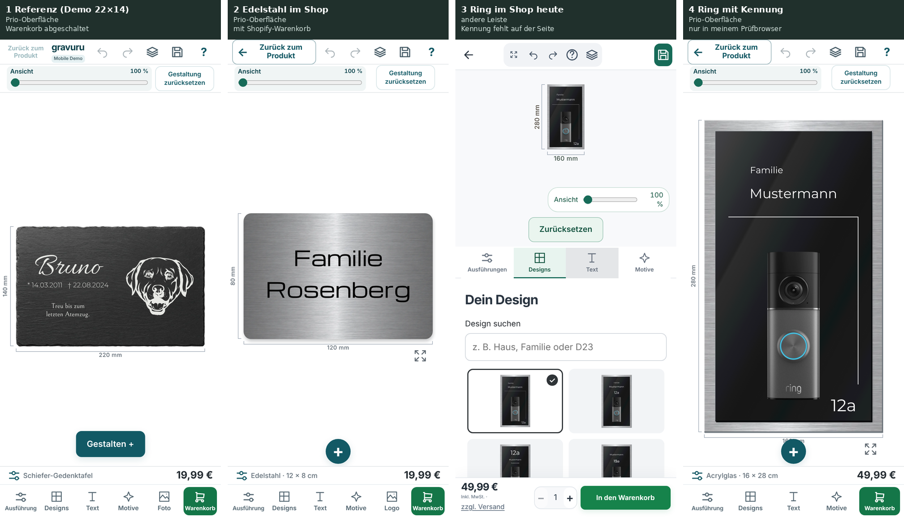
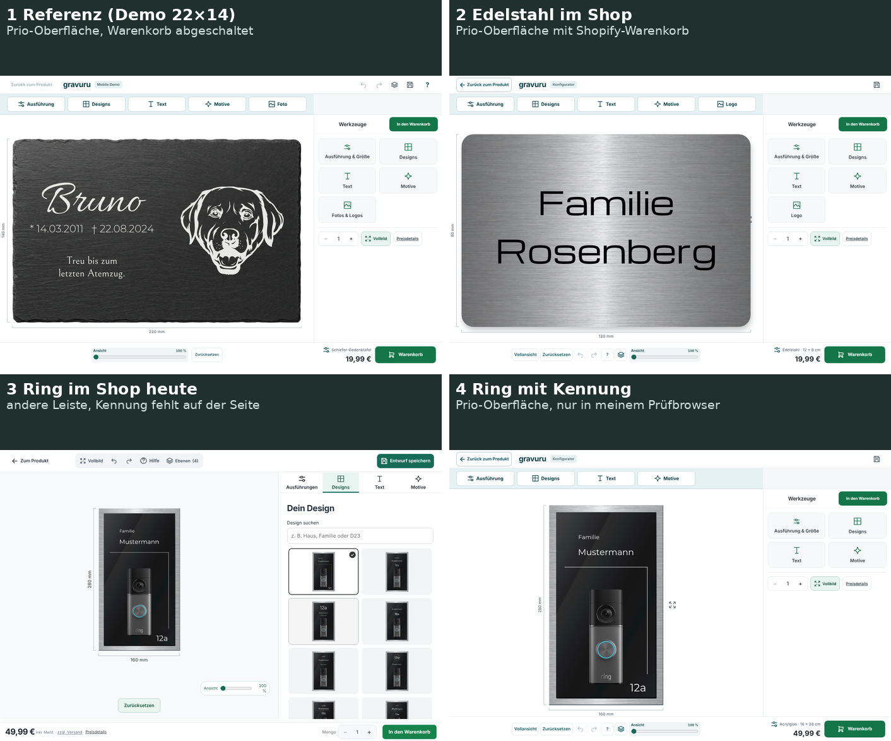
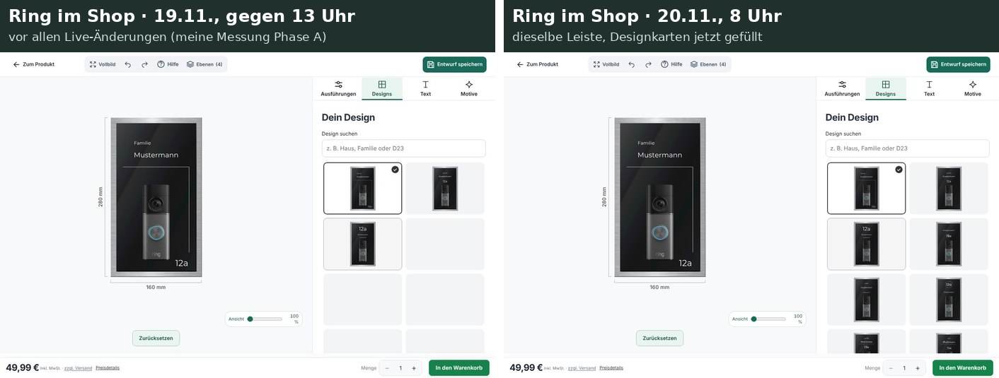

# #267 · Prio-R15 für den Ring mit Shopify-Warenkorb: Ausgangslage vor der Abnahme (Claude, 20.11.2026)

Auftrag: [koordinierter Auftrag von Chris in #267](https://github.com/Chris83638w/gravuru-2027/issues/267#issuecomment-7031593545), Abschnitt „Claude – unabhängige Abnahme“. Reihenfolge laut Auftrag: (1) richtige Prio-R15-Oberfläche, (2) Ring und Shopify-Warenkorb, (3) sichere Bestellung und Fertigung, (4) Tempo.

Astras Ring in der Prio-Oberfläche ist noch nicht geliefert. Dieser Bericht hält deshalb die Ausgangslage fest und legt den Maßstab für die Abnahme offen.

**Nur gelesen.** Ich habe die Referenz, zwei Produktseiten und den Editor geöffnet, nichts gespeichert, keinen Warenkorb angelegt und nichts bestellt. Die beiden Testbestellungen habe ich in Shopify gelesen. Keine Änderung an Shop, Theme, Server, Preisen oder den Branches der Teams. **Keine Freigabe durch diese Prüfung.**

Kennzeichnung: **S** = selbst reproduziert · **F** = fremder Bericht · **N** = nicht prüfbar.

## Ergebnis

1. **Der Ring hat im Shop eine andere Bedienleiste als die Referenz, weil seiner Produktseite die Prio-Kennung fehlt** (S). Das Edelstahl-Türschild trägt sie und öffnet die Prio-Oberfläche.
2. **Das war schon gestern Mittag so**, vor allen Live-Änderungen (S, mein Bild aus Phase A). Astra hat in der Nacht keine alte Oberfläche eingesetzt.
3. **Mit der Kennung öffnet der Ring heute schon die Prio-Oberfläche mit seinen eigenen Daten** (S, nur in meinem Prüfbrowser): 16 Ring-Designs, drei Formate mit Preisen, Klingelposition, vier Rahmen, fünf Befestigungen mit Aufpreisen, zwei Acrylfarben. Der Schritt ist also klein. Nicht geprüft ist der Warenkorb aus dieser Ansicht.
4. **Die Prio-Oberfläche im Shop weicht an drei Stellen von der Referenz ab** (S). Das muss Chris entscheiden.
5. **Die zwei Testbestellungen #1033 und #1034 stimmen** (S): je zwei Positionen derselben Variante zu 49,99 €, eigene Bilder, eigene Revisionen.
6. **Die Tempogewinne von gestern gelten für den Ring in der bisherigen Leiste.** Das Edelstahl-Türschild in der Prio-Oberfläche war in meiner Messung vom 19.11. deutlich langsamer, und der Ring öffnete mit Prio-Kennung langsamer als ohne.

## Die vier Ansichten (S)

| | 1 Referenz | 2 Edelstahl-Türschild | 3 Ring heute | 4 Ring mit Kennung |
| --- | --- | --- | --- | --- |
| Adresse | `/konfi-demo/mobil-20261107-r15/22x14.html` | Produktseite im Shop | Produktseite im Shop | Produktseite im Shop, Kennung nur in meinem Prüfbrowser ergänzt |
| Kennung `#gravuru-konfi-presentation` auf der Seite | – | vorhanden, `ui: prio-r15` | **fehlt** | fehlt |
| Start-Adresse | – | endet auf `&ui=prio-r15` | ohne `ui` | von mir um `&ui=prio-r15` ergänzt |
| Oberfläche | Prio | Prio | andere Leiste | Prio |
| Editor-Paket | eigenes, eingefrorenes Paket vom 07.11. unter `/konfi-demo/…/_bundle/` | `/_acryl-bundle/editor-52542041…` | dasselbe wie 2 | dasselbe wie 2 |
| Warenkorb | abgeschaltet (laut Freigabevertrag, F) | Shopify, laut Astra geprüft (F) | Shopify, zwei Testbestellungen (S gelesen) | nicht geprüft |
| Produktdaten | Schiefer 22 × 14, 19,99 € | Edelstahl 12 × 8, 19,99 € | Ring 16 × 28, 49,99 € | Ring 16 × 28, 49,99 € |

## Der Ring war schon gestern so (S)

Links mein Bild aus Phase A vom 19.11. gegen 13 Uhr (Bukarest), vor der ersten Live-Änderung um 20:15 Uhr. Rechts heute. Die Leiste ist dieselbe. Neu ist nur, dass die Designkarten gefüllt sind.

## Ring mit Kennung: was schon da ist (S)

Geprüft in meinem Prüfbrowser auf PC und in Handybreite, ohne zu speichern.

| Bereich | Befund |
| --- | --- |
| Designs | 16 Ring-Designs, am PC alle sichtbaren Karten gezeichnet, „Strichdesign“ gewählt |
| Ausführung, Reiter Material | Acrylfarbe: 2 Werte |
| Ausführung, Reiter Größe | Format: Hochformat 49,99 €, Querformat 59,99 €, Länglich 69,99 € |
| Ausführung, Reiter Befestigung | Position der Klingel (unten, oben), Edelstahlrahmen (4 Werte), Befestigung (5 Werte, Aufpreise 5,99 / 4,99 / 4,99 / 3,69 €) |
| Text | Felder, Schrift, Größe, Ausrichtung; Griffe zum Ziehen, Drehen und Löschen |
| Motive | Suche und Kategorien |
| Fotos | kein Reiter, wie in der bisherigen Ring-Leiste |

Kleinigkeit im vierten Bild der Handyreihe: Der runde Plus-Knopf verdeckt die Maßangabe „160 mm“ unter dem Schild.

**Nicht geprüft:** Speichern, Warenkorb, Kasse und Bestellung aus dieser Ansicht. Dafür braucht es einen Schreibzugriff, den ich ohne Freigabe nicht mache.

## Abweichungen zwischen Referenz und Prio im Shop (S)

| Stelle | Referenz | Prio im Shop (Edelstahl) |
| --- | --- | --- |
| Handy, Knopf unter dem Schild | Schaltfläche „Gestalten +“ | runder Knopf „+“ |
| Handy, Kopfzeile | „Zurück zum Produkt“ als Text, daneben das gravuru-Zeichen | „Zurück zum Produkt“ als umrandete Schaltfläche, kein Zeichen |
| PC, Werkzeuge | Rückgängig, Wiederholen, Ebenen, Speichern, Hilfe oben rechts | nur Speichern oben rechts; die übrigen stehen unten neben „Vollansicht“ und „Zurücksetzen“ |

Die Referenz lädt ein eigenes, am 07.11. eingefrorenes Paket. Der Shop lädt den heutigen Editor.

## Testbestellungen in Shopify gelesen (S)

| | #1033 | #1034 |
| --- | --- | --- |
| Angelegt | 19.11., 22:34 Uhr | 19.11., 22:37 Uhr |
| Art | Test, Testzahlung, bezahlt, nicht versandt, nicht storniert | ebenso |
| Summe | 99,98 € | 99,98 € |
| Positionen | 2 × Variante `57471227756924`, Artikelnummer `FK-AV2A-16x28-1441`, je 49,99 € | ebenso |
| Gestaltung | „Strichdesign“ mit „Haus Süd 27“, „Klar & modern“ mit „Haus Nord 12“ | ebenso |
| Je Position | 15 Angaben; eigene Konfiguration, eigenes Angebot, eigenes Bild auf dem eigenen Server und eigenes Kassenbild bei Shopify | ebenso |

Auffällig in allen vier Positionen: Im Gravurtext steht „Name: Haus Süd 27 · Text „Mustermann“: Mustermann · Text „12a“: 12a“. Die beiden unveränderten Beispieltexte sind mitbestellt. Die Angabe „Bearbeitbarer Entwurf“ hat keinen Unterstrich und enthält eine technische Kennung.

Gestern Mittag hatte die Ring-Position im Warenkorb 11 Angaben (S, Phase A), heute 15. Hinzugekommen sind „Bearbeitbarer Entwurf“, `_gravuru_motifs`, `_gravuru_uploads` und `_gravuru_revision`. Astra nennt dafür die Freigabe von Chris zur Preiszuordnung des Ring-Artikels (F).

## Live-Stand `b36a8eef` (S)

Branch `dev/astra-r15-live-267-20261119`: der bisherige Live-Code `9af3a1ac` plus elf einzelne Commits, 28 Dateien. Die Ständerregel für Schiefer und die Fototests sind nicht enthalten. Enthalten ist eine Änderung an der Bestellannahme (`order-intake.mjs`).

| Prüfung | Ergebnis |
| --- | --- |
| Gegenprobe Bestellung (Preis, Revision, zehn manipulierte Zustellungen, Storno) | unverändert richtig |
| SVG und Druck-PDF bei Wiederholung | bytegleich |
| Kontur-PDF bei Wiederholung | nicht bytegleich, wie schon vor den Änderungen |
| Gesamtsuite (Umfang wie `npm test`) | 2.743 von 2.751 bestanden, 4 übersprungen, 4 Fehler. Dieselben vier Tests schlagen am bisherigen Live-Code `9af3a1ac` fehl (drei zur Fotoauflösung, einer zur Werkstatt-Kopfzeile). Kein neuer Fehlschlag |

Stand B `83fa4bd3`: Gegenprobe unverändert richtig (S). Die Gesamtsuite für B folgt mit der Abnahme.

## Tempo: Ausgangswerte für den gewünschten Weg

Meine Messung vom 19.11. im Live-Shop, Handyprofil, Median aus drei Läufen (S). Alle Werte stammen von vor den Live-Änderungen.

| Messpunkt | Ring, bisherige Leiste | Ring mit Prio-Kennung | Edelstahl in Prio |
| --- | ---: | ---: | ---: |
| Tipp „Jetzt personalisieren“ bis Editor bedienbar | 10,6 s | 14,9 s | 11,4 s |
| Daten bis Editor bereit | 0,92 MB | 1,57 MB | 1,05 MB |
| Designwechsel | 2,8 bis 3,2 s, im Gerät | 2,9 bis 3,1 s, im Gerät | 6,9 bis 7,5 s, über den Server |
| Letzter Tipp bis Position im Warenkorb | 7,6 s | nicht gemessen | 14,9 s |
| davon vier eigene Serverschritte | 4,9 s | – | 12,4 s |

Am PC lag das Edelstahl-Türschild beim Warenkorb bei 10,8 s bis zur Position. Astra misst heute 12,07 s bis zum sichtbaren Bild (F). Die Änderungen von gestern haben diesen Weg demnach nicht spürbar beschleunigt.

## Maßstab für die Abnahme

Sobald Astra liefert, prüfe ich in dieser Reihenfolge. Für A und B gelten dieselben Punkte.

1. **Oberfläche.** Ring-Produktseite trägt die Kennung, Start-Adresse enthält `ui=prio-r15`, Editor zeigt die Prio-Leiste auf PC und Handy. Vergleichsbild mit Referenz und Edelstahl. Die drei Abweichungen sind entschieden.
2. **Ring-Daten.** 16 Designs, 3 Formate, 2 Positionen, 4 Rahmen, 5 Befestigungen, 2 Farben, 120 Varianten, Preise wie in Shopify. Texte, Motive frei bewegen und skalieren.
3. **Warenkorb.** Zwei Gestaltungen derselben Variante als getrennte Positionen, eigene vergrößerbare Bilder, richtiger Preis, Entfernen ja, Bearbeiten nein. Dasselbe Bild in der Kasse.
4. **Bestellung und Fertigung.** Testbestellung über die Testzahlung, in Shopify gelesen. Revision, Preis, SVG, PDF und Kontur passen zur Position.
5. **Tempo.** Edelstahl-Prio und Ring getrennt, PC und Handy, kalt und warm, mehrere Läufe. Echte Shop-Messung und Nachstellung getrennt ausgewiesen.

## Offen bei Chris

- Entscheidung zu den drei Abweichungen zwischen Referenz und Prio im Shop.
- Freigabe, ob ich für die Abnahme selbst Testwarenkörbe im Shop anlegen darf (abgestimmt mit Astra), oder ob ich nur Astras Läufe gegenlese.
- Sollen unveränderte Beispieltexte bestellbar bleiben?

## Wiederholen

`node ansicht.mjs <demo|ring|edelstahl> <pc|mobil> [--prio] [--tiefe] [--reiter]` mit Chrome und Playwright. Das Skript öffnet nur Seiten und den Editor. `--prio` ergänzt die Kennung an der eigenen Anfrage. Rohwerte: [rohwerte/](2026-11-20-prio-r15-abnahme-claude/rohwerte/).
