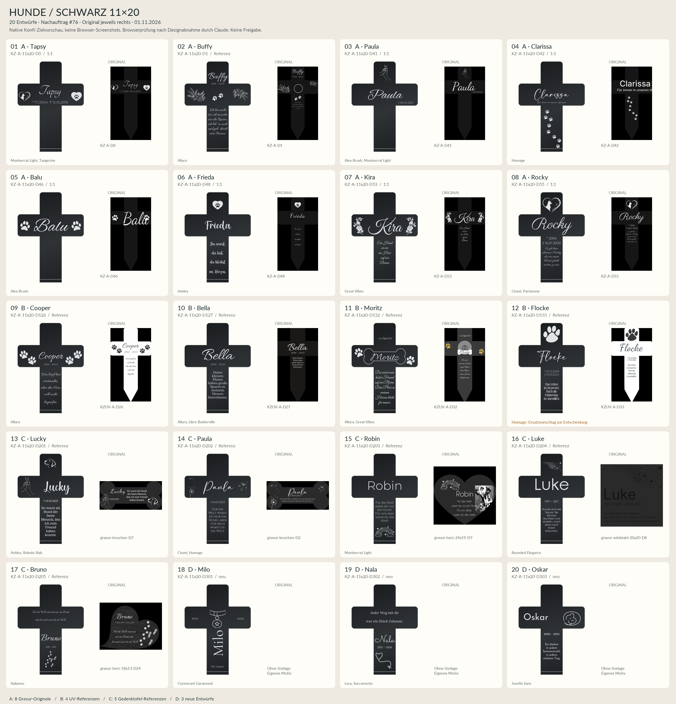

# Hunde-Kreuze · Nachauftrag · Schwarz 11×20

**Zuerst ausschließlich dieser Kontaktbogen zur Gestaltungssichtung durch Claude.** 20 Entwürfe: 8 Gravur-Originale, 4 UV-Referenzen, 5 Gedenktafel-Referenzen und 3 neue Designs. Weitere Größen/Farben erst nach Abnahme.

[Kontaktbogen als JPG](kontaktbogen-schwarz-11x20.jpg) · [Messprüfung](nachauftrag-pruefung.json) · [20 native Zielprüfungen](nachauftrag-native-pruefung.json)

## Maßgebliche Vorgaben

[Nachauftrag](https://github.com/Chris83638w/gravuru-2027/blob/main/docs/handoffs/design-start-mika/kreuze/NACHAUFTRAG-HUNDE.md), [Auftrag](https://github.com/Chris83638w/gravuru-2027/blob/main/docs/handoffs/design-start-mika/kreuze/AUFTRAG.md) und [Design-Master](https://github.com/Chris83638w/gravuru-katalog./blob/main/designs/DESIGN-MASTER.md). Fontentscheidung Katalog-main `2cfe4db`; finale Kontur aus `schneidvorlagen/kreuze/kreuze.json`. Verbindliche Grenzwerte: 50 mm Erdteil, weitere 5 mm Gestaltungsabstand, mindestens 3 mm H-Versalhöhe. Alle Freigaben bleiben `null`.

## Was die Prüfung belegt

- 20/20 native `targetDesignPreview`-Aufrufe mit Status **passt**, ohne Warnungen; je Master genau ein Ziel geprüft: Schwarz 11×20. Gemeinsamer Renderer zeigt 150 mm sichtbare Höhe. Keine neue 14×25-/22×40-/Anthrazit-Vorschau erzeugt.
- Schriftprüfung mit vollständigen Fontdateien und H-Glyphen: mindestens **3.1 mm**, 1–3 Schriften je Design, keine fehlenden verwendeten Glyphen; Gravur endet spätestens vor 145 mm. Alle Texte bleiben editierbar, Fotofelder und Foto-Bedienzeichen entfernt.
- Ein JPG mit **1,077,218 Bytes** (Grenze 2.000.000), 3360×3500 Pixel. 17 unbearbeitete Katalog-Originalvorschauen daneben; drei neue Designs als „Ohne Vorlage“ beschriftet.
- Sechs klar belegte Aufbauten: senkrechter Name und Außendaten (D301); Spruch im Querbalken/Name im Stamm (D205/D302); Motive neben dem Namen (D0/D46/D53); lange Pfotenspur (D42); Motiv unten (D203); Name links/Hund rechts (D303).
- Mindestens acht unterschiedliche Motive: Hund im Herz, Pfotenherz, Flügel, betende Hände, Rosen, Knochen, Hundekopf, Pusteblume, Regenbogen, Sternenschwarm, Mensch-/Hundespur sowie drei eigene Motive. Gleiche Herz- und Pfotenherzmotive erscheinen je zweimal. Pfoten/Pfotenspuren als **Oberbegriff** kommen in der verbindlichen Pflichtliste sechsmal vor; die unterschiedlichen Originalzeichnungen/-gruppen bleiben erhalten. Das ist kein behauptetes Maximum von drei Pfoten-Designs.
- Katalog-Metadatenlauf `python scripts/build-katalog.py --katalog ../grabkreuze-hunde-katalog --metadata-only`: 15 Familien gültig, KATALOG.md neu erzeugt. Frühere technische Familien-PDFs und Excel bleiben historisch unverändert; aktuelle Schriftliste steht in der schwarzen Familie. Beide Kreuz-Familien-PNGs wurden ebenfalls aus dem PR entfernt.
- Quellenbestand gegen Katalog-HEAD vor der Überarbeitung geprüft (Git-Inhalt unverändert; Textzeilenenden normalisiert, Original-PNGs bytegleich). Die abgelehnten D100–D116 und ihre Bilddateien, 6 alte PNG-Kontaktbögen, 120 gerenderte SVG-Vorschauen, kopierte Original-PNGs und zwei technische Familien-PNGs sind aus PR #125 entfernt. In jedem neuen Designordner nur `design.json`/`design.svg`.

## Offene Punkte klar getrennt

**Flocke (D133):** Die Pflichtvorlage nennt Vista La Diva; diese Schrift steht weder in den 84 noch in der beschlossenen Ersatztabelle. Homage ist im Bogen und Master **ausdrücklich als Vorschlag zur Entscheidung** gekennzeichnet. [Rückfrage an Claude](https://github.com/Chris83638w/gravuru-2027/issues/76#issuecomment-6561540397). Keine neue globale Ersatzregel und keine Designfreigabe gesetzt.

**Browser-/Bedienprüfung offen.** Der Bogen ist eine unverzerrte Rasterausgabe des gemeinsamen nativen Konfi-Zielrenderers, kein Browser-Screenshot. Nach dem Nachauftrag übernimmt Claude die sichtbare Konfi-Prüfung nach Gestaltungsabnahme. Die bereits technisch akzeptierte Erdteilsperre samt 72 gezielten Tests wurde bei dieser reinen Designüberarbeitung nicht verändert; die frühere technische Prüfung ist kein neuer Browsernachweis.

**Originaltreue versus leerer Stamm:** Tapsy, Paula und Balu behalten die ausdrücklich verlangte ursprüngliche Aufteilung und deren ruhige Freiflächen. Tapsy/Kira/Rocky bleiben in ihren bereits gelieferten Geometrien unverändert. Die Referenzen und neuen Entwürfe nutzen den Stamm mit größeren Sprüchen beziehungsweise einem abschließenden Motiv. Keine unbestellte Ergänzung eines fremden Motivs in die Pflichtoriginale.

## Einzelzuordnung

„1:1“ bedeutet erhaltene Originalkomposition mit den ausdrücklich beschlossenen Ersatzschriften und dokumentierter Mindesthöhenanpassung. Buffy benötigt wegen 22×40-Quelle und Fotoentfall Modus Referenz. Quellenpfade beziehen sich auf das Katalog-Repo.

| Nr. / ID | Name / Gruppe / Modus | Quelle | Schriften | Motiv / Abweichung |
|---|---|---|---|---|
| 01 / KZ-A-11x20-D0 | Tapsy · A · 1:1 | `designs/bestand/kreuze/Allgemein/Allgemein/KZ-A-D0` | Montserrat Light, Tangerine | Hund im Herz, Pfotenherz. Bereits geliefertes Original bleibt gemäß Pflichtliste. Ruhiger Stamm ist Teil dieser Vorlage. |
| 02 / KZ-A-11x20-D1 | Buffy · A · Referenz | `designs/bestand/kreuze/Sprüche/Spruch/KZ-A-D1` | Allura | Flügelpaar, Pfotenduo. 22×40-Original proportional übertragen; Fotofeld samt Bedienzeichen entfernt. Flügel und Pfoten erhalten; längerer Spruch lesbar neu umbrochen. |
| 03 / KZ-A-11x20-D41 | Paula · A · 1:1 | `designs/bestand/kreuze/Allgemein/Allgemein/KZ-A-D41` | Alex Brush, Montserrat Light | Betende Hände. Clarissa → Alex Brush; Champagne & Limousines → Montserrat Light. Originalaufteilung mit ruhigem Stamm bleibt. Unverzerrte Übertragung auf die finale 110×200-Kontur; bestätigte Ersatzschriften, Mindesthöhe und Fotofeldentfernung sind einzeln vermerkt. |
| 04 / KZ-A-11x20-D42 | Clarissa · A · 1:1 | `designs/bestand/kreuze/Anlass/Liebe/KZ-A-D42` | Homage | Pfotenspur. Playlist → Homage. Pfotenspur um 1 mm nach oben, damit ihr letzter Abdruck vor der Gestaltungsgrenze bleibt. Unverzerrte Übertragung auf die finale 110×200-Kontur; bestätigte Ersatzschriften, Mindesthöhe und Fotofeldentfernung sind einzeln vermerkt. |
| 05 / KZ-A-11x20-D46 | Balu · A · 1:1 | `designs/bestand/kreuze/Allgemein/Allgemein/KZ-A-D46` | Alex Brush | Pfotenpaar. Clarissa → Alex Brush, optisch auf ursprüngliche Namensbreite eingepasst; ursprüngliche Freiflächen bleiben. Unverzerrte Übertragung auf die finale 110×200-Kontur; bestätigte Ersatzschriften, Mindesthöhe und Fotofeldentfernung sind einzeln vermerkt. |
| 06 / KZ-A-11x20-D48 | Frieda · A · 1:1 | `designs/bestand/kreuze/Allgemein/Allgemein/KZ-A-D48` | Ashley | Pfotenherz. Standlist → Ashley. Vier Original-Spruchzeilen auf mindestens 3 mm Versalhöhe angehoben, ursprüngliche großzügige Staffelung beibehalten. Unverzerrte Übertragung auf die finale 110×200-Kontur; bestätigte Ersatzschriften, Mindesthöhe und Fotofeldentfernung sind einzeln vermerkt. |
| 07 / KZ-A-11x20-D53 | Kira · A · 1:1 | `designs/bestand/kreuze/Tiere/Hund/KZ-A-D53` | Great Vibes | Rosenpaar. Bereits geliefertes Original bleibt gemäß Pflichtliste. Ruhiger Stamm ist Teil dieser Vorlage. |
| 08 / KZ-A-11x20-D55 | Rocky · A · 1:1 | `designs/bestand/kreuze/Tiere/Hund/KZ-A-D55` | Cinzel, Parisienne | Hund im Herz. Bereits geliefertes Original bleibt gemäß Pflichtliste. Ruhiger Stamm ist Teil dieser Vorlage. |
| 09 / KZ-A-11x20-D126 | Cooper · B · Referenz | `designs/bestand/kreuze/Sprüche/Spruch/KZUV-A-D26` | Allura | Pfotenspurenpaar. UV-Flächen entfernt; Allura bleibt. Spruch auf Mindesthöhe lesbar und bis in den unteren Stamm gestaffelt. Unverzerrte Übertragung auf die finale 110×200-Kontur; bestätigte Ersatzschriften, Mindesthöhe und Fotofeldentfernung sind einzeln vermerkt. |
| 10 / KZ-A-11x20-D127 | Bella · B · Referenz | `designs/bestand/kreuze/Tiere/Tiere allgemein/KZUV-A-D27` | Allura, Libre Baskerville | ohne Motiv – Original. Original ohne Motiv bleibt typografisch. Times New Roman → Libre Baskerville; Grammatik „meinem Herzen“ korrigiert, Spruch neu umbrochen. |
| 11 / KZ-A-11x20-D132 | Moritz · B · Referenz | `designs/bestand/kreuze/Tiere/Tiere allgemein/KZUV-A-D32` | Allura, Great Vibes | Knochen, Versetztes Pfotenpaar. Foto und Fotokreis entfernt; Knochenplakette als Gravurkontur erhalten, Name vergrößert. Spruch auf Mindesthöhe umbrochen. |
| 12 / KZ-A-11x20-D133 | Flocke · B · Referenz | `designs/bestand/kreuze/Sprüche/Spruch/KZUV-A-D33` | Dream Orphans, Homage, Montserrat Light | Einzelpfote. Vista La Diva fehlt; Homage ausdrücklich nur als Vorschlag zur Entscheidung bei Claude (#76, Kommentar 6561540397), kein beschlossener Ersatz. Arial als Corel-Voreinstellung durch Montserrat Light gewählt. |
| 13 / KZ-A-11x20-D201 | Lucky · C · Referenz | `designs/bestand/gedenktafeln/Tiere/Hund/gravur-knochen-D7` | Ashley, Roboto Slab | Hundekopf, Hundekopf im Herz. Standlist → Ashley. Beide Originalmotive erhalten, Knochen-Plattenform entfällt. Spruch in korrekter Lesereihenfolge. |
| 14 / KZ-A-11x20-D202 | Paula · C · Referenz | `designs/bestand/gedenktafeln/Tiere/Hund/gravur-knochen-D2` | Cinzel, Homage | Pusteblume mit Samen. Homage und Cinzel bleiben; Pusteblume und fliegender Samen unverzerrt. Spruch auf Querbalken und Stamm verteilt. |
| 15 / KZ-A-11x20-D203 | Robin · C · Referenz | `designs/bestand/gedenktafeln/Tiere/Hund/gravur-herz-24x19-D7` | Montserrat Light | Regenbogen mit Blüten. Champagne & Limousines → Montserrat Light. Foto entfernt; unverzerrter Regenbogen schließt den Stamm ab. |
| 16 / KZ-A-11x20-D204 | Luke · C · Referenz | `designs/bestand/gedenktafeln/Tiere/Hund/gravur-edelstahl-20x20-D8` | Rounded Elegance | Sternenschwarm. Rounded Elegance bleibt; Arial/Arial Unicode MS als Corel-Voreinstellung passend durch Rounded Elegance ersetzt. Ungültiger Originaltag 29.02.2017 wird als Jahr 2017 wiedergegeben; „Erlöschen“ korrigiert. |
| 17 / KZ-A-11x20-D205 | Bruno · C · Referenz | `designs/bestand/gedenktafeln/Tiere/Hund/gravur-herz-18x13-D24` | Italianno | Mensch-und-Hund-Spuren. Italianno und gemeinsame Fuß-/Pfotenspur bleiben; Spruch im Querbalken, Name im Stamm. Daten auf Jahre gekürzt. |
| 18 / KZ-A-11x20-D301 | Milo · D · neu | ohne Vorlage | Cormorant Garamond | Halsband mit Medaillon. Ohne Vorlage. Senkrechter Name und seitliche Jahreszahlen; eigenes Halsband mit Anhänger. |
| 19 / KZ-A-11x20-D302 | Nala · D · neu | ohne Vorlage | Lora, Sacramento | Herzleine. Ohne Vorlage. Breiter, ruhiger Spruch, großer Name darunter, frei gezeichnete Leine mit Herzschlaufe. |
| 20 / KZ-A-11x20-D303 | Oskar · D · neu | ohne Vorlage | Josefin Sans | Schlafender Hund. Ohne Vorlage. Name seitlich im Querbalken; eigener eingerollter Hund rechts, ruhig gestaffelter Spruch im Stamm. |

Die drei neuen Motive sind `mika-hunde-halsband-20261101`, `mika-hunde-herzleine-20261101`, `mika-hunde-schlafend-20261101`. Vektoren jeweils im Design eingebettet und unter `motive-eigene/` samt Index; kein Eintrag in `motive/motive.json`.

## Reproduktion und nächster Schritt

Im Code-Repo `revise-grabkreuze-hunde.py`, `review-grabkreuze-hunde.mjs` und `check-render-grabkreuze.py` ausführen; `GRAVURU_KATALOG` kann den Katalogpfad und `GRAVURU_DOG_REVIEW` einen lokalen Ausgabeordner vorgeben. Temporäre PNG/SVG liegen außerhalb der Repos, einzig der JPG-Kontaktbogen im Code-Repo. Frühere Skripte leiten auf den eingeschränkten Nachauftragslauf um.

Claude bewertet **diesen einen Bogen**, entscheidet den Flocke-Schriftvorschlag und meldet Änderungen beziehungsweise Abnahme in #76. Bis dahin keine weiteren Designvarianten, keine weiteren Produkte. Code-PR #109 und Katalog-PR #125 bleiben Entwürfe. Kein Merge, kein Import, kein Shop-Zugriff.
