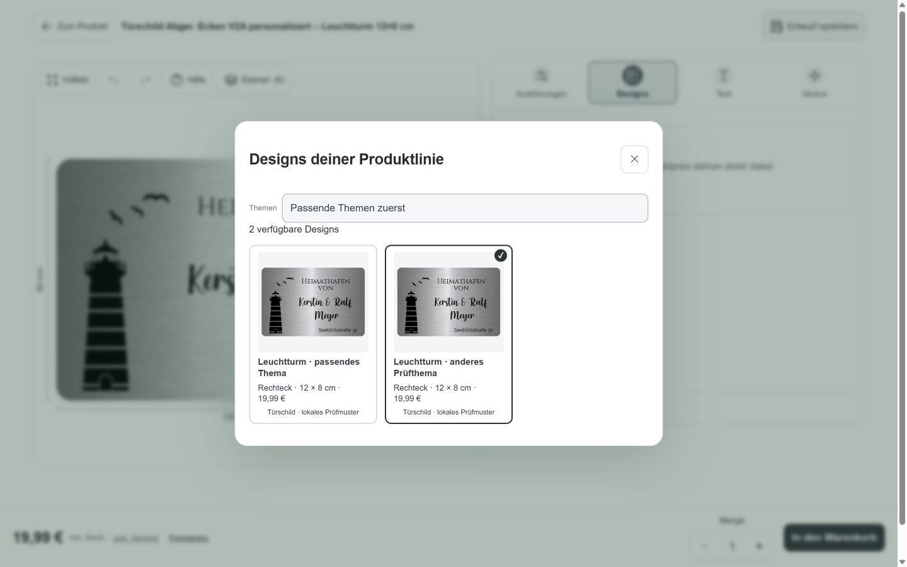
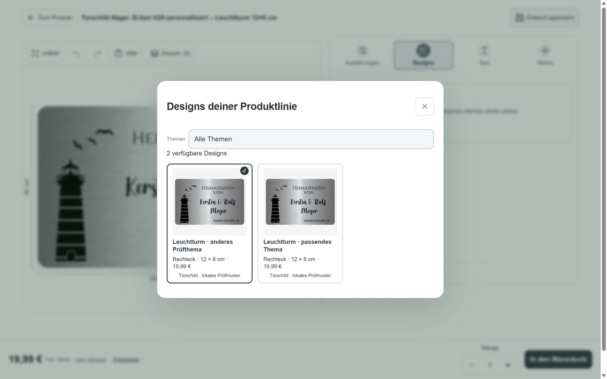
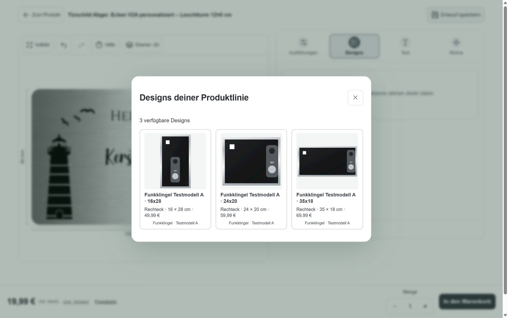
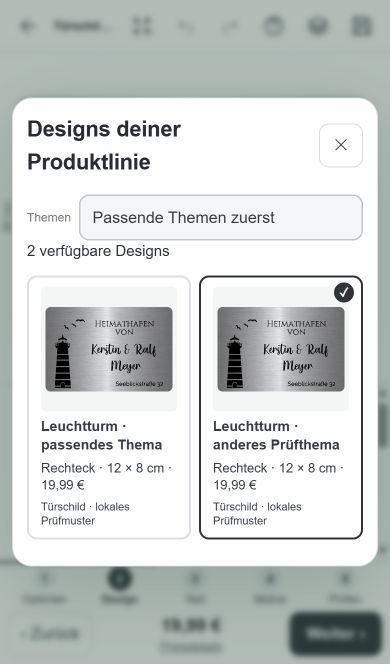
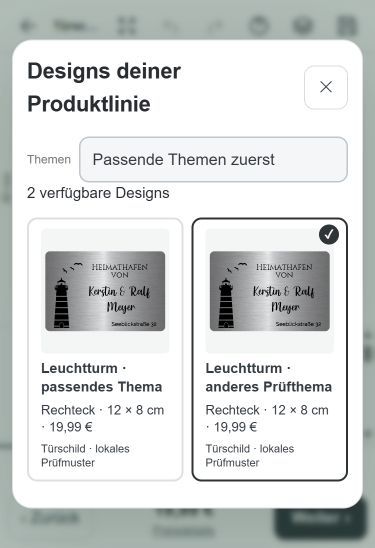
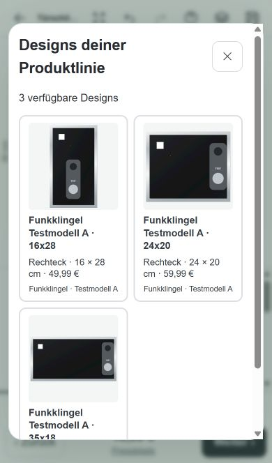
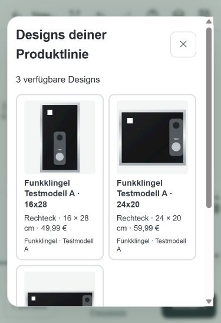

# Galerie je Linie und Klingelmodell · lokale Bildnachweise

Stand: 29.10.2026. Chromium, tatsächlicher kombinierter Build aus PR #42/#43. Desktop 1440 × 900, iPhone-13-Format 390 × 664, SE-Format 375 × 548. Kein Live- oder Safari-Nachweis.

Ein lokaler gemischter Bestand verwendet die echte Galerie-/Token-/Vorschaufunktion. Türschild-Vorlage D8; Themen und Geräte A/B sind Prüfdaten, Geräteillustration mit TEST gekennzeichnet. Preisangaben der Klingelprüfmuster sind Testwerte. Die dritte Klingelkachel ist auf dem Handy durch Scrollen erreichbar.

## desktop-linie.jpg

## desktop-alle-themen.jpg

## desktop-klingelmodell.jpg

## iphone13-linie.jpg

## iphone-se-linie.jpg

## iphone13-klingelmodell.jpg

## iphone-se-klingelmodell.jpg

