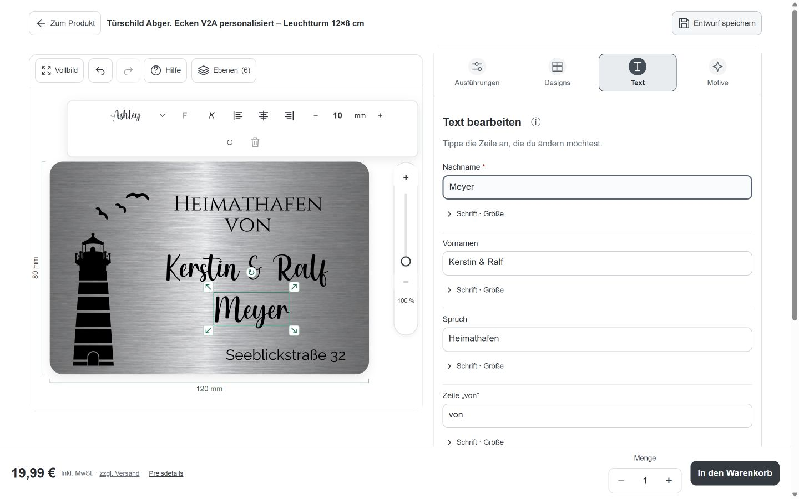
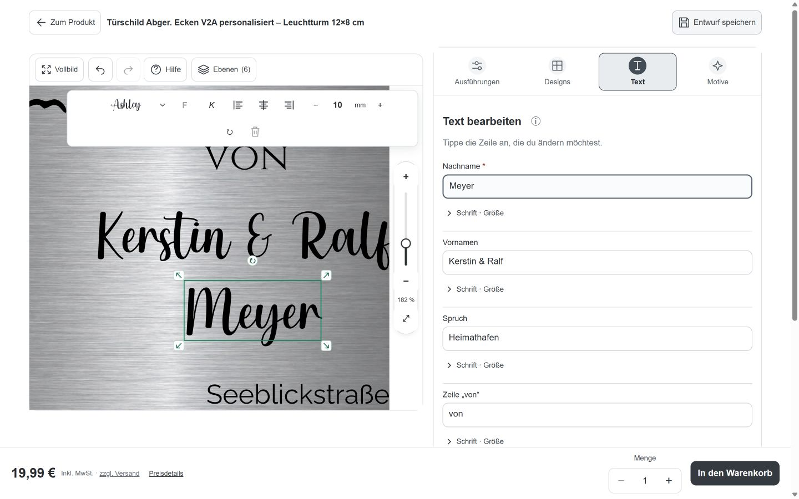
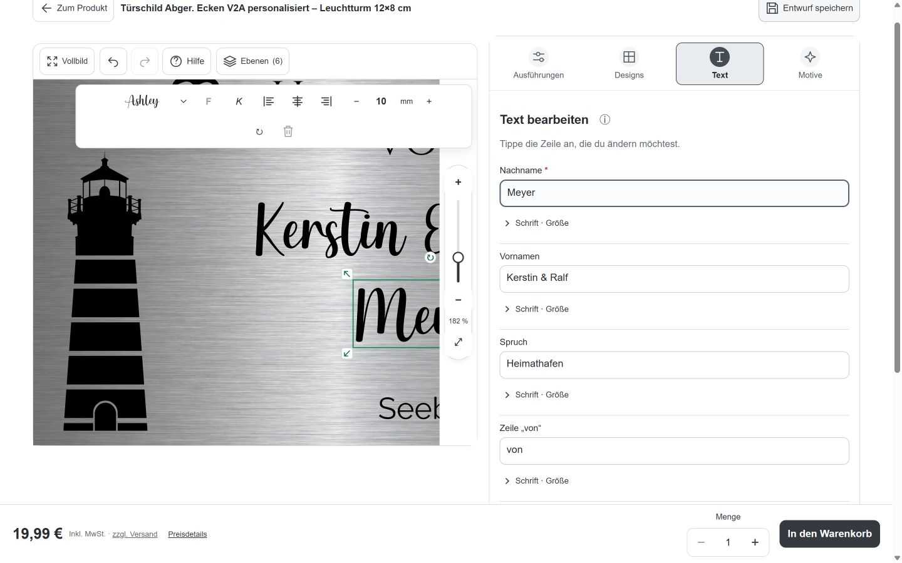
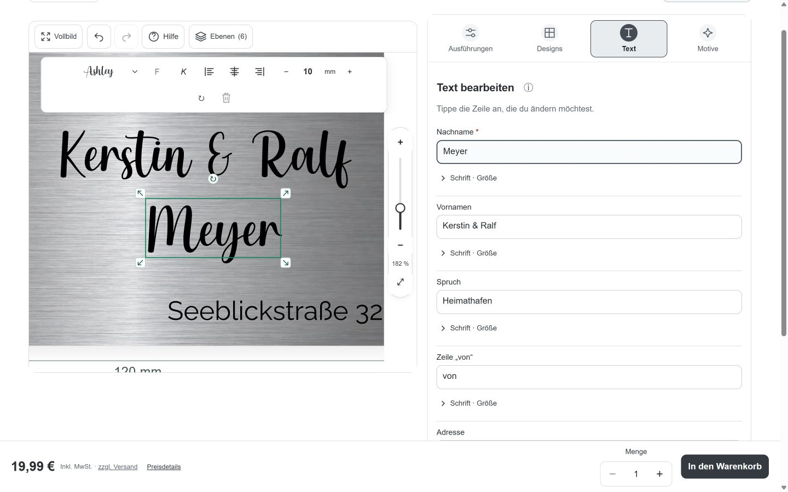
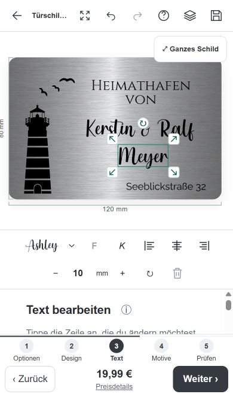
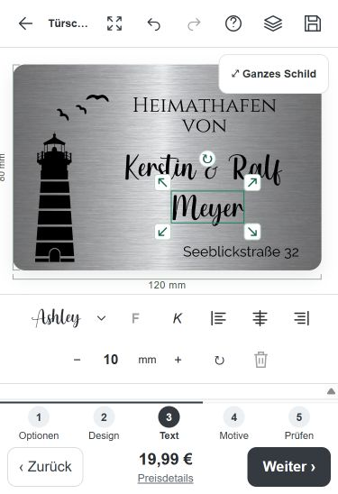

# Mausrad über Text, Motiv und Griff · lokale Bildnachweise

Stand: 29.10.2026. Chromium, tatsächlicher kombinierter Build aus PR #42/#43. Desktop 1440 × 900, iPhone-13-Format 390 × 664, SE-Format 375 × 548. Kein Live- oder Safari-Nachweis.

Native Mausrad-Eingabe: 100 % → 182 % über ausgewähltem Text, Motiv und Griff. Schrift bleibt 10 mm. „vorher“ zeigt den Ausgangszustand mit 100 % im neuen Build, keinen Fehler im alten Build. Handy-Bilder prüfen die unveränderte Textleiste und den sichtbaren Preis.

## desktop-mausrad-vorher.jpg

## desktop-mausrad-text.jpg

## desktop-mausrad-motiv.jpg

## desktop-mausrad-griff.jpg

## iphone13-textleiste.jpg

## iphone-se-textleiste.jpg

