# Konfigurator: 1:1-Vorschauen, 28.10.2026

Lokale echte Editor-Laufzeit mit D8-Exportkopie. Keine Live-Veröffentlichung. Desktop 1440 × 900, Handy 390 × 844. Frühere Stufenbilder dokumentieren den jeweiligen Zwischenstand; Stufe 5 den Abschlussstand. Der echte D8-Datensatz enthält weiterhin ein Design; Importgruppierung und breitere Zielauswahl sind separat durch Tests geprüft, nicht durch eine erfundene Galerie.

## 01 desktop stil

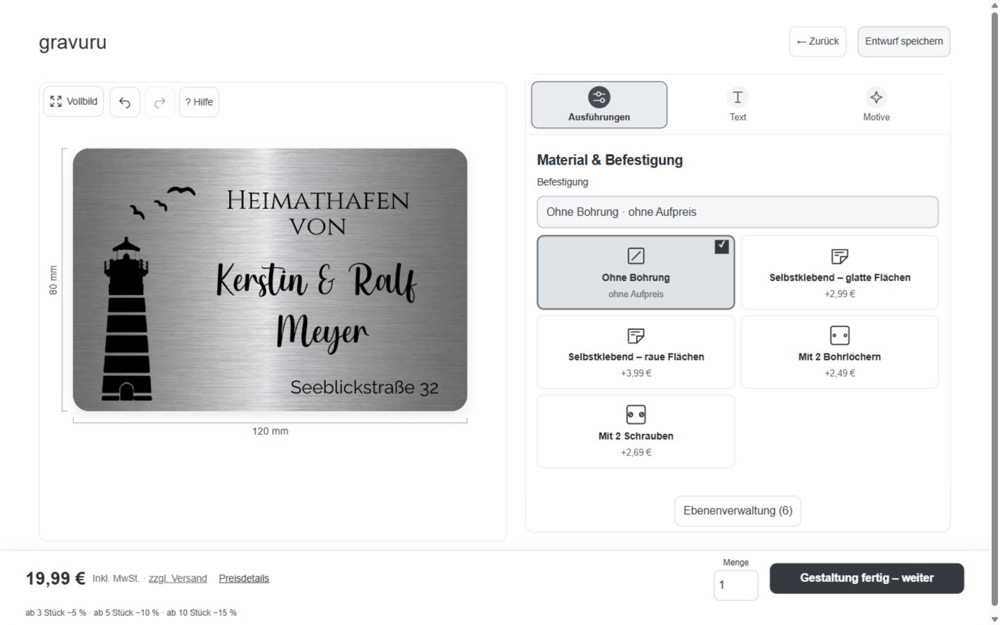

## 01 iphone stil

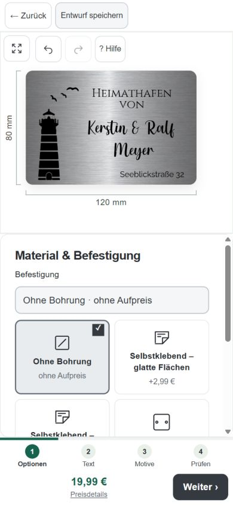

## 02 desktop rahmen

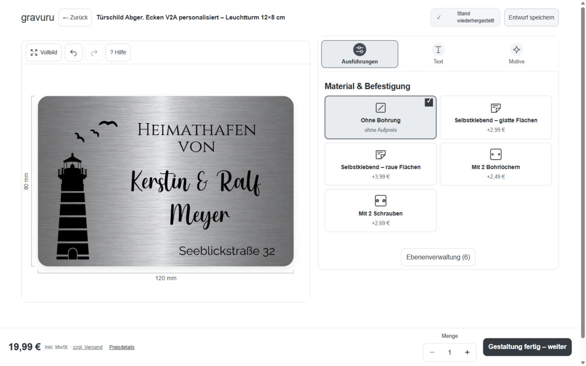

## 02 desktop vollbild

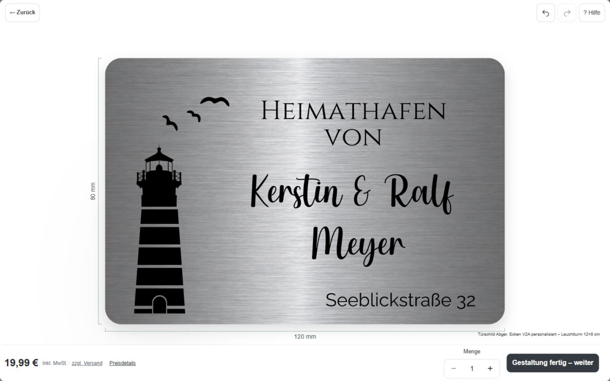

## 02 iphone rahmen

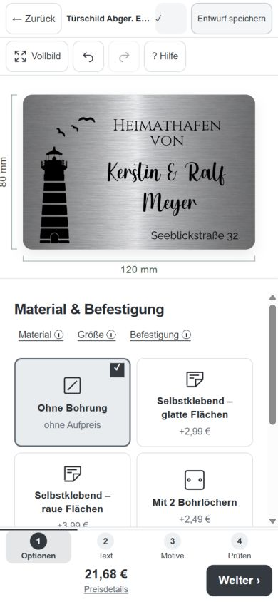

## 03 desktop text

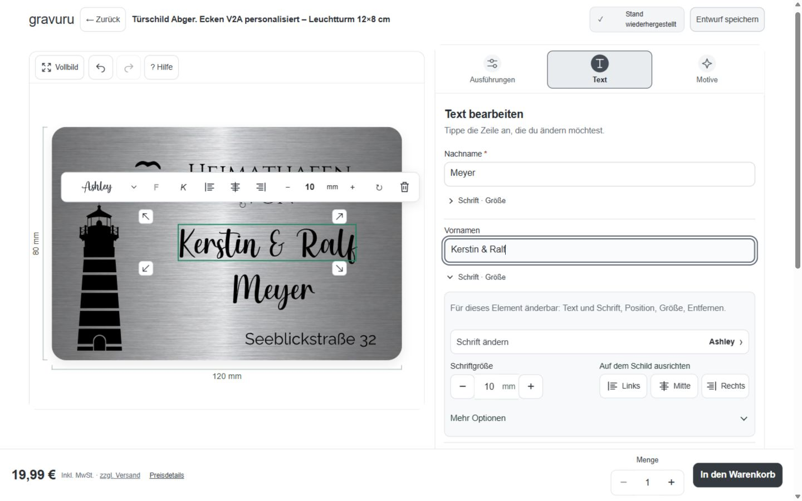

## 03 iphone text

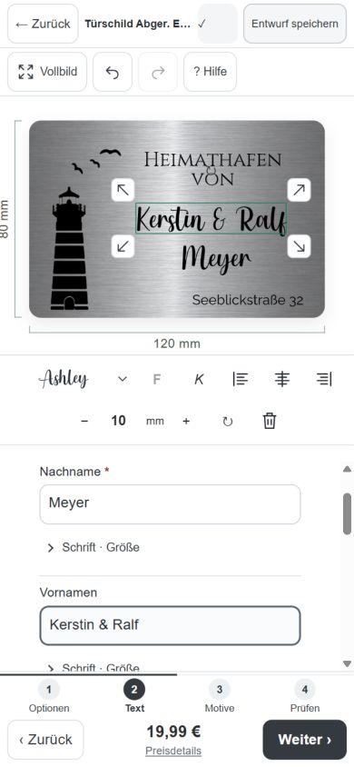

## 04 desktop motive

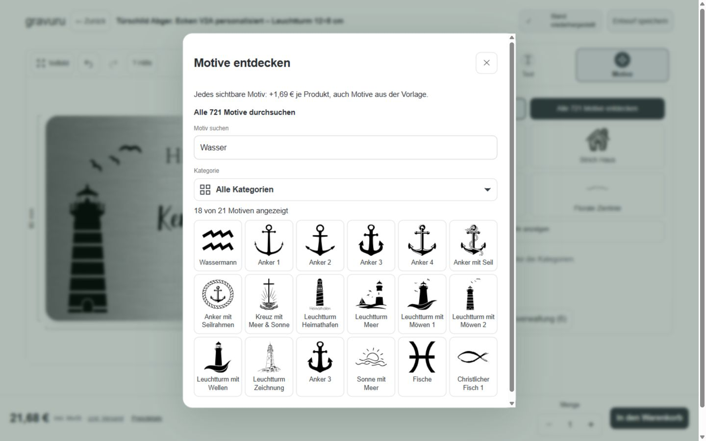

## 04 iphone motive

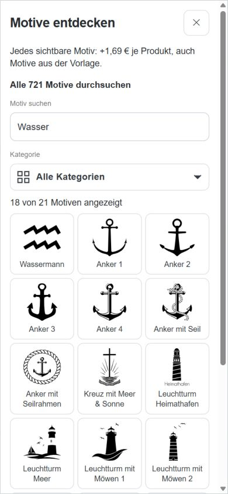

## 05 desktop abschlussstand

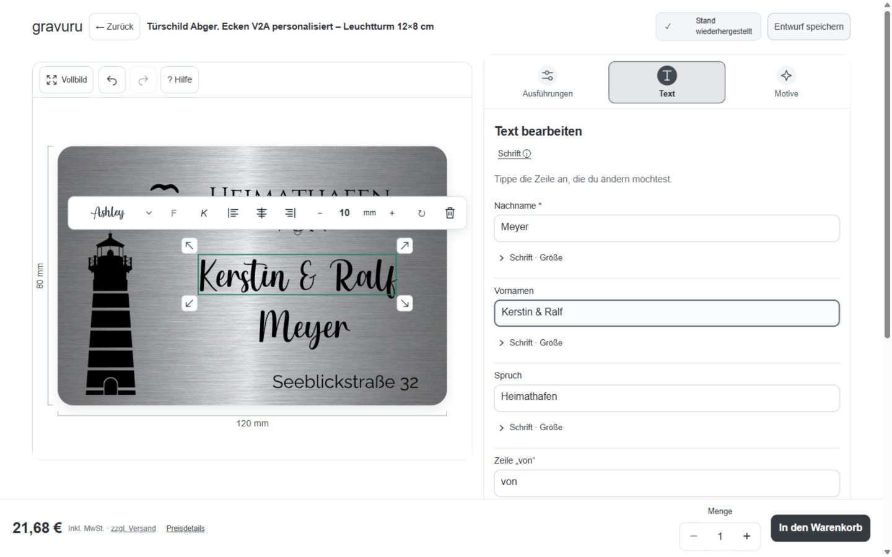

## 05 iphone abschlussstand

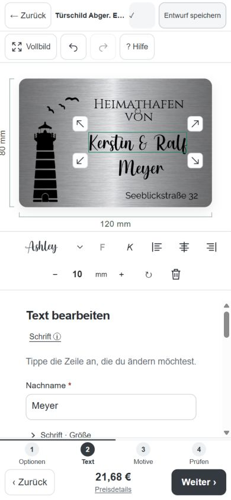

Der Handy-Rahmennachweis 02 wurde bei der Abschlussprüfung erneut aufgenommen; er zeigt bereits die bestätigte neue Motivpreisregel.
