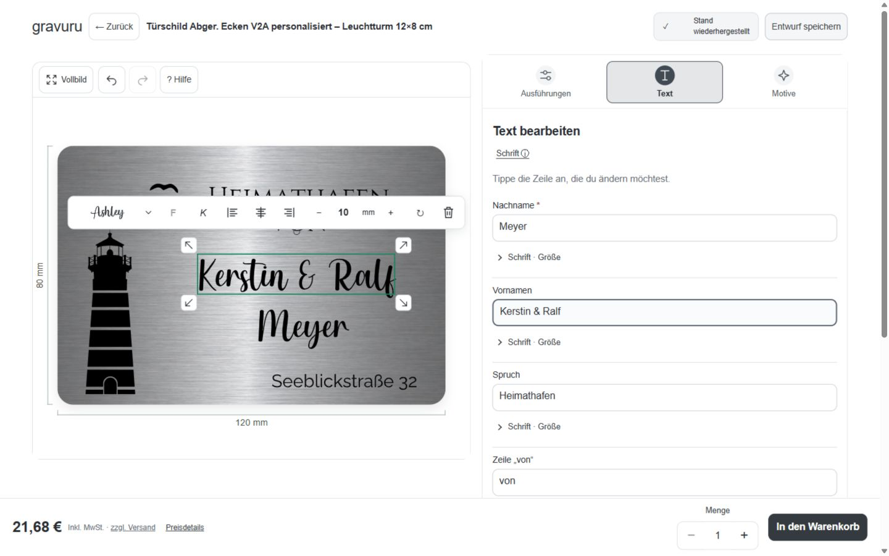
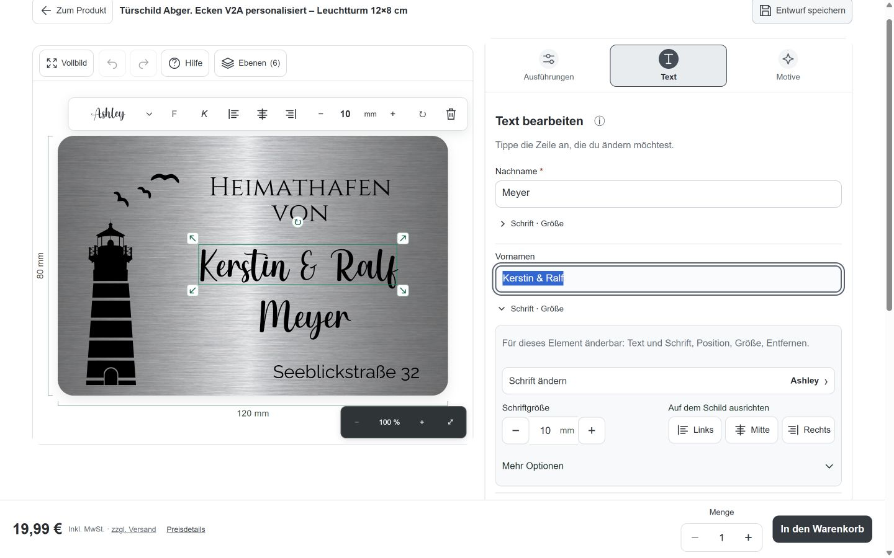
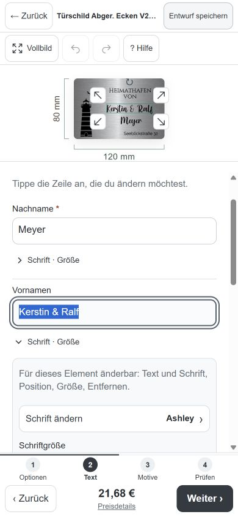
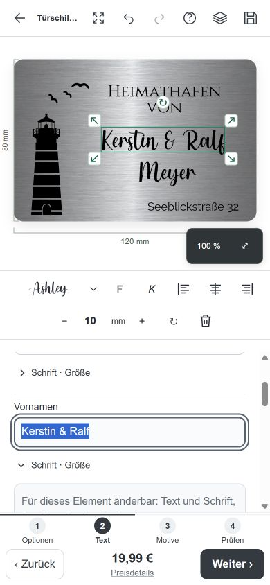

# Vorher/Nachher – PR #41, zweiter Auftrag

28.10.2026 · echte lokale Editor-Laufzeit, keine Skizzen. Vorher: veröffentlichter PR-Stand 458f56b8, identisch neu gebautes Bündel 408f0908326ee07d. Nachher: Auftrag 2; Desktop 1440 × 900, iPhone-Ansicht 390 × 844. Ein ergänzender lokaler Warenkorbbeleg hat 375 × 812 Pixel; sämtliche Editor-iPhone-Bilder haben 390 × 844. Mobile Browseransicht ist emuliert, kein physischer Safari-/Tastaturtest. Originalaufnahmen ohne Bildbearbeitung; Größen und SHA-256 in [manifest.json](manifest.json).

[Bericht](../2026-10-28-konfi-ux-auftrag2-astra-bericht.md). Die neue Preisentscheidung lautet: Vorlagenmotiv inklusive, weiteres oder geändertes Motiv +1,69 €. Historische Produktkopien sind keine Live-Freigabe.

## Vergleich je Auftragspunkt

| Punkt | Vorher | Nachher |
| --- | --- | --- |
| 1 Preisregel | [Desktop](vorher-desktop-optionen.jpg), [iPhone](vorher-iphone-optionen.jpg) | [19,99 € Desktop](nachher-desktop-optionen.jpg), [19,99 € iPhone](nachher-iphone-optionen.jpg), [Hausmotiv 21,68 €](nachher-iphone-zusatzmotiv.jpg), [ⓘ Desktop](nachher-desktop-motivinfo.jpg), [ⓘ iPhone](nachher-iphone-motivinfo.jpg) |
| 2 Textleisten | [Desktop](vorher-desktop-text.jpg), [iPhone](vorher-iphone-text.jpg) | [Desktop B](nachher-desktop-text-b.jpg), [Desktop A](nachher-desktop-text-a.jpg), [iPhone M2](nachher-iphone-text.jpg) |
| 3 Vollbildkopf | [Desktop](vorher-desktop-vollbild.jpg), [iPhone](vorher-iphone-vollbild.jpg) | [Desktop B](nachher-desktop-vollbild-b.jpg), [Desktop A](nachher-desktop-vollbild-a.jpg), [iPhone](nachher-iphone-vollbild.jpg) |
| 4 Informationen | [Desktop Motive](vorher-desktop-motive.jpg), [iPhone Motive](vorher-iphone-motive.jpg) | [Desktop](nachher-desktop-motive.jpg), [iPhone](nachher-iphone-motive.jpg), Informationen unmittelbar am Begriff |
| 5 Zoom | [Desktop](vorher-desktop-vollbild.jpg), [iPhone](vorher-iphone-vollbild.jpg) | [Desktop](nachher-desktop-zoom.jpg), [iPhone](nachher-iphone-zoom.jpg), Mini-Karte und ⤢ |
| 6 Griffe | [Desktop](vorher-desktop-text.jpg), [iPhone](vorher-iphone-text.jpg) | [Desktop](nachher-desktop-text-b.jpg), [iPhone](nachher-iphone-text.jpg), gemessen 19 px / Trefferfläche 44 px |
| 7 Auswahl | [Desktop Motive](vorher-desktop-motive.jpg), [iPhone Motive](vorher-iphone-motive.jpg) | [Desktop Galerie](nachher-desktop-produktgalerie.jpg), [iPhone Galerie](nachher-iphone-produktgalerie.jpg), nur gewählte Kachel mit Haken |
| 8 Motive/Ebenen | [Desktop](vorher-desktop-motive.jpg), [iPhone](vorher-iphone-motive.jpg) | [Desktop](nachher-desktop-motive.jpg), [iPhone](nachher-iphone-motive.jpg) |
| 9 Handyplatz | [Desktop](vorher-desktop-optionen.jpg), [iPhone](vorher-iphone-optionen.jpg) | [Desktop](nachher-desktop-optionen.jpg), [iPhone](nachher-iphone-optionen.jpg), Platte gemessen 351 px bei 390 px Ansicht |
| 10 Pille | [Desktop](vorher-desktop-text.jpg), [iPhone](vorher-iphone-text.jpg) | [Desktop-Kopf ohne Restkästchen](nachher-desktop-optionen.jpg), [iPhone-Kopf](nachher-iphone-optionen.jpg); Einblenden und vollständiges Verschwinden nach 4 s zusätzlich funktional geprüft |
| 11 Produktwechsel | [D8 ohne produktübergreifende Galerie](vorher-desktop-optionen.jpg), [iPhone](vorher-iphone-optionen.jpg) | [Desktop Galerie](nachher-desktop-produktgalerie.jpg), [iPhone Galerie](nachher-iphone-produktgalerie.jpg), [Bestätigung](nachher-desktop-produktwechsel-hinweis.jpg), [Desktop Ziel](nachher-desktop-produktwechsel.jpg), [iPhone Ziel](nachher-iphone-produktwechsel.jpg), [Text nach Zurück](nachher-desktop-zurueck-text-erhalten.jpg) |

## Lokaler Warenkorbnachweis

[Deklarierter Desktop-Testwarenkorb](nachher-desktop-testwarenkorb.jpg) und [iPhone-Testwarenkorb](nachher-iphone-testwarenkorb.jpg): Gedenktafel 220 × 140 mm, 22,99 €, Shopify-Produkt 16138083107196 / Variante 57509812633980. Die Anwendung durchläuft die echten Sitzungs-, Binding-, Draft- und Warenkorbrouten; allein der abschließende Shopify-Transport ist lokal ersetzt. Keine Shopify-Anfrage, kein Checkout, keine Bestellung.

Die Textrollen der zwei historischen Produktkopien sind nicht eindeutig kompatibel. Deshalb bleibt der vollständige Testtext beim Wechsel als Hinweis erhalten, ohne erfundene Feldzuordnung. Zurück stellt ihn exakt wieder her. Automatische Übernahme passender Felder ist durch Verhaltenstests geprüft.

## Direktvergleich

Desktop vorher:

Desktop nachher, Standard B:

iPhone vorher:

iPhone nachher:

