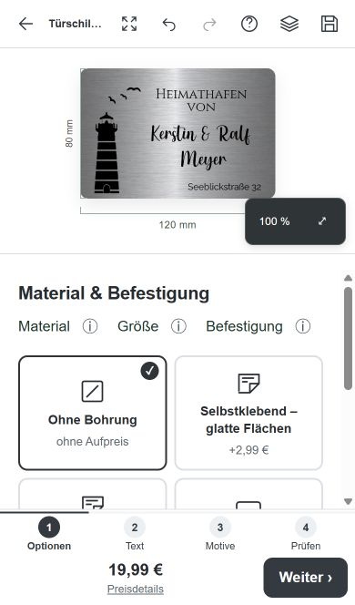
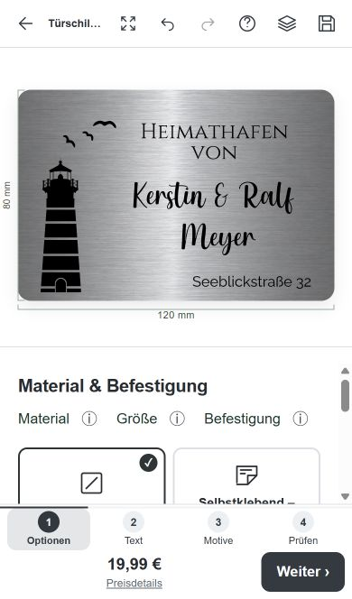
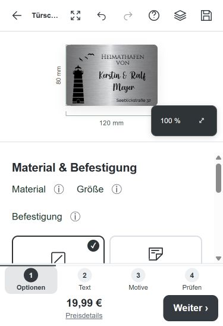
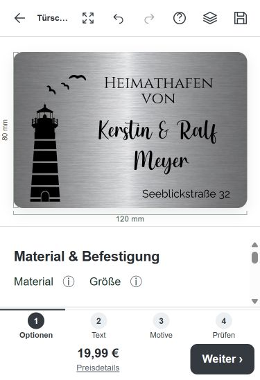

# Nachtrag zu PR #41: Vorher/Nachher

20 direkte Browseraufnahmen aus dem echten lokalen Editor, 28.10.2026. Basis: Fast-Forward auf Claude-Merge 87154ac. Historische D8-Produktkopie, ausschließlich lokaler Server; kein Live-Preisnachweis. Keine Bildmontagen und keine geänderten Produktdaten. Die Handygrößen sind die sichtbaren Safari-Flächen aus dem Auftrag; Aufnahme im Chromium-Browser, kein physischer iPhone-/Safari-Test.

| Ansicht | Vorher | Nachher |
| --- | --- | --- |
| Desktop 1440 × 900 | [Bild](vorher-desktop.jpg) | [Bild](nachher-desktop.jpg) |
| 390 × 664, Optionen | [Bild](vorher-390-optionen.jpg) | [Bild](nachher-390-optionen.jpg) |
| 390 × 664, Text | [Bild](vorher-390-text.jpg) | [Bild](nachher-390-text.jpg) |
| 390 × 664, Motive | [Bild](vorher-390-motive.jpg) | [Bild](nachher-390-motive.jpg) |
| 375 × 548, Optionen | [Bild](vorher-375-optionen.jpg) | [Bild](nachher-375-optionen.jpg) |
| 375 × 548, Text | [Bild](vorher-375-text.jpg) | [Bild](nachher-375-text.jpg) |
| 375 × 548, Motive | [Bild](vorher-375-motive.jpg) | [Bild](nachher-375-motive.jpg) |

Weitere Nachweise: [390 Zoom](nachher-390-zoom.jpg), [390 Ganzes Schild](nachher-390-einpassen.jpg), [375 Zoom](nachher-375-zoom.jpg), [375 Ganzes Schild](nachher-375-einpassen.jpg), [390 Vollbild mit M2](nachher-390-vollbild-text.jpg), [375 Vollbild mit M2](nachher-375-vollbild-text.jpg).

Die Platte ist in Optionen, Text und Motive bei 390 px genau 351 px und bei 375 px genau 337,5 px breit: jeweils 90 %. Bei 100 % ist die Handy-Zoomanzeige verborgen, nach einer echten Radgeste bei 182 % sichtbar, nach „Ganzes Schild“ wieder verborgen. Desktop: Maßtext endet bei y=663,1; Zoomleiste beginnt bei y=680. Im kleinen Vollbild bleibt die Maßangabe oberhalb der Textleiste lesbar; der verfügbare Platz mit geöffneter M2-Leiste begrenzt dort die Plattenbreite auf 277,5 px.

[DOM-Messungen](messungen.json) · [Abmessungen und SHA-256 aller Bilder](manifest.json) · [Bericht](../2026-10-28-konfi-ux-nachtrag-astra-bericht.md)

## Direktvergleich Handy 390 × 664

| Vorher | Nachher |
| --- | --- |
|  |  |

## Direktvergleich iPhone-SE-Fläche 375 × 548

| Vorher | Nachher |
| --- | --- |
|  |  |
