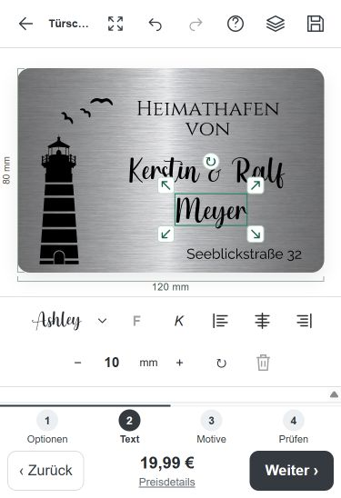

# Nachtrag 2 · Bild- und Prüfbelege · 28.10.2026

Lokales Chromium, historisches D8-Testmodell, Variante B. Vorher: unveränderter PR-Stand **7ac1505**. Nachher: Nachtrag 2, Bundle **editor-5d78be16948aa18d.mjs**. Kein Live-Shop-/Gerätenachweis. Die 1,69-Euro-Einstellung der lokalen Vorschau ist kein Beleg für den gespeicherten Live-Preisvertrag.

| Ansicht | Vorher | Nachher |
| --- | --- | --- |
| Desktop 1440 × 900, Text ausgewählt | [Bild](vorher-desktop-text.jpg) | [Bild](nachher-desktop-text.jpg) |
| 390 × 664, Text ausgewählt | [Bild](vorher-390x664-text.jpg) | [Bild](nachher-390x664-text.jpg) |
| 375 × 548, Text ausgewählt | [Bild](vorher-375x548-text.jpg) | [Bild](nachher-375x548-text.jpg) |

Zusätzlich: [375 × 548 Vollbild](nachher-375x548-vollbild.jpg).

## Gleichzeitige Berührungen

Zwei native Touch-Kontakte in **einem** synthetischen TouchEvent über ausgewähltem „Meyer“, danach bewusster SVG-Neuaufbau während der Berührung. Der ursprüngliche Berührungs-Knoten ist dabei abgelöst. Belege: [Desktop](touch-batch-desktop.jpg), [390 × 664](touch-batch-390x664.jpg), [375 × 548](touch-batch-375x548.jpg).

Alle drei: Ansicht 100 → 190 %, Anzeige **10 → 10 mm**, interner Ausgangswert **10,32 → 10,32 mm**, sämtliche Objekte, Druck-SVG und Undo unverändert. Beim SVG-Vergleich werden nur zufällig erzeugte Namespace-IDs samt Referenzen vereinheitlicht; Geometrie und Attribute bleiben vollständig im Vergleich. Reproduzierbarer Prüfer: [scripts/konfi-touch-browser-check.mjs](../../../scripts/konfi-touch-browser-check.mjs), auf der lokalen Testseite mit dem geladenen Konfigurator aufrufen. Nicht in den Produktions-Einstieg importiert.

Dies belegt den gebauten Browsercode mit TouchEvent-Batches, **keine reale Safari-Eingabefolge**. Die physische iPhone-SE-Gegenprüfung bleibt bei der Abnahme offen.

## Messungen

| Größe | Textleiste | Ende Textleiste | Beginn Schrittleiste | Plattenbreite |
| --- | ---: | ---: | ---: | ---: |
| 375 × 548 | 99 px, 2 × 44 px Steuerzeilen | 425 px | 442,71 px | 337,5 px / 90 % |
| 390 × 664 | 99 px, 2 × 44 px Steuerzeilen | 483 px | 558,71 px | 351 px / 90 % |

[DOM-Messungen](messungen.json) · [Touch-Ergebnisse](touch-ergebnisse.json) · [Windows-Vollaufvergleich](testvergleich.json) · [Bildgrößen und SHA-256](bilder-manifest.json)

