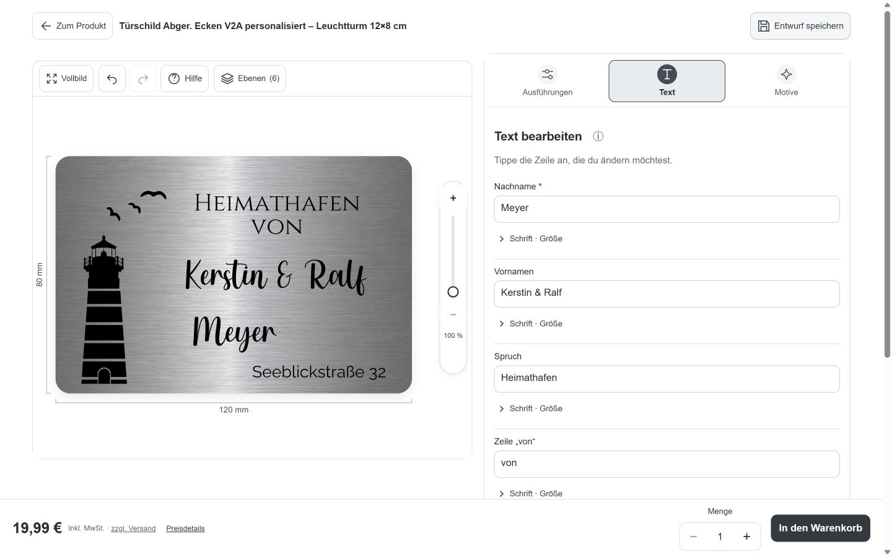
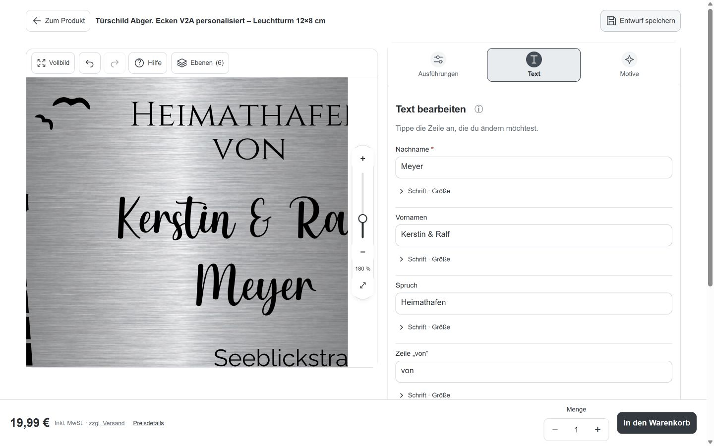
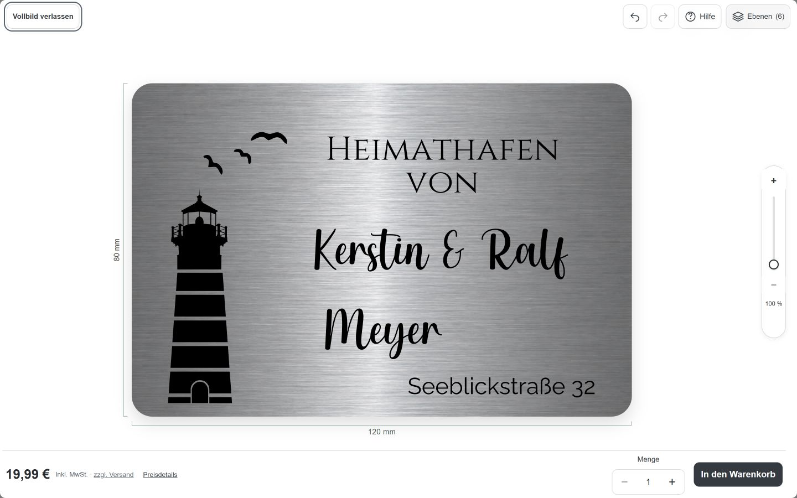
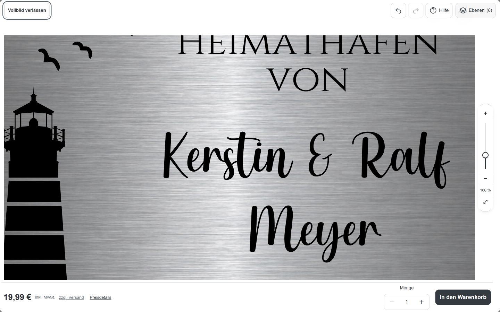
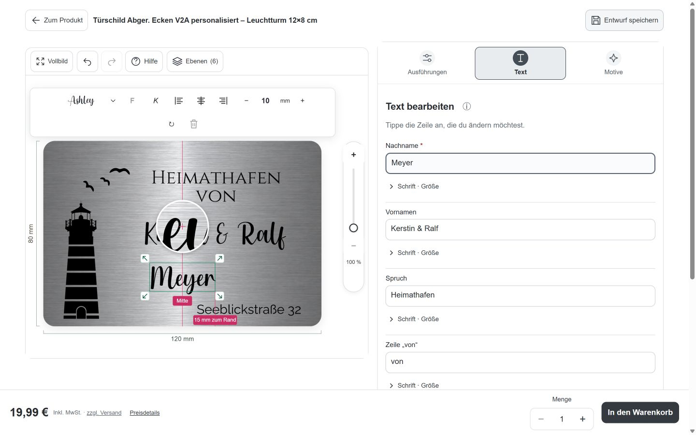
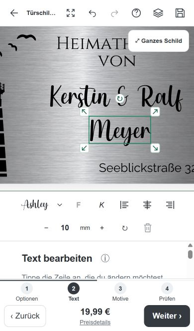
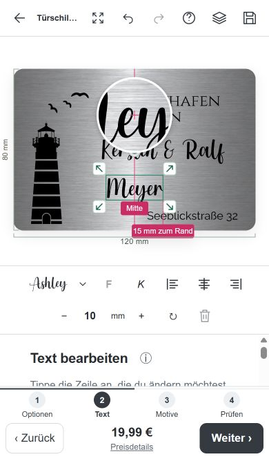
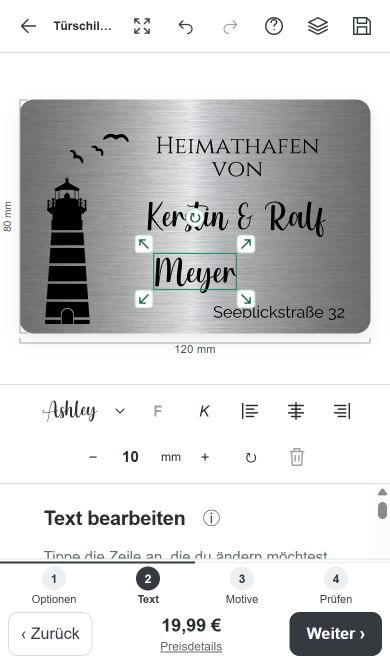
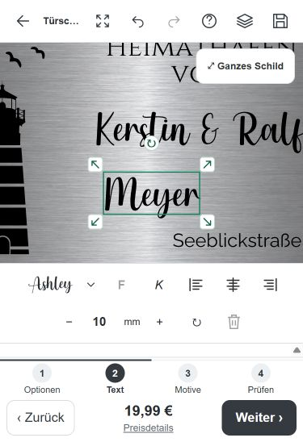
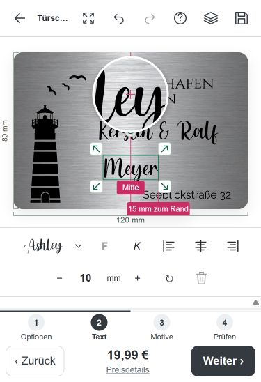

# Nachtrag 5 – Bilder der vereinfachten Zoomsteuerung

Gebauter lokaler Editor, 29.10.2026. Chrome mit den angegebenen Bildschirmgrößen. Synthetische Touch-/Dragereignisse; kein physischer Safari-/iPhone- oder Live-Test. Preis und Gestaltung kommen aus dem historischen D8-Testmodell. Die einzelnen Bilder sind unveränderte Browseraufnahmen. In den Dragfällen ist objectsUnchanged=false beabsichtigt: das Textelement wird verschoben. Bei reinen Zoomgesten bleibt der gesamte Objektbestand identisch.

[Bericht](../2026-10-29-konfi-ux-nachtrag5-astra-bericht.md) · [Tests](tests.json) · [DOM-Messungen](browser-checks.json)

## Desktop · 1440 × 900

100 %: 44-px-Balken rechts, eigener 60-px-Bereich, beide Maßangaben sichtbar.

180 %: Regler/Prozent synchron, Gesamtansichtknopf sichtbar, vergrößerte Platte endet vor dem Balken.

Vollbild 100 % und 180 %:

Lupe und 15 mm zum Rand:

## iPhone 13 · 390 × 664

Zwei Finger 100→150 %, keine Fokus-Pille; „Ganzes Schild“ oben rechts. Objektgröße und Text bleiben unverändert. Preis und Schritte sichtbar.

Ziehen mit Lupe und 15-mm-Hilfe:

Nach „Ganzes Schild“ wieder 100 %, kein Rückkehrknopf:

## iPhone SE · 375 × 548

Zwei Finger 100→150 %; Textleiste bleibt zweizeilig oberhalb von Preis und Schritten:

Lupe und 15-mm-Hilfe:

