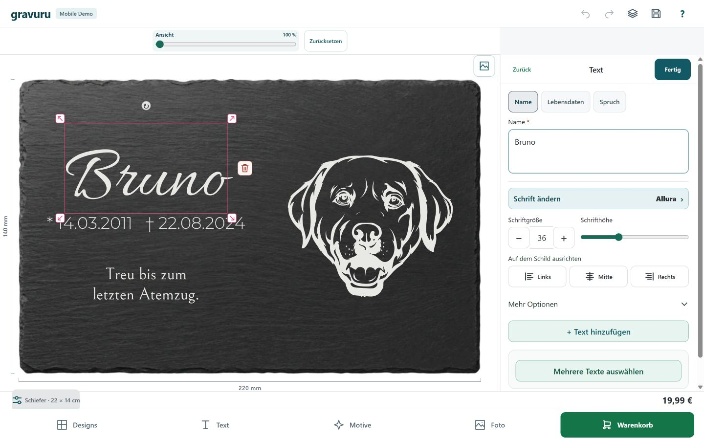
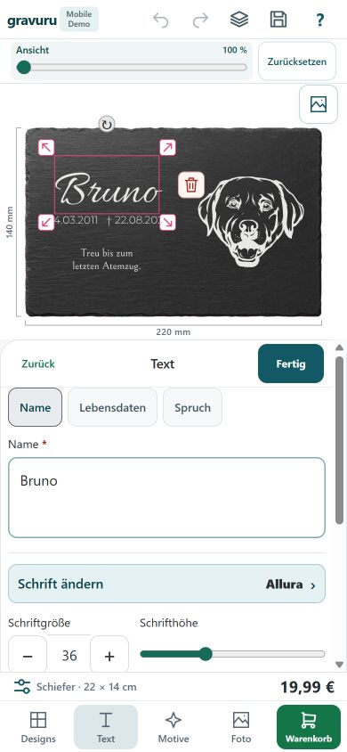
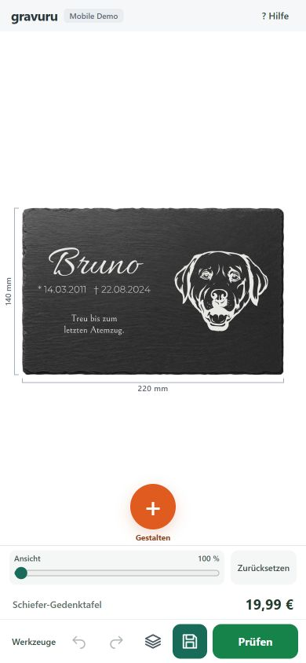

# Demo R5 – Textbedienung und PC-Ansicht

[22×14 frisch starten](https://app-2027.gravuru-designwerkstatt.de/konfi-demo/mobil-20261107-r5/22x14.html?fresh=1) · [30×20 frisch starten](https://app-2027.gravuru-designwerkstatt.de/konfi-demo/mobil-20261107-r5/30x20.html?fresh=1)

Getrennte statische Demo mit unveränderter nativer Engine; keine Bestellung, Konto- oder Galerie-Rückspeicherung. R4 bleibt als früherer Stand erhalten. Quellcommit `07d5d8a4`.

- `r5-tests.txt`: 38 gezielte Tests bestanden, keine Fehler oder übersprungenen Tests.
- `host-preflight-r5.json`: geprüfte Ausgangslage vor jeder Veröffentlichung, 2061 vorhandene öffentliche Dateien.
- `host-publication-r5.json`: vier Originalkopien plus vollständiges Inventar privat gesichert; Originale und alle bisherigen öffentlichen Dateien nachher hashgleich. Kein Neustart/Router-/Shop-/Datenbankschreiben.
- `http-public-r5.json`: acht öffentliche Stichproben liefern 200, gzip, no-store/noindex und stimmen zum Manifest. Einzelabrufe vom PC sind keine mobile Performance-Messung.
- `demo-r5-text-online-390.jpg`: öffentliche Textansicht bei 390×844.
- `demo-r5-desktop-online-1440.jpg`: öffentliche PC-Ansicht bei 1440×900, große Tafel und rechte Bearbeitung.
- `demo-r5-tastatur-online-390x430.jpg`: **simulierte** verkleinerte Ansicht mit fokussiertem mehrzeiligem Textfeld (349×91 px, 16-px-Schrift). Kein Screenshot einer physischen Smartphone-Tastatur.

Die Bediennachweise verteilen sich auf R5-C3/C4/Final; die [R5-Übergabe](../../handoffs/2026-11-07-mobile-demo-r5-bedienung.md) trennt diese Stände ausdrücklich. Physische Android-/iOS-Tastatur- und Touchprüfung bleibt offen. Keine neue Einzelabnahme aller 43 Designs.

---

# Getrennte mobile Demo – sichtbare und technische Nachweise

Die [22×14-Demo](https://app-2027.gravuru-designwerkstatt.de/konfi-demo/mobil-20261107-r4/22x14.html?fresh=1) und die [30×20-Demo](https://app-2027.gravuru-designwerkstatt.de/konfi-demo/mobil-20261107-r4/30x20.html?fresh=1) sind ausschließlich eine neue statische Teststrecke. Die vorhandenen Kundenwege bleiben unverändert. Bestellen, Kundenkonto- und Galerie-Rückspeicherung sind nicht angeschlossen.

- `host-preflight-r4.json`: Paket und Ausgangsstand geprüft, noch keine Veröffentlichung.
- `host-publication-r4.json`: private Sicherung vor Veröffentlichung; vier originale Einstieg-/Vorschaudateien und alle 58 vorherigen öffentlichen Dateien nachher hashgleich. Keine Datenbank-/Shop-Schreibzugriffe, kein Neustart oder Routerwechsel.
- `http-public-r4.json`: beide HTML-Einstiege, Demo-JavaScript, CSS sowie je eine Katalog- und Motivressource mit HTTP 200, gzip, passenden MIME-Typen und exakt zum Manifest passenden Inhalten. Einzelabrufe vom Arbeits-PC sind keine Handy-Ladezeit- oder Lastmessung.
- `demo-start-online-390.jpg` und `demo-werkzeuge-online-390.jpg`: veröffentlichte R4 im Chrome-Viewport 390×844.
- Weitere Aufnahmen zeigen lokale R4 in 430×932, 844×390, 1440×900 und den tatsächlich gezogenen Foto-Eckgriff. Kein physischer Smartphone-/Safari-Test wird damit behauptet.

22 gezielte automatisierte Tests bestanden: 10 Adapter-, 6 Paket-/Isolations- und 6 Veröffentlichungsprüfungen. Die Bedienfälle wurden während R1–R4 auf derselben vorhandenen Engine durchgeführt; nach der Veröffentlichung nochmals Start, Werkzeugwahl und kategorienübergreifende Motivsuche geprüft. Einzelheiten und verbleibende Grenzen stehen in [design-qa.md](../../../design-qa.md) und der [Gesamtübergabe](../../handoffs/2026-11-07-mika-gesamtstand-mobile-demo-und-anbindung.md).

