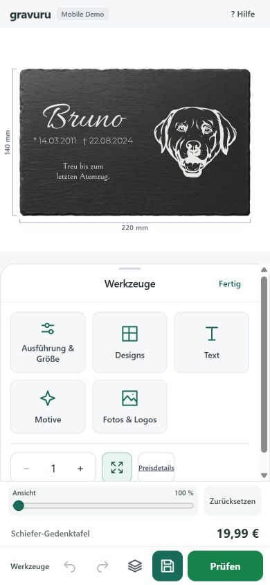

# Getrennte mobile Demo – sichtbare und technische Nachweise

Die [22×14-Demo](https://app-2027.gravuru-designwerkstatt.de/konfi-demo/mobil-20261107-r4/22x14.html?fresh=1) und die [30×20-Demo](https://app-2027.gravuru-designwerkstatt.de/konfi-demo/mobil-20261107-r4/30x20.html?fresh=1) sind ausschließlich eine neue statische Teststrecke. Die vorhandenen Kundenwege bleiben unverändert. Bestellen, Kundenkonto- und Galerie-Rückspeicherung sind nicht angeschlossen.

- `host-preflight-r4.json`: Paket und Ausgangsstand geprüft, noch keine Veröffentlichung.
- `host-publication-r4.json`: private Sicherung vor Veröffentlichung; vier originale Einstieg-/Vorschaudateien und alle 58 vorherigen öffentlichen Dateien nachher hashgleich. Keine Datenbank-/Shop-Schreibzugriffe, kein Neustart oder Routerwechsel.
- `http-public-r4.json`: beide HTML-Einstiege, Demo-JavaScript, CSS sowie je eine Katalog- und Motivressource mit HTTP 200, gzip, passenden MIME-Typen und exakt zum Manifest passenden Inhalten. Einzelabrufe vom Arbeits-PC sind keine Handy-Ladezeit- oder Lastmessung.
- `demo-start-online-390.jpg` und `demo-werkzeuge-online-390.jpg`: veröffentlichte R4 im Chrome-Viewport 390×844.
- Weitere Aufnahmen zeigen lokale R4 in 430×932, 844×390, 1440×900 und den tatsächlich gezogenen Foto-Eckgriff. Kein physischer Smartphone-/Safari-Test wird damit behauptet.

22 gezielte automatisierte Tests bestanden: 10 Adapter-, 6 Paket-/Isolations- und 6 Veröffentlichungsprüfungen. Die Bedienfälle wurden während R1–R4 auf derselben vorhandenen Engine durchgeführt; nach der Veröffentlichung nochmals Start, Werkzeugwahl und kategorienübergreifende Motivsuche geprüft. Einzelheiten und verbleibende Grenzen stehen in [design-qa.md](../../../design-qa.md) und der [Gesamtübergabe](../../handoffs/2026-11-07-mika-gesamtstand-mobile-demo-und-anbindung.md).

