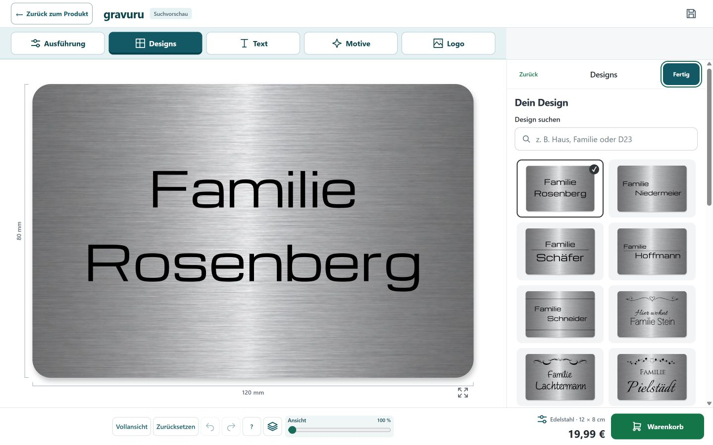
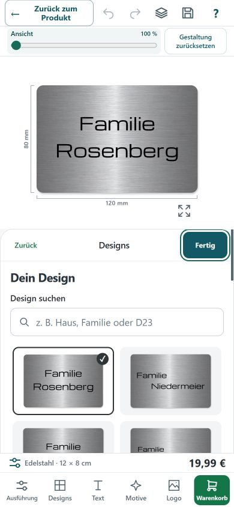

# Designsuche: echte lokale Desktop- und Handyansicht

Stand 11.11.2026, Mika / `module_contract`. **Nur eine visuelle Suchfeld-Vorschau, keine implementierte Suche und keine Veröffentlichung.** Der bestehende R15-Konfigurator zeigt die unveränderte reale r4-Designbank. Keine neue Produktanlage, keine Kundendaten-/Shopify-/Pleskaktion.

| Browsernachweis | Größe | Datei | SHA-256 |
|---|---|---|---|
| Desktop, Chrome | 1440 × 900 CSS-Pixel, DPR 1 | [Desktop](designsuche-desktop-1440x900.jpg) | `64a2368cc0e0313b3b8787c3eaca733fef7de619cfffa21839b9310893ec8144` |
| Handybreite, Chrome-Emulation | 390 × 844 CSS-Pixel, DPR 1 | [Mobil](designsuche-mobil-390x844.jpg) | `7bde7316d81c9f122e010d0b7def8615f5865ebb9ca8a2a457c65c369f1b1c1b` |

Die JPG-Dateien stammen unmittelbar aus der echten Browserdarstellung, ohne Bildbearbeitung. Dies ist keine Abnahme auf einem physischen Handy. Die temporäre Ansichtsgröße wurde danach zurückgesetzt. Ausschließlich eine neue lokale Registerkarte wurde verwendet; keine vorhandene Live- oder Plesk-Registerkarte wurde bedient.





## Exakter lokaler Stand

- URL: `http://127.0.0.1:8240/steel`, nur auf diesem Rechner verfügbar.
- Host und Overlay: `outputs/issue230-search-preview-20261110/host.mjs` und `search-proposal.mjs` im gemeinsamen Workspace. Belege: `host-proof.json`, `baseline-provenance.json`, `http-checks.json`.
- Host-SHA nach der einzigen Fixture-Ergänzung: `bc5cf6ef2a4e947519ac2ee827104b1036aa45382d1f4a6e09d6d1c8b1cedc06`; unverändertes Overlay: `16eb3eee1ec9f6aac7ba98049c37ed6d8ffb104a46a3b4d2e2914d6c414e2eb7`.
- Unveränderter Quellbaum: `work/issue230-bc-20261110`, Git `54c2651201f55887d9dce6c5e6d7f7251db845de`.
- Reale r4-Produktdatei: `candidate-product-document.live-normalized.compact.json`, SHA-256 `2e74548aa7211a2f5546af428e1d27d9f00f12181490356633e3cd109cb179c0`.
- Bank: 251 Designs, 80 Formate; im gewählten Format zeigt die native Galerie 21 passende Designs. Kein Import der 1.298 Katalogoriginale und keine neue Designfreigabe.
- 36 Styles sowie die zwei bekannten Quellen `family-formats.mjs` / `option-media.mjs` stammen aus dem gespeicherten Paket mit Baseline `767701ee`, lokal einzeln gehasht. Das ist **keine frische vollständige Live-Inventur**.
- Native lokale Build-URL: `/_bundle/editor-b9827ca8587a6c7b.mjs`.

## Lokalen Sitzungsfehler behoben, Schutzprüfung erhalten

Der erste Browseraufruf brach korrekt mit „Die Produktsitzung passt nicht zum geladenen Konfigurator“ ab. Der lokale Host setzte `GravuruShopEntry`, ließ aber den zugehörigen `GravuruWorkshopReview`-Verweis aus. Der unveränderte native `shopPresentationContext` verlangt beide identischen Produkt-/Revisionsreferenzen.

Auf ausdrücklichen lokalen Auftrag wurde ausschließlich im Vorschauhost direkt nach dessen Modellzuweisung ergänzt:

```js
window.GravuruWorkshopReview = {
  productId: model.configuration.id,
  productRevision: model.configuration.revision
};
```

Dies entspricht dem vorhandenen echten `shop-entry-page.mjs`-Sitzungsaufbau. Kein Guard, Produktobjekt oder Runtime-Quelltext wurde verändert. `node --check` bestand. Nur der zuvor per vollständiger Befehlszeile identifizierte Vorschauprozess PID 1392 wurde beendet und derselbe Host neu gestartet (PID 33168, Ausführungssitzung 61242). Danach erschien die native R15-Oberfläche samt Feld in beiden Ansichten.

## Aussagegrenze

Das Overlay fügt ein schreibgeschütztes Feld „Design suchen“ mit Beispieltext ein und öffnet den vorhandenen Designbereich. Die zugängliche Beschriftung benennt ausdrücklich „Vorschlag, noch ohne Suchfunktion“. Die Desktop-Kopfzeile zeigt „Suchvorschau“; dieser bestehende Badge ist auf der schmalen Handyansicht nicht sichtbar. Die Suche filtert nichts und zählt keine Suchbegriffe. Der Host nutzt ausschließlich eine `:memory:`-Werkstatt; Schreib-, Upload-, Verwaltungs- und Warenkorbaktionen sind gesperrt. Keine Produktsitzung oder Datenbank wurde produktiv verändert.

Nächster Schritt ist die Sichtentscheidung über diese Platzierung. Erst ein eigener ausdrücklich freigegebener Implementierungsauftrag kann daraus funktionale Suche machen. Die Originale folgen unverändert dem [Design-Master](https://github.com/Chris83638w/gravuru-katalog./blob/main/designs/DESIGN-MASTER.md).
