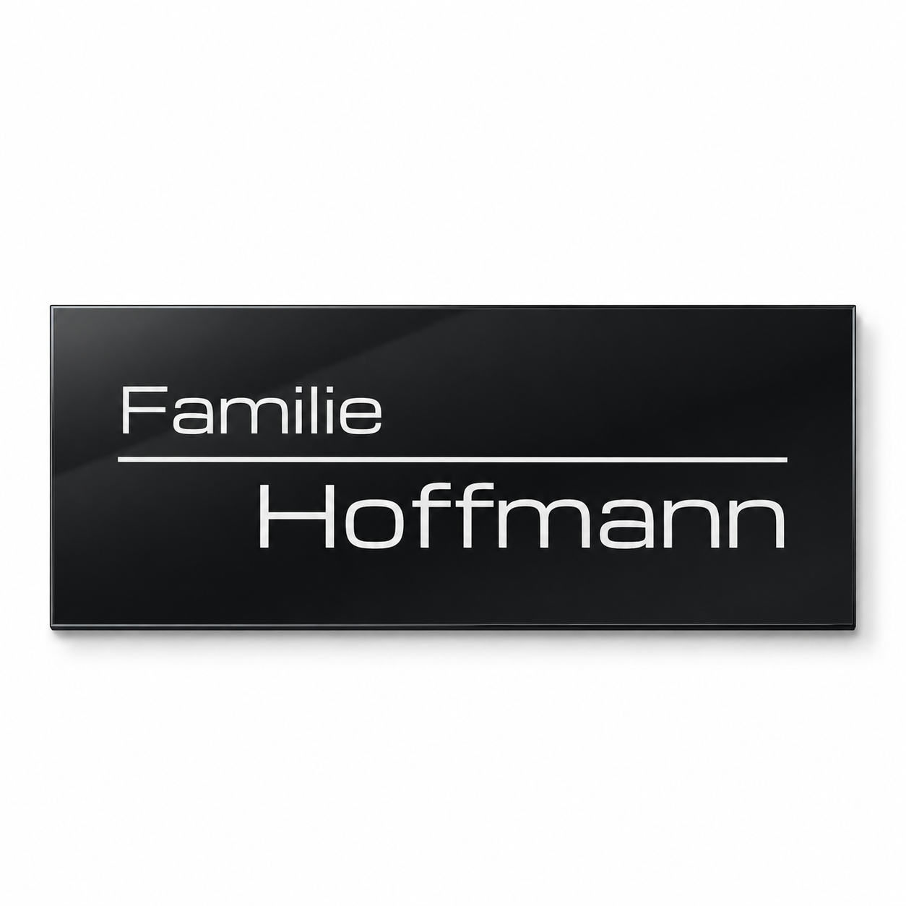
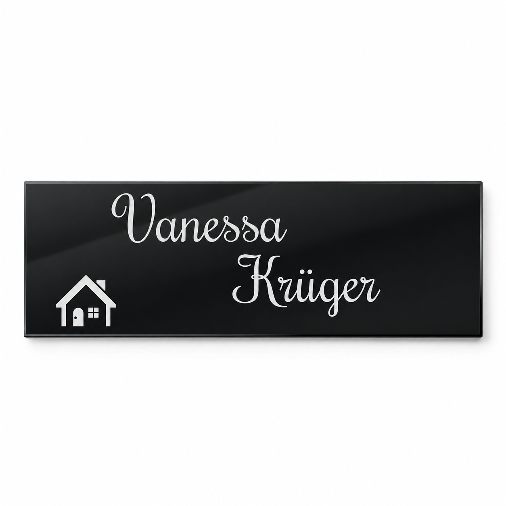
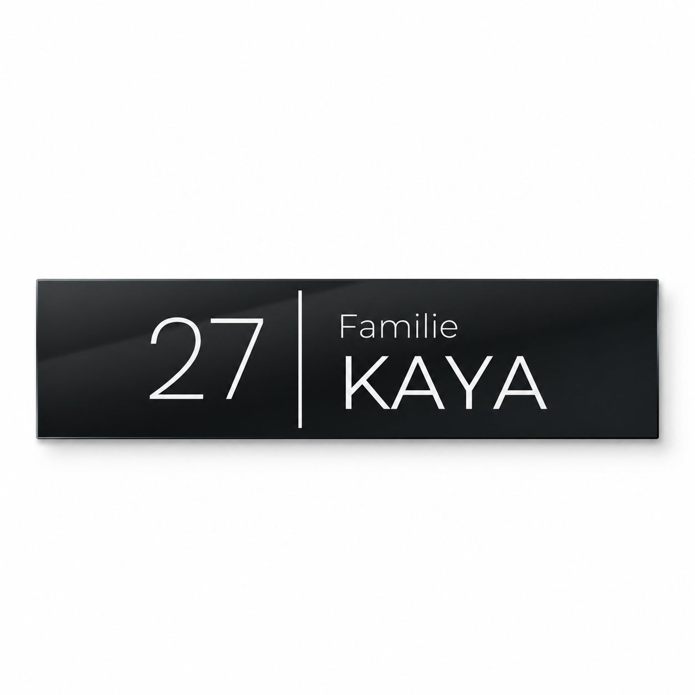
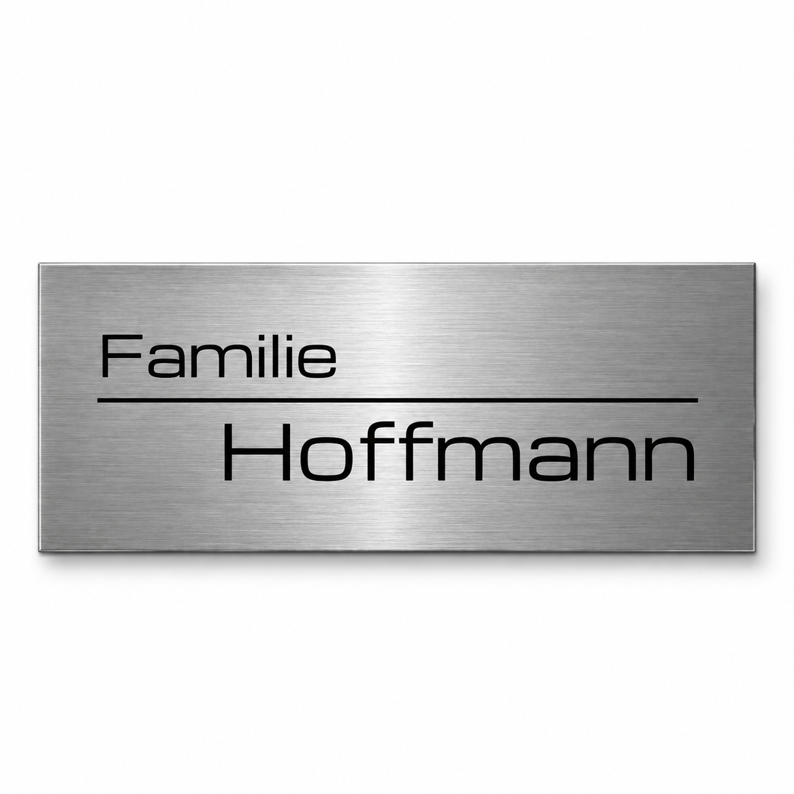
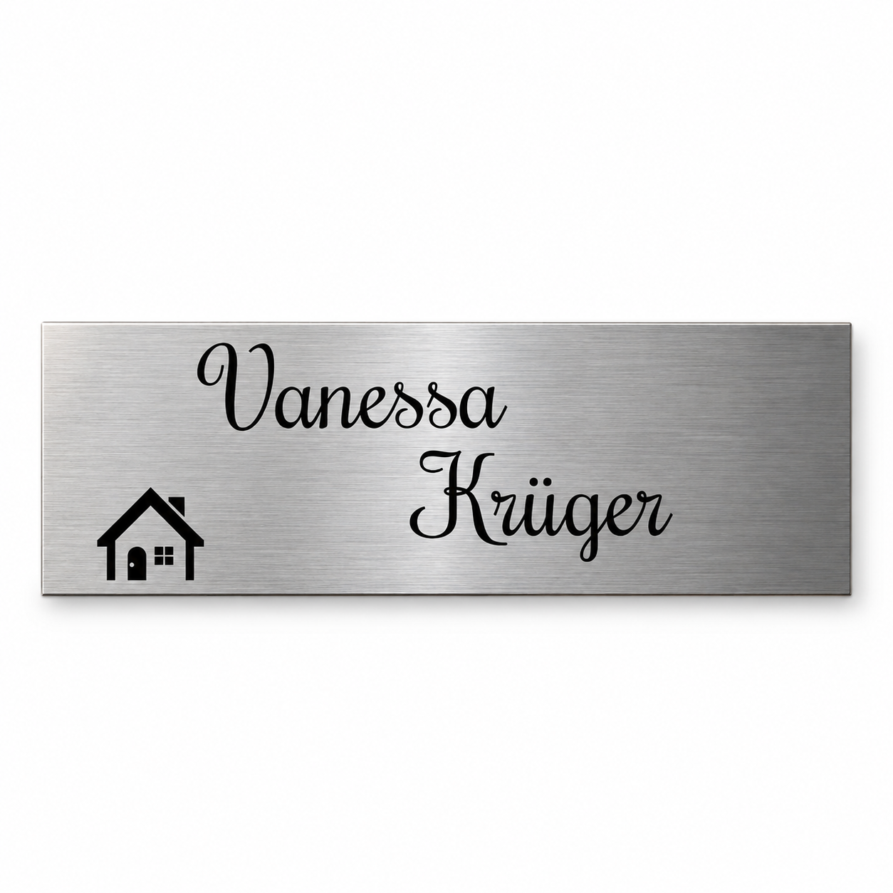
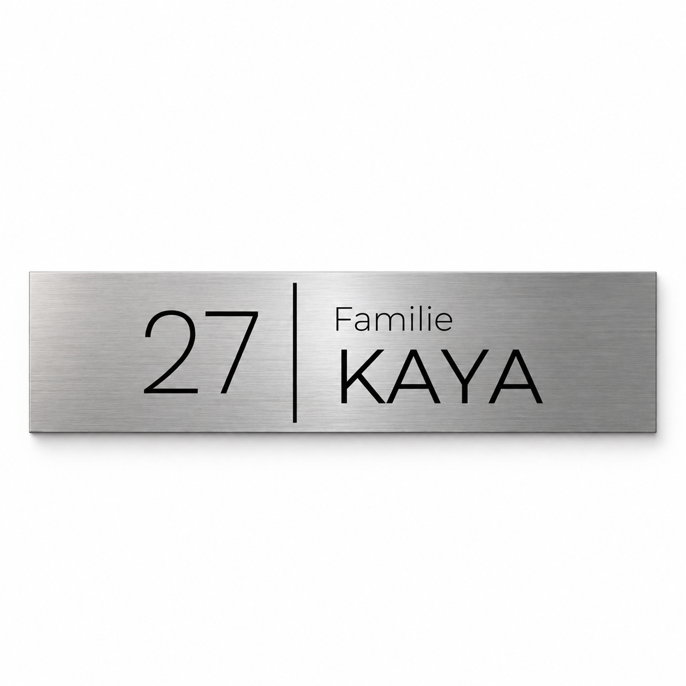

# Sechs neue Produkte – Bilder und Texte zur Freigabe

Stand der Vorschläge: 12.11.2026; Prüfbericht ergänzt am 13.11.2026. **Alle Produkte bleiben Entwürfe. Bilder, Texte und Handles sind noch nicht in den Shop übernommen.**

Bitte die sechs Bild-/Textvorschläge anhand ihrer IDs prüfen. Eine Zustimmung dazu ist keine Veröffentlichung oder App-Umschaltung.

## Warenkorb und Konfigurator

**Teilweise geprüft – Motivpreis im bestehenden Warenkorb bestätigt**
Ein echter Warenkorbtest an einem bestehenden Edelstahlprodukt bestätigt den Motivaufpreis. Die sieben neuen Produktstände bleiben Entwürfe; deren vollständiger Kaufweg ist noch nicht bestätigt. Die sechs Bilder und Verkaufstexte bleiben Vorschläge.

- **Preise im Konfigurator:** Hauptacryl, Acryl 5 × 2 cm und Edelstahl 8 × 2 cm zeigen im echten Browser die erwarteten Preise einschließlich der geprüften Aufpreise und Mengenrabatte.
- **Designauswahl wieder erreichbar:** Der Galerie-Fix ist eingebaut: 1,7–1,9 Sekunden bei den wiederholten Abrufen, 3,3 Sekunden beim ersten Abruf nach Neustart. Der zuvor gemessene Zeitabbruch tritt in diesen Prüfungen nicht mehr auf; Inhalt und Preise bleiben gleich.
- **Preislogik:** 438 von 438 Fällen mit den tatsächlichen Preisfeldern in der JavaScript-Quelle bestanden. Zusätzlich wurde ein Motivpreis im echten Warenkorb eines bestehenden Produkts bestätigt. Der vollständige Lauf des aktiven kompilierten Programms (WASM) und dessen Instruktionsgrenze bleiben offen; das ursprüngliche Binary liegt nicht vor.
- **Echter Shopify-Warenkorb:** Claude bestätigt am 13.11. für das bestehende aktive Edelstahlprodukt 16190784438652: 19,99 € + 1,69 € Motiv = 21,68 € in der echten Warenkorbzeile. Nur die hinzugefügte Testzeile wurde anschließend entfernt, der vorherige Warenkorb wiederhergestellt. Die sieben Entwürfe werden weiterhin mit HTTP 422 abgewiesen; deren Zeilenpreise, Foto/Logo, Staffeln, Mengenwechsel und Zeilenersatz sind nicht vollständig geprüft. Keine Bestellung oder Zahlung.
- **Gestaltung wieder öffnen:** Der laufende Teststand setzt die Menge noch auf 1 zurück. Die lokale Korrektur ist mit 13 gezielten Fällen, unabhängigem Review und sichtbarem Neuladen bei Menge 10 geprüft und an Claude übergeben. Einbau und anschließender Hostnachweis stehen separat aus.
- **Mobiler Konfigurator:** Echter Konfigurator bei 390 × 844 geprüft; ein links abgeschnittener Vorschauausschnitt wurde gefunden. Die lokale Korrektur zeigt Hauptprodukt, Acryl 5 × 2 und Edelstahl 8 × 2 vollständig; Vollbild und Reset geprüft. Noch kein installierter Hostnachweis und kein physischer Handylauf.
- **Sichtprüfung 5 × 2 cm:** Schraubenköpfe entsprechen den bestätigten 5 mm, also einem Viertel der 20-mm-Schildhöhe. Native Geometrie geprüft; keine optische Verkleinerung vorgesehen.
- **Offener Gestaltungsbefund:** Claude meldet beim bestehenden Edelstahlprodukt, dass ein neu hinzugefügtes Hausmotiv zunächst den Text Rosenberg überlappt. Dieser separate Platzierungsbefund ist noch nicht behoben.

[Ausführlicher Warenkorbbericht](cart-report-20261113.md) · [Echte Mobilprüfung](mobile-konfi-review-20261113.md)

## Vorschläge

| ID | Produkt |
| --- | --- |
| A52 | Türschild Acrylglas 5 × 2 cm mit Gravur |
| A62 | Türschild Acrylglas 6 × 2 cm mit Gravur |
| A82 | Türschild Acrylglas 8 × 2 cm mit Gravur |
| S52 | Türschild Edelstahl 5 × 2 cm mit Gravur |
| S62 | Türschild Edelstahl 6 × 2 cm mit Gravur |
| S82 | Türschild Edelstahl 8 × 2 cm mit Gravur |

## A52 · Türschild Acrylglas 5 × 2 cm mit Gravur

**Bild-ID: A52-v1.** KI-erstellter Shopbildvorschlag anhand einer bestehenden Gestaltung. Das Bild zeigt eine Beispielgestaltung; die Konfigurator-Startdesigns bleiben unverändert.
[Originale Konfigurator-Referenz](references/A52-native.png)

### Vollständiger Verkaufstext

Dein Name auf kleinem Format: Gestalte ein Türschild aus schwarzem oder anthrazitfarbenem Acrylglas.

Mit 5 × 2 cm bleibt dieses rechteckige Schild kompakt. Das 3 mm starke Acrylglas wird auf der Rückseite graviert. Wähle ein Design und passe den Beispieltext an – so wird aus der Vorlage dein eigenes Namensschild.

**Maße und Material**

- Maße: 5 × 2 cm (50 × 20 mm)
- Form: Rechteckig
- Material: Acrylglas, 3 mm stark
- Farben: Schwarz oder Anthrazit
- Gestaltung: Rückseitige Gravur mit deinem Text

**So gestaltest du dein Schild**

Wähle ein Design, ersetze den Beispieltext und kontrolliere die Vorschau. Für eigene Ergänzungen steht eine Auswahl aus 13 Motiven bereit. Ob Text und Motiv gut zusammenpassen, prüfst du direkt in deiner Gestaltung. Foto- und Logo-Uploads sind bei diesem Kleinformat nicht vorgesehen.

Das Produktbild zeigt eine Beispielgestaltung. Im Konfigurator kannst du ein anderes Design wählen und den Text anpassen.

**Befestigung und Preise**

Ab 6,99 € pro Stück in der Variante „Ohne Bohrung“. Die Preise gelten gleichermaßen für Schwarz und Anthrazit. Die folgenden Preise verstehen sich inklusive 19 % MwSt., vor Mengenrabatt und zusätzlichen Motivkosten.

| Variante | Aufpreis | Preis pro Stück |
|---|---:|---:|
| Ohne Bohrung | im Grundpreis | 6,99 € |
| Selbstklebend – glatte Flächen | +2,99 € | 9,98 € |
| Selbstklebend – raue Flächen | +3,99 € | 10,98 € |
| Mit 2 Bohrlöchern | +2,49 € | 9,48 € |
| Mit 2 Schrauben | +2,69 € | 9,68 € |

**Motive und Mengenrabatt**

Im gewählten Design enthaltene Originalmotive sind inklusive. Jedes zusätzlich eingefügte oder ersetzte Motiv kostet 1,69 €.

Mengenrabatt je Warenkorbposition: ab 3 Stück 5 %, ab 5 Stück 10 %, ab 10 Stück 15 %. Es gilt die höchste erreichte Stufe auf den Stückpreis einschließlich gewählter Befestigung und kostenpflichtiger Motive; die Stufen werden nicht addiert.

### SEO und Bildbeschreibung

- **SEO-Titel:** Türschild Acrylglas 5 × 2 cm mit Gravur | Gravuru
- **SEO-Beschreibung:** Türschild aus 3 mm Acrylglas in 5 × 2 cm: Schwarz oder Anthrazit, rückseitige Gravur, eigener Text und fünf Befestigungen. Im Konfigurator gestalten.
- **Vorgeschlagener Handle:** `tuerschild-acrylglas-5x2-cm-gravur`
- **Alttext:** Türschild aus schwarzem Acrylglas, 5 × 2 cm, mit Familie Hoffmann und horizontaler Linie
- **Shopify-Produkt-ID:** 16203675074940

## A62 · Türschild Acrylglas 6 × 2 cm mit Gravur

**Bild-ID: A62-v1.** KI-erstellter Shopbildvorschlag anhand einer bestehenden Gestaltung. Das Bild zeigt eine Beispielgestaltung; die Konfigurator-Startdesigns bleiben unverändert.
[Originale Konfigurator-Referenz](references/A62-native.png)

### Vollständiger Verkaufstext

Dein Text, ein schmales Format: Gestalte dein Acryl-Türschild in 6 × 2 cm.

Das 60 mm breite und 20 mm hohe Schild verbindet ein längliches Format mit 3 mm starkem Acrylglas. Entscheide dich für Schwarz oder Anthrazit und gestalte die rückseitige Gravur mit deinem Text in einem der vorhandenen Designs.

**Maße und Material**

- Maße: 6 × 2 cm (60 × 20 mm)
- Form: Rechteckig
- Material: Acrylglas, 3 mm stark
- Farben: Schwarz oder Anthrazit
- Gestaltung: Rückseitige Gravur mit deinem Text

**So gestaltest du dein Schild**

Wähle ein Design, ersetze den Beispieltext und kontrolliere die Vorschau. Für eigene Ergänzungen steht eine Auswahl aus 13 Motiven bereit. Ob Text und Motiv gut zusammenpassen, prüfst du direkt in deiner Gestaltung. Foto- und Logo-Uploads sind bei diesem Kleinformat nicht vorgesehen.

Das Produktbild zeigt eine Beispielgestaltung. Im Konfigurator kannst du ein anderes Design wählen und den Text anpassen.

**Befestigung und Preise**

Ab 7,99 € pro Stück in der Variante „Ohne Bohrung“. Die Preise gelten gleichermaßen für Schwarz und Anthrazit. Die folgenden Preise verstehen sich inklusive 19 % MwSt., vor Mengenrabatt und zusätzlichen Motivkosten.

| Variante | Aufpreis | Preis pro Stück |
|---|---:|---:|
| Ohne Bohrung | im Grundpreis | 7,99 € |
| Selbstklebend – glatte Flächen | +2,99 € | 10,98 € |
| Selbstklebend – raue Flächen | +3,99 € | 11,98 € |
| Mit 2 Bohrlöchern | +2,49 € | 10,48 € |
| Mit 2 Schrauben | +2,69 € | 10,68 € |

**Motive und Mengenrabatt**

Im gewählten Design enthaltene Originalmotive sind inklusive. Jedes zusätzlich eingefügte oder ersetzte Motiv kostet 1,69 €.

Mengenrabatt je Warenkorbposition: ab 3 Stück 5 %, ab 5 Stück 10 %, ab 10 Stück 15 %. Es gilt die höchste erreichte Stufe auf den Stückpreis einschließlich gewählter Befestigung und kostenpflichtiger Motive; die Stufen werden nicht addiert.

### SEO und Bildbeschreibung

- **SEO-Titel:** Türschild Acrylglas 6 × 2 cm mit Gravur | Gravuru
- **SEO-Beschreibung:** Acryl-Türschild 6 × 2 cm selbst gestalten: 3 mm stark, Schwarz oder Anthrazit, rückseitige Gravur. Design, eigenen Text und Befestigung auswählen.
- **Vorgeschlagener Handle:** `tuerschild-acrylglas-6x2-cm-gravur`
- **Alttext:** Türschild aus schwarzem Acrylglas, 6 × 2 cm, mit Vanessa Krüger und Hausmotiv
- **Shopify-Produkt-ID:** 16203715281276

## A82 · Türschild Acrylglas 8 × 2 cm mit Gravur

**Bild-ID: A82-v1.** KI-erstellter Shopbildvorschlag anhand einer bestehenden Gestaltung. Das Bild zeigt eine Beispielgestaltung; die Konfigurator-Startdesigns bleiben unverändert.
[Originale Konfigurator-Referenz](references/A82-native.png)

### Vollständiger Verkaufstext

Mehr Breite für deine Gestaltung: Dein Acryl-Türschild im Format 8 × 2 cm.

Bei 80 mm Breite bleibt die Höhe dieses Schildes bei 20 mm. Das rechteckige Format besteht aus 3 mm starkem Acrylglas in Schwarz oder Anthrazit und erhält eine rückseitige Gravur. Passe eine Designvorlage mit deinem eigenen Text an.

**Maße und Material**

- Maße: 8 × 2 cm (80 × 20 mm)
- Form: Rechteckig
- Material: Acrylglas, 3 mm stark
- Farben: Schwarz oder Anthrazit
- Gestaltung: Rückseitige Gravur mit deinem Text

**So gestaltest du dein Schild**

Wähle ein Design, ersetze den Beispieltext und kontrolliere die Vorschau. Für eigene Ergänzungen steht eine Auswahl aus 13 Motiven bereit. Ob Text und Motiv gut zusammenpassen, prüfst du direkt in deiner Gestaltung. Foto- und Logo-Uploads sind bei diesem Kleinformat nicht vorgesehen.

Das Produktbild zeigt eine Beispielgestaltung. Im Konfigurator kannst du ein anderes Design wählen und den Text anpassen.

**Befestigung und Preise**

Ab 8,49 € pro Stück in der Variante „Ohne Bohrung“. Die Preise gelten gleichermaßen für Schwarz und Anthrazit. Die folgenden Preise verstehen sich inklusive 19 % MwSt., vor Mengenrabatt und zusätzlichen Motivkosten.

| Variante | Aufpreis | Preis pro Stück |
|---|---:|---:|
| Ohne Bohrung | im Grundpreis | 8,49 € |
| Selbstklebend – glatte Flächen | +2,99 € | 11,48 € |
| Selbstklebend – raue Flächen | +3,99 € | 12,48 € |
| Mit 2 Bohrlöchern | +2,49 € | 10,98 € |
| Mit 2 Schrauben | +2,69 € | 11,18 € |

**Motive und Mengenrabatt**

Im gewählten Design enthaltene Originalmotive sind inklusive. Jedes zusätzlich eingefügte oder ersetzte Motiv kostet 1,69 €.

Mengenrabatt je Warenkorbposition: ab 3 Stück 5 %, ab 5 Stück 10 %, ab 10 Stück 15 %. Es gilt die höchste erreichte Stufe auf den Stückpreis einschließlich gewählter Befestigung und kostenpflichtiger Motive; die Stufen werden nicht addiert.

### SEO und Bildbeschreibung

- **SEO-Titel:** Türschild Acrylglas 8 × 2 cm mit Gravur | Gravuru
- **SEO-Beschreibung:** Türschild Acrylglas 8 × 2 cm mit deinem Text gestalten. 3 mm stark, Schwarz oder Anthrazit, rückseitig graviert. Fünf Befestigungen zur Auswahl.
- **Vorgeschlagener Handle:** `tuerschild-acrylglas-8x2-cm-gravur`
- **Alttext:** Türschild aus schwarzem Acrylglas, 8 × 2 cm, mit 27, Familie KAYA und senkrechter Trennlinie
- **Shopify-Produkt-ID:** 16203716100476

## S52 · Türschild Edelstahl 5 × 2 cm mit Gravur

**Bild-ID: S52-v1.** KI-erstellter Shopbildvorschlag anhand einer bestehenden Gestaltung. Das Bild zeigt eine Beispielgestaltung; die Konfigurator-Startdesigns bleiben unverändert.
[Originale Konfigurator-Referenz](references/S52-native.png)

### Vollständiger Verkaufstext

Klein im Format, persönlich im Text: Dein graviertes Türschild aus gebürstetem Edelstahl.

Das rechteckige Schild misst 5 × 2 cm und besteht aus 1,5 mm starkem Edelstahl. Die gebürstete Oberfläche bildet den Hintergrund für deine Gravur. Wähle ein Design, ersetze den Beispieltext und prüfe deine Gestaltung in der Vorschau.

**Maße und Material**

- Maße: 5 × 2 cm (50 × 20 mm)
- Form: Rechteckig
- Material: Gebürsteter Edelstahl, 1,5 mm stark
- Gestaltung: Gravur mit deinem Text

**So gestaltest du dein Schild**

Wähle ein Design, ersetze den Beispieltext und kontrolliere die Vorschau. Für eigene Ergänzungen steht eine Auswahl aus 13 Motiven bereit. Ob Text und Motiv gut zusammenpassen, prüfst du direkt in deiner Gestaltung. Foto- und Logo-Uploads sind bei diesem Kleinformat nicht vorgesehen.

Das Produktbild zeigt eine Beispielgestaltung. Im Konfigurator kannst du ein anderes Design wählen und den Text anpassen.

**Befestigung und Preise**

Ab 7,99 € pro Stück in der Variante „Ohne Bohrung“. Die folgenden Preise verstehen sich inklusive 19 % MwSt., vor Mengenrabatt und zusätzlichen Motivkosten.

| Variante | Aufpreis | Preis pro Stück |
|---|---:|---:|
| Ohne Bohrung | im Grundpreis | 7,99 € |
| Selbstklebend – glatte Flächen | +2,99 € | 10,98 € |
| Selbstklebend – raue Flächen | +3,99 € | 11,98 € |
| Mit 2 Bohrlöchern | +2,49 € | 10,48 € |
| Mit 2 Schrauben | +2,69 € | 10,68 € |

**Motive und Mengenrabatt**

Im gewählten Design enthaltene Originalmotive sind inklusive. Jedes zusätzlich eingefügte oder ersetzte Motiv kostet 1,69 €.

Mengenrabatt je Warenkorbposition: ab 3 Stück 5 %, ab 5 Stück 10 %, ab 10 Stück 15 %. Es gilt die höchste erreichte Stufe auf den Stückpreis einschließlich gewählter Befestigung und kostenpflichtiger Motive; die Stufen werden nicht addiert.

### SEO und Bildbeschreibung

- **SEO-Titel:** Türschild Edelstahl 5 × 2 cm mit Gravur | Gravuru
- **SEO-Beschreibung:** Kleines Türschild aus gebürstetem Edelstahl, 5 × 2 cm und 1,5 mm stark. Mit eigenem Text gravieren lassen und eine von fünf Befestigungen wählen.
- **Vorgeschlagener Handle:** `tuerschild-edelstahl-5x2-cm-gravur`
- **Alttext:** Türschild aus gebürstetem Edelstahl, 5 × 2 cm, mit Familie Hoffmann und horizontaler Linie
- **Shopify-Produkt-ID:** 16203716854140

## S62 · Türschild Edelstahl 6 × 2 cm mit Gravur

**Bild-ID: S62-v1.** KI-erstellter Shopbildvorschlag anhand einer bestehenden Gestaltung. Das Bild zeigt eine Beispielgestaltung; die Konfigurator-Startdesigns bleiben unverändert.
[Originale Konfigurator-Referenz](references/S62-native.png)

### Vollständiger Verkaufstext

Gebürsteter Edelstahl für deinen Namen: Gestalte dein Türschild in 6 × 2 cm.

Mit 60 mm Breite und 20 mm Höhe bietet dieses Schild ein schmales, längliches Format. Der Edelstahl ist 1,5 mm stark. Gestalte die Gravur ausgehend von einer Designvorlage und entscheide dich für die passende Befestigungsvariante.

**Maße und Material**

- Maße: 6 × 2 cm (60 × 20 mm)
- Form: Rechteckig
- Material: Gebürsteter Edelstahl, 1,5 mm stark
- Gestaltung: Gravur mit deinem Text

**So gestaltest du dein Schild**

Wähle ein Design, ersetze den Beispieltext und kontrolliere die Vorschau. Für eigene Ergänzungen steht eine Auswahl aus 13 Motiven bereit. Ob Text und Motiv gut zusammenpassen, prüfst du direkt in deiner Gestaltung. Foto- und Logo-Uploads sind bei diesem Kleinformat nicht vorgesehen.

Das Produktbild zeigt eine Beispielgestaltung. Im Konfigurator kannst du ein anderes Design wählen und den Text anpassen.

**Befestigung und Preise**

Ab 8,79 € pro Stück in der Variante „Ohne Bohrung“. Die folgenden Preise verstehen sich inklusive 19 % MwSt., vor Mengenrabatt und zusätzlichen Motivkosten.

| Variante | Aufpreis | Preis pro Stück |
|---|---:|---:|
| Ohne Bohrung | im Grundpreis | 8,79 € |
| Selbstklebend – glatte Flächen | +2,99 € | 11,78 € |
| Selbstklebend – raue Flächen | +3,99 € | 12,78 € |
| Mit 2 Bohrlöchern | +2,49 € | 11,28 € |
| Mit 2 Schrauben | +2,69 € | 11,48 € |

**Motive und Mengenrabatt**

Im gewählten Design enthaltene Originalmotive sind inklusive. Jedes zusätzlich eingefügte oder ersetzte Motiv kostet 1,69 €.

Mengenrabatt je Warenkorbposition: ab 3 Stück 5 %, ab 5 Stück 10 %, ab 10 Stück 15 %. Es gilt die höchste erreichte Stufe auf den Stückpreis einschließlich gewählter Befestigung und kostenpflichtiger Motive; die Stufen werden nicht addiert.

### SEO und Bildbeschreibung

- **SEO-Titel:** Türschild Edelstahl 6 × 2 cm mit Gravur | Gravuru
- **SEO-Beschreibung:** Edelstahl-Türschild 6 × 2 cm mit Gravur: gebürstet und 1,5 mm stark. Design und Text im Konfigurator anpassen, Befestigung auswählen.
- **Vorgeschlagener Handle:** `tuerschild-edelstahl-6x2-cm-gravur`
- **Alttext:** Türschild aus gebürstetem Edelstahl, 6 × 2 cm, mit Vanessa Krüger und Hausmotiv
- **Shopify-Produkt-ID:** 16203717804412

## S82 · Türschild Edelstahl 8 × 2 cm mit Gravur

**Bild-ID: S82-v1.** KI-erstellter Shopbildvorschlag anhand einer bestehenden Gestaltung. Das Bild zeigt eine Beispielgestaltung; die Konfigurator-Startdesigns bleiben unverändert.
[Originale Konfigurator-Referenz](references/S82-native.png)

### Vollständiger Verkaufstext

Deine Gestaltung im breiten, schmalen Format: Ein Edelstahl-Türschild in 8 × 2 cm.

Das 80 mm breite Schild ist 20 mm hoch und 1,5 mm stark. Auf der gebürsteten Edelstahloberfläche wird dein Text graviert. Nutze eine der vorhandenen Designvorlagen und prüfe die Anordnung vor dem Bestellen in der Vorschau.

**Maße und Material**

- Maße: 8 × 2 cm (80 × 20 mm)
- Form: Rechteckig
- Material: Gebürsteter Edelstahl, 1,5 mm stark
- Gestaltung: Gravur mit deinem Text

**So gestaltest du dein Schild**

Wähle ein Design, ersetze den Beispieltext und kontrolliere die Vorschau. Für eigene Ergänzungen steht eine Auswahl aus 13 Motiven bereit. Ob Text und Motiv gut zusammenpassen, prüfst du direkt in deiner Gestaltung. Foto- und Logo-Uploads sind bei diesem Kleinformat nicht vorgesehen.

Das Produktbild zeigt eine Beispielgestaltung. Im Konfigurator kannst du ein anderes Design wählen und den Text anpassen.

**Befestigung und Preise**

Ab 9,49 € pro Stück in der Variante „Ohne Bohrung“. Die folgenden Preise verstehen sich inklusive 19 % MwSt., vor Mengenrabatt und zusätzlichen Motivkosten.

| Variante | Aufpreis | Preis pro Stück |
|---|---:|---:|
| Ohne Bohrung | im Grundpreis | 9,49 € |
| Selbstklebend – glatte Flächen | +2,99 € | 12,48 € |
| Selbstklebend – raue Flächen | +3,99 € | 13,48 € |
| Mit 2 Bohrlöchern | +2,49 € | 11,98 € |
| Mit 2 Schrauben | +2,69 € | 12,18 € |

**Motive und Mengenrabatt**

Im gewählten Design enthaltene Originalmotive sind inklusive. Jedes zusätzlich eingefügte oder ersetzte Motiv kostet 1,69 €.

Mengenrabatt je Warenkorbposition: ab 3 Stück 5 %, ab 5 Stück 10 %, ab 10 Stück 15 %. Es gilt die höchste erreichte Stufe auf den Stückpreis einschließlich gewählter Befestigung und kostenpflichtiger Motive; die Stufen werden nicht addiert.

### SEO und Bildbeschreibung

- **SEO-Titel:** Türschild Edelstahl 8 × 2 cm mit Gravur | Gravuru
- **SEO-Beschreibung:** Graviertes Edelstahl-Türschild 8 × 2 cm, gebürstet und 1,5 mm stark. Mit eigenem Text gestalten und aus fünf Befestigungsvarianten wählen.
- **Vorgeschlagener Handle:** `tuerschild-edelstahl-8x2-cm-gravur`
- **Alttext:** Türschild aus gebürstetem Edelstahl, 8 × 2 cm, mit 27, Familie KAYA und senkrechter Trennlinie
- **Shopify-Produkt-ID:** 16203718459772

Die sechs Handles waren beim lesenden Abgleich am 12.11.2026, 19:04 UTC, nicht vergeben. Das ist keine Reservierung. Fachliche Quellen und unveränderte Textdaten liegen im zugehörigen Paket.

**Nichts wurde veröffentlicht. Freigabe und Änderungswünsche bitte mit den IDs A52, A62, A82, S52, S62 und S82 im Chat nennen.**
